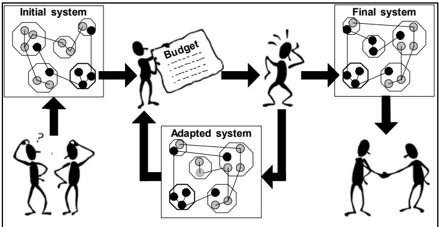
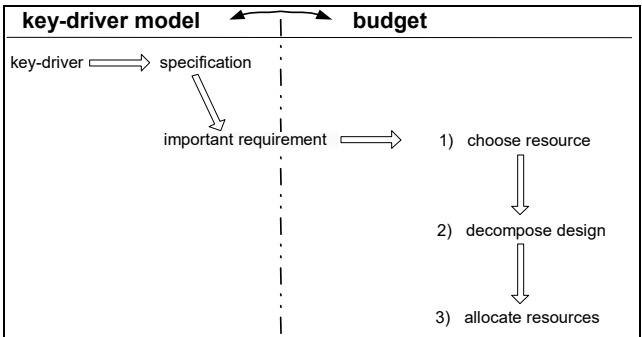
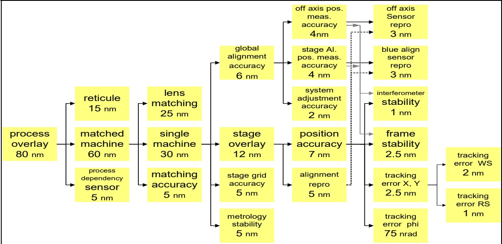
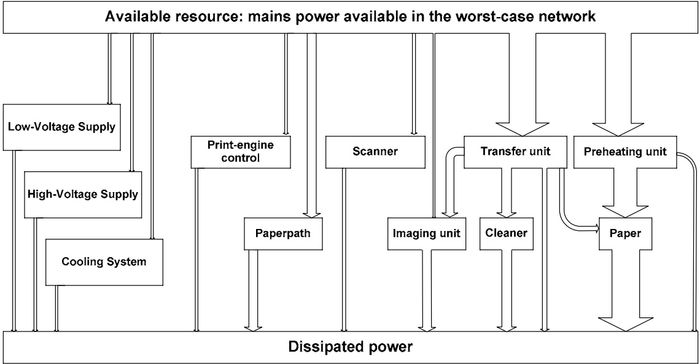
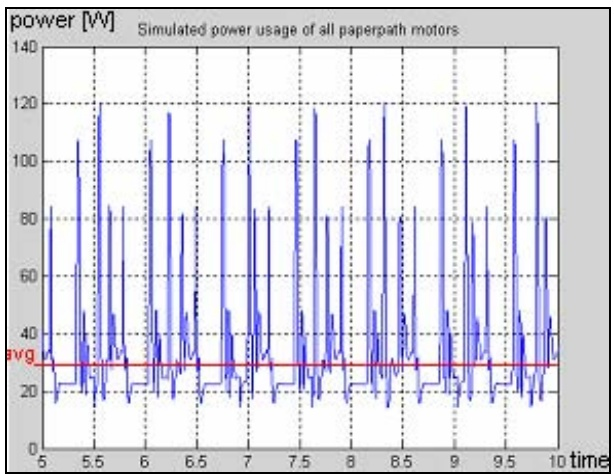

# On the Systematic Use of Budget-Based Design

> 本地 MinerU 机器转换，保留原语言。物理页码从 PDF 首页起计；质量抽查说明见 [QUALITY.md](QUALITY.md)。
> 来源：[GitHub 原件](https://github.com/OpticsPan/Overlay2/blob/61883f6693a9edf02a54b9d563dd0a33463892c8/references/patents/On%20the%20Systematic%20Use%20of%20Budget-Based%20Design.pdf) · [本地 PDF](../../patents/On%20the%20Systematic%20Use%20of%20Budget-Based%20Design.pdf)

## PDF 第 1 页

[查看原页](../../patents/On%20the%20Systematic%20Use%20of%20Budget-Based%20Design.pdf#page=1)

# On the Systematic Use of Budget-Based Design

H.J.M. Freriks Océ-Technologies B.V. P.O. Box 101, 5900 MA Venlo, The Netherlands

W.P.M.H. Heemels, G.J. Muller Embedded Systems Institute P.O. Box 513, 5600 MB Eindhoven, The Netherlands

J.H. Sandee Tech. Univ. Eindhoven P.O. Box 513, 5600 MB Eindhoven, The Netherlands

{Hennie.Freriks, Maurice.Heemels, Gerrit.Muller}@esi.nl, j.h.sandee@tue.nl

Sixteenth Annual International Symposium of the International Council On Systems Engineering (INCOSE) 8 - 14 July 2006

Copyright © 2006 by H.J.M. Freriks, W.P.M.H. Heemels, G.J. Muller, J.H. Sandee. Published and used by INCOSE with permission.

**Abstract** In the majority of the engineering projects, the most important design decisions are taken at the early stages of the design. As these decisions have a considerable impact on the final implementation of the product, they ought to be made in a well-considered manner. The usage of higher-level methods to support making balanced decisions in initial stages of a design is considered very helpful. This paper deals with one of these methods: budget-based design. It is claimed that the systematic usage of budgets helps to speed-up the development process, to better assess project risks and results in better-founded design tradeoffs.

This work has been carried out as part of the Boderc project under the responsibility of the Embedded Systems Institute. This project is partially supported by the Netherlands Ministry of Economic Affairs under the Senter TS program.

## 1 INTRODUCTION

According to the dictionary, a budget is defined as an estimate of income and expenditure, for a specified period of time. Although financial budgets and overviews are well-known to most people, the usage of budgeting in technical designs is less common. A technical budget primarily focuses on a resource that is considered important in the design or in normal employment of the final product. Technical budgets typically concentrate on distributed quantities such as standby power, processor load, product size, memory size, response time or accuracy.

In this paper we claim that ‘using a more systematic approach towards budgeting’ is an effective means for supporting a technical design process.

## 1.1 Related Research

There are various application domains in which technical budgets are used. One of these areas is optical data communication. In this field, optical link-loss budgets are frequently used to check whether enough optical power is available to communicate between transmitter and receiver. Some examples for optical budgets can be found in [Mohammed 2004] and [Transition].

An application field in which budgeting is also widely accepted is lithography. [Yamada] shows how a company compared its overlay budged to the technology roadmap of their industry. This way they were able to show the evolution of their own equipment in the context of general market trends. In [Stanton 1999] an overlay budget was used to specify the total alignment accuracy of a new type of lithographic device. It is interesting to see how the authors have formulated a number of summation rules that intend to attribute budget parameter values to the correspond-

## PDF 第 2 页

[查看原页](../../patents/On%20the%20Systematic%20Use%20of%20Budget-Based%20Design.pdf#page=2)

ing use-case scenarios of the device in question. In this paper we will also present an example from the lithography industry.

Also in the area of hardware-software co-design budgets play an important role. An example of this is, for example, given in [Bate 2004]. The focus in [Bate 2004] is on making trade-offs in the timing aspects of how software can be mapped onto different choices of hardware configurations. Budgets of the worst and best case execution times of software tasks on various platforms are indispensable in their approach. Also the work of [Wecksten 2004] is of interest in this particular application domain.

Another example of budget-based design is given in [Katopis 1999]. This paper shows how a budget was used for designing a processor chip in such way that the total electrical noise contribution of all subparts could be kept within the specified limits. According to the authors, this kind of planning in the early stages of the design was essential to meet the requirements in a timely and cost-effective manner.

The European and other space agencies also use budgeting in their design processes. In [Simone] and [ISO] mass budgets are used to regulate the mass of a spaceship, during development. The total mass of the spacecraft and its payload is important as it influences the amount of propellant that is required to move the ship and the amount of steering force that is needed for manouvering it through space. Moreover, in [Dillon 2003] one is interested in setting up monetary budgets for complete aerospace programs (unmanned space programs) to minimize the risks of project failure.

Although several case studies on budget-based design have been described in literature in various application domains as outlined above, an overview of the budgeting technique itself, and of guidelines towards using budgets, are hard to find. This paper aims at filling this gap by taking a more generic view on budget-based design and removing the application domain and resource specific aspects. Two examples illustrate the general overview and the guidelines.

## 1.2 Influencing the Design Process

Budgeting basically is the process of gathering and structuring information about a resource that plays a major role in the design, and distributing this resource in the best possible way over a decomposition of the system at hand. That is, once the retrieved information is combined and represented in a clear and distinct manner, it is excellently useable for making trade-offs in the distribution of the resource.

A technical budget can be made on many topics like standby power, memory usage, processor load, accuracy, or other product-specific aspects. Figure 1 depicts the way in which budgeting is supposed to influence the engineering process.

Figure 1: The influence of budgeting

## PDF 第 3 页

[查看原页](../../patents/On%20the%20Systematic%20Use%20of%20Budget-Based%20Design.pdf#page=3)

In first instance, engineers will start thinking about the design of the system. Using the initial design blueprint, the first budget is created from the information that is already available. During this budgeting process, engineers first select a suitable decomposition of the system and try to quantify the chosen components in terms of resource usage. Experience from previous projects, from measurements, from models or from datasheets is used for this. Eventually this must lead to a budget that expresses a satisfactory distribution of the budgeted resource. In order to adapt the design to meet the specifications, the relationships between design alternatives and resource consumed should be known.

This distribution will certainly raise a lot of discussion between people involved, solve a few misunderstandings or lead to some feasibility studies being started. The relationships mentioned above are used for adaptation of the design. After engineers have agreed upon a new distribution, the initial system is adapted, after which an update of the budget is made. This is an iterative process that continues until a final design is found, which is satisfactory to all parties involved. This means that the design must also fulfill a number of other important system requirements.

Using budgets in a design process serves the following purposes:

• To make the design more explicit.

To provide a baseline for taking design decisions.

• To specify the requirements for the detailed designs of the components.

• To have guidance during integration.

To be a baseline for verification.

• To manage the design margins explicitly.

Although often assumed otherwise, making a budget does not consume a lot of time. Practical cases have proven that, when relevant data is readily available, drawing-up a budget can sometimes be done within a day. This is not a large expense considering the fact that budgeting helps identifying design risks, stimulating faster design and creating commitment between the engineers involved.

## 2 BUDGETING

A budget contains the following elements:

• the budgeted resource,

• a decomposition and

the distribution of the budgeted resource over the decomposition.

Budgeting work starts after one has decided what the subject of the budget will be. In principle, all resources in a design could be covered by separate budgets. However, as the amount of effort to be spent on budgeting is limited, one has to focus on the most important aspects of the design: these aspects can determine success or failure of the whole project.

## PDF 第 4 页

[查看原页](../../patents/On%20the%20Systematic%20Use%20of%20Budget-Based%20Design.pdf#page=4)

## Figure 2: (Pre-)Budgeting Processes

Figure 2 shows that the key-driver model can be useful for retrieving those system requirements that are a candidate for budgeting. The key-driver technique [Muller 2004] is a way to determine the main drivers of a product, from the perspective of its stakeholders, and to relate them to the most important system requirement(s). Of course, other requirements engineering tools can be used in this decision as well. See [Lamsweerde 2001], [Saiedian 2005] and the references therein. Ultimately, the resources that are designated to be budgeted are those that are most directly related to these essential requirements. The specification of a resource provides the bottom line of a budget. For instance, if a power consumption budget is made for a device that uses power from the wall socket, the total resource distributed in the budget should not exceed the maximum power available from the socket (which depends on the country of residence).

As Figure 2 also shows, there is no clear boundary between where the key-driver technique ends and where the budgeting method starts. For instance, while making the budget it sometimes turns out that the budgeted resource has been wrongly chosen or that another requirement plays a much more important role. At these moments, one just has to adapt the existing budget or restart with a new one. The effort that was spent now seems like lost time, but note that one has now eliminated already one of the (alleged) critical system requirements. In the end, this effort will pay out and benefit the design.

## 2.1 A Systematic Approach

The following paragraph shows the basic guidelines for making a technical budget. These budgeting rules can be applied as soon as the topic/resource of the budget has been selected.

## 1) Clearly define the scope within which the budget is applied.

Budgets generally have a limited scope within which they are valid. For this reason, one needs to set the system boundaries before starting to budget. First of all, one needs to decide what parts of the design will be included in the budget and what parts will not. For example, some add-on modules may be regarded as part of the entire product – and thus as part of the budget – whereas others may not. In case of a copier, for instance, the sheet finisher must be connected to a separate wall socket (by design choice). Hence this part of the product should not be included in the power budget for the copier, either.

Secondly, one has to choose in what operating modes or in what use-case scenarios [Cockburn 2000] the budget is valid. A system architect, for example, must decide whether he will be budgeting the typical usage of a product or whether he rather sees the budget based on worst-case conditions, like for instance extremely intensive usage of the device.

2) **Select a decomposition of the system-under-design that suits the budgeted resource.** A decomposition is the foundation of a budget. No universal recipe exists for the way of decomposing a design. The constructional decomposition and the functional decomposition are frequently used for this purpose. From project management point-of-view, a decomposition that easily maps on the development organization is preferred. This way every component from the decomposition is easily assigned to a responsible person who collects the information and who can be held responsible for meeting the specifications as agreed. Moreover, it is also preferred to make use of budgets for existing products to obtain a first decomposition, if possible. These budgets have a certain proven authority and therefore provide a first guidance to fill-in the new budget. Furthermore, it is recommended always to stay focused on the budgeted resource. Although people are often inclined to decompose a design into the most

## PDF 第 5 页

[查看原页](../../patents/On%20the%20Systematic%20Use%20of%20Budget-Based%20Design.pdf#page=5)

obvious functional blocks, the decomposition that most closely corresponds to the budgeted resource is the one that ought to be chosen.

3) **Find the quantitative figures in each of the chosen components from the decomposition.** If available, budgets for existing products provide the first guidelines for filling-in the budget for a new design. Although the budget for a new system can be based on an existing one, it must have a number of explicit improvements in order to fulfill the new specifications. The figures that are presented in the budget must be substantiated by means of calculations, estimates, data sheets or simulation of the designed components. Known uncertainties in the used figures and expected margins in the given estimates should always be included. The further the design process evolves, the better the initial figures can be verified with the real design and the better they can be matched to measurements of existing (sub)systems. A budget can thus continuously be improved. Also see section 2.2.

4) **Combine the gathered information into a clear and simple overview and re-iterate between the previous steps.**

A clear overview must reveal the essence of the budget and the most critical issues to the system architect and his stakeholders, in the glimpse of an eye. The architect must ensure the manageability of the budgets. A good budget has tens of quantities described. The danger of having a more detailed budget is loss of overview. An unambiguous representation, like a graphical decomposition, supports the discussion about matching the design to its specification. These debates lead to fruitful negotiations over the design and to the design improvements needed to meet the specifications. This is an iterative process over the previous steps.

## 2.2 Gathering the Relevant Data

Aside from the basic guidelines as given in the previous paragraph, there is also the art of retrieving relevant data. Although this information can come from various sources, the first source lies within the company itself. As most companies make products with which they are already familiar, experience such as measurement data, design specification documents of previous projects or existing budgets can provide a valuable reference for future designs. This work can be used in order to gain insight in what is possible in new projects and in order to obtain initial estimates. For instance, data from other devices in the same product family can be interpreted in order to make realistic estimates for the resources required for the new product. Besides that, (measurement) data from re-useable modules can often be extrapolated into those figures that are relevant to the current budget. Talking to experts is another valuable source. Moreover, predictions and estimates made by experienced colleagues often give a good indication of what can be expected in the new design. Even more so, models, simulations and back-of-the-envelope calculations bring the information one needs.

In addition, also be sure to use the specifications given by third party vendors. If these resources still do not give enough information to complete the budget, one can also turn to articles, browse through academic research reports or even scroll the internet. One could even decide to apply trend analysis (e.g. Moore’s Law) or to take notice of the strategy of one’s competitors.

## 2.3 Continuous Evolution

Projects in industrial environments usually show a fast progress. For this reason, design budgets have a very evolutionary character. A budget is a ‘living entity’, which has a limited

## PDF 第 6 页

[查看原页](../../patents/On%20the%20Systematic%20Use%20of%20Budget-Based%20Design.pdf#page=6)

time of validity before new content updates are required. In addition to this, there can be other factors which outdate a budget. The following paragraphs deal with changes that often occur.

**Direct Changes.** Direct changes are mostly due to changing requirements concerning the budgeted resource itself. An example that played a major role in the development of a digital copier is power consumption. In the initial stage of the design, the requirement on the budgeted resource was set by the power available from the wall socket. After a while, however, people realised themselves that also some work needed to be done in order to make the device compliant to the major energy criteria, like for instance the well-known Energy Star . Although this change was not initially foreseen, in the end it did have an effect on the power budget.

**Indirect Changes.** Indirect changes are design changes that do not directly influence the budgeted resource, but that influence other parameters in such way that the resource is changed anyhow. For example, in the development project for a copier system, it was decided in a later stage that the total outer dimensions needed to be some 20% smaller. In first instance, this would not directly influence the budgeted resource (power consumption). On the other hand, the change did have a considerable effect on the schedule of sheets through the printer and thus on the time at which motors required their peak power. So, in the end, it did indeed affect the power consumption in an indirect way. In the selected case we could fortunately show that the change only had a limited effect on the total power budget. By exactly showing the effect, we could take one of the worries of this strategic change away.

Another example of an indirect realisation change is given by the choice for the type of motors in the same copier project. DC motors were initially assumed to take care of paper transport. Once the first version of the budget became ready, however, it turned out that some engineers wanted to replace DC motors by stepper motors, for cost price reasons. Due to this design change, the magnitude of the power peaks became different too, thus leading to a change in the power budget. In the studied case, the updated budget was used to assess whether this change in motor type could be realised, considering the given resource.

## 2.4 Margins, Uncertainties & Inaccuracies

One important aspect of filling-in a budget is how to deal with measurement inaccuracies and uncertainties. Of course one could stay on the safe side and always assume a worst-case situation. However, this may be much too conservative, causing a feasible design to be judged infeasible instead. As a consequence, one will start improving the design that was wrongly labeled ‘infeasible’, which can possibly lead to a higher cost price or other negative effects. Dealing with uncertainties in such a way that one obtains a nearly optimal – but still properly functioning – solution, is therefore a true art.

Moreover, possible design improvements that require further investigation can be explicitly included in a budget as (obtainable) design margins. These design improvements can be exploited to reduce the total resource usage and thereby matching the specifications better. Of course such improvements should not interfere with other design criteria.

**The Impact of Deviations.** One of the factors that influences how errors should be dealt with is their impact on the budget, and therefore on the design. Suppose you have conducted a measurement of peak power consumption, which shows that the measured peaks have a mean value of 1.5, a standard deviation of 0.5, but that there is an occasional peak with an absolute maximum of 4.5. Depending on the impact of this peak on the total budget, we have several ways to deal with it. If an occurrence of the worst case peak will cause a severe malfunction of the product, then the value 4.5 needs to be included in the budget. When its impact is less prominent, then

## PDF 第 7 页

[查看原页](../../patents/On%20the%20Systematic%20Use%20of%20Budget-Based%20Design.pdf#page=7)

one could consider noting the measured value including e.g. twice the standard deviation as an input. If the error is insignificant enough, one might consider leaving it out altogether and use the mean value of 1.5. However, remember that the significance of an error depends on how much margin there is left in the budget, and be aware that many small errors can still make a big one after all. So, explicitly keeping track of errors and margins remains important. Note that this issue is clearly related to step 1 in section 2.1: the interpretation of the figures is related to the scope of the budget (its use-case).

**Correlation of Deviations.** The second factor that needs to be considered is the correlation between deviations in budget figures. In case deviations in the figures are related, special care should be taken not to handle them as individual and insignificant variations. For instance, imagine that the power peak for a number of components always coincides. The deviation for each component may be insignificant to the total budget, but if they are taken together they might indeed be of influence.

In case the relationships between figures are known in more detail, one can also use stochastic techniques to express their influence on the total budget. This actually means that one has a conceptual model of the decomposition and the system-under-design that provides the necessary insight to correctly attribute the overall effect of components to the resource. A good example for this is found in the overlay budget as will be presented in the following section. Here the purely stochastic effects were accounted for by quadratic summation, whereas linear and weighted additions were used for systematic and mixed effects, respectively.

**Application and User Expectation.** Another point of attention is the application of the product for which the budget is made. For example, assume there is a peak in the processor load, which occurs approximately once every hour and causes the product to slow down for a minute. Statistically seen, one would be inclined to omit this kind of deviation. However, whether it is important or not depends on the application in which the product is used and/or on the customers’ expectations for it. For an office printer, for instance, the user will be annoyed for having to wait a little while, but will probably forget about it in the next half-hour. The situation changes when the user expects the device to operate flawlessly, e.g. in case one is dealing with the design of a pace-maker.

## 3 CASE STUDY: THE OVERLAY BUDGET FOR A WAFER STEPPER

The budgeting method as presented in the previous section has been formulated in accordance with experiences gained in real engineering projects. The first case study considers the overlay budget of a wafer stepper; see also [Muller 2005].

Wafer steppers are machines that produce electronic chips out of slices bare silicon, so-called wafers. During the fabrication process, the wafers will be exposed to the patterns that need to be etched into them. This patterning takes place by a short-wavelength light source in combination with an optical system and a pattern mask, called reticle. As a wafer is much larger than the area that can be exposed in one go, it needs to be moved (stepped) several times in order to expose the entire surface. To guarantee a correct alignment of the patterns, the movement needs to take place quite accurately. The accuracy is expressed as the amount of mis-alignment that occurs when a pattern is projected on the wafer. This so-called overlay is the topic of the budget.

The goals of the overlay budget are:

• To summarise the requirements for subsystems and components.

To get early feedback on the total overlay performance of a design, by being able to compare the results of individual component prototypes with the budgeted targets.

## PDF 第 8 页

[查看原页](../../patents/On%20the%20Systematic%20Use%20of%20Budget-Based%20Design.pdf#page=8)

## 3.1 Scope of the Budget

The budget was limited to those elements that directly influence overlay, such as the lens, the motion control system and the available sensors. The budget is valid under typical operating conditions. Deviations in the distribution are accounted for by means of statistics.

## 3.2 Selecting a Decomposition

The new overlay budget was based on the existing budget for a previous generation of equipment. Also the system decomposition into components had already been made before and could therefore be reused in the new budget. Note that this is a typical situation.

## 3.3 Finding Quantitative Figures

In first instance, the figures of merit for the relevant design choices were retrieved from measurement data that was already available from a previous version of the wafer stepper. This provided an initial budget. The existing budget for the previous version also comprised the contribution of each individual component to the budget total. Quadratic summation was used to account for stochastic effects, linear addition for systematic effects and weighted addition for mixed effects. These relations were based on an explicit model made by the system engineers of ASML. An example for quadratic summation is given by the global alignment accuracy in Figure 3. The figures for each of the three contributions do not add linearly (like it does for the stage overlay), but rather as a quadratic sum: $4^{2} + 4^{2} + 2^{2} = 6^{2}$

At the same time, also a top-down approach was followed, since the new generation of wafer steppers needs a much better overlay specification than the older generation. The maximum allowable resource usage was set to a value determined by strategic road mapping [Phaal 2004]. Based on the roadmap, 80 nm became the new overlay target for this new generation of wafer steppers. This immediately pointed out the major design issue: all design choices needed to match this new resource requirement. This specification gave the bottom line and sufficient improvements were made with respect to the existing stepper to achieve this (as can be seen in the final budget in Figure 3).

## 3.4 Providing a Clear Overview

Figure 3 presents the overlay budget in a top-down decomposition. This overview must be read from left to right. The total allowable process overlay is 80 nm, which is split up into the contribution that each of the subsystems makes. After that, the contribution of all the main components is further broken down into different subparts and related to a specification for each part.

## PDF 第 9 页

[查看原页](../../patents/On%20the%20Systematic%20Use%20of%20Budget-Based%20Design.pdf#page=9)

Figure 3: Wafer-stepper overlay budget

## 3.5 System Adaptations

The initial budget had been based on an older generation of wafer steppers. Since the future generation had to have an improved performance, the initial budget lead to discussions among system engineers on how to satisfy the maximum overlay demand. In this interactive process, several design alternatives were discussed and some iterations on the budget were made. After a final round of negotiations the people involved agreed upon one of the solutions and they started converting the system-level budget into mono-disciplinary design decisions. This case study shows that a budget plays a crucial role in wafer stepper development.

## 4 CASE STUDY: THE POWER BUDGET FOR A DIGITAL COPIER

The project that was subject in this study dealt with the realisation of a digital office copier, whose sales were targeted at a number of different countries. The latter condition implied that, in some of those countries, the copier needed to be operable under very strict power conditions. For instance, in the United States less than 2 kW is available from the power sockets found in an average office. As countries like the United States are important sales regions, the design of the copier was greatly influenced by the power issue. Being able to operate on the power from normal wall-sockets became one of the most important realisation aspects for this project. Moreover, other projects in the past had also struggled with power issues. As a result, power usage became a critical realisation aspect, and was therefore subject of the budget.

## 4.1 Scope of the Budget

Office equipment knows various modes of operation, like full production, low-power or standby. Since a main driver was ‘to be operable within the limits of a wall-socket’, this particular case focused on the situation in which the largest amount of power is consumed: during full production of the copier.

## PDF 第 10 页

[查看原页](../../patents/On%20the%20Systematic%20Use%20of%20Budget-Based%20Design.pdf#page=10)

## 4.2 Selecting a Decomposition

The next point of concern was to subdivide the layout of the copier into suitable components that influence power usage. Since a copier is naturally divided into a number of physical functions, this decomposition was largely maintained. An exception was made for the losses created in the voltage supplies and the cooling system. These losses could either be attributed to the functional components that cause them, or they could be grouped into the supply and cooling functions. During development, these losses are usually measured at the voltage supply side and at the cooling side. Therefore it was decided to group the losses into three blocks: the highvoltage supply, the low-voltage supply and the cooling system. On the other hand, if they had been attributed to each specific functional component separately, this would have explicitly shown the contribution of each component. The choice for a three-group division was made for the sake of easy measurement and verification. The identified functional components are depicted in the graphical power decomposition, as given in Figure 4.

Figure 4: Graphical representation of the power budget of a copier

## 4.3 Finding Quantitative Figures

The largest part of the budgeting work was to find the realisation choices in each of the functional blocks and to retrieve realistic values for them. The following paragraphs deal with some of the ways in which this was done.

**Using A Reference Architecture in combination with Third-Party Data.** The print engine control unit was one of the components for which a reference architecture from a previous project was available. Although the exact configuration of its processing architecture was not known at the moment of the initial budget, the reference did prove to be a good indication of what power-consuming components print engine control would ultimately contain. Once the components were known, data sheets from third party manufacturers of processors, memory and driver boards were used to make a reasonable estimate.

For those parts for which data sheets were not yet available, extrapolation on data of previous projects was carried out. Since manufacturers tend to give figures for predefined (worst-case) scenarios only, this approach only works well in case one is making a budget based on these sce-

## PDF 第 11 页

[查看原页](../../patents/On%20the%20Systematic%20Use%20of%20Budget-Based%20Design.pdf#page=11)

narios. Once you need more specific values that depend on a non-typical mode of operation, hardly any concrete formulas are given. Finding the appropriate data may then become a cumbersome job. For example, how would one try to estimate the power usage of a processor when it has an exact 30% CPU load? Measurements on existing controllers or test bench prototypes are useful in these situations.

**Using Documented Formulas.** Another way of gathering data was employed in estimating the amount of energy that is transferred from the transfer unit towards each sheet of paper. In this case, internal documents contained the formulas for calculating the approximate amount of transferred heat. This kind of documentation actually forms an excellent basis for budgeting. Besides this information, (academic) literature often provides starting points for reliable budgets, too.

**Using Existing Measurements.** The power consumption of the cleaner and preheater units was estimated by means of data available from comparable units in existing products. Unfortunately, the copy speed of the new copier differed from that of its predecessor. An extrapolation on existing data was therefore performed. This introduced an extrapolation error whose margins were very difficult to determine. In order to reduce the associated uncertainty, measurements on a real test bench were done later on in the project.

**Using Prototype Measurements.** The amount of power absorbed by the transfer and the cooling unit cannot be expressed by formulas so easily. The estimates for their power consumption were based on measurements carried out on experimental setups and early prototypes. Unfortunately, this method leads to figures that are only valid momentarily and that – depending on their sensitivity to design changes – may become useless as soon as some details in the setup are changed. For this reason, figures found by means of experiments should be monitored throughout the project and validation in later stages might be necessary.

**Simulation and Modeling.** The functional components that had the largest amount of uncertainty were the paperpath and the scanner modules. Both of them are made up of actuators that drive and control the flow of paper sheets through the copier and the scanner, respectively. Since paper transport is a time-dependent (dynamic) process rather than a static one, the figures for these components are the most difficult to extract. Of course, one could again take worst-case figures. However, since these worst-case figures only express power peaks that occur during accelerations, they provide a very conservative (too high) estimate for the overall consumption of the copier. That is, thanks to the spreading of the peaks, the overall power consumption will usually turn out to be lower than the sum of the peaks. On the other hand, once the peak power usage of the various actuators coincides, the resulting figure will become dramatically worse. For this reason, the time of occurrence (related to scheduling of paper flow) and the magnitude of these peaks must preferably be known prior to making predictions.

In the studied case, this issue was analysed by using a simulation model that was used for scheduling the sheets in the paper path of the copier. Based on the velocity profiles for the actuators, the time-dependent power profile could be determined. The magnitude of the power peaks was retrieved from comparable actuators that were used in existing projects. So, based on assumptions concerning the paper schedule and the type of actuator used, we were able to reasonably predict actuator power consumption.

Besides giving a sufficiently reliable indication of the actual power consumption, the resulting figures also made some of the project engineers aware of the fact that they needed to assure that actuators were driven such that none of the power peaks coincided. This is an example that shows how budget-based design positively influences a design process.

## PDF 第 12 页

[查看原页](../../patents/On%20the%20Systematic%20Use%20of%20Budget-Based%20Design.pdf#page=12)

## 4.4 Providing a Clear Overview

After the information has been gathered, a budget needs to be presented to its stakeholders. These stakeholders could for instance be a project leader, a design team or even company management. In the copier case, the sales department might also be seen as stakeholder, since (small) power consumption can be a good sales argument.

Since one of the goals of the budget is to communicate the effect of certain design decisions to others, its representation must provide a clear overview for all people involved in the project. For this reason, the tabular form might not always be the most ideal way to depict it. To really convince others by means of the budget, its data needs to be represented in a very informative way: preferably in a graphical depiction.

Figure 4 presented the functional decomposition of the copier, together with the collected data on power consumption. The power decomposition in Figure 4 should be read from top to bottom. The upper horizontal bar represents the source of the system resource that was budgeted (the available power, less than 2000W), whereas the lower horizontal bar expresses its sink (the dissipated power). The blocks in between the source and the sink represent the functional modules that consume the resource. Recall that these are the same modules as identified during step 2 of the budgeting process. The arrows in between source and sink express the resource flow (power flow) from source to modules, mutually between modules, and from modules to sink. The arrows have been scaled to show their relative influence on the total resource flow.

For what the studied case concerns, this tells you in the glimpse of an eye that the largest amount of power is consumed in the modules at the right side of the figure: in the transfer and the preheating units. Such a conclusion gives system architects a convincing argument to demand for considerable improvements in the responsible modules. So, although Figure 4 expresses the same figures as could have been written down in a simple table, it does give a much better overview on the whole situation. Moreover, for quantitative details a table can be consulted anyway.

According to our experiences, visual depictions have proven to be much more informative in the sense that people immediately understand how the resource is distributed over the various components in the design. Hence the visualization is a major factor in creating insight in the distribution of a resource.

## 4.5 Budget Dynamics

Resource budgets applied in engineering environments can be categorized into three types:

<u>Static budgets</u>. The word static signifies that budget values do not change with the particular operating mode of a device. Typical examples are average or worst-case values. Note that static figures do change when a design changes after some time.

<u>Semi-static budgets</u>. A semi-static budget means that several static budgets are made: each for a different mode of operation of the product. The budget for a copier, for instance, can have a version for full production as well as one for standby of the device. Semi-static budgets are often used in combination with scenarios. For each available scenario or use case [Cockburn 2000], a dedicated budget is made. Each budget then solely contains the effects that occur under that particular condition.

<u>Dynamic budgets</u>. In dynamic budgets, variable figures dominate: the majority of the values is time-dependent or depends on the condition or state the device is in. For the typical case of a copier, the power that is consumed by the motors is dynamic. It depends on the format of the paper that is transported through the engine (timing schedule), on the number of pages per minute that is produced and it depends on time.

## PDF 第 13 页

[查看原页](../../patents/On%20the%20Systematic%20Use%20of%20Budget-Based%20Design.pdf#page=13)

In general, the figures in a semi-static budget are much harder to find than those in static budgets. Dynamic budgets, on their turn, are best made with the use of simulation tools that are able to determine figures that depend on multiple factors. The boundary between budgets and timed models of various kinds is thin. An example of such a simulation is given in Figure 5. This plot depicts the sum of the power usage of some motors in the paperpath of a copier, over time, during a copy job. The average power consumption turns out not even to amount to a quarter of the peak power. In case a simulation like this is combined with simulations for other functional modules, a reasonably accurate prediction of the actual power consumption of the copier can be made (provided that the models represent reality closely).

Figure 5: Simulated motor power usage

As already mentioned, a budget that is entirely dynamic shows a very small contrast between being a budget or a simulation. In other words, is such kind of model still a budget or has it evolved into a simulation? A practical guideline is that one should not spend too much effort on making the budget dynamic. One should rather draw up a number of (semi-)static budgets, instead. In case a simulation model is already available, then the figures that can be extracted from this model can give the information required for making the (semi-)static budgets.

## 5 BUDGETING BENEFITS & CONCERNS

The case studies presented in this paper show how the proposed budgeting approach can be applied in a systematic way. The outcome of these studies was that consistently applying budgetbased design techniques has various advantages. These advantages are described in the following paragraphs.

## 5.1 Benefits

**Identify Threats & (Early) Design Improvements.** One of the merits of making budgets is that budgets clearly document the particular specification of a project. They state the available resource and the way in which it is supposed to be distributed across the design. In order to compose a budget, project engineers first have to think thoroughly about a design for the system, the decomposition and how to quantify the components with realistic values. Since different engineers have different opinions, this process will undoubtedly lead to discussions and negotiations, based on facts rather than on feelings. Discussing a design in order to create commitment be-

## PDF 第 14 页

[查看原页](../../patents/On%20the%20Systematic%20Use%20of%20Budget-Based%20Design.pdf#page=14)

tween engineers often reveals a number of critical realisation aspects. Such a-priori knowledge of potential problems enables one to adapt the design on time. Since budgeting is often started in the initial stage of a design, optimisations can still be made before any irreversible decisions are taken or costly mistakes are made.

**To Make the Design Explicit for Communication and Awareness.** A side-effect of discussing the budget is that the exact meaning of the quantities in the budget gets documented and communicated quite effectively towards all project members. Once implicit design assumptions are made more concrete and are talked over by engineers, they tend to develop a larger awareness of potential design risks. In this way everyone will become more aware of the consequences of the decisions they take and sees how this fits in the bigger, multi-disciplinary picture. In this sense the budget provides a baseline to take decisions.

**Enabling Concurrent Design via Specification of Requirements for Components.** Besides contributing to design improvements, budgets also enable concurrent design of parts for which the specification can be extracted from the budget. Once the budget has been written down, it expresses the exact distribution of the resource over the individual functional modules. The budget itself is used to ensure that the interaction between the individual components satisfies the overall resource requirements for the product. This gives also clear guidance during the integration process. Moreover, since a budget records the agreements that were made, people will also tend to argue less about them afterwards. Potential conflicts can thus be avoided, which is good for the working atmosphere.

**Managing design margins.** Although this was not emphasised in the particular case studies, one of the large advantages of budgets is that they enable making design margins explicit. On the one hand, budgets can include the uncertainties due to unknown effects and missing information, whereas on the other hand, they can also include the design margins that can be obtained by improving the design (at the cost of longer design time, larger design effort or higher cost price). By making uncertainties more concrete, risks can be identified and reduced in an early stage. If improvements are required and the budget offers various options to achieve them, a suitable choice can be made.

**Supporting Roadmapping.** As we saw in the case study of the overlay, budgets can also serve as a tool to roadmap future versions of one’s design [Phaal 2004]. The future evolution of the budgeted resource can be strategically relevant to the company’s success. Budgets indicate the strenghts of the current design and can therefore help to identify the necessary technological steps to achieve the improvements to be realised.

## 5.2 Concerns

One of the major concerns for using the budgeting method in a project is that one needs to watch out for that people ‘hide’ themselves behind the figures in the budget and that become inflexible to changes in the figures, in a later stage. In early stages of the design the figures might still be uncertain and subject to change. People have to realise this and appreciate the value of the budget anyway, since it makes the design issues explicit. People that use the figures in the budget as an excuse for not having a pro-active attitude, no longer take their own responsibility for the quality of the overall product. This phenomenon requires an attitude-change for some persons, or sometimes even a cultural change within a company.

## PDF 第 15 页

[查看原页](../../patents/On%20the%20Systematic%20Use%20of%20Budget-Based%20Design.pdf#page=15)

## 6 CONCLUSIONS

In this paper the system-level method of budget-based design is promoted. An iterative approach consisting of four steps was given to set up a budget. In addition to the iterative approach, guidelines are given on how to retrieve the relevant data and how to deal with uncertainties and design margins.

The proposed budgeting approach was applied in two practical cases. During these cases, several advantages were recognised. Budget-based design supports:

Early recognition of potential threats to meeting the requirements for the budgeted resource. This provides guidance in taking the correct design decisions and in making improvements.

Making the design more explicit and transparent. This enables improved communication of project targets, leading to a greater awareness of the consequences of individual decisions on the design as a whole.

• Concurrent design and integration. Proper documentation of the resource distribution in a design can be seen as a specification for the individual components. This enables an improved concurrent design process and provides a baseline for integration.

• Managing design margins explicitly.

Identification of the technological leap to be taken in future, therefore assisting the roadmapping process that is carried out with the goal of keeping the business successful.

A possible threat was also identified: some people tend to ‘hide’ behind the figures in a budget, thus justifying an inactive attitude towards their contribution to success of the product.

Taking all pros and cons into account, we believe that its systematic approach supports making decisions that reach over the mono-disciplinary engineering disciplines and over the functional modules of a product. Thereby it is a multi-disciplinary design method that supports product design. This paper can be used as first start to learn the skill of budgeting.

## REFERENCES

Bate I. and Audsley, N., “Flexible design of complex high-integrity systems using trade offs”, Proc. 8th Int. Symp. High Assurance Systems Engineering 2004.

Cockburn, A., Writing effective use cases, Addison-Wesley, 2000.

Dillon, R.L., Paté-Cornell, M.E. and Guikema, S.D., “Programmatic risk analysis for critical engineering systems under tight resource constraints”, Operations Research, Vol. 51, No. 3, 2003, pp. 354-370.

European Space Agency, “Smallsat Intercept Mission to Objects near Earth”, SIMONE project, http://www.esa.int/gsp/NEO/simone/simone.htm.

International Organisation for Standardization, “Space Systems – Mass Properties Control”, Proposal ISO International Standard, ISO/CD 22010.

Katopis, G.A., et al, “MCM Technology and Design for the S/;390 G5 System”, IBM Journal of Research and Development, Vol. 43 - no 5/6, September/November 1999.

Lamsweerde, A. van, “Goal-Oriented Requirements Engineering: A Guided Tour”, Proc. 5th IEEE Int. Symp. on Requirements Eng. (RE’01), August 2001, Toronto, pp. 249-263.

Mohammed, E., et al, “Optical Interconnect System Integration for Ultra-Short-Reach Applications”, Intel Technical J. on Optical Technologies and Applications, Vol. 8 - no 2, May 2004.

Muller, G., “CAFCR: A multi-view method for embedded systems architecting; balancing genericity and specificity”, PhD thesis, 2004, Delft University of Technology.

## PDF 第 16 页

[查看原页](../../patents/On%20the%20Systematic%20Use%20of%20Budget-Based%20Design.pdf#page=16)

http://www.extra.research.philips.com/natlab/sysarch/ThesisBook.pdf.

Muller, G., “Do Multi-Domain Methods Exist?”, Conference on Systems Engineering Research (CSER), March 2005, Hoboken NJ, USA.

Phaal, R., Farrukh, C.J.P. and Probert, D.R., “Technology roadmapping - a planning framework for evolution and revolution”, Technological Forecasting & Social Change, 2004, Vol 71 – no 1-2, pp. 5-26.

Saiedian, H., Kumarakulasingam, P, Anan, M., “Scenario-based requirements analysis techniques for real-time software systems: a comparative evaluation”, Requirements Eng. J., 2005 (10), pp. 22-33.

Stanton, S. T., et al, “Overlay Error Budgets for a High-Throughput SCALPEL System”, Proceedings of SPIE, Vol. 3676, p. 543-555, June 1999.

Transition Networks, “Optical Power Budgets – A White Paper”, www.transition.com/TransitionNetworks/Resources/en/PDF/pwrbudwp.pdf.

Wecksten, P.M., Vasell, J. and Jonsson, M., “Towards a tool for derivation of implementation constraints”, Proc. 9th IEEE Int. Conf. Engineering Complex Computer Systems Navigating Complexity in the e-Engineering Age 2004.

Yamada, Y., “Exposure Tool Strategy for 90nm \~ 65nm Production”, Semiconductor Fabtech, 18th edition.

## BIOGRAPHY

**Hennie Freriks** received his M.Sc. degree in Electrical Engineering from the University of Twente (Enschede, The Netherlands), in 2002. Since 2003 he is a researcher at the research department of Océ-Technologies B.V. He participates in the Boderc project at the Embedded Systems Institute in Eindhoven since the end of 2003.

**Maurice Heemels** received his M.Sc. degree (with honours) in Mathematics and the Ph.D. degree (cum laude) in Hybrid Systems theory of the TU/e, The Netherlands in 1995 and 1999, respectively. From 2000 until 2004 he has been working as an assistant professor in the Control Systems group (Electrical Engineering, TU/e). In June 2004 he moved to the Embedded Systems Institute. His research interests include modeling, analysis and control of hybrid systems and their application to industrial design problems for high-tech systems.

**Gerrit Muller** received his Master’s degree in Physics from the University of Amsterdam in 1979. He worked from 1980 until 1997 at Philips Medical Systems as system architect. From 1997 to 1999 he was manager System Engineering at ASML. From 1999 - 2002 he worked at Philips Research. Since 2003 he is working as senior research fellow at ESI (Embedded Systems Institute). In June 2004 he received his doctorate. The main focus of his work at ESI is to work on System Architecture methods and to enable education of new System Architects. http://www.extra.research.philips.com/natlab/sysarch/

**Heico Sandee** is currently a Ph.D. student in the Control Systems group at the department of Electrical Engineering of the Eindhoven University of Technology (TU/e). He received his M.Sc. degree in Electrical Engineering from the TU/e, in 2002. His main research interest is the multi-disciplinary design of embedded dynamical systems, with real-time control applications as the main focus.
