# CN117234040A — 方法和更换工具

原件：[PDF](original.pdf)；SHA-256 `7d3ef60ee1f5a79bd33cb1a73be7616a7438156321194d2a7a256c639ff56f10`。物理页码从封面计1。

转换：本地MinerU 4.0.12，standard / auto；保留原语言。资料来源与文件校验值见[清单](../manifest.json)。机器输出未逐字校勘，关键文字、公式与图表回看原件。

校核提示（独立于机器提取正文）：[转换质量与已知问题](../QUALITY.md)。

## PDF第1页

[回看原页](original.pdf#page=1)

CN 117234040 A

(19)国家知识产权局

D

(12)发明专利申请

(10)申请公布号 CN 117234040 A

(43)申请公布日 2023.12.15

(21)申请号 202310693711 .0

(22)申请日 2023.06 .12

(30)优先权数据102022205972.7 2022 .06 .13 DE

(71)申请人 卡尔蔡司SMT有限责任公司地址 德国上科亨

(72)发明人 E·多策尔 J·克鲁伊斯B·西格尔 D·杜尔 T·赫格尔A·奥斯坦多夫 S·亨塞勒C·贝尔 C·沃纳 A·卡纽特

(74)专利代理机构 北京市柳沈律师事务所11105专利代理师 王蕊瑞

(51)I nt.Cl. (2006.01)

(54)发明名称方法和更换工具

## (57)摘要

一种方法，用于更换投射曝光设备(1)的光学系统(100)，特别是DUV反射镜，包括以下步骤:a)沿光学系统(100)的中心轴(102)升高(S1)光学系统(100)，使得光学系统(100)的安装支柱(132)脱离与承载光学系统(100)的框架(138)的框架支柱(134、136)的接触，b)围绕中心轴(102)旋转(S2)光学系统(100)，使得安装支柱(132)布置在框架支柱(134、136)之间，c)沿中心轴(102)降低(S3)光学系统(100)，以及d)垂直于中心轴(102)转移(S4)光学系统(100) ，使得光学系统(100)移出壳体(144)。

权利要求书2页 说明书15页 附图11页

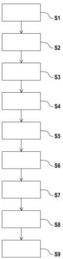

[回看原页](original.pdf#page=1)

## PDF第2页

[回看原页](original.pdf#page=2)

CN 117234040 A

权　利　要　求　书

1/2 页

1 .一种方法，用于更换投射曝光设备(1)的光学系统(100)，特别是DUV反射镜，包括以下步骤:

a)沿所述光学系统(100)的中心轴(102)升高(S1)所述光学系统(100)，使得所述光学系统(100)的安装支柱(132)脱离与框架(138)的框架支柱(134、136)的接触，所述框架承载所述光学系统(100)，

b)将所述光学系统(100)围绕所述中心轴(102)旋转(S2)，使得所述安装支柱(132)布置在所述框架支柱(134、136)之间，

c)沿所述中心轴(102)降低(S3)所述光学系统(100)，以及

d)垂直于所述中心轴(102)转移(S4)所述光学系统(100)，使得所述光学系统(100)移出壳体(144)。

2 .根据权利要求1所述的方法，其中在步骤c)期间，所述光学系统(100)降低到这样的程度，使得当沿所述中心轴(102)观察时，所述光学系统(100)布置在与步骤a)之前的所述光学系统(100)的位置不同的位置。

3 .根据权利要求1或2所述的方法，进一步包括以下步骤:

e)用其他光学系统(100)更换(S5)所述光学系统(100)，

f)垂直于所述其他光学系统(100)的中心轴转移(S6)所述其他光学系统(100)，使得所述其他光学系统(100)移动到所述壳体(144)中，

g)沿所述中心轴(102)升高(S7)所述其他光学系统(100)，

h)围绕所述中心轴(102)旋转(S8)所述其他光学系统(100)，使得所述其他光学系统(100)的安装支柱(132)布置在所述框架支柱(134、136)上方，以及

i)沿所述中心轴(102)降低(S9)所述其他光学系统(100)，使得所述安装支柱(132)与所述框架支柱(134、136)接触。

4 .根据权利要求3所述的方法，其中在步骤i)之后，所述其他光学系统(100)沿所述中心轴(102)升高，使得所述安装支柱(132)脱离与所述框架支柱(134、136)的接触，其中所述其他光学系统(100)随后沿所述中心轴(102)降低，使得所述安装支柱(132)再次与所述框架支柱(134、136)接触。

5 .根据权利要求4所述的方法，其中在步骤i)之后并且在升高所述其他光学系统(100)之前，释放所述光学系统(100)和更换工具(200)之间的连接，使得所述安装支柱(132)自动定位在所述框架支柱(134、136)上。

6 .根据权利要求5所述的方法，其中在升高所述其他光学系统(100)之前，所述其他光学系统(100)和所述更换工具(200)之间的连接被恢复。

7 .根据权利要求5或6所述的方法，其中在步骤a)之前，检测所述光学系统(100)的姿态，其中在步骤e)之前，将检测到的所述光学系统(100)的姿态传输到所述其他光学系统(100)。

8 .根据权利要求7所述的方法，其中在步骤i)之前，借助于所述更换工具(200)调节所述其他光学系统(100)的姿态。

9 .一种更换工具(200)，用于更换投射曝光设备(1)的光学系统(100)，特别是DUV反射镜，具有:

xyz载具(216)，用于沿所述光学系统(100)的中心轴(102)升高和降低所述光学系统

22

## PDF第3页

[回看原页](original.pdf#page=3)

CN 117234040 A

权　利　要　求　书

2/2 页

(100)，

rz载具(218)，用于围绕所述中心轴(102)旋转所述光学系统(100)，以及

x框架(204)，用于垂直于所述中心轴(102)转移(S4)所述光学系统(100)。

10.根据权利要求9所述的更换工具，其中所述xyz载具(216)和所述rz载具(218)设计为在六个自由度上调节所述光学系统(100)。

11 .根据权利要求9或10所述的更换工具，其中所述x框架(204)携带所述xyz载具(216)，其中所述xyz载具(216)携带所述rz载具(218)。

12.根据权利要求9至11中任一项所述的更换工具，还具有适配器块(220)，所述适配器块可连接到所述光学系统(100)。

13.根据权利要求12所述的更换工具，其中所述rz载具(218)具有夹持装置(228)，用于将所述rz载具(218)可释放地连接到所述适配器块(220)。

14.根据权利要求13所述的更换工具，其中所述夹持装置(228)具有夹持臂(230、232)，其中所述夹持臂(230、232)借助于板簧(236、238)支撑在所述rz载具(218)的连接体(226)上。

15.根据权利要求9至14中任一项所述的更换工具，还具有传感器布置，用于检测所述光学系统(100)的姿态。

33

## PDF第4页

[回看原页](original.pdf#page=4)

CN 117234040 A

说　明　书

1/15 页

## 方法和更换工具

[0001] 相关申请的交叉引用

[0002] 优先权申请DE102022205972.7的内容通过引用整体并入。

## 技术领域

[0003] 本发明涉及一种用于更换投射曝光设备的光学系统的方法，并且涉及一种用于更换光学系统的更换工具。

## 背景技术

[0004] 微光刻用于生产微结构部件，例如集成电路。微光刻工艺利用光刻设备执行，光刻设备具有照明系统和投射系统。在这种情况下，通过照明系统照明的掩模(掩模母版)的像通过投射系统投射到衬底上，例如硅晶片，衬底涂有光敏层(光刻胶)并布置在投射系统的像平面中，以便将掩模结构转印到衬底的光敏涂层上。

[0005] 在集成电路生产中对于更小结构的需求的驱动下，目前正在开发的是DUV光刻设备(深紫外DUV)，其使用波长在30nm至250nm范围内(特别是193nm)的光。在这种DUV光刻设备的情况下，可以使用反射光学单元(也就是反射镜)来代替迄今为止的折射光学单元(也就是透镜元件)。

[0006] 希望能够在这种DUV光刻设备的使用位置更换该类型的反射镜。由于当更换该类型的反射镜时受限的空间条件和需要观察的公差，这在时间和劳动力方面与大量的支出相关联，因此传统上在DUV光刻设备的使用位置是不可能的。这需要改进。

## 发明内容

[0007] 在此背景下，本发明的目的是提供一种用于更换光学系统的改进方法。

[0008] 相应地，提出了一种用于更换投射曝光设备的光学系统(特别是DUV反射镜)的方法。该方法包括以下步骤:a)沿光学系统的中心轴升高光学系统，使得光学系统的安装支柱脱离与承载光学系统的框架的框架支柱的接触，b)围绕中心轴旋转光学系统，使得安装支柱布置在框架支柱之间，c)沿中心轴降低光学系统，以及d)垂直于中心轴转移光学系统，使得光学系统移出壳体。

[0009] 由于光学系统旋转然后降低的事实，即使当空间条件受限时，也可以将光学系统移出壳体，而没有在安装支柱和框架支柱之间的碰撞。这使得光学系统的无干扰更换成为可能。

[0010] 光学系统可以是投射曝光设备的投射光学单元的一部分。在这种情况下，壳体也可以是投射光学单元的一部分。壳体可以被称为系统壳体。壳体可以特别地被称为反射镜壳体。在这种情况下，光学系统优选地是反射镜。然而，壳体也可以被称为透镜元件壳体。在这种情况下，光学系统优选地是透镜元件。光学系统适用于DUV光刻。然而，光学系统也可以适用于EUV光刻。DUV代表“深紫外”，表示工作光的波长在30nm和250nm之间。EUV代表“极紫外”，表示工作光的波长在0.1nm和30nm之间。

44

## PDF第5页

[回看原页](original.pdf#page=5)

CN 117234040 A

说　明　书

2/15 页

[0011] 光学系统是反射镜，特别是DUV反射镜。相应地，光学系统可以是反射镜或反射镜模块，或者可以如此称呼。替代地，光学系统也可以是透镜元件。特别地，光学系统可以是所谓的半球形反射镜(HDM)，特别优选地是可变形半球形反射镜(dHDM)。

[0012] 具有第一空间方向或x方向、第二空间方向或y方向和第三空间方向或z方向的坐标系优选地分配给光学系统。x方向也可以被称为x轴，y方向也可以被称为y轴，z方向也可以被称为z轴。

[0013] 中心轴优选地平行于z方向或与z方向重合定向。相应地，光学系统在步骤a)期间沿z方向升高，在步骤c)期间逆z方向降低。在步骤b)期间，光学系统相应地围绕z方向旋转。在步骤d)期间光学系统的转移垂直于z方向并沿x方向发生。

[0014] 光学系统可以被构造为相对于中心轴基本上旋转对称。光学系统具有光学元件。光学元件可以是反射镜或透镜元件。下面假设光学元件是反射镜。除了光学元件外，光学系统具有承载光学元件的安装件。

[0015] 在光学系统是dHDM的情况下，它可以具有致动器或致动元件，借助于致动器或致动元件，光学元件是可变形的，以便修改或影响光学元件的光学特性。在这种情况下，光学系统是可致动的。特别优选地，在该方法中，不可致动的HDM(静态或固体半球形反射镜，sHDM)可以被更换为可致动的dHDM。然而，sHDM也可以更换为另一sHDM，或者dHDM更换为另一dHDM。

[0016] 多个安装支柱布置在安装件上。优选地提供三个安装支柱，安装支柱以围绕中心轴均匀分布的方式附接到安装件。特别地，精确地提供三个彼此偏移120°的安装支柱。安装支柱被称为“A支柱”，或者可以如此称呼。每个安装支柱包括两个彼此倾斜布置的臂部。臂部可以包括接头，特别是所谓的弯曲部分。

[0017] 光学系统被分配了六个空间点，空间点借助于六个框架支柱来实现。借助于六个空间点来限定光学系统在空间中的姿态。每个框架支柱形成空间点。在每种情况下，两个框架支柱被分配给一个安装支柱。相应地，在每种情况下，一个框架支柱被分配给各自的安装支柱的一个臂部。其上设置有框架支柱的框架优选地是所谓的操纵器框架。

[0018] 光学系统具有六个自由度，即分别沿x方向、y方向和z方向的三个直线或平移自由度，以及分别围绕x方向、y方向和z方向的三个旋转自由度。换句话说，可以借助于六个自由度来确定或描述光学系统的位置和取向。

[0019] 光学系统的“位置”应理解为特别是指其关于x方向、y方向和z方向的坐标。光学系统的“取向”特别地理解为表示其相对于三个方向的倾斜。换句话说，光学系统可以围绕x方向、y方向和/或z方向倾斜。

[0020] 这给予光学系统的位置和取向的六个自由度。光学系统的“姿态”包括其位置和取向。相应地，术语“姿态”可由词语“位置和取向”来代替，反之亦然。相应地，光学系统在壳体内的姿态由六个框架支柱实现，六个框架支柱限定了六个空间点，空间点限定了光学元件的姿态。在该方法期间，可以调节光学系统的姿态。“调节”或“对准”在这里应理解为指光学系统的姿态被改变。例如，光学系统可以从实际姿态移动到目标姿态。

[0021] 该方法也可以称为拆卸光学系统的方法。在步骤b)期间，光学系统围绕中心轴或围绕z方向旋转，使得当沿z方向观察时，安装支柱放置在框架支柱上方和框架支柱之间。在步骤c)期间，光学系统然后沿中心轴或逆着z方向降低，使得安装支柱与框架支柱齐平或近

55

## PDF第6页

[回看原页](original.pdf#page=6)

CN 117234040 A

说　明　书

3/15 页

似齐平放置，但是在框架支柱之间，使得安装支柱和框架支柱之间没有接触。

[0022] 例如，在步骤a)期间，光学系统沿中心轴或z方向升高10mm。在步骤b)期间，光学系统围绕中心轴或z方向旋转例如‑43 .5°。在步骤c)期间，光学系统的降低沿中心轴并逆着z方向发生，其中光学系统优选地不降低到光学系统在步骤a)之前的位置。在步骤d)中，光学系统优选地沿x方向并因此垂直于中心轴或垂直于z方向移出光学系统的壳体。为此，壳体具有相应的开口。

[0023] 根据一个实施例，在步骤c)期间，光学系统降低到这样的程度，使得当沿中心轴观察时，光学系统布置在与步骤a)之前的光学系统的位置不同的位置。

[0024] 特别地，光学系统在步骤c)期间降低到一位置，当沿z方向观察时，布置在光学系统在步骤a)之前所处的位置的上方。例如，当沿z方向观察时，步骤a)之前的光学系统位于10mm的高度。在步骤c)期间，光学系统然后降低，例如，当沿z方向观察时，从前面提到的10mm的高度降低到大约0.7mm的高度。

[0025] 根据进一步的实施例，该方法包括以下步骤:e)用其他光学系统更换光学系统，f)垂直于其他光学系统的中心轴转移其他光学系统，使得其他光学系统移动到壳体中，g)沿中心轴升高其他光学系统，h)围绕中心轴旋转其他光学系统，使得其他光学系统的安装支柱布置在框架支柱上方，以及i)沿中心轴降低其他光学系统，使得安装支柱与框架支柱接触。

[0026] 与前面提到的光学系统相比，“其他光学系统”在这里应理解为是指安装的另一光学系统，而不是首先提到的光学系统。该其他光学系统优选地在结构上不同于首先提到的光学系统。特别优选地，首先提到的光学系统是sHDM，其被更换为dHDM形式的其他光学系统。也就是说，集成的其他光学系统可以具有首先提到的光学系统不具有的部件。然而，优选地，光学系统和其他光学系统的安装件和/或安装支柱在结构上相同或相同。然而，dHDM也可能被另一dHDM更换。在最后提到的情况下，光学系统和其他光学系统实际上在结构上是相同的。也就是说，特别是在最后提到的情况下，光学系统和其他光学系统在其设计方面彼此没有区别。其他光学系统也可以被称为光学更换系统、光学变化系统或光学更换模块。前述光学系统也可以被称为第一光学系统，并且其他光学系统也可以被称为第二光学系统。在步骤d)中，已移出壳体的光学系统被其他光学系统替换。随后，根据步骤f)至i)，将其他光学系统安装在壳体中。步骤h)中，其他光学系统围绕中心轴或z方向旋转，使得当沿z方向观察时，其他光学系统的安装支柱布置在框架支柱上方。在步骤i)中，安装支柱然后被降低到框架支柱上，使得安装支柱位于框架支柱上。

[0027] 根据进一步的实施例，在步骤i)之后，其他光学系统沿中心轴升高，使得安装支柱脱离与框架支柱的接触，其中其他光学系统随后沿中心轴降低，使得安装支柱再次与框架支柱接触。

[0028] 其他光学系统的升高导致可能冻结在框架支柱的接头中的应力被松弛。随后以更好的精度再次放置其他光学系统。

[0029] 根据进一步的实施例，在步骤i)之后并且在升高其他光学系统之前，释放光学系统和更换工具之间的连接，使得安装支柱自动定位在框架支柱上。

[0030] 更换工具优选地包括夹持装置，夹持装置设计为夹住安装在其他光学系统上的适配器块。所述夹持装置被释放。

66

## PDF第7页

[回看原页](original.pdf#page=7)

CN 117234040 A

说　明　书

4/15 页

[0031] 根据进一步的实施例，在升高其他光学系统之前，其他光学系统和更换工具之间的连接被恢复。

[0032] 为此，夹持装置再次关闭。一旦夹持装置再次关闭，光学系统借助于更换工具升高。

[0033] 根据进一步的实施例，在步骤a)之前，检测光学系统的姿态，其中，在步骤e)之前，将检测到的光学系统的姿态传输到其他光学系统。

[0034] 为了检测光学系统的姿态，更换工具具有包括多个传感器的传感器布置。其他光学系统以这样的方式定位在更换工具上，使得待安装的其他光学系统的姿态对应于从壳体移除的光学系统的姿态。

[0035] 根据进一步的实施例，在步骤i)之前，借助于更换工具调节其他光学系统的姿态。

[0036] 如前所述，“调节”或“对准”在这里可以理解为是指将其他光学系统从其实际姿态移动到其目标姿态，反之亦然。借助于更换工具进行调节。

[0037] 此外，提出了一种用于更换投射曝光设备的光学系统(特别是DUV反射镜)的更换工具。更换工具包括用于沿光学系统的中心轴升高和降低光学系统的xyz载具、用于围绕中心轴旋转光学系统的rz载具，以及用于垂直于中心轴转移光学系统的x框架。

[0038] 更换工具特别地适用于DUV光刻设备。然而，更换工具也可用于EUV光刻设备。借助于xyz载具，光学系统可以沿x方向、y方向和z方向平移定位。借助于rz载具，可以执行光学系统围绕中心轴或围绕z方向的旋转移动。借助于x框架，光学系统可以垂直于中心轴并沿x方向移动。

[0039] 根据实施例，xyz载具和rz载具设计为在六个自由度上调节光学系统。

[0040] 如前所述，光学系统包括六个自由度。借助于xyz载具和rz载具，可以调节所有六个自由度。特别地，四个所述自由度(即分别沿x方向、y方向和z方向平移，以及围绕z方向旋转)是主动可调节的，其中两个旋转自由度(即分别围绕y方向和z方向)是通过更换工具的对准被动可调节的。

[0041] 根据进一步的实施例，x框架携带xyz载具，其中xyz载具携带rz载具。

[0042] 优选地，x框架包括例如导轨形式的直线引导部，xyz载具沿导轨被直线引导。rz载具安装在xyz载具上。rz载具包括以圆弧形式弯曲的导轨，连接体可移位地安装在导轨上。连接体经由前面提到的适配器块连接到光学系统。

[0043] 根据进一步的实施例，更换工具还具有可连接到光学系统的适配器块。

[0044] 适配器块优选地拧到光学系统上。适配器块具有多个传感器，传感器与光学系统的传感器目标相互作用，以便检测光学系统的姿态。

[0045] 根据进一步的实施例，rz载具具有夹持装置，用于将rz载具可释放地连接到适配器块。

[0046] 特别地，在步骤i)之后并且在升高其他光学系统之前，释放夹持装置以便释放光学系统和更换工具之间的连接，使得安装支柱可以定位在框架支柱上。

[0047] 根据进一步的实施例，夹持装置具有夹持臂，其中夹持臂借助于板簧支撑在rz载具的连接体上。

[0048] 在光学系统的更换期间，板簧防止光学系统下垂，从而防止光学系统围绕y方向倾斜。因此，可以更精确地定位光学系统。如前所述，y方向也可以被称为y轴。

77

## PDF第8页

[回看原页](original.pdf#page=8)

CN 117234040 A

说　明　书

5/15 页

[0049] 根据进一步的实施例，更换工具还具有用于检测光学系统的姿态的传感器布置。

[0050] 传感器布置可以具有任何期望数量的各种不同的传感器。例如，至少一些传感器设置在适配器块中或适配器块上。

[0051] 在当前情况下的“一”或“一个”不应被必须理解为限于恰好一个元件。相反，也可以提供多个元件，例如两个、三个或更多个。这里使用的任何其他数字也不应被理解为对所声称的元件的确切数量有限制。相反，除非另有说明，否则向上和向下的数字偏差是可能的。

[0052] 对于该方法描述的实施例和特征相应地适用于所提出的更换工具，反之亦然。

[0053] 本发明的进一步可能的实现还包括没有明确提及的特征或实施例的组合，这些特征或实施例在上文或下文中关于示例性实施例描述。在这种情况下，本领域技术人员也将添加单独的方面作为对本发明的各基本形式的改进或补充。

## 附图说明

[0054] 本发明进一步有利的配置和方面是从属权利要求和下文中描述的本发明的示例性实施例的主题。在下文中，参照附图基于优选实施例更详细地解释本发明。

[0055] 图1示出了用于DUV投射光刻的投射曝光设备的实施例的示意图；

[0056] 图2示出了用于根据图1的投射曝光设备的光学系统的实施例的示意性平面图；

[0057] 图3示出了根据图2的光学系统的示意性后视图；

[0058] 图4示出了根据图2的光学系统的示意性侧视图；

[0059] 图5示出了用于更换根据图2的光学系统的更换工具的实施例的示意性侧视图；

[0060] 图6示出了根据图5的更换工具的示意性平面图；

[0061] 图7示出了用于根据图5的更换工具的rz载具的实施例的示意性平面图；

[0062] 图8示出了用于根据图5的更换工具的rz载具的进一步实施例的示意性侧视图；

[0063] 图9示出了用于根据图5的更换工具的适配器块的实施例的示意性平面图；

[0064] 图10示出了用于根据图2的光学系统的透镜顶部冷却器接口(LTCi)的实施例的示意图；

[0065] 图11示出了根据图7的rz载具的进一步示意性平面图；以及

[0066] 图12示出了用于更换根据图2的光学系统的方法的实施例的示意性框图。

[0067] 除非另有说明，否则在附图中，相同或功能相同的元件具有相同的附图标记。还应该注意的是，附图中的图示不一定是真实的比例。

## 具体实施方式

[0068] 图1示出了投射曝光设备1，特别是DUV光刻设备的示意图，投射曝光设备包括光束整形和照明系统2(这里也称为“照明光学单元”)和投射光学单元4(这里也称为“投射镜头”)。在这种情况下，DUV代表“深紫外”，表示工作光的波长在30nm和250nm之间。

[0069] 光束整形和照明系统2和投射光学单元4优选地各自布置在真空壳体(未示出)中。每个真空壳体借助于抽空装置(未示出)被抽真空。真空壳体被机械室(未示出)包围，其中可以提供用于机械移动或调节光学元件的驱动设备。此外，电控制器等也可以布置在机械室中。

88

## PDF第9页

[回看原页](original.pdf#page=9)

CN 117234040 A

说　明　书

6/15 页

[0070] 投射曝光设备1具有光源6。例如，可以提供ArF准分子激光器作为光源6，ArF准分子激光器发射DUV范围中的辐射8，例如193nm。在光束整形和照明系统2中，辐射8被聚焦，并且期望的操作波长(工作光)从辐射8中滤出。光束整形和照明系统2可以具有光学元件(未示出)，例如反射镜或透镜元件。

[0071] 在经过光束整形和照明系统2之后，辐射8被引导到光掩模或掩模母版10上。光掩模10形成为透射光学元件，并且可以布置在光束整形和照明系统2和投射光学单元4的外部。光掩模10具有通过投射光学单元4以缩小的形式成像在晶片12上的结构。

[0072] 投射光学单元4具有多个透镜元件14、16、18和/或反射镜20、22，用于将光掩模10的图像投射到晶片12上。在这种情况下，投射光学单元4的单独透镜元件14、16、18和/或反射镜20、22可以相对于投射光学单元4的光轴24对称布置。应当注意的是，这里所示的透镜元件14、16、18和反射镜20、22的数量仅是示例性的，并不限于所示的数量。也可以提供更多或更少数量的透镜元件14、16、18和/或反射镜20、22。

[0073] 最后一个透镜元件(未示出)与晶片12之间的空气间隙可以被折射率大于1的液体介质26替换。例如，液体介质26可以是高纯水。这种设定也被称为浸没式光刻，并且具有增加的光刻分辨率。介质26也可以被称为浸没液体。

[0074] 图2示出了用于投射曝光设备1的光学系统100的实施例的示意性平面图。图3示出了光学系统100的示意性后视图。图4示出了光学系统100的示意性侧视图。下面同时参考图2至图4。

[0075] 如上所述，光学系统100可以是投射光学单元4的一部分。然而，光学系统100也可以是如前所述的光束整形和照明系统2的一部分。然而，下面假设光学系统100是该类型的投射光学单元4的一部分。光学系统100适用于DUV光刻。然而，光学系统100也可以适用于EUV光刻。

[0076] 光学系统100可以是反射镜20、22之一。相应地，光学系统100可以是反射镜或反射镜模块，或者可以如此称呼。特别地，光学系统100可以是DUV反射镜或者可以如此称呼。光学系统100优选地是所谓的半球形反射镜(HDM)。光学系统100可以被分配包括x方向x、y方向y和z方向z的坐标系。x方向也可以被称为x轴，y方向也可以被称为y轴，z方向也可以被称为z轴。

[0077] 光学系统100具有平行于z方向z或与其重合定向的对称轴或中心轴102。光学系统100可以被构造为相对于中心轴102基本上旋转对称。光学系统100被分配了与中心轴102相交的两个半轴104、106。光学系统100的径向方向R垂直于中心轴102并远离中心轴定向。周向方向U围绕中心轴102定向。

[0078] 光学系统100是可更换的。也就是说，光学系统100可以从所述的投射光学单元4移除，并且再次插入投射光学单元。为此，可以提供相应的更换工具(未示出)。光学系统100优选地“在现场”更换，也就是说直接在投射曝光设备1的操作位置更换。

[0079] 光学系统100具有光学元件108。光学元件108可以是反射镜或透镜元件。下面假设光学元件108是反射镜。光学元件108具有光学有效表面110。光学有效表面110适于在光学系统100操作期间反射照明辐射，特别是前述辐射8。光学有效表面110是镜面。光学有效表面110可以借助于涂层来实现。

[0080] 光学元件108具有背对光学有效表面110的后侧112。后侧112不具有限定的表面特

99

## PDF第10页

[回看原页](original.pdf#page=10)

CN 117234040 A

说　明　书

7/15 页

性。也就是说，特别地，后侧112不是镜面，因此也不具有反射特性。光学元件108的外表面114设置在光学有效表面110和后侧112之间。外表面114可以是圆柱形的。外表面114可以相对于中心轴102旋转对称地构造。

[0081] 除了光学元件108外，光学系统100具有承载光学元件108的安装件116。安装件116具有外环118和内环120。周向方向U沿外环118伸展。外环118和内环120可以各自相对于中心轴102旋转对称地构造。当沿径向方向R观察时，内环120布置在外环118内，或者外环118布置在内环120的外部。外环118和内环120可以各自具有中空圆柱形或管状几何形状。

[0082] 外环118连接到光学元件108，特别是连接到外表面114。为此，可以提供粘合连接。在粘合连接中，连接配对通过原子力或分子力保持在一起。粘合连接是不可释放的连接，其只能通过破坏连接装置和/或连接配对来分离。例如，粘合连接可以通过粘接来实现。也就是说，外环118可以粘接到光学元件108，特别是粘接到外表面114。

[0083] 内环120不连接到光学元件108。在图3的取向中，内环120布置在光学元件108的后侧112上方，但是不接触所述后侧。也就是说，可以在后侧112和内环120之间提供空气间隙。

[0084] 内环120借助于加强腹板或加强肋122、124连接到外环118，其中只有两个设有参考标记。因此，当沿径向方向R观察时，加强肋122、124布置在内环120和外环118之间，并且跨越设置在外环118和内环120之间的空隙126。原则上，加强肋122、124的数量是任意的。加强肋122、124在外环118和内环120之间倾斜伸展。加强肋122、124完全围绕中心轴102伸展。

[0085] 在每种情况下，两个加强肋122、124在外部或第一连接点128处连接到外环118。相应地，在每种情况下，两个加强肋122、124在内部或第二连接点130处连接到内环120。也就是说，在每种情况下，两个加强肋122、124在外部连接点128处相遇，并且在每种情况下，两个加强肋122、124在内部连接点130处相遇。

[0086] 安装件116是单件式部件，特别是在材料上是单件的。“单件式”或“整体式”在这里特别意味着安装件116不由不同的附属部件组成，而是外环118、内环120和加强肋122、124形成共同的部件，即安装件116。“材料上是单件的”在这里特别意味着安装件116完全由相同的材料制造。例如，安装件116可以由铜、铝、钢等制造。安装件116可以借助于添加的或生成的生产方法来生产，特别是借助于3D打印方法。此外，安装件116也可以借助于腐蚀方法来生产。

[0087] 如图4所示，安装支柱132(图4中仅示出一个)附接到安装件116。安装支柱132被称为“A支柱”，或者可以如此称呼。优选地，精确地提供三个彼此偏移120°的安装支柱132。光学系统100以六个框架支柱134、136的形式被分配了六个空间点，在图4中仅示出了其中的两个。

[0088] 借助于框架支柱134、136，光学系统100可以以框架138的形式联接到固定世界。框架138可以是所谓的操纵框架。每个安装支柱132被分配两个所述的框架支柱134、136。也就是说，每个安装支柱132抵靠两个所述的框架支柱134、136。为此，每个安装支柱132具有两个臂部140、142。借助于安装支柱132，光学系统100从框架138机械分离。为此，每个安装支柱132具有接头，特别是所谓的弯曲部分。

[0089] 光学系统100容纳在壳体144或透镜筒内。壳体144可以是反射镜壳体，或者可以这样称呼。为了改变光学系统100，必须将光学系统100从壳体144移除。随后必须将新的光学系统100插入壳体144中。光学系统100通过设置在壳体144中的开口146更换。开口146是可

1010

## PDF第11页

[回看原页](original.pdf#page=11)

CN 117234040 A

说　明　书

8/15 页

关闭的。为此，提供了合适的盖子。出于构造空间的原因，开口146在尺寸上仅略微大于光学系统100。然而，当光学系统100被更换时，它必须不与框架支柱134、136或壳体144碰撞。光学系统100被分配了放置在壳体144外部的透镜顶部冷却器(LTC)148。

[0090] 光学系统100或光学元件108具有六个自由度，具体地，在每种情况下沿第一空间方向或x方向x、第二空间方向或y方向y和第三空间方向或z方向z具有三个平移自由度，并且还具有三个旋转自由度，每个旋转自由度围绕x方向x、y方向y和z方向z。也就是说，可以借助于六个自由度来确定或描述光学系统100或光学元件108的位置和取向。

[0091] 光学系统100或光学元件108的“位置”具体理解为表示其坐标或光学系统100上提供的测量点相对于x方向x、y方向y和z方向z的坐标。光学系统100或光学元件108的“取向”具体理解为表示其相对于三个空间方向x、y、z的倾斜。也就是说，光学系统100或光学元件108可以围绕x方向x、y方向y和/或z方向z倾斜。

[0092] 这导致光学系统100或光学元件108的位置和取向的六个自由度。光学系统100或光学元件108的“姿态”包括其位置和取向。相应地，术语“姿态”可由词语“位置和取向”来代替，反之亦然。

[0093] 图5示出了用于更换光学系统100的更换工具200的实施例的示意性侧视图。图6示出了更换工具200的示意性平面图。下面同时参考图5和图6。

[0094] 更换工具200具有基础框架202。基础框架202联接到固定世界，并因此与投射光学单元4的周围环境形成固定连接。除了基础框架202外，还提供了x框架204。x框架204借助于基础框架202的球支撑件206、208以无扭矩的方式安装到基础框架202，并且经由板簧210连接到所述的基础框架。

[0095] x框架204具有两个沿x方向x伸展的直线引导部212、214。直线引导部212、214可以是沿y方向y彼此间隔开布置并且彼此平行伸展的引导部。

[0096] xyz载具216沿x方向x可移位地安装在直线引导部212、214上。xyz载具216可以借助于直线引导部212、214沿x方向x移动。在x框架204上高度精确对准的直线引导部212、214与xyz载具216结合预先确定了更换方向，从而部分地预先确定了在完成更换过程之后投射光学单元4中被更换的光学系统100沿x方向x和y方向y的可能位置偏差。

[0097] rz载具218安装在xyz载具216上。rz载具218允许光学系统100围绕中心轴102或围绕z方向z旋转。rz载具218承担接收光学系统100并使其围绕中心轴102旋转的任务。光学系统100借助于适配器块220联接到更换工具200，适配器块220被拧到安装件116。适配器块220具有多个传感器，如将在后面解释。

[0098] rz载具218具有夹持装置，也将在后面解释，借助于夹持装置，适配器块220可以被rz载具218夹住。为了使由更换工具200承载的光学系统100的下垂和可能的冲击载荷最小化，夹持装置包括多个板簧，板簧以光学系统100的重心方向定向。

[0099] 为了当更换光学系统100时的最佳结果，先前提到的更换工具200的各个部件，即基础框架202、x框架204、xyz载具216、rz载具218和适配器块220必须相对于彼此对准。此外，光学系统100的位置必须在任何时刻都是已知的。

[0100] 因此，为了对准和检测位置，使用共焦和三角测量传感器形式的额外的传感器和自动准直器。不正确的对准操作可能导致光学系统100与其周围环境的碰撞。在最坏的情况下，这可能导致光学系统100有缺陷。这必须避免。

1111

## PDF第12页

[回看原页](original.pdf#page=12)

CN 117234040 A

说　明　书

9/15 页

[0101] 为了更换的光学系统100可以尽可能远地放置在框架支柱134、136上而没有寄生效应，可以执行第一放置操作和第一放置操作之后的第二放置操作。在第一放置操作期间，光学系统100放置成其安装支柱132在框架支柱134、136上。rz载具218和适配器块220之间的夹持连接随后被释放，使得安装支柱132可以滑动通过并被定位。

[0102] rz载具218和适配器块220之间的夹持连接随后被恢复，并且安装支柱132借助于xyz载具216从框架支柱134、136沿z方向升高大约2mm，使得安装支柱132的接头中冻结的可能应力可以松弛。在所述两阶段过程之后，以更好的精度执行光学系统100的后续再次放置。

[0103] 图7示出了rz载具218的实施例的示意性平面图。

[0104] rz载具218包括连接到xyz载具216的基体222。以圆弧形状弯曲的导轨224设置在基体222上。优选地，设置两个导轨224，当沿z方向z观察时，两个导轨224彼此间隔布置并且彼此平行伸展。

[0105] 连接体226可移位地安装在导轨224上。连接体226可以沿导轨224转移，以便围绕z方向z枢转所述连接体。如前所述，有两个夹持臂230、232的夹持装置228设置在连接体226上。夹持臂230、232可枢转地安装在连接体226上。rz载具218可以借助于夹持装置228可释放地连接到适配器块220。

[0106] 借助于更换工具200，光学系统100沿x、y和z方向的直线移动以及在每种情况下围绕x方向x、z方向z和y方向y的旋转移动是可能的。为了改进围绕y方向y的可调节性，可以提供致动器234，致动器使得可以围绕y方向y相对于连接体226倾斜夹持臂230、232。这里的优点是安装支柱132被更少地加载，因此也更少的寄生力被引入光学元件108中。因为要更换的光学系统100的公差和其他适应参数是已知的，可以进行光学系统100的协同安装。

[0107] 图8示出了rz载具218的进一步实施例的示意图。

[0108] 在rz载具218的这个实施例中，提供了板簧236、238来代替致动器234。板簧236、238以这样的方式布置，使得板簧236、238的延伸在光学系统100的重心处相交。与涉及围绕y方向y的可倾斜性的静态系统相比，更换工具200更加灵活并且减少了寄生效应。

[0109] 因此，保持适配器块220的夹持臂230、232围绕y方向y的旋转也是可能的。更换工具200使得即使用长的杆臂也可以将光学系统100保持在位置。可以获得更换工具200的一致刚度。调节的再现性可以在微米范围内进行。防止了安装支柱132的过载。可以不省略随后的测量步骤和调节步骤。

[0110] 下面解释用于更换光学系统100的程序。如图4所示，待更换的光学系统100位于壳体144内。更换工具200的安装是更换操作的基本部分，因为它包括多个对准和测量步骤。

[0111] 首先，如图9所示，校准适配器块220的传感器240。适配器块220可以具有任何期望数量的传感器240。为此，适配器块220安装在校准块242上。校准块242包括传感器240的多个传感器目标244。传感器目标244可以是反射镜。

[0112] 图10示出了透镜顶部冷却器接口246(LTCi)的实施例的示意图。

[0113] LTCi 246是经由x框架204(图4)将更换工具200联接到透镜顶部冷却器(LTC)148的部件。相应地，首先安装LTCi 246。LTCi 246允许x框架204在沿x、y和z方向的三个平移自由度和围绕x和z方向的各自旋转自由度的定位，以及围绕y方向y的旋转自由度的对准。

[0114] 首先，LTCi 246松弛地安装在LTC 148上。对准工具248安装在LTCi 246上。借助于

1212

## PDF第13页

[回看原页](original.pdf#page=13)

CN 117234040 A

说　明　书

10/15 页

所述对准工具248对准LTCi 246。借助于对准工具248改进了LTCi 246的定位。当LTCi 246对准时，LTCi 246可以固定地连接到LTC 148。然后移除对准工具248。

[0115] 下一个步骤包括将适配器块220安装在光学系统100上。特别地，适配器块220被拧到光学系统100的安装件116的合适接口。适配器块220包括六个传感器240来检测光学系统100的姿态。

[0116] 在适配器块220安装在光学系统100上之前，如先前关于图9所解释，适配器块220连接到校准块242。校准块242具有与框架138相同的传感器目标244。校准块242用于测试和/或校准适配器块220的传感器240。传感器240被分配评估单元250(图9)，用于评估传感器240的传感器信号。评估单元250优选地仅当适配器块220安装在安装件116上时可操作地连接到传感器240。为了测试传感器240，评估单元250不一定必须连接到传感器240。传感器240的位置可以被检测并可选地被调节。该位置随后被存储。

[0117] 在适配器块220安装在光学系统100上之前，首先安装承载板。所述承载板用作重量支撑件，并简化了适配器块220的预对准。适配器块220放置在承载板上，并在光学系统100的方向上移动。承载板对准适配器块220，使得适配器块相对于为光学系统100上的适配器块220提供的接口对准。接口包括三个螺纹孔，借助于螺纹孔，适配器块220被拧到光学系统100。然后可以移除承载板。传感器240连接到评估单元250。

[0118] 在下一个步骤中，基础框架202被集成。基础框架202以现有结构的形式具有到固定世界的接口。该固定世界支撑基础框架202，因此也支撑整个更换工具200。基础框架202还允许x框架204围绕y方向y的调节，并确保在x框架204的安装期间沿x、y和z方向的平移可调节性以及围绕z方向z的倾斜。

[0119] x框架204、xyz载具216和rz载具218然后放置在基础框架202上。当x框架204放置在基础框架202的球支撑件206、208上时，xyz载具216和rz载具218已经安装在x框架204上。x框架204朝向LTCi 246移动，直到找到预对准销。基础框架202然后在前部降低以找到相应的对准销。

[0120] 前球支撑件208被降低，直到x框架204不再与其接触。x框架204然后被手动拧到LTCi 246。此时，围绕y方向y的对准还没有完成，因为稍后要进行精确的调节。在整个更换操作期间，基础框架202的前端放置得比其后端更低。

[0121] 为了校正围绕y方向y的倾斜，提供了自动准直器252(图5)。正确对准的要求是围绕y方向y倾斜0 .3mrad。这样的原因是在光学系统100的更换期间围绕y方向y的倾斜导致沿z方向z的移动。因为光学系统100与开口146的边缘之间沿z方向z的可用距离只有几毫米，围绕y方向y的不对准不能太大。

[0122] xyz载具216在图5的取向中向左移动。然后自动准直器252放置在x框架204上。自动准直器252测量x框架204围绕y方向y的倾斜。自动准直器252将光束254发送到附接到适配器块220的传感器目标256。传感器目标256可以是反射镜。传感器目标256将光束254反射回自动准直器252。x框架204的不对准可以由出射光和入射光的方向差来确定。

[0123] 借助于球支撑件206、208，可以校正围绕y方向y的倾斜误差，直到达到0 .3mrad的期望精度。其余的螺纹连接被拧紧，并且球支撑件206、208从x框架204向下移开。x框架204然后借助于板簧210连接到基础框架202。

[0124] 光学系统100可以借助于夹具连接到框架138。在更换光学系统100之前，必须打开

1313

## PDF第14页

[回看原页](original.pdf#page=14)

CN 117234040 A

说　明　书

11/15 页

所述夹具。在打开夹具之前，当夹具关闭时，传感器被设定为零。为了协助打开过程，提供了夹具模块，即中间夹具模块MCM、左夹具模块LCM和右夹具模块RCM。

[0125] 这些步骤如下执行。中间夹具模块的安装、夹具的解锁、夹具的打开、夹具的锁定和中间夹具模块的移除。左夹具模块和右夹具模块未移除。左夹具模块和右夹具模块仅打开并锁定在其打开状态。在所有三个夹具打开之后，传感器再次设定为零。夹具模块也可以被称为透镜夹具。

[0126] 在夹具可以连接到板簧之前，必须测量和调节rz载具218相对于板簧的平移的方向x和y以及旋转的z方向z。出于几个原因，需要在平移的方向x和y以及旋转的方向z上仔细对准。首先，导轨224的枢转点必须与光学系统100的中心轴102重合。如果不是这种情况，在光学系统100的更换期间可能发生寄生移动，其可能导致碰撞。此外，应防止夹具和板簧之间的碰撞。应使回弹最小化。

[0127] 为此目的可以提供工具258(图11)。工具258包括传感器支架(sensor bracket)和基准。与适配器块220和校准块242类似地使用基准，以将传感器支架的传感器设定为零。传感器支架包括三个传感器，即两个用于测量x方向x和一个用于测量y方向y。因此也可以确定围绕z方向z的旋转。沿x方向x平移所需的对准精度是100μm，沿y方向y平移所需的对准精度是300μm，围绕z方向z旋转所需的对准精度是0 .5μrad。所有三个方向x、y和z可以在rz载具218处被校正。

[0128] 随后，xyz载具216沿x方向x转移到其零位置。为此，可以提供抵靠在端部停止件的阻尼器。适配器块220被定位，并且适配器块220的传感器240的电缆被手动连接。当适配器块220被定位时，它优选地被拧到安装件116。在这种情况下，夹具模块仍然关闭。这防止了零位置的移位。相比之下，夹持装置228在适配器块220连接到安装件116之后最初是打开的。夹持装置228最终是关闭的。光学系统100现在准备好更换。

[0129] 在光学系统100可以被拉出壳体144之前，光学系统100必须被旋转，使得安装支柱132不与框架支柱134、136碰撞。因此，光学系统100以三个步骤从壳体144取出。首先，光学系统100沿z方向z升高10mm。升高可以借助于传感器来核查。借助于rz载具218，光学系统100旋转‑43 .5°。导轨224随后被锁定。光学系统100然后再次沿z方向z降低到0 .7mm的高度。这也可以借助于传感器来核查。

[0130] 前述步骤将光学系统100移动到光学系统100可以安全地移出壳体144的姿态。xyz载具216沿直线引导部212、214远离壳体144移动并被锁定。吊耳可以安装在光学系统100上，并且适配器块220可以从光学系统100释放。光学系统100可以从更换工具200提升并暂时存储。

[0131] 可以打开其他光学系统100位于其中的运输箱，并且可以打开光学系统100和运输箱之间的连接。在视觉检查光学系统100之后，安装吊耳。光学系统100移动到更换工具200，并且光学系统100安装在适配器块220上。安装光学系统100的步骤如前所述执行，但是顺序相反。

[0132] 但是，安装的完成与移除略有不同。在到达传感器的检测区域之后，光学系统100沿z方向z调节到0mm。为了使安装支柱132的弯曲最小化，计划第二放置操作。为此，使用夹具扳手来打开夹具，然后立即再次关闭夹具。光学系统100然后被升高并再次放置在框架支柱134、136上。该程序对应于第一放置操作。随后，夹具扳手被再次插入rz载具218中以打开

1414

## PDF第15页

[回看原页](original.pdf#page=15)

CN 117234040 A

说　明　书

12/15 页

夹具。rz载具218然后可以被移出。

[0133] 图12示出了用于更换光学系统100的方法的实施例的示意框图。

[0134] 该方法借助于先前解释的更换工具200来执行。该方法包括沿中心轴102升高光学系统100的步骤S1，这种升高方式使得光学系统100的安装支柱132脱离与承载光学系统100的框架138的框架支柱134、136的接触。也就是说，安装支柱132被提升离开框架支柱134、136。

[0135] 在步骤S2中，光学系统100围绕中心轴102旋转，这种旋转方式使得安装支柱132布置在框架支柱134、136之间。在步骤S3中，光学系统100沿中心轴102降低。步骤S4包括垂直于中心轴102转移光学系统100，这种转移方式使得光学系统100移出壳体144。

[0136] 在步骤S3期间，光学系统100可以降低到这样的程度，使得当沿中心轴102观察时，光学系统100布置在与步骤S1之前的光学系统100的位置不同的位置。

[0137] 该方法还可以包括用其他光学系统100更换光学系统100的步骤S5。光学系统100和其他光学系统100优选地在结构上不同。其他光学系统100也可以被称为光学更换系统、光学变化系统或光学变化部件。

[0138] 该其他光学系统100优选地在结构上不同于首先提到的光学系统100。特别优选地，光学系统100是sHDM或静态或固体半球形反射镜，其被更换为dHDM或可变形半球形反射镜形式的其他光学系统。也就是说，集成在壳体144中的其他光学系统100可以具有首先提到的光学系统100不具有的部件。然而，优选地，光学系统100和其他光学系统100的至少安装件116和/或安装支柱132在结构上相同或相同。然而，dHDM也可能被另一dHDM更换。在最后提到的情况下，光学系统100和其他光学系统100实际上在结构上是相同的。

[0139] 在步骤S6中，其他光学系统100垂直于中心轴102转移，这种转移方式使得其他光学系统100移动到壳体144中。步骤S7包括沿中心轴102或沿z方向z升高其他光学系统100。

[0140] 在步骤S8中，其他光学系统100围绕中心轴102旋转，这种旋转方式使得其他光学系统100的安装支柱132布置在框架支柱134、136上方。随后，在步骤S9中，沿中心轴102降低其他光学系统100，这种降低方式使得安装支柱132与框架支柱134、136接触。也就是说，安装支柱132降低到框架支柱134、136上。

[0141] 在步骤S9之后，可以沿中心轴102升高其他光学系统100，这种升高方式使得安装支柱132脱离与框架支柱134、136的接触。随后，其他光学系统100沿中心轴102或逆着z方向z降低，这种降低方式使得安装支柱132再次与框架支柱134、136接触。安装支柱132因此放置在框架支柱134、136上。

[0142] 在步骤S9之后并且在升高其他光学系统100之前，可以释放其他光学系统100和更换工具200之间的连接，使得安装支柱132自动定位在框架支柱134、136上。为此，夹持装置228被打开。特别地，在升高其他光学系统100之前，其他光学系统100和更换工具200之间的连接被恢复。为此，夹持装置228再次关闭。

[0143] 在步骤S1之前，检测光学系统100的姿态，其中，在步骤S5之前，将检测到的光学系统100的姿态传输到其他光学系统100。在步骤S9之前，可以借助于更换工具200调节其他光学系统100的姿态。

[0144] 尽管已参考示例性实施例描述了本发明，但是它可以以各种方式修改。

[0145] 附图标记列表

1515

## PDF第16页

[回看原页](original.pdf#page=16)

CN 117234040 A

说　明　书

13/15 页

- [0146] 1 投射曝光设备
- [0147] 2 光束整形和照明系统
- [0148] 4 投射光学单元
- [0149] 6 光源
- [0150] 8 辐射
- [0151] 10 光掩模
- [0152] 12 晶片
- [0153] 14 透镜元件
- [0154] 16 透镜元件
- [0155] 18 透镜元件
- [0156] 20 反射镜
- [0157] 22 反射镜
- [0158] 24 光轴
- [0159] 26 介质
- [0160] 100光学系统/HDM
- [0161] 102 中心轴
- [0162] 104 半轴
- [0163] 106 半轴
- [0164] 108 光学元件
- [0165] 110 光学有效表面
- [0166] 112 后侧
- [0167] 114 外表面
- [0168] 116 安装件
- [0169] 118 外环
- [0170] 120 内环
- [0171] 122 加强肋
- [0172] 124 加强肋
- [0173] 126 空隙
- [0174] 128 连接点
- [0175] 130 连接点
- [0176] 132 安装支柱
- [0177] 134 框架支柱
- [0178] 136 框架支柱
- [0179] 138 框架
- [0180] 140 臂部分
- [0181] 142 臂部分
- [0182] 144 壳体
- [0183] 146 开口
- [0184] 148透镜顶部冷却器/LTC

1616

## PDF第17页

[回看原页](original.pdf#page=17)

CN 117234040 A

说　明　书

14/15 页

- [0185] 200 更换工具
- [0186] 202 基础框架
- [0187] 204 x框架
- [0188] 206 球支撑件
- [0189] 208 球支撑件
- [0190] 210 板簧
- [0191] 212 直线引导部
- [0192] 214 直线引导部
- [0193] 216 xyz载具
- [0194] 218 rz载具
- [0195] 220 适配器块
- [0196] 222 基体
- [0197] 224 导轨
- [0198] 226 连接体
- [0199] 228 夹持装置
- [0200] 230 夹持臂
- [0201] 232 夹持臂
- [0202] 234 致动器
- [0203] 236 板簧
- [0204] 238 板簧
- [0205] 240 传感器
- [0206] 242 校准块
- [0207] 244 传感器目标
- [0208] 246透镜顶部冷却器接口/LTCi
- [0209] 248 对准工具
- [0210] 250 评估单元
- [0211] 252 自动准直器
- [0212] 254 光束
- [0213] 256 传感器目标
- [0214] 258 工具
- [0215] R 径向方向
- [0216] S1 步骤
- [0217] S2 步骤
- [0218] S3 步骤
- [0219] S4 步骤
- [0220] S5 步骤
- [0221] S6 步骤
- [0222] S7 步骤
- [0223] S8 步骤

1717

## PDF第18页

[回看原页](original.pdf#page=18)

CN 117234040 A

说　明　书

15/15 页

[0224] S9 步骤[0225] U 周向方向[0226] x x方向[0227] y y方向[0228] z z方向

1818

## PDF第19页

[回看原页](original.pdf#page=19)

CN 117234040 A

说　明　书　附　图

1/11 页

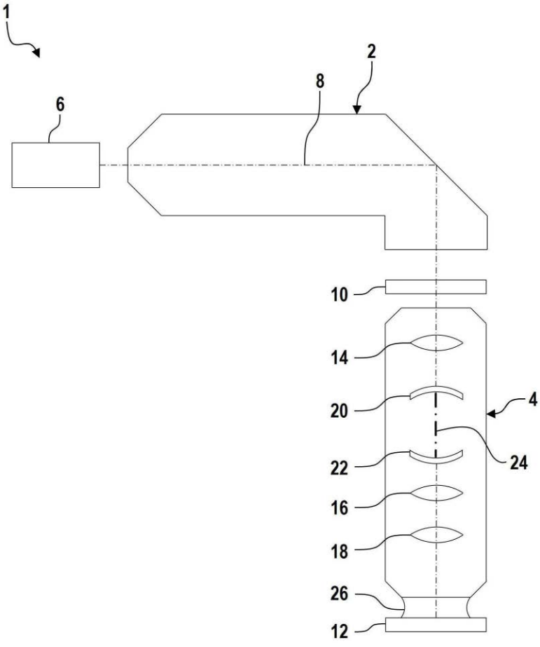

[回看原页](original.pdf#page=19)

图1

1919

## PDF第20页

[回看原页](original.pdf#page=20)

CN 117234040 A

说　明　书　附　图

2/11 页

100

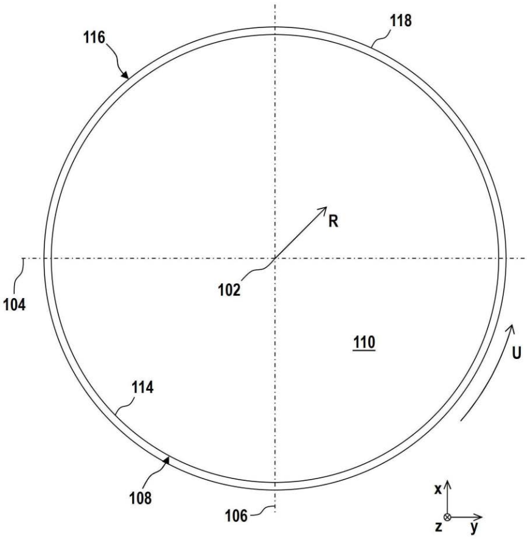

[回看原页](original.pdf#page=20)

图2

2020

## PDF第21页

[回看原页](original.pdf#page=21)

CN 117234040 A

说　明　书　附　图

3/11 页

100

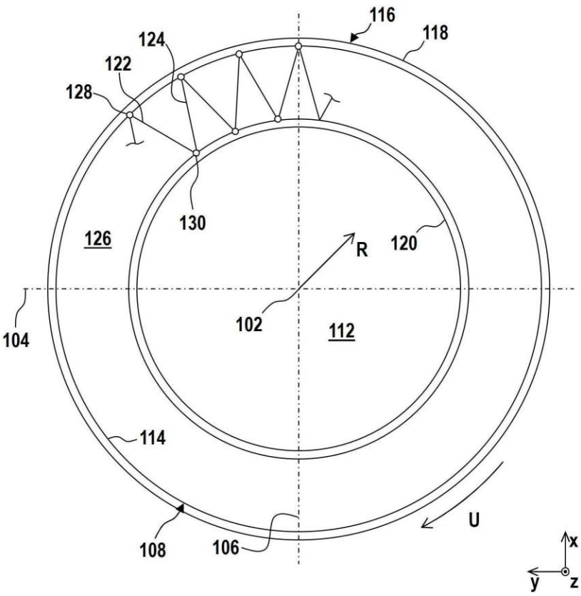

[回看原页](original.pdf#page=21)

图3

2121

## PDF第22页

[回看原页](original.pdf#page=22)

CN 117234040 A

说　明　书　附　图

4/11 页

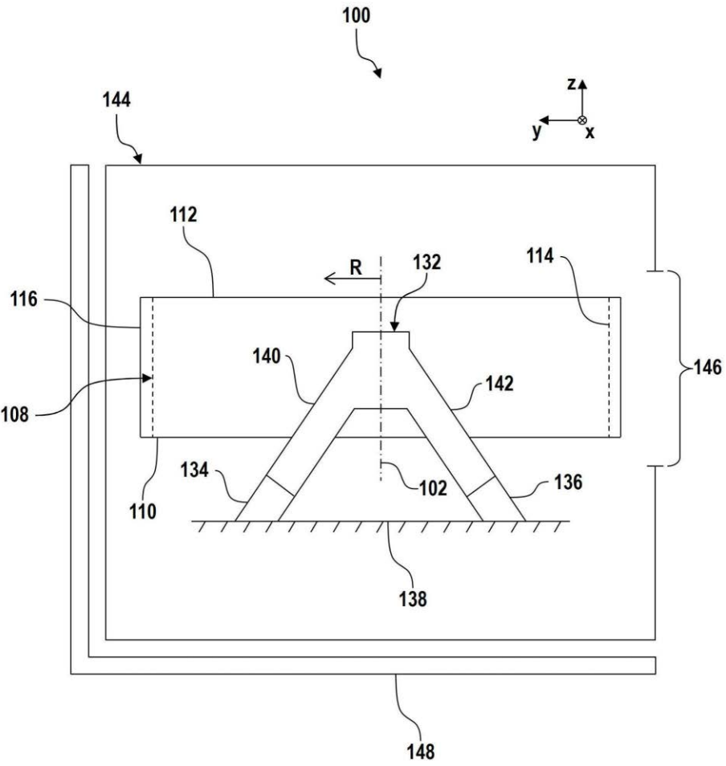

[回看原页](original.pdf#page=22)

图4

2222

## PDF第23页

[回看原页](original.pdf#page=23)

CN 117234040 A

说　明　书　附　图

5/11 页

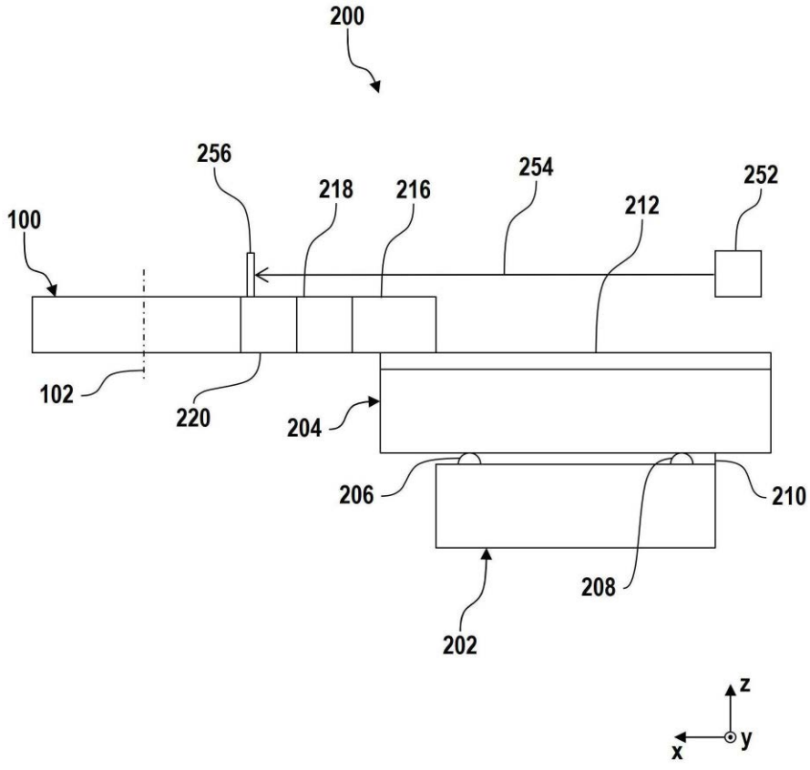

[回看原页](original.pdf#page=23)

图5

2323

## PDF第24页

[回看原页](original.pdf#page=24)

CN 117234040 A

说　明　书　附　图

6/11 页

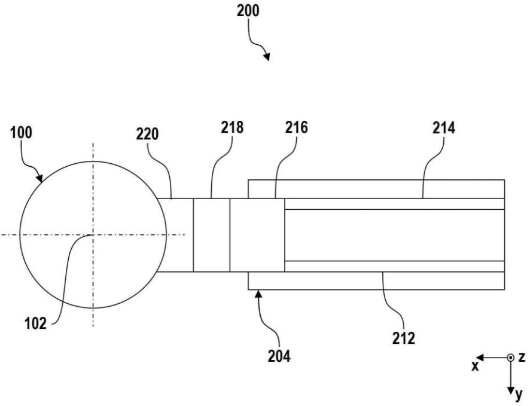

[回看原页](original.pdf#page=24)

图6

2424

## PDF第25页

[回看原页](original.pdf#page=25)

CN 117234040 A

说　明　书　附　图

7/11 页

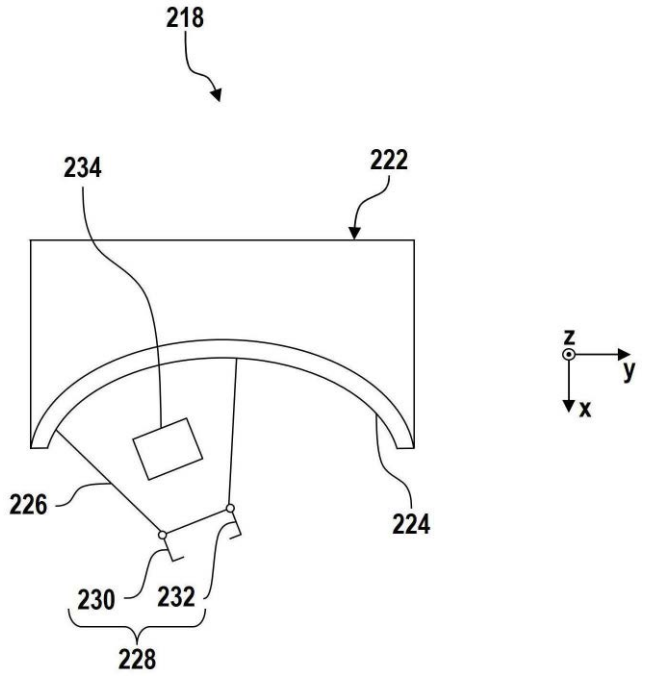

[回看原页](original.pdf#page=25)

图7

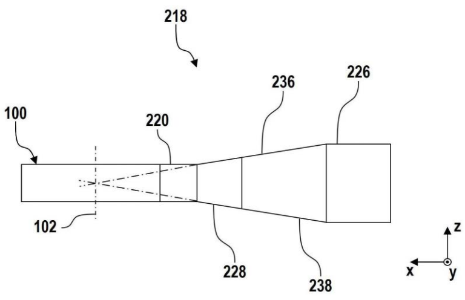

[回看原页](original.pdf#page=25)

图8

2525

## PDF第26页

[回看原页](original.pdf#page=26)

CN 117234040 A

说　明　书　附　图

8/11 页

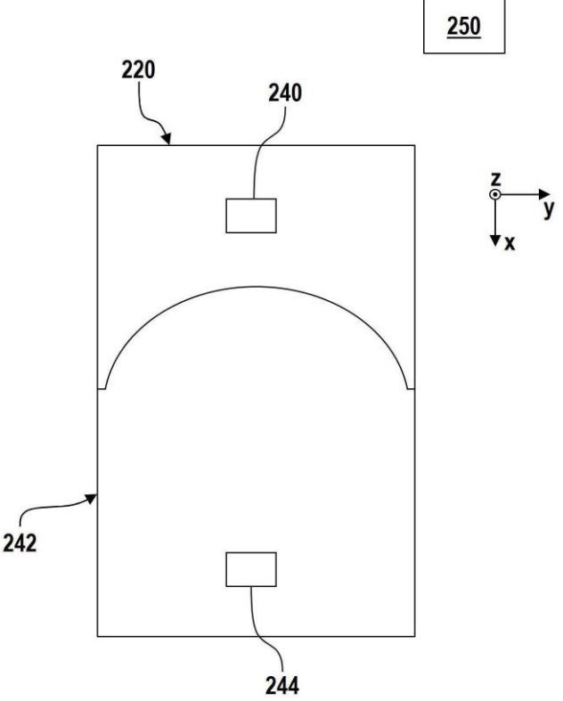

[回看原页](original.pdf#page=26)

图9

2626

## PDF第27页

[回看原页](original.pdf#page=27)

CN 117234040 A

说　明　书　附　图

9/11 页

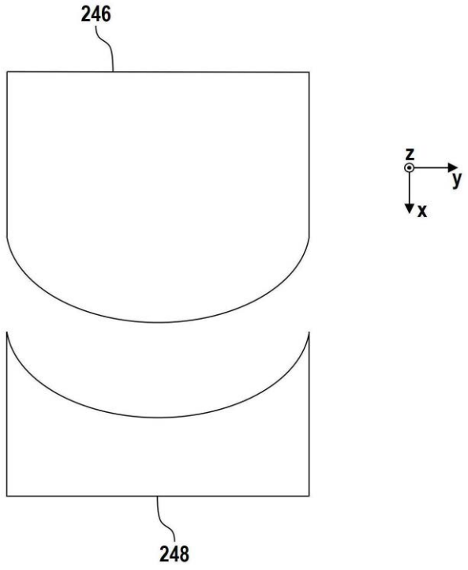

[回看原页](original.pdf#page=27)

图10

2727

## PDF第28页

[回看原页](original.pdf#page=28)

CN 117234040 A

说　明　书　附　图

10/11 页

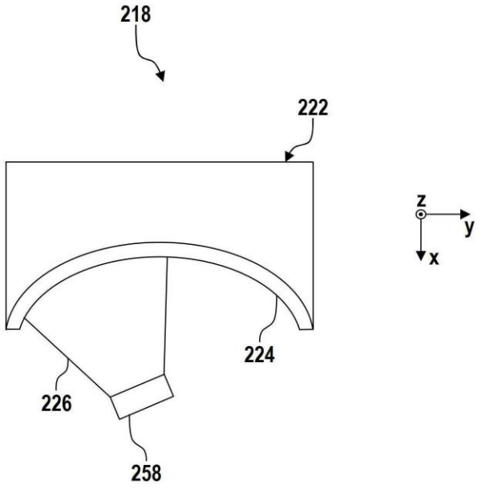

[回看原页](original.pdf#page=28)

图11

2828

## PDF第29页

[回看原页](original.pdf#page=29)

CN 117234040 A

说　明　书　附　图

11/11 页

[回看原页](original.pdf#page=29)

图12

2929

