# CN120344910A — 基于掩模版形状测量来推断和估计掩模版温度的方法

原件：[PDF](original.pdf)；SHA-256 `8522703e5b194f57f414c2645b32492c756630c1f4b4db9f58eca712395244a7`。物理页码从封面计1。

转换：本地MinerU 4.0.12，standard / auto；保留原语言。资料来源与校验值见[清单](../manifest.json)。机器输出未逐字校勘，关键文字、公式与图表回看原件。

校核提示（独立于机器提取正文）：[转换质量与已知问题](../QUALITY.md)。

## PDF第1页

[回看原页](original.pdf#page=1)

CN 120344910 A

(19)国家知识产权局

P

(12)发明专利申请

(10)申请公布号 CN 120344910 A

(21)申请号 202380087174 .3

(22)申请日 2023.11 .20

(30)优先权数据63/433,709 2022.12.19 US

(85)PCT国际申请进入国家阶段日2025.06.18

(86)PCT国际申请的申请数据PCT/EP2023/082417 2023.11 .20

(87)PCT国际申请的公布数据WO2024/132326 EN 2024 .06.27

(71)申请人 ASML荷兰有限公司地址 荷兰

(72)发明人 拉贾·加纳帕蒂·苏布拉曼尼安

## (54)发明名称

基于掩模版形状测量来推断和估计掩模版温度的方法

## (57)摘要

本文中的实施例描述了用于基于掩模版形状测量来确定掩模版温度的系统、方法和装置。系统可以包括:照射路径，所述照射路径被配置成将辐射引导到图案形成装置上；和检测路径，所述检测路径被配置成在所述辐射的一部分与所述图案形成装置相互作用之后将所述辐射的所述部分引导到检测器上，所述检测器被配置成输出表示所述辐射束的所述部分的信号。控制器可以接收所述信号，确定关于与所述图案形成装置相对应的物理特性或对准数据的信息，并且使用所述信息来估计所述图案形成装置的负载温度。所述控制器或另一控制器可以估计负载温度以补偿所述图案形成装置的温度引起的放大。所述控制器或所述另一控制器通过调整系统的平台或透镜的定位来进行补偿。

(43)申请公布日 2025.07.18

(74)专利代理机构 中科专利商标代理有限责任公司 11021专利代理师 王益

(51)I nt.Cl. (2006.01)

权利要求书2页 说明书14页 附图9页

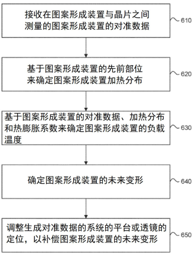

[回看原页](original.pdf#page=1)

## PDF第2页

[回看原页](original.pdf#page=2)

CN 120344910 A

权　利　要　求　书

1/2 页

## 1 .一种系统，包括:

照射路径，所述照射路径被配置成将辐射引导到图案形成装置上；

检测路径，所述检测路径被配置成在所述辐射的一部分与所述图案形成装置相互作用之后将所述辐射的所述部分引导到检测器上，所述检测器被配置成输出表示所述辐射束的所述部分的信号；以及

控制器，所述控制器被配置成接收所述信号，确定关于与所述图案形成装置相对应的物理特性或对准数据的信息，并且使用所述信息来估计所述图案形成装置的负载温度。

## 2.根据权利要求1所述的系统，其中，

所述控制器或另一控制器使用所估计的负载温度和/或相对温度变化来补偿所述图案形成装置的温度引起的变形；

所述控制器或所述另一控制器通过调整所述系统的平台或透镜的定位来进行补偿；和

所述控制器或所述另一控制器修改所述图案形成装置的物理特性、另一物理特性或对准。

3.根据权利要求1所述的系统，其中，所述信息包括所述图案形成装置的放大特性。

4.根据权利要求1所述的系统，其中，所述信息包括所述图案形成装置的变形。

5.根据权利要求1所述的系统，其中，

所述控制器还被配置成存储与变形数据相对应的掩模版形状测量的模型；

所述控制器被配置成使用所述信息并且使用所述模型输出所预测的变形数据；和

所述控制器还被配置成使用所预测的变形数据来预测所述图案形成装置温度的绝对上升或下降。

6.根据权利要求1所述的系统，其中，所述图案形成装置是掩模版，并且所述控制器使用所述放大特性来预测掩模版加热分布。

## 7 .一种用于估计图案形成装置负载温度的方法，包括:

接收在所述图案形成装置与晶片之间所测量的所述图案形成装置的对准数据；

基于所述图案形成装置的先前部位确定图案形成装置加热轮廓；

基于所述对准数据、所述加热轮廓和所述图案形成装置的热膨胀系数来确定所述图案形成装置的负载温度；

## 确定所述图案形成装置的未来变形；以及

调整生成所述对准数据的系统的平台或透镜的定位，以补偿所述图案形成装置的未来变形。

## 8.根据权利要求7所述的方法，还包括:

将辐射引导到所述图案形成装置上；

在所述辐射的一部分与所述图案形成装置相互作用之后将所述辐射的所述部分引导到检测器上，所述检测器被配置成输出表示所述辐射束的所述部分的信号；

确定关于所述图案形成装置的物理特性或对准的信息；以及

使用所述信息来估计所述图案形成装置的负载温度。

9.根据权利要求8所述的方法，其中，使用所述信息包括使用所述图案形成装置的放大特性来估计所述负载温度。

10.根据权利要求8所述的方法，其中，使用所述信息包括使用所述图案形成装置的变

22

## PDF第3页

[回看原页](original.pdf#page=3)

CN 120344910 A

权　利　要　求　书

2/2 页

形信息来估计所述负载温度。

11 .根据权利要求7所述的方法，还包括:

存储与变形数据相对应的图案形成装置形状测量的模型；和

使用所述信息以使用所述模型输出所预测的变形数据。

12.根据权利要求11所述的方法，还包括使用所预测的变形数据来预测所述图案形成装置温度的绝对上升或下降。

13.根据权利要求11所述的方法，其中，所述图案形成装置是掩模版，并且所述模型被用于基于掩模版形状或掩模版对准数据、基于所述掩模版的先前部位的掩模版加热分布、以及所述掩模版材料的热膨胀系数来估计掩模版温度。

14.一种光刻工具，包括根据权利要求1所述的系统。

15.根据权利要求14所述的光刻工具，其中，所述控制器或另一控制器使用所估计的负载温度和/或相对温度变化来补偿所述图案形成装置的温度引起的变形。

33

## PDF第4页

[回看原页](original.pdf#page=4)

CN 120344910 A

说　明　书

1/14 页

## 基于掩模版形状测量来推断和估计掩模版温度的方法

[0001] 相关申请的交叉引用

[0002] 本申请要求2022年12月19日提交的美国申请63/433 ,709的优先权，该美国申请的全部内容通过引用而被合并入本文中。

## 技术领域

[0003] 本公开涉及与光刻设备中的掩模版温度相关的系统、方法和装置。

## 背景技术

[0004] 光刻设备是一种将期望的图案施加至衬底（通常是在衬底的目标部分上）上的机器。例如，光刻设备可以用于集成电路（IC）的制造中。在这种情况下，可以将替代地称为掩模或掩模版的图案形成装置用于生成要在IC的单层上形成的电路图案。可以将所述图案转印到衬底（例如硅晶片）上的目标部分（例如，包括一部分管芯、一个或若干个管芯）上。典型地，通过将图案成像到设置在衬底上的辐射敏感材料（抗蚀剂）层上进行图案的转印。通常，单个衬底将包含被连续图案化的相邻目标部分的网格。已知的光刻设备包括所谓的步进器和所谓的扫描器，在步进器中，通过将整个图案一次曝光到目标部分上来辐照每个目标部分，在扫描器中，通过在辐射束沿给定方向（“扫描”方向）扫描图案的同时平行或反向平行于这个扫描方向同步地扫描所述目标部分来辐照每个目标部分。还可以通过将图案压印到衬底上而将图案从图案形成装置转印到衬底上。

[0005] 为了在衬底上投影图案，光刻设备可以使用电磁辐射。这种辐射的波长确定可以形成在衬底上的特征的最小大小。光刻设备可以使用波长范围在4 nm至20 nm内（例如6 .7 nm或13 .5 nm）的极紫外（EUV）辐射，或者（波长范围在大约120 nm至大约400 nm内，例如193 nm或248 nm的）深紫外（DUV）辐射。

[0006] 在DUV光刻术中，所述辐射束可能会在掩模版中引起热响应。特别地，所掩模版可能会从DUV辐射束中吸收大量热能，这会导致掩模版加热并且膨胀。其它源，诸如遍及掩模版输送装置和掩模版平台模块中的各种机电设备，也会导致掩模版加热。导致掩模版的不均匀的热轮廓的掩模版加热可能是所述光刻系统中图像变形和重叠误差的主要贡献因素。

[0007] 目前，使用掩模版温度传感器（RTS）来测量掩模版温度。然而，这存在缺点，诸如传感器随时间的劣化，这被称为传感器寿命终止（EOL）。另一缺点是传感器本身具有温度梯度，这可能导致无法捕获掩模版温度的快速指数行为。此外，每晶片每次测量可能需要多达约5秒，这导致额外的开销。所需要的是确定掩模版的温度的更好的方法。

## 发明内容

[0008] 本公开提供了用于基于掩模版形状测量来确定掩模版温度的系统和方法。

[0009] 在一些实施例中，一种系统包括:照射路径，所述照射路径被配置成将辐射引导到图案形成装置上；和检测路径，所述检测路径被配置成在所述辐射的一部分与所述图案形成装置相互作用之后将所述辐射的所述部分引导到检测器上，所述检测器被配置成输出表

44

## PDF第5页

[回看原页](original.pdf#page=5)

CN 120344910 A

说　明　书

2/14 页

示所述辐射束的所述部分的信号。控制器被配置成接收所述信号，确定关于与所述图案形成装置相对应的物理特性或对准数据的信息，并且使用所述信息来估计所述图案形成装置的负载温度。

[0010] 在一些实施例中，所述控制器或另一控制器使用所估计的负载温度来补偿图案形成装置的温度引起的放大。

[0011] 在一些实施例中，所述控制器或所述另一控制器通过调整系统的平台或透镜的定位来进行补偿。

[0012] 在一些实施例中，所述控制器或所述另一控制器修改所述图案形成装置的物理特性、另一物理特性或所述对准。

[0013] 在一些实施例中，所述信息包括所述图案形成装置的放大特性。

[0014] 在一些实施例中，所述信息包括所述图案形成装置的变形。

[0015] 在一些实施例中，所述控制器还被配置成存储与变形数据相对应的掩模版形状测量的模型。

[0016] 在一些实施例中，所述控制器被配置成使用所述信息并且使用所述模型输出所预测的变形数据。

[0017] 在一些实施例中，所述控制器还被配置成使用所预测的变形数据来预测所述图案形成装置温度的绝对上升或下降。

[0018] 在一些实施例中，所述图案形成装置是掩模版，并且所述控制器使用所述放大特性来预测掩模版加热分布。

[0019] 在一些实施例中，一种用于估计图案形成装置负载温度的方法包括:接收在所述图案形成装置与晶片之间所测量的所述图案形成装置的对准数据；和基于所述图案形成装置的先前部位确定图案形成装置加热轮廓。可以基于所述对准数据、所述加热轮廓和所述图案形成装置的热膨胀系数来确定所述图案形成装置的负载温度。还可以确定所述图案形成装置的未来变形。可以进行生成所述对准数据的系统的平台或透镜的位置调整，以补偿所述图案形成装置的未来变形。

[0020] 在一些实施例中，所述方法可以包括:将辐射引导到所述图案形成装置上；和在所述辐射的一部分与所述图案形成装置相互作用之后将所述辐射的所述部分引导到检测器上，所述检测器被配置成输出表示所述辐射束的所述部分的信号。所述方法可以确定关于所述图案形成装置的物理特性或对准的信息，并且使用所述信息来估计所述图案形成装置的负载温度。

[0021] 在一些实施例中，所述方法可以使用所述信息，包括使用所述图案形成装置的放大特性来估计所述负载温度。

[0022] 在一些实施例中，所述方法可以使用所述信息，包包括使用所述图案形成装置的变形信息来估计所述负载温度。

[0023] 在一些实施例中，所述方法可以存储与变形数据相对应的图案形成装置形状测量的模型。

[0024] 在一些实施例中，所述方法可以使用所述信息以使用所述模型输出所预测的变形数据。

[0025] 在一些实施例中，所述方法可以使用所预测的变形数据来预测所述图案形成装置

55

## PDF第6页

[回看原页](original.pdf#page=6)

CN 120344910 A

说　明　书

3/14 页

温度的绝对上升或下降。

[0026] 在一些实施例中，所述图案形成装置是掩模版，并且所述模型被用于基于掩模版形状或掩模版对准数据、基于所述掩模版的先前部位的掩模版加热分布、以及所述掩模版材料的热膨胀系数来估计掩模版温度。

[0027] 在下文中参考随附附图详细地描述本公开的另外的特征以及本公开的各个实施例的结构和操作。应注意，本发明不限于本公开中所描述的具体实施例。本文仅出于说明性的目的来呈现这样的实施例。基于本发明中包含的教导，明白额外的实施例将对于相关领域技术人员显而易见。

## 附图说明

[0028] 并入本文中并构成说明书的一部分的随附附图图示出本公开，并且与描述一起进一步用于解释本公开的原理并使相关领域的技术人员能够完成并使用本公开。

[0029] 图1是根据示例性方面的光刻设备的示意图。

[0030] 图2A是根据示例性方面的光刻单元的示意图。

[0031] 图2B是根据示例性方面的包括用于优化光刻过程的计算机系统的整体光刻的示意图。

[0032] 图3A是根据示例性方面的掩模版平台和掩模版的示意性仰视透视图。

[0033] 图3B是图3A中示出的掩模版平台的示意性仰视平面图。

[0034] 图4A是根据示例性方面的掩模版交换设备的示意性俯视透视图。

[0035] 图4B是图4A中示出的掩模版交换设备的示意性局部截面图。

[0036] 图5A、图5B和图5C图示出根据本公开的实施例的掩模版热机械关键性能指标随时间的实验结果。

[0037] 图6至图8图示出根据本公开的实施例的预测掩模版温度轮廓的各种示例性方法。

[0038] 从根据下文阐明的具体实施方式，当与附图结合时，将明白本公开的特征，在附图中相同的附图标记始终标识相应的元件。在附图中，相似的附图标记通常指示相同的、功能上类似的和/或结构上类似的元件。另外，通常，附图标记的最左边的数字标识其中所述附图标记第一次出现的附图。除非另有陈述，否则遍及本公开提供的附图不应被解释为成比例的附图。

## 具体实施方式

[0039] 本说明书公开并入有本发明的特征的一个或更多个方面。所公开的方面仅例示本发明。本发明的范围不限于所公开的方面。本发明由所附权利要求书限定。

[0040] 所描述的方面和本说明书中对“一个方面”、“方面”、“示例方面”、“示例性方面”等的提及指示所描述的方面可以包括特定特征、结构或特性，但每个方面可能不必包括所述特定特征、结构或特性。此外，这些词组不必指同一方面。此外，在结合方面描述特定特征、结构或特性时，应理解，无论是否来明确描述的，结合其它方面实现这种特征、结构或特性在本领域技术人员的认知内。

[0041] 为易于描述，本文中可以使用诸如“在……之下”、“在……下方”、“下部”、“在……上方”、“在……上”、“上部”和类似术语的空间相对术语来描述附图中所图示的一个元件或

66

## PDF第7页

[回看原页](original.pdf#page=7)

CN 120344910 A

说　明　书

4/14 页

特征相对于另一元件或特征的关系。除附图中描绘的方向之外，空间相对术语也旨在涵盖装置在使用或操作中的不同定向。设备可以以其它方式定向（旋转90度或处于其它定向）且本文中所使用的空间相对描述词同样可以相应地来解释。

[0042] 本文中所使用的术语“约”或“基本上”或“大致”指示可以基于特定技术变化的给定量的值。基于特定技术，术语“约”或“基本上”或“大致”可以指示在例如值的1%至15%（例如，值的±1%、±2%、±5%、±10%或±15%）内变化的给定量的值。

[0043] 本文中所使用的术语“寄生热效应”指示掩模版的引起或内部应力和/或变形，例如归因于加热和/或冷却掩模版（例如，通过电阻加热、气流冷却、将掩模版曝光于一剂量的辐射等）或将掩模版夹持和/或保持在掩模版平台上而产生的机械压力和/或变形。

[0044] 本文中所使用的术语“非生产衬底”指示不是生产批次的部分且不是通过光刻过程制造为器件（例如，IC芯片）的衬底（例如，晶片）。例如，非生产衬底可以是用于掩模版校准方法的卡盘温度调节（CTC）晶片或校准晶片，例如以校准掩模版加热模型且通过将掩模版和CTC晶片曝光于一剂量的辐射和测量掩模版对准和/或掩模版温度来使掩模版顺应。

[0045] 本文中所使用的术语“生产衬底”指示作为生产批次的部分且通过光刻过程制造为器件（例如，IC芯片）的衬底（例如，晶片）。例如，生产衬底可以是例如通过将掩模版和晶片曝光于一剂量的辐射和测量掩模版对准和/或掩模版温度而用于掩模版加热模型的制造和在线实时校准的晶片（例如，硅）。

[0046] 本文中所使用的术语“掩模版加热模型”指示模态变形方法（例如，对不同掩模版模式形状的分析）以基于掩模版对准和/或掩模版形状变形和有限元模型（FEM）（例如，COMSOL）来确定掩模版加热效应。例如，掩模版加热模型可以是确定性的（例如，无随机未来状态）或非确定性的（例如，包括随机未来状态）掩模版加热效应。此外，掩模版加热模型可以被视为使用在线模态校准以确定基线掩模版加热动力学的掩模版加热执行算法（RHEA）。掩模版加热模型可以通过将掩模版和非生产衬底曝光于一剂量的辐射来校准，以用于掩模版加热模型的在线实时校准。在一些方面，例如，掩模版加热模型可以通过将掩模版和生产衬底曝光于一剂量的辐射来校准，以用于掩模版加热模型的在线实时校准。其它掩模版加热模型利用基于传感器的方法（例如，使用RTS测量）来校准掩模版加热模型。这在美国专利号10 ,429 ,749、美国专利号10 ,281 ,825和美国公开号2020/0166854中有进一步详细描述，这些专利的全部内容通过引用并入本文。

[0047] 掩模版加热导致掩模版性质的变化，这会影响辐射路径并导致制备误差（例如，重叠）。可以计算掩模版机械变形（例如，基于掩模版温度）并将其分解为k参数。每个热机械模式（例如，特征向量）可以使用模态参与因子μ和时间常数τ在时间上建模。测量的重叠和/或对准可以用于对相关的k参数漂移建模，所述相关的k参数漂移可以用于计算对前馈参数μ和τ的调整。掩模版加热模型还可以包括调整前馈参数μ和τ。这在美国专利号10 ,429 ,749、美国公开号2020/0166854和WIPO公开号2021/043519中进一步详细描述，这些专利的全部内容通过引用并入本文。

[0048] 本文中所使用的术语“有限元模型”或“FEM”指示用于对掩模版加热模型中出现的微分方程式（例如，传热方程式、结构分析方程式、流体流动方程式等）进行数值求解的方法。例如，基线掩模版加热动力学可以通过FEM经由有限元分析来分析。这在美国专利号10 , 429,749、美国专利号10 ,281 ,825和美国公开号2020/0166854中进一步详细描述。

77

## PDF第8页

[回看原页](original.pdf#page=8)

CN 120344910 A

说　明　书

5/14 页

[0049] 本文中所使用的术语“关键性能指标”或“KPI”或“k参数”指示拟合至掩模版对准标记和/或边缘对准标记的变形的多项式的系数。k参数参数化每个衬底场上的成像变形。例如，每个k参数可以描述某一图像变形分量（例如，缩放误差、桶形变形、枕形变形等）。例如，两个重要的k参数是表示Y轴放大变形的k4（例如，图7中所示出的k4/my）和表示Y轴桶形变形的k18（例如，图8中所示出的k18/cshpy）。k参数可以用作光刻过程（例如光刻设备LA、光刻单元LC、控制系统CL）的输入以校正变形。这在美国专利号10 ,429 ,749、美国公开号2020/0166854和WIPO公开号2021/043519中进一步详细描述。

[0050] 本文中所使用的术语“在线实时校准”指示在生产衬底的实际制造期间掩模版加热模型的校准。例如，可以避免校准批量生产衬底，并且可以减少或避免出于校准目的的生产衬底的返工。可以通过将掩模版和生产衬底曝光于一剂量的辐射来进行在线校准。此外，校准可以实时地（例如，以实时帧速率或2.56秒或更小的计算速率）进行 。

[0051] 本公开的方面（诸如控制器）可以以硬件、固件、软件或其任何组合来实现。本公开的方面也可以实施为储存在机器可读介质上的指令，所述指令可以由一个或更多个处理器读取和执行。机器可读介质可以包括用于储存或传输呈可以由机器（例如，计算装置）读取的形式的信息的任何机制。例如，机器可读介质可以包括:只读存储器（ROM）；随机存取存储器（RAM）；磁盘储存介质；光学储存介质；闪存装置；电学、光学、声学或其它形式的传播信号（例如，载波、红外信号、数字信号等）等。此外，固件、软件、例程和/或指令可以在本文中描述为执行某些动作。然而，应了解，这些描述仅仅出于方便起见，并且这些动作实际上由计算装置、处理器、控制器或执行固件、软件、例程、指令等的其它装置引起，如本领域技术人员将明白的。

[0052] 然而，在更详细地描述这些方面之前，呈现可以实施本公开的方面的示例环境是具指导性的。

## [0053] 示例性光刻系统

[0054] 图1示出包括辐射源SO和光刻设备LA的光刻系统。辐射源SO被配置成生成EUV和/或DUV辐射束B和将EUV和/或DUV辐射束B供应给光刻设备LA。光刻设备LA包括照射系统IL、配置成支撑图案形成装置MA（例如，掩模、掩模版）的支撑结构MT（例如，掩模台、掩模版台、掩模版平台）、投影系统PS，和配置成支撑衬底W的衬底台WT。

[0055] 照射系统IL被配置成在EUV和/或DUV辐射束B入射到图案形成装置MA上之前调节EUV和/或DUV辐射束B。另外，照射系统IL可以包括琢面场反射镜装置10和琢面光瞳反射镜装置11。琢面场反射镜装置10和琢面光瞳反射镜装置11一起向EUV和/或DUV辐射束B提供期望的横截面形状和期望的强度分布。作为琢面场反射镜装置10和琢面光瞳反射镜装置11的补充或替代，照射系统IL可以包括其它反射镜或装置。

[0056] 在因此调节之后，EUV和/或DUV辐射束B与图案形成装置MA相互作用。这种相互作用可以是反射型的（如所示出的），这对于EUV辐射可以是优选的。这种相互作用可以是透射型的，这对于DUV辐射可以是优选的。由于这种相互作用，生成经图案化的EUV和/或DUV辐射束B '。投影系统PS被配置成将经图案化的EUV和/或DUV辐射束B '投影至衬底W上。出于所述目的，投影系统PS可以包括配置成将经图案化的EUV和/或DUV辐射束B '投影至由衬底台WT保持的衬底W上的多个反射镜13、14。投影系统PS可以将减小因子应用至经图案化的EUV和/或DUV辐射束B '，因此形成特征小于图案形成装置MA上的相应的特征的图像。例如，可以应

88

## PDF第9页

[回看原页](original.pdf#page=9)

CN 120344910 A

说　明　书

6/14 页

用为4或8的减小因子。虽然投影系统PS在图1中被图示为仅具有两个反射镜13、14，但投影系统PS可以包括不同数目个反射镜（例如，六个或八个反射镜）。

[0057] 衬底W可以包括先前形成的图案。在这样的情况下，光刻设备LA使由经图案化的EUV和/或DUV辐射束B'形成的图像与先前形成在衬底W上的图案对准。

[0058] <u>示例性光刻单元</u>

[0059] 图2A示出光刻单元LC，其有时也称作光刻元或簇。光刻设备LA可以形成光刻单元LC的部分。光刻单元LC也可以包括用于对衬底执行曝光前和曝光后过程的一个或更多个设备。常规地，这些设备包括用于沉积抗蚀剂层的旋涂器SC、用于使经曝光的抗蚀剂显影的显影器DE、激冷板CH和焙烤板BK。衬底输送装置或机器人RO从输入/输出端口I/O1、I/O2拾取衬底，在不同过程设备之间移动衬底，并且将衬底传递至光刻设备LA的进料台LB。常常统称为轨道或涂覆显影系统的这些装置是在轨道或涂覆显影系统控制单元TCU的控制下，所述轨道或涂覆显影系统控制单元TCU自身受到管理控制系统SCS控制，所述管理控制系统SCS也经由光刻控制单元LACU来控制光刻设备LA。因此，不同的设备可以被操作以最大化吞吐量和处理效率。

[0060] 为了正确且一致地曝光由光刻设备LA曝光的衬底W，期望检查衬底以测量经图案化的衬底的性质，例如后续层之间的重叠误差、线厚度、临界尺寸（CD）等。为此目的，检查工具（例如，量测工具MT）可以被包括在光刻单元LC和/或光刻设备LA中。如果检测到误差，则可以例如对后续衬底的曝光或对待对衬底W执行的其它处理步骤进行调整，尤其在同一批量或批次的其它衬底W仍待曝光或处理之前进行检查的情况下。

[0061] 也可以称作量测设备或量测工具MT的检查设备是用于确定衬底W的性质，并且尤其确定不同衬底W的性质如何变化或与同一衬底W的不同层相关联的性质如何在不同层间变化。检查设备替代地构造成识别衬底W上的缺陷，并且可以例如为光刻单元LC的部分、集成至光刻设备LA中和/或为单独的装置。检查设备可以测量潜像（例如，在曝光之后抗蚀剂层中的图像）上、半潜像（例如，在曝光后焙烤步骤之后抗蚀剂层中的图像）上、经显影的抗蚀剂图像（例如，抗蚀剂的曝光部分或未曝光部分已被移除的图像）上，或经蚀刻的图像（例如，在诸如蚀刻的图案转印步骤之后的图像）上的性质。

[0062] <u>示例性计算机系统</u>

[0063] 图2B示出计算机系统CL，其也称作控制器或处理器。计算机系统CL可以是光刻单元LC的部分、集成至光刻设备LA中和/或为单独的装置。计算机系统CL被配置成优化光刻过程，例如校准掩模版加热模型。通常，光刻设备LA中的图案化过程为处理中的最重要的步骤，其需要衬底W上的结构的尺寸标定和放置的高准确度。为了确保这种高准确度，可以在图2B中示意性地描绘的所谓“整体”控制环境中组合三个系统。如图2B中所示出的，“整体”环境可以包括光刻设备LA、计算机系统CL和量测工具MT。例如，光刻设备LA（第一系统）可以连接至计算机系统CL（第二系统）和量测工具MT（第三系统）。

[0064] 这种整体光刻的关键为优化这三个系统之间的协作以优化光刻过程，例如以增强总体过程窗口且提供严格控制回路以确保由光刻设备LA执行的图案化保持在过程窗口内。过程窗口限定过程参数（例如，剂量、聚焦、重叠等）的范围，在所述过程参数范围内，特定制造过程产生所限定的结果，例如功能性半导体器件，通常在所述结果内，允许光刻过程或图案化过程中的过程参数变化。

99

## PDF第10页

[回看原页](original.pdf#page=10)

CN 120344910 A

说　明　书

7/14 页

[0065] 计算机系统CL可以例如使用待图案化的设计布局（例如，设计布局的部分）以预测使用哪些分辨率增强技术且执行计算光刻模拟和计算，例如以确定哪些掩模布局和光刻设备设置实现图案化过程的最大总体过程窗口（在图2B中由第一标尺SC1中的双箭头示出）。通常，分辨率增强技术被布置成与光刻设备LA的图案化可能性相匹配。计算机系统CL也可以用于检测光刻设备LA当前在过程窗口内的何处操作（例如，使用来自量测工具MT的输入），以预测例如由于次优处理是否可能存在缺陷（在图2B中由第二标尺SC2中指向“0”的箭头示出）。

[0066] 量测工具MT可以将输入提供至计算机系统CL，例如以实现准确模拟和预测。例如，量测工具MT可以提供对准信息。例如，量测工具MT可以提供对准信息。量测工具MT可以将反馈（例如，经由计算机系统CL）提供至光刻设备LA以识别例如在光刻设备LA的校准状态中的可能漂移（在图2B中由第三标尺SC3中的多个箭头示出）。在光刻过程中，期望频繁地测量所产生的结构，例如以用于过程控制和验证。例如，可以使用不同类型的量测工具MT来测量关于光刻设备LA、待图案化的衬底W和/或掩模版对准的一个或更多个性质。这进一步详细地描述于以全文引用的方式并入本文中的美国专利号11 ,099 ,319和WIPO公开号2021/043519中。

[0067] <u>示例性掩模版平台和掩模版</u>

[0068] 图3A和图3B示出根据示例性方面的掩模版平台200的示意图。图3A是根据示例方面的掩模版平台200和掩模版300的示意性仰视透视图。图3b是图3A中所示出的掩模版平台200和掩模版300的示意性仰视平面图。

[0069] 掩模版平台200（例如，支撑结构MT）可以在光刻设备（例如，光刻设备LA）中用于保持图案形成装置（例如，图案形成装置MA）。掩模版平台200可以包括底部平台表面202、顶部平台表面204、侧平台表面206、夹具250、掩模版保持架224和/或掩模版300。在一些方面，具有掩模版300的掩模版平台200可以在光刻设备LA中实施。例如，掩模版平台200可以是光刻设备LA中的支撑结构MT。在一些方面，掩模版300可以设置在底部平台表面202上且由夹具250保持。例如，如图3A和图3B中所示出的，掩模版300可以设置在底部平台表面202的中心处的夹具250（例如，静电夹具）上，其中，掩模版前侧302竖直地背向底部平台表面202。在一些方面，掩模版保持架224可以设置在底部平台表面202上。例如，如图3A和图3B中所示出的，掩模版300可以设置在底部平台表面202的中心处，并且由邻近于掩模版300的每个拐角的掩模版保持架224紧固。

[0070] 在例如光刻设备LA的一些光刻设备中，具有夹具250的掩模版平台200可以用于保持并定位掩模版300以用于扫描或图案化操作。在一些方面，如图3A和图3B中所示出的，掩模版平台200可以包括用于定位操作的第一编码器212和第二编码器214。例如，第一编码器212和第二编码器214可以是干涉仪。第一编码器212可以沿掩模版平台200的第一方向，例如横向方向（即，X方向）进行附接。并且，第二编码器214可以沿掩模版平台200的第二方向，例如纵向方向（即，Y方向）进行附接。

[0071] 如图3A和图3B中所示出的，掩模版300可以包括掩模版前侧302、对准标记310和/或边缘对准标记320。对准标记310被配置成测量掩模版300与衬底（例如，衬底W、非生产衬底、生产衬底）之间的掩模版对准。在一些方面，如图3A和图3B中所示出的，一个或更多个对准标记310可以设置在掩模版300的拐角和/或中心中以用于RA测量。边缘对准标记320被配

1010

## PDF第11页

[回看原页](original.pdf#page=11)

CN 120344910 A

说　明　书

8/14 页

置成测量在掩模版300不在预定温度内（例如，在 $\mathrm { ( 2 2 ^ { \circ } C \pm 0 . 2 ^ { \circ } C ) }$ 时因热膨胀而导致的掩模版300的掩模版形状变形。在一些方面，如图3A和图3B中所示出的，可以沿掩模版300的周边边缘（例如，水平和竖直边缘）设置一个或更多个边缘对准标记320以用于掩模版形状变形（RSD）测量。在一些方面，RA测量和/或RSD测量的结果可以例如由FEM转化为掩模版温度，所述FEM基于掩模版对准和/或掩模版变形对温度进行求解。

## [0072] 示例性掩模版交换设备

[0073] 图4A和图4B示出根据示例性方面的掩模版交换设备100的示意图。图4A是根据示例性方面的掩模版交换设备100的示意性俯视透视图。图4b是图4A中所示出的掩模版交换设备100的示意性部分截面图。

[0074] 掩模版交换设备100可以被配置成减少掩模版交换时间和掩模版300中的热应力以增加例如光刻设备LA中的总体吞吐量。在一些方面，掩模版交换设备100可以通过将掩模版300从掩模版平台200移除至真空机器人（IVR）400而减少掩模版300中的应力。例如，掩模版交换设备100可以从掩模版保持架224和夹具250快速地松开掩模版300，并且将掩模版300转移至IVR 400以释放掩模版300中的热应力。在一些方面，掩模版交换设备100可以通过松开掩模版300并将所述掩模版从掩模版平台200转移至IVR 400且快速返回并将掩模版300夹回至掩模版平台200来减少掩模版300中的应力且增加吞吐量。如图4A和图4B中所示出的，掩模版交换设备100可以包括掩模版平台200、夹具250和IVR 400。

[0075] IVR 400可以包括具有一个或更多个掩模版输送装置臂404的掩模版输送装置402。在一些方面，掩模版输送装置402可以是快速交换装置（RED），所述快速交换装置被配置成高效地旋转且最少化掩模版交换时间。掩模版输送装置臂404可以包括配置成保持对象（例如，掩模版300）的掩模版底板406。在一些方面，掩模版底板406可以是用于掩模版300的极紫外内舱（EIP）。掩模版底板406包括掩模版底板前侧407，并且掩模版300包括掩模版背侧304。

[0076] 如图4A和图4B中所示出的，掩模版底板406可以保持掩模版300，使得掩模版底板前侧407和掩模版背侧304各自面向底部平台表面202和夹具前侧252。例如，掩模版底板前侧407和掩模版背侧304可以竖直地背向底部平台表面202和夹具前侧252。如图4B中所示出的，掩模版交换设备100可以包括掩模版交换区域410，所述掩模版交换区域是夹具250、掩模版300、掩模版底板406和掩模版输送装置臂404在掩模版交换过程期间的横截面区域。

[0077] 在一个示例中，在掩模版交换过程期间，掩模版输送装置402的掩模版输送装置臂404在掩模版交换区域410中将掩模版300朝向夹具250而定位在掩模版底板406上。如上文所描述的，掩模版从掩模版输送装置402移交至夹具250和从夹具移交至掩模版输送装置可以释放掩模版300中的热应力且减少掩模版300中的寄生热效应。

## [0078] 示例性掩模版校准方法

[0079] 如上文所论述的，光刻设备（例如，光刻设备LA）可以包括掩模版平台（例如，支撑结构MT、掩模版平台200）以保持图案形成装置（例如，图案形成装置MA、掩模版300），从而将图案转印至衬底（例如，衬底W）。掩模版加热和/或冷却可能引起掩模版性质的改变，这可能影响辐射束路径（例如，聚焦）且引起经图案化的衬底的变形（例如，重叠误差）。可以通过掩模版加热模型来建模和校正掩模版性质的改变。当前掩模版加热模型依赖于基于传感器的特殊应用方法以利用RTS来校准掩模版加热模型且需要校准批量的生产晶片。

1111

## PDF第12页

[回看原页](original.pdf#page=12)

CN 120344910 A

说　明　书

9/14 页

[0080] 在一些示例中，这种方法可能是不准确且低效的，这是因为RTS可能展现误差，可能引入不必要延迟且可能需要生产晶片的返工。在一些方面，RTS具有约 $\pm 0 . 6 ^ { \circ } ($ C温度梯度变化，在可能引起约 $1 ~ \mathrm { { n m } / ^ { \circ } }$ °C的重叠失配。此外，在一些方面，通过RTS进行的每个掩模版温度测量每晶片花费约五秒，这可能引入额外的延迟。当前的掩模版预调节技术可能减慢晶片处理。此外，在校准之前掩模版的热机械性质的变化可能放大且加剧重叠失配（例如，从1 $\mathrm { n m } / ^ { \circ }$ °C增加至超过2 . $1 ~ \mathrm { n m / ^ { \circ } C ) }$ 。另外，可以随时间返工用于校准的生产晶片，这可能引入额外的延迟且减少总体吞吐量。

[0081] 其全部内容被并入本文中的PCT/EP2022/078447中所论述的掩模版校准设备、系统和方法的方面可以增加掩模版加热模型的校准准确度和速度，减少掩模版的调节时间、减少掩模版中的应力，避免生产衬底的返工，和/或增加光刻过程的制造吞吐量和产率。

[0082] <u>通过导出掩模版温度信息来改善掩模版校准方法的示例性方法</u>

[0083] 如上文提到的，当前掩模版校准和/或测量系统和方法可以采用基于传感器的直接测量方法。在一些方面，本公开提高了此类当前温度传感器的性能。

[0084] 在一些实施例中，披露了用于通过基于掩模版形状测量推断掩模版温度来确定掩模版温度的系统和方法。例如，系统和方法可以基于对准数据、掩模版的加热轮廓和掩模版的热膨胀系数来确定所述图案形成装置的负载温度。

[0085] 使用掩模版输送装置将掩模版定位在掩模版站上和离开掩模版站。例如在美国专利号10 ,284 ,830中描述了这样的系统，该美国专利的全部内容通过引用而被合并入本文。这样的系统可以采用掩模版加热校正（RHC）。在一些示例中，即使在温度预处理的情况下，高温掩模达到也可能并非罕见。在一些方面，在扫描器中曝光之前对掩模版进行热调节以实现明确限定的掩模版温度（这对于RHC的最佳性能是期望的），尤其是对于不依赖于掩模版温度传感器（RTS）测量来测量初始掩模版温度的系统。在一些方面，掩模版可以被快速调节到期望的温度（例如， $2 2 + 1 - 2 ^ { \circ }$ C的掩模版可以在5分钟内朝向 $[ 2 2   , 1 8   ^ { \circ } \mathrm { C } ]$ 调节），而在正常狭槽中，掩模版可以被缓慢调节（在45分钟内至 $[22.3^{\circ}C  至  22.8^{\circ}C )$

[0086] 在需要调节掩模版的实施例中，它们可以通过用户的掩模版传递系统从系统外部或从光刻系统（扫描器）中的不同部位传递。掩模版的实际到达温度依赖于其历史，诸如从以下位置到达:扫描器外部，在这种情况下，掩模版温度的范围可以在约 $120 ^{\circ} C   至   24 ^{\circ}($ C之间；掩模版站，在这种情况下，掩模版温度可以在约 $122^{\circ} C   至  24^{\circ} C$ 之间的范围内，这依赖于掩模版被曝光的批次的曝光剂量和吞吐量；集成掩模版检查系统（IRIS），在这种情况下，掩模版温度可以在约 $122.2 ^{\circ} C   至   22.5 ^{\circ} C ;$ 之间的范围内，这依赖于在IRIS中的停留时间；或者来自内部掩模版库（IRL）狭槽，在这种情况下，掩模版温度的范围可以在约 $1 2 2   ^ { \circ } \mathrm { C }$ 至 $[ 2 4   ^ { \circ } \mathrm { C } ]$ 之间，这依赖于其先前的历史和在正常狭槽中的停留时间。在一些方面，测量这种精细的温差可以利用可能遭受上述缺点的复杂传感器。

[0087] 本公开的实施例使用掩模版形状/对准（RA）测量来确定掩模版温度。在一些方面，RA测量可以具有比RTS小得多的再现性（K）。与通过本公开的系统和方法实现的0 .05 K相比，当前RTS再现性约为 $1 0 . 6   \mathrm { ~ K } _ { \circ }$ 在一些方面，与当前公开的系统和方法相关的RA测量花费约1秒，因此具有比使用每次测量花费超过约5秒的当前RTS更低的吞吐量影响，这将吞吐量影响提高到五倍。并且当前公开的系统和方法可能不需要修改或添加新硬件到掩模版系统。

[0088] 在一些实施例中，掩模版放大数据与关于掩模版的物理和机械性质的数据一起使

1212

## PDF第13页

[回看原页](original.pdf#page=13)

CN 120344910 A

说　明　书

10/14 页

用，以便确定掩模版的温度将改变多少。例如，如果系统通常处于 $\cdot 2 2   ^ { \circ } ($ C并且变形数据在放大率上为每厘米两纳米，则可以使用掩模版的热膨胀系数来计算掩模版正在加热 $, 0.4 ^{\circ} C  。$ 。这样的温度信息可以被反馈到控制器以更好地预测掩模版加热曲线。

[0089] 如上文提到的，减少光刻过程中的掩模版加热和/或冷却的影响的方法可以包括校准线性时不变掩模版加热模型或掩模版加热执行算法（RHEA）。在一些方面，所述方法可以使用掩模版加热模型和光刻过程中的输入来预测所述掩模版的变形，然后基于所预测的掩模版的变形来计算和施加光刻过程中的校正。在一些方面，可以基于传感器数据和/或模拟数据来获得掩模版加热模式形状。模拟数据可以例如由描述掩模版加热输入参数与由这些输入参数所引起的掩模版加热引起的掩模版变形之间的关系的有限元模型生成。

[0090] 在一些实施例中，可以使用掩模版的物理特性，诸如掩模版上已知形状的尺寸或基于放大率测量的掩模版的变形。在一些实施例中，对掩模版进行的放大率测量（其是长度的性质）可以被用于推断或以其它方式估计掩模版的温度。例如，包含石英的掩模版具有固定的热膨胀系数（CTE）（约 $5.5 \times 10 - 7  cm/cm ^{\circ} C$ 。掩模版可以包括具有已知CTE的其它材料。因此，可以使用掩模版的CTE和放大率测量来计算所述掩模版的温度轮廓。

[0091] 在一些实施例中，可以使用通过使用PARIS（扫描器传感器处的平行集成透镜干涉测量法）的测量。这种传感器是本领域技术人员已知的。但是可以使用其它已知测量技术。

[0092] 图5A、图5B和图5C图示出根据一些实施例的掩模版热机械关键性能指标（KPI）随时间的实验结果。图5A示出了示例掩模版加热曲线。在一个方面，随着掩模版预热，相对峰值功率变化（K4）502增加，并且（非）自愿不平衡（K18）504减小。相反，图5B示出了示例掩模版冷却曲线。在一个方面，随着掩模版冷却，相对峰值功率变化（K4）506减小，并且（非）自愿不平衡（K18）508增大。图5C示出了示例掩模版热‑掩模版曲线。在一个方面，随着掩模版热掩模版冷却，相对峰值功率变化（K4）510减小，类似于506，并且（非）自愿不平衡（K18）512指示加热然后冷却。

[0093] 在一些方面，利用热机械关键性能指标（KPI），掩模版特性的测量与掩模版物理性质的组合可以被用于确定掩模版负载温度。也就是说，可以使用诸如石英的热膨胀系数之类的物理性质、通过光刻工具中的掩模版对准传感器而被测量的k4和k18的组合来计算掩模版负载温度，然后以1nm/cm的比率在k4中缩放至 $[ 0 . 2 ^ { \circ } \mathrm { C }$ ，以推断掩模版温度。

[0094] 在一些方面，所述掩模版加载温度数据然后可以由掩模版加热控制器使用以使掩模版加热分布为零。换句话说，所述掩模版加热控制器可以预测加热或冷却（例如，由EUV成像引起），且然后通过由系统进一步加热或冷却来补偿，以维持所述掩模版的期望的目标温度。因此，可以更容易地维持任何用户期望的掩模版热状态（例如，当掩模版被装载到系统中时的温度或一些其它目标温度状态）。

[0095] 在一些方面，在不需要额外硬件的情况下增加了掩模版测试时间/吞吐量。在一些方面，由所述控制器使用关于掩模版的现有信息来生成掩模版负载温度数据。

[0096] 因此，不仅可以估计所述掩模版温度，而且可以预测基于掩模版形状测量的绝对掩模版温升（例如，使用k4和k18）。

[0097] 在一些实施例中，如果掩模版加热是指数曲线，则控制器被配置成以相反方式加热或冷却所述掩模版以衰减特定的掩模版加热行为。

[0098] 图6至图8图示出根据本公开的预测掩模版温度轮廓的各种示例性方法。将理解，

1313

## PDF第14页

[回看原页](original.pdf#page=14)

CN 120344910 A

说　明　书

11/14 页

操作可以以不同顺序执行，或者可以不需要所示出的所有步骤。

[0099] 在一些实施例中，如图6中图示的，在步骤610，所述系统控制器接收在所述图案形成装置与晶片之间所测量的图案形成装置的对准数据。在步骤620，控制器可以例如基于图案形成装置的先前部位来确定图案形成装置加热轮廓。在步骤630，所述控制器可以基于对准数据、加热轮廓和图案形成装置的热膨胀系数来确定图案形成装置的负载温度。在步骤640，所述控制器可以确定图案形成装置的未来变形。在一些实施例中，在步骤650，所述控制器可以调整生成所述对准数据的系统的平台或透镜的定位，以补偿所述图案形成装置的未来变形。

[0100] 在一些实施例中，诸如图7中图示的，所述投影系统在步骤710将所述辐射引导到所述图案形成装置上。然后，在步骤720，在与图案形成装置相互作用之后，将所述辐射的一部分引导到被配置成输出表示所述辐射束的一部分的信号的检测器上。在步骤730，所述控制器可以基于信号来确定关于所述图案形成装置的物理特性或对准的信息。在步骤740，所述控制器可以使用所述信息来估计所述图案形成装置的负载温度。

[0101] 在其它实施例中，诸如图8中图示的，所述投影系统在步骤810将辐射引导到图案形成装置上。然后，在步骤820，在与图案形成装置相互作用之后，将辐射的一部分引导到配置成输出表示所述辐射束的一部分的信号的检测器上。在步骤830，所述控制器可以基于信号来确定关于所述图案形成装置的物理特性或对准的信息。在步骤840，所述信息可以是由控制器用来估计负载温度的图案形成装置的放大特性。替代地，可以使用图案形成装置的变形信息来估计负载温度。

[0102] 在随后的经编号的方面的列表中披露本系统和方法的各种实施例:

[0103] 1 .一种系统，包括:

[0104] 照射路径，所述照射路径被配置成将辐射引导到图案形成装置上；

[0105] 检测路径，所述检测路径被配置成在所述辐射的一部分与所述图案形成装置相互作用之后将所述辐射的所述部分引导到检测器上，所述检测器被配置成输出表示所述辐射束的所述部分的信号；以及

[0106] 控制器，所述控制器被配置成接收所述信号，确定关于与所述图案形成装置相对应的物理特性或对准数据的信息，并且使用所述信息来估计所述图案形成装置的负载温度。

[0107] 2 .根据方面1所述的系统，其中，所述控制器或另一控制器使用所估计的负载温度和/或相对温度变化来补偿所述图案形成装置的温度引起的变形。

[0108] 3 .根据方面2所述的系统，其中，所述控制器或所述另一控制器通过调整所述系统的平台或透镜的定位来进行补偿。

[0109] 4 .根据方面2所述的系统，其中，所述控制器或所述另一控制器修改所述图案形成装置的物理特性、另一物理特性或对准。

[0110] 5.根据方面1所述的系统，其中，所述信息包括所述图案形成装置的放大特性。

[0111] 6.根据方面1所述的系统，其中，所述信息包括所述图案形成装置的变形。

[0112] 7 .根据方面1所述的系统，其中，所述控制器还被配置成存储与变形数据相对应的掩模版形状测量的模型。

[0113] 8.根据方面7所述的系统，其中，所述控制器被配置成使用所述信息并且使用所述

1414

## PDF第15页

[回看原页](original.pdf#page=15)

CN 120344910 A

说　明　书

12/14 页

模型输出所预测的变形数据。

[0114] 9 .根据方面8所述的系统，其中，所述控制器还被配置成使用所预测的变形数据来预测所述图案形成装置温度的绝对上升或下降。

[0115] 10 .根据方面1所述的系统，其中，所述图案形成装置是掩模版，并且所述控制器使用所述放大特性来预测掩模版加热分布。

[0116] 11 .一种用于估计图案形成装置负载温度的方法，包括:

[0117] 接收在所述图案形成装置与晶片之间所测量的所述图案形成装置的对准数据；

[0118] 基于所述图案形成装置的先前部位确定图案形成装置加热轮廓；

[0119] 基于所述对准数据、所述加热轮廓和所述图案形成装置的热膨胀系数来确定所述图案形成装置的负载温度；

[0120] 确定所述图案形成装置的未来变形；以及

[0121] 调整生成所述对准数据的系统的平台或透镜的定位，以补偿所述图案形成装置的未来变形。

[0122] 12.根据方面11所述的方法，还包括:

[0123] 将辐射引导到所述图案形成装置上；

[0124] 在所述辐射的一部分与所述图案形成装置相互作用之后将所述辐射的所述部分引导到检测器上，所述检测器被配置成输出表示所述辐射束的所述部分的信号；

[0125] 确定关于所述图案形成装置的物理特性或对准的信息；以及

[0126] 使用所述信息来估计所述图案形成装置的负载温度。

[0127] 13 .根据方面12所述的方法，其中，使用所述信息包括使用所述图案形成装置的放大特性来估计所述负载温度。

[0128] 14 .根据方面12所述的方法，其中，使用所述信息包括使用所述图案形成装置的变形信息来估计所述负载温度。

[0129] 15 .根据方面11所述的方法，还包括存储与变形数据相对应的图案形成装置形状测量的模型。

[0130] 16 .根据方面15所述的方法，还包括使用所述信息以使用所述模型输出所预测的变形数据。

[0131] 17 .根据方面16所述的方法，还包括使用所预测的变形数据来预测所述图案形成装置温度的绝对上升或下降。

[0132] 18 .根据方面15所述的方法，其中，所述图案形成装置是掩模版，并且所述模型被用于基于掩模版形状或掩模版对准数据、基于所述掩模版的先前部位的掩模版加热分布、以及所述掩模版材料的热膨胀系数来估计掩模版温度。

[0133] 19.一种光刻工具，包括根据方面1所述的系统。

[0134] 20 .根据方面19所述的光刻工具，其中，所述控制器或另一控制器使用所估计的负载温度和/或相对温度变化来补偿所述图案形成装置的温度引起的变形。

[0135] 虽然在本文中具体提及“掩模版”，但是应理解，这仅是图案形成装置的一个示例并且本文中描述的实施例可以适用于任何类型的图案形成装置。另外，本文中描述的实施例可以被用于为任何物体提供安全支撑，以确保夹紧故障不会使所述物体落下并损坏其本身或其它装备。

1515

## PDF第16页

[回看原页](original.pdf#page=16)

CN 120344910 A

说　明　书

13/14 页

[0136] 虽然本文具体提及的是光刻设备用于集成电路的制造中，但是，应理解，这里所述的光刻设备可以具有其它应用，例如集成光学系统的制造、磁畴存储器的引导和检测图案、液晶显示器（LCD）、薄膜磁头等。本领域技术人员将理解，在这种替代应用的上下文中，这里使用的任何术语“晶片”或“管芯”可以被认为分别与更上位的术语“衬底”或“目标部分”同义。本文中提及的衬底可以在曝光之前或之后例如在轨道单元或涂覆显影系统单元（一种典型地将抗蚀剂层施加到衬底上并且对曝光后的抗蚀剂进行显影的工具）、量测单元和/或检查单元中进行处理。在适用时，可以将本文中的公开内容应用于这样的衬底处理工具和其它衬底处理工具。另外，可以将衬底处理一次以上，例如以便产生多层IC，使得本文中所使用的术语衬底也可以指已经包含多个处理后的层的衬底。

[0137] 虽然上文已经在光学光刻术的情境下使用本公开的实施例进行具体参考，但是将理解，本公开可以用于其它应用，例如压印光刻术，并且在情境允许的情况下，不限于光学光刻术。在压印光刻术中，图案形成装置中的形貌限定了产生在衬底上的图案。图案形成装置的形貌可以被压印到供给至所述衬底的抗蚀剂层中，由此所述抗蚀剂通过应用电磁辐射、热、压力或其组合而被固化。在抗蚀剂被固化之后所述图案形成装置被移出所述抗蚀剂，从而在其中留下图案。

[0138] 应理解，本文中的措辞或术语是出于描述而非限制性目的，使得本公开中的术语或措辞将由相关领域技术人员按照本文中的教导来解释。

[0139] 如本文中使用的术语“衬底”描述其上添加有各材料层的材料。在一些实施例中，所述衬底其本身可以被图案化，并且添加在其顶部的材料还可以被图案化，或者可以保持不被图案化。

[0140] 虽然在本文中可以对根据本公开的设备和/或系统在IC的制造中的使用进行具体参考，但是应明确地理解，这样的设备和/或系统可以具有许多其它可能的应用。例如，这样的设备和/或系统可以被用于集成光学系统的制造、磁畴存储器的引导和检测图案、LCD面板、薄膜磁头等。技术人员将理解，在这种替代应用的情境下，在这种情境下术语“掩模版”、“晶片”或“管芯”的任何使用应被认为分别被更上位的术语“掩模”、“衬底”和“目标部分”替换。

[0141] 虽然上文已经描述了本公开的具体实施例，但是将理解，可以以与所描述的不同的方式来实践本公开。本说明书并不旨在限制本公开。

[0142] 将理解，具体实施方式章节而不是发明内容章节和说明书摘要章节被旨在用于解释权利要求。如由发明者考虑到的，发明内容章节和说明书摘要章节可以阐明本公开的一个或更多个而不是所有示例性实施例，并且因此不旨在以任何方式限制本公开和随附权利要求。

[0143] 上文已经借助于图示出指定功能的实施方式及其相互关系的功能性构件块描述了本公开。为了描述方便，在本文中已经任意地限定了这些功能性构造块的边界。只要适当地执行指定功能及其关系，就可以定义替换的边界。

[0144] 特定实施例的前述描述将如此充分地揭示本公开的一般性质，在不背离本公开的整体构思且不进行过度实验的情况下，他人可以通过应用本领域技术范围内的知识容易地修改和/或调适例如这些特定实施例的各种应用。因此，基于本文中提出的教导和指导，这样的适应和修改旨在落入所公开的实施例的等同物的含义和范围内。

1616

## PDF第17页

[回看原页](original.pdf#page=17)

CN 120344910 A

说　明　书

14/14 页

[0145] 本公开的广度和范围不应受到上文描述的任何的示例性实施例的限制，而应仅由随附的权利要求及其等同物来限定。

1717

## PDF第18页

[回看原页](original.pdf#page=18)

CN 120344910 A

说　明　书　附　图

1/9 页

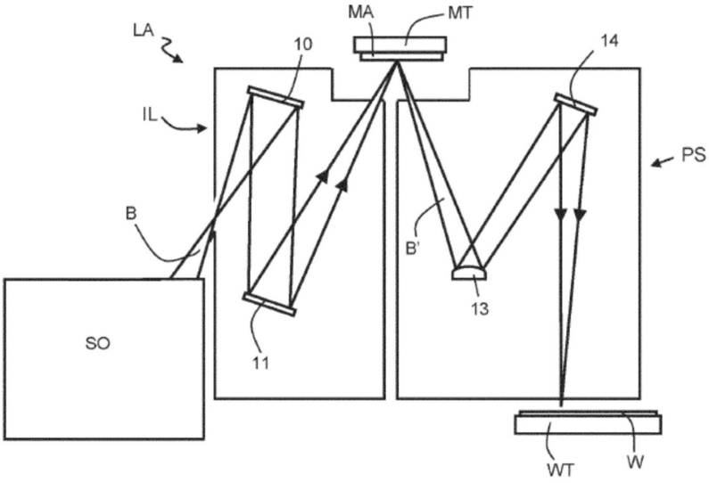

[回看原页](original.pdf#page=18)

图1

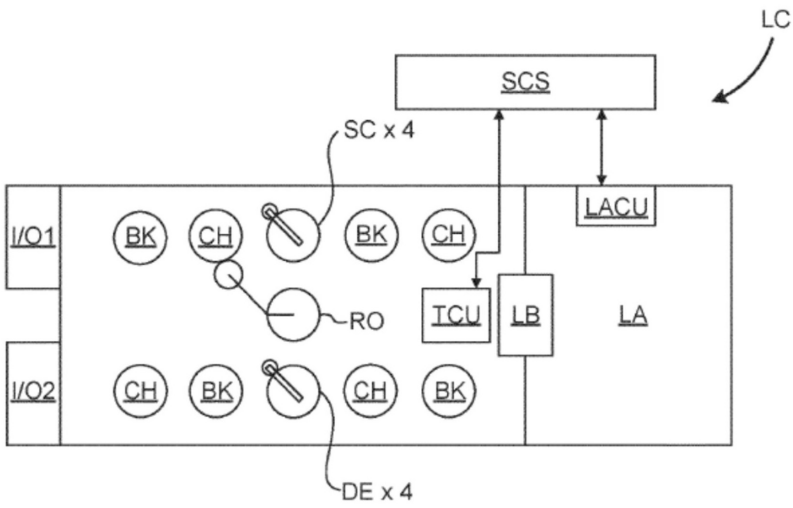

[回看原页](original.pdf#page=18)

图2A

1818

## PDF第19页

[回看原页](original.pdf#page=19)

CN 120344910 A

说　明　书　附　图

2/9 页

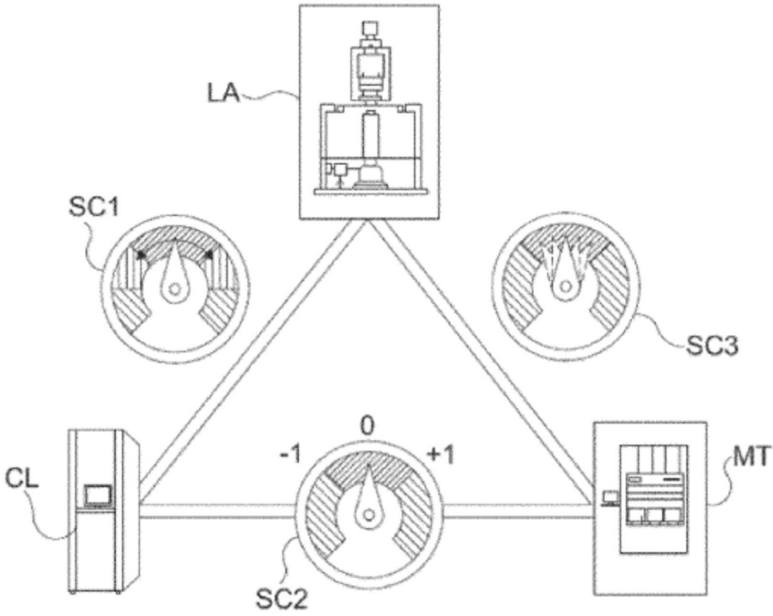

[回看原页](original.pdf#page=19)

图2B

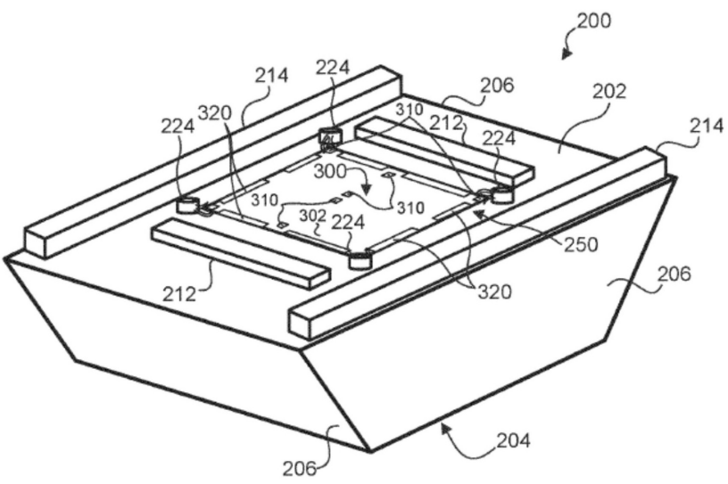

[回看原页](original.pdf#page=19)

图3A

1919

## PDF第20页

[回看原页](original.pdf#page=20)

CN 120344910 A

说　明　书　附　图

3/9 页

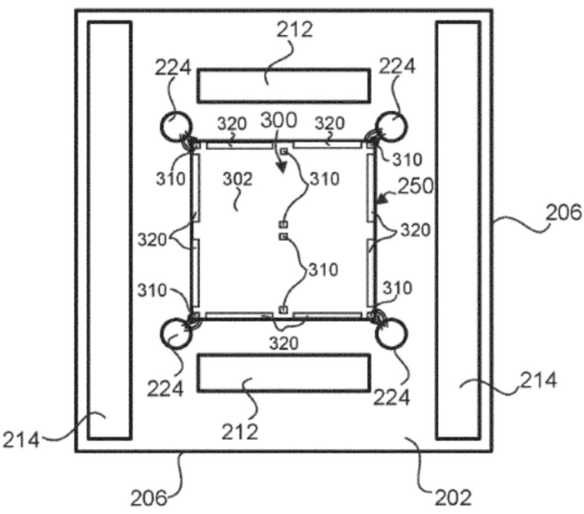

[回看原页](original.pdf#page=20)

图3B

2020

## PDF第21页

[回看原页](original.pdf#page=21)

CN 120344910 A

说　明　书　附　图

4/9 页

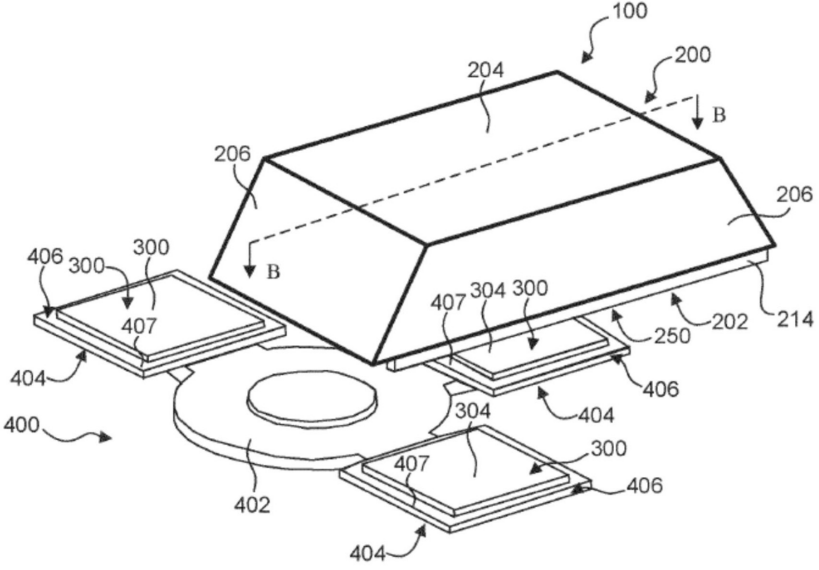

[回看原页](original.pdf#page=21)

图4A

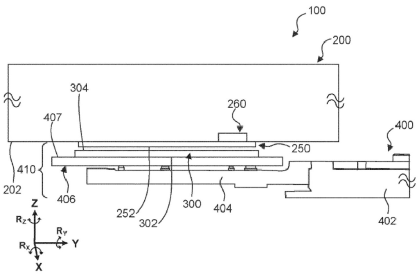

[回看原页](original.pdf#page=21)

图4B

2121

## PDF第22页

[回看原页](original.pdf#page=22)

CN 120344910 A

说　明　书　附　图

5/9 页

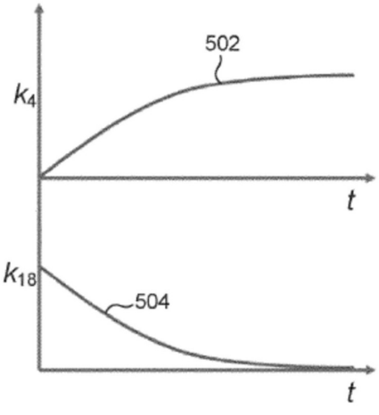

[回看原页](original.pdf#page=22)

图5A

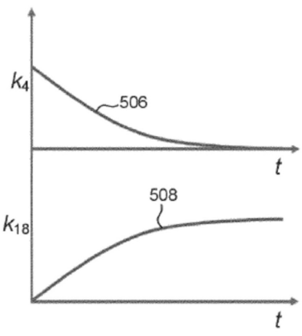

[回看原页](original.pdf#page=22)

图5B

2222

## PDF第23页

[回看原页](original.pdf#page=23)

CN 120344910 A

说　明　书　附　图

6/9 页

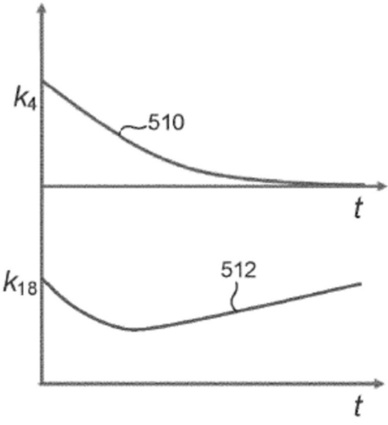

[回看原页](original.pdf#page=23)

图5C

2323

## PDF第24页

[回看原页](original.pdf#page=24)

CN 120344910 A

说　明　书　附　图

7/9 页

[回看原页](original.pdf#page=24)

图6

2424

## PDF第25页

[回看原页](original.pdf#page=25)

CN 120344910 A

说　明　书　附　图

8/9 页

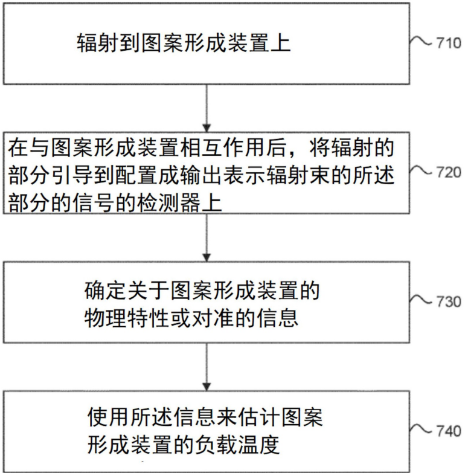

[回看原页](original.pdf#page=25)

图7

2525

## PDF第26页

[回看原页](original.pdf#page=26)

CN 120344910 A

说　明　书　附　图

9/9 页

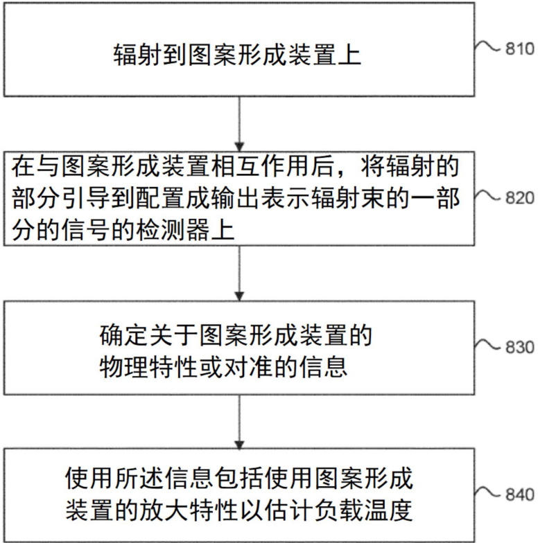

[回看原页](original.pdf#page=26)

图8

2626

