# DE102016205618A1 — Projektionsobjektiv mit Wellenfrontmanipulator, Projektionsbelichtungsverfahren und Projektionsbelichtungsanlage

原件：[PDF](original.pdf)；SHA-256 `b0d416ca7fd787ceb9b076ed7f011d53b3460fa343f661df09d147d9707ed30e`。物理页码从封面计1。

转换：本地MinerU 4.0.12，standard / auto；保留原语言。资料来源与文件校验值见[清单](../manifest.json)。机器输出未逐字校勘，关键文字、公式与图表回看原件。

校核提示（独立于机器提取正文）：[转换质量与已知问题](../QUALITY.md)。

## PDF第1页

[回看原页](original.pdf#page=1)

(19)

[回看原页](original.pdf#page=1)

Deutsches Patent- und Markenamt

[回看原页](original.pdf#page=1)

(10) **DE 10 2016 205 618 A1** 2017.03.30

(12)

**Offenlegungsschrift**

(21) Aktenzeichen: **10 2016 205 618.2**

(22) Anmeldetag: **05.04.2016**

(43) Offenlegungstag: **30.03.2017**

(71) Anmelder: **Carl Zeiss SMT GmbH, 73447 Oberkochen, DE**

(74) Vertreter: **Patentanwälte Ruff, Wilhelm, Beier, Dauster & Partner mbB, 70174 Stuttgart, DE**

(51) Int Cl.: **G03F 7/20** (2006.01)

(72) Erfinder: **Epple, Alexander, 73434 Aalen, DE; Feldmann, Heiko, 73430 Aalen, DE**

(56) Ermittelter Stand der Technik:

**DE 198 24 030 A1**

Prüfungsantrag gemäß § 44 PatG ist gestellt.

**Die folgenden Angaben sind den vom Anmelder eingereichten Unterlagen entnommen**

(54) Bezeichnung: **Projektionsobjektiv mit Wellenfrontmanipulator, Projektionsbelichtungsverfahren und Projektionsbelichtungsanlage**

(57) Zusammenfassung: Ein Projektionsobjektiv (PO) zur Abbildung eines in einer Objektebene (OS) des Projektionsobjektivs angeordneten Musters in eine Bildebene (IS) des Projektionsobjektivs mittels elektromagnetischer Strahlung einer Arbeitswellenlänge λ < 260 nm weist eine Vielzahl von optischen Elementen auf, die entlang einer optischen Achse (OA) angeordnet sind und optische Flächen aufweisen, die in einem Projektionsstrahlengang zwischen der Objektebene (OS) und der Bildebene (IS) derart angeordnet sind, dass ein in der Objektebene angeordnetes Muster mittels der optischen Elemente in die Bildebene abbildbar ist. Weiterhin ist ein Wellenfront-Manipulationssystem (WFM) zur steuerbaren Beeinflussung der Wellenfront der von der Objektebene zur Bildebene verlaufenden Projektionsstrahlung vorgesehen. Das Wellenfront-Manipulationssystem (WFM) weist einer Z-Manipulatorgruppe zur Beeinflussung einer Anzahl AA von Aberrationen auf, welche Rotationssymmetrie in Bezug auf die optische Achse aufweisen, wobei die Z-Manipulatorgruppe durch eine Anzahl MZ von Z-Manipulatoren (ZMAN1, ZMAN1) gebildet ist, die ausgewählte optische Elemente aufweisen, welche mittels zugeordneter Stelleinrichtungen individuell parallel zur optischen Achse verschiebbar sind. Weiterhin weist das Wellenfront-Manipulationssystem (WFM) einen Deformations-Manipulator (DMAN) auf, der ein deformierbares Manipulatorelement (ME) mit einer im Projektionsstrahlengang angeordneten Manipulatorfläche und eine an dem deformierbaren Manipulatorelement (ME) angreifende Stelleinrichtung (DR) zur reversiblen Veränderung von Oberflächenform der Manipulatorfläche aufweist, wobei die Stelleinrichtung dafür konfiguriert ist, an der Manipulatorfläche eine Deformation einzustellen, welche Rotationssymmetrie in Bezug auf die optische Achse (OA) aufweist.

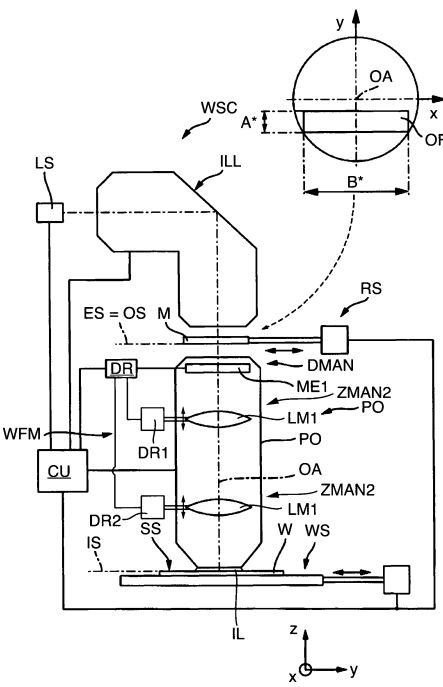

[回看原页](original.pdf#page=1)

## PDF第2页

[回看原页](original.pdf#page=2)

# DE 10 2016 205 618 A1    2017.03.30

## Beschreibung

## ANWENDUNGSGEBIET UND STAND DER TECHNIK

**[0001]** Die Erfindung betrifft ein Projektionsobjektiv zur Abbildung eines in einer Objektebene des Projektionsobjektivs angeordneten Musters in eine Bildebene des Projektionsobjektivs mittels elektromagnetischer Strahlung einer Arbeitswellenlänge λ < 260 nm sowie ein Projektionsbelichtungsverfahren, welches mit Hilfe des Projektionsobjektivs durchgeführt werden kann, und eine Projektionsbelichtungsanlage mit einem solchen Projektionsobjektiv.

**[0002]** Zur Herstellung von Halbleiterbauelementen und anderen feinstrukturierten Bauteilen, wie z.B. Photo lithographie-Masken, werden heutzutage überwiegend mikrolithographische Projektionsbelichtungsverfahren eingesetzt. Dabei werden Masken (Retikel) oder andere Mustererzeugungseinrichtungen verwendet, die das Muster einer abzubildenden Struktur tragen oder bilden, z.B. ein Linienmuster einer Schicht (Layer) eines Halbleiterbauelementes. Das Muster wird in einer Projektionsbelichtungsanlage zwischen einem Beleuchtungssystem und einem Projektionsobjektiv im Bereich der Objektebene des Projektionsobjektivs positioniert und mit einer vom Beleuchtungssystem bereit gestellten Beleuchtungsstrahlung beleuchtet. Die durch das Muster veränderte Strahlung läuft als Projektionsstrahlung durch das Projektionsobjektiv, welches das Muster auf das zu belichtende Substrat (z.B. einen Wafer aus Halbleitermaterial) in verkleinertem Maßstab abbildet. Die Oberflä che des Substrats ist in der zur Objektebene optisch konjugierten Bildebene des Projektionsobjektivs angeordnet. Das Substrat ist in der Regel mit einer strahlungsempfindlichen Schicht (Resist, Photolack) beschichtet.

**[0003]** Eines der Ziele bei der Entwicklung von Projektionsbelichtungsanlagen besteht darin, Strukturen mit zunehmend kleineren Abmessungen auf dem Substrat lithographisch zu erzeugen. Kleinere Strukturen führen z.B. bei Halbleiterbauelementen zu höheren Integrationsdichten, was sich im Allgemeinen günstig auf die Leistungsfähigkeit der hergestellten mikrostrukturierten Bauelemente auswirkt.

**[0004]** Die Größe der erzeugbaren Strukturen hängt maßgeblich vom Auflösungsvermögen des verwendeten Projektionsobjektivs ab und lässt sich einerseits durch Verringerung der Wellenlänge der für die Projektion verwendeten Projektionsstrahlung und andererseits durch Erhöhung der im Prozess genutzten bildseitigen numerischen Apertur NA des Projektionsobjektivs steigern.

**[0005]** Hochauflösende Projektionsobjektive arbeiten heutzutage bei Wellenlängen von weniger als 260 nm im tiefen Ultraviolettbereich (DUV) oder im extremen Ultraviolettbereich (EUV).

**[0006]** Um bei Wellenlängen aus dem tiefen Ultraviolettbereich (DUV) eine ausreichende Korrektur von Aberrationen (z.B. chromatischen Aberrationen, Bildfeldkrümmung) zu gewährleisten, werden meist katadioptrische Projektionsobjektive verwendet, welche sowohl transparente refraktive optische Elemente mit Brechkraft (Linsen), als auch reflektive Elemente mit Brechkraft, also gekrümmte Spiegel, enthalten. Typischerweise ist mindestens ein Konkavspiegel enthalten. Hier erreicht man heutzutage mit der Immersionslithographie bei NA = 1.35 und λ = 193 nm Auflösungsvermögen, die eine Projektion von 40 nm großen Strukturen ermöglichen.

**[0007]** Neben den intrinsischen Aberrationen (Abbildungsfehlern), die ein Projektionsobjektiv aufgrund seiner optischen Auslegung (seines optischen Designs) und der Herstellung aufweisen kann, können Aberrationen auch während der Nutzungsdauer, z.B. während des Betriebs einer Projektionsbelichtungsanlage beim Anwender, auftreten. Solche Aberrationen haben häufig ihre Ursache in Veränderungen der im Projektionsobjektiv verbauten optischen Elemente durch die bei der Nutzung verwendete Projektionsstrahlung.

**[0008]** Beispielsweise kann die Projektionsstrahlung zu einem gewissen Teil von den optischen Elementen im Projektionsobjektiv absorbiert werden, was durch deren Aufheizung zu Deformationen und/oder Brechzahländerungen optischer Elemente führen kann, die die Abbildungsleistung beeinträchtigen. Dieser Problemkreis wird häufig unter dem Stichwort „lens heating“ behandelt.

**[0009]** Auch andere interne oder externe Störungen können zur Verschlechterung der Abbildungsleistung führen. Hierzu gehören unter anderem ein eventueller Maßstabsfehler der Maske, Veränderungen des Luftdrucks in der Umgebung, Unterschiede in der Stärke des Gravitationsfeldes zwischen dem Ort der ursprünglichen Objektivjustage und dem Ort der Nutzung beim Kunden, Brechzahländerungen und/oder Formveränderungen von optischen Elementen aufgrund von Materialveränderungen durch hochenergetische Strahlung (z.B. Kompaktierung), Deformationen aufgrund von Relaxationprozessen in den Halteeinrichtungen, das Driften optischer Elemente und ähnliches.

2/72

## PDF第3页

[回看原页](original.pdf#page=3)

DE 10 2016 205 618 A1    2017.03.30

**[0010]** Man versucht üblicherweise, während der Service-Lebensdauer auftretende Aberrationen, insbesondere die während des Betriebs auftretenden Aberrationen, durch Verwendung von Manipulatoren mindestens teilweise zu kompensieren. Der Begriff „Manipulator“ bezeichnet hierbei u.a. optomechanische oder optoelektronische Einrichtungen, die dafür eingerichtet sind, aufgrund entsprechender Steuersignale eines Betriebs-Steuerungssystems auf einzelne optische Elemente oder Gruppen von optischen Elementen aktiv einzuwirken, um deren optische Wirkung zu verändern, insbesondere so zu verändern, dass eine auftretende Aberration wenigstens teilweise kompensiert wird.

**[0011]** Zu den Aberrationen, die die Abbildungsqualität stark beeinträchtigen können, zählen unter anderem solche Aberrationen bzw. Abbildungsfehler, welche eine Rotationssymmetrie in Bezug auf die optische Achse des Projektionsobjektivs aufweisen. Diese Aberrationen werden im Rahmen dieser Anmeldung auch als „Rotationssymmetrie-Aberrationen“ bezeichnet. Beispielsweise führt ein falsch (d.h. abweichend von vorgegebenen optischen Design) eingestellter Luftraum (Zwischenraum zwischen aufeinander folgenden Linsen) oder ein falsch gefertigter Linsenradius (Krümmungsradius einer Linsenfläche) in der Regel zu einem Defokus, einer Änderung des Abbildungsmaßstabs, aber auch zu sphärischer Aberration, Koma und Astigmatismus (außerhalb der optischen Achse).

**[0012]** Rotationssymmetrie-Aberrationen werden bei herkömmlichen Projektionsobjektiven in der Regel mit Hilfe sogenannter Z-Manipulatoren korrigiert. Zu den Z-Manipulatoren gehören z.B. ausgewählte optische Elemente (typischerweise Linsen) des Projektionsobjektivs, welche mittels zugeordneter Stelleinrichtungen individuell axial, d.h. parallel zur optischen Achse, verschoben werden können. Die Fassungstechnik dieser optischen Elemente muss so ausgelegt sein, dass dieser Starrkörperfreiheitsgrad einer linearen Bewegung möglich ist. Weiterhin müssen entsprechende Stelleinrichtungen mit Aktuatoren und ggf. Sensoren vorgesehen sein. Auch Verlagerungen der Maske (Retikel) und des Substrats parallel zur optischen Achse können zur Korrektur rotationssymmetrischer Aberrationen beitragen.

**[0013]** Erfahrungsgemäß wird die Anzahl der für ein bestimmtes Korrekturszenario erforderlichen Z-Manipulatoren größer, je mehr Aberrationen gleichzeitig auf ein für die Abbildungsqualität nicht mehr schädliches Ausmaß reduziert werden sollen. Dies ist unter anderem dadurch bedingt, dass jede zum Zweck der Korrektur einer bestimmten Aberration eingeführte Verlagerung eines optischen Elementes auch andere, sekundäre Aberrationen einführen kann, die durch Gegenmaßnahmen mit Hilfe eines oder mehrerer weiterer Manipulatoren wieder korrigiert werden sollten. Es wird daher als günstig angesehen, wenn die Anzahl der unabhängig voneinander steuerbaren Z-Manipulatoren mindestens so groß ist wie die Anzahl der gleichzeitig zu korrigierenden Rotationssymmetrie-Aberrationen. Hierdurch kann eine Unterbestimmtheit vermieden werden, bei der allenfalls Ausgleichslösungen für ein Korrekturproblem möglich sind. Entsprechend nimmt die mechanische Komplexität des Projektionsobjektivs zu, je mehr Rotationssymmetrie-Aberrationen gleichzeitig zu korrigieren sind.

## AUFGABE UND LÖSUNG

**[0014]** Es ist eine Aufgabe der Erfindung, ein Projektionsobjektiv bereitzustellen, welches eine hohe Korrekturfähigkeit für Rotationssymmetrie-Aberrationen aufweist und dennoch einen nur mäßig komplexen mechanischen Aufbau hat und zu relativ günstigen Kosten bereitgestellt werden kann. Es ist eine weitere Aufgabe, ein Projektionsbelichtungsverfahren und eine Projektionsbelichtungsanlage bereitzustellen, die es erlauben, rotationssymmetrische Aberrationen effizient zu korrigieren.

**[0015]** Diese Aufgabe wird gelöst durch ein Projektionsobjektiv mit den Merkmalen von Anspruch 1 sowie durch ein Projektionsbelichtungsverfahren mit den Merkmalen von Anspruch 16 und eine Projektionsbelichtungsanlage mit den Merkmalen von Anspruch 18. Vorteilhafte Weiterbildungen sind in den abhängigen Ansprüchen angegeben. Der Wortlaut sämtlicher Ansprüche wird durch Bezugnahme zum Inhalt der Beschreibung gemacht.

**[0016]** Im Allgemeinen ist es gewünscht, für die Betriebsphase eines Projektionsobjektivs gewisse Aberrationen gezielt ändern zu können. Ein Grund hierfür ist durch den Betrieb bei Realbedingungen gegeben. Zu den Aberrationen, die die Abbildungsqualität stark beeinträchtigen können, zählen Aberrationen, welche eine Rotationssymmetrie in Bezug auf die optische Achse des Projektionsobjektivs aufweisen (Rotationssymmetrie-Aberrationen).

**[0017]** Beispielsweise zeigen Projektionsobjektive der hier betrachteten Art meist eine Sensitivität bezüglich des Luftdrucks. Ändert sich dieser beispielsweise im Rahmen des normalen Wettergeschehens, so sollte die Projektionsoptik geringfügig modifiziert werden, um wieder zu einer (im Rahmen der Toleranzen) aberrations-

3/72

## PDF第4页

[回看原页](original.pdf#page=4)

DE 10 2016 205 618 A1    2017.03.30

freien Konfiguration zu gelangen. Die durch Luftdruckänderungen beeinflussbaren Aberrationen werden im Rahmen dieser Anmeldung auch als „pressure induced aberrations (Abkürzung: PIA) bezeichnet. Zu den durch Luftdruckänderungen beeinflussbaren Aberrationen gehören vornehmlich Defokus, Abbildungsmaßstab, Koma, Feldkrümmung, Astigmatismus, Verzeichnung und Dreiwelligkeit, sowie noch weitere Aberrationen höherer Ordnung. Sie entstehen in einem charakteristischen Verhältnis zueinander, welches sich von Design zu Design unterscheiden kann.

**[0018]** Des Weiteren können sich durch den Betrieb Systemeigenschaften, wie beispielsweise der Abbildungsmaßstab, die Verzeichnung ändern oder es entsteht sphärische Aberration, etwa durch die Aufheizung und damit verbundenen Ausdehnung des Retikels und/oder der optischen Elemente des Projektionsobjektivs (lens heating). Auch diese Beeinträchtigungen sollten während des Betriebs korrigiert werden können.

**[0019]** Geänderte Betriebsbedingungen sowie eine nicht völlig ebene Topographie der Substratoberfläche führen häufig auch zur Forderung nach einer Möglichkeit der Veränderung der Feldkrümmung. Die Feldkrümmung kann im Wesentlichen als ein Defokus beschrieben werden, der quadratisch mit der Feldkoordinate (d.h. mit dem radialen Abstand des Feldpunkts von der optischen Achse) ansteigt. Der Defokus wird in der Regel durch Z4 angegeben. Somit variiert Z4 quadratisch mit dem Abstand des Feldpunkts von der optischen Achse. In hochaperturigen Systemen gehören zu diesem Defokus strenggenommen auch noch Terme sphärischer Aberration höherer Ordnung im festen Verhältnis zueinander, nämlich Z9, Z16, Z25 .... Dieser charakteristische Aberrationstyp wird hier auch als „Quadratische Feldkrümmung“ bezeichnet und mit FC2 abgekürzt.

**[0020]** Um derartigen Problemen begegnen zu können weist das Projektionsobjektiv ein Wellenfront-Manipulationssystem zur steuerbaren Beeinflussung der Wellenfront der von der Objektebene zur Bildebene des Projektionsobjektives verlaufenden Projektionsstrahlung auf. Die Wirkung der im Projektionsstrahlengang angeordneten Komponenten des Wellenfront-Manipulationssystems lässt sich in Abhängigkeit von Steuersignalen einer Steuereinrichtung variabel einstellen, wodurch die Wellenfront der Projektionsstrahlung gezielt verändert werden kann. Die optische Wirkung des Wellenfront-Manipulationssystems kann z.B. bei bestimmten, vorab definierten Anlässen oder situationsabhängig vor einer Belichtung oder auch während einer Belichtung geändert werden.

**[0021]** Vorzugsweise sollen einzelne Eigenschaften des Systems während des Scanvorgangs kontrolliert und korrigiert werden können, so etwa die Fokuslage, die ggf. auch über das Bildfeld hinweg variieren kann (Bildfeldkipp bzw. sogar Bildfeldkrümmung). Dies kann einer nur unzulänglichen Perfektion der Substratoberfläche geschuldet sein. Bei entsprechender Dynamik der Manipulatoren ist dies möglich.

**[0022]** Das Wellenfront-Manipulationssystem weist eine Z-Manipulatorgruppe zur Beeinflussung einer Anzahl von Aberrationen auf, die Rotationssymmetrie in Bezug auf die optische Achse aufweisen. Derartige Aberrationen werden im Folgenden auch als Rotationssymmetrie-Aberrationen bezeichnet. Die Z-Manipulatorgruppe wird durch eine Anzahl von Z-Manipulatoren gebildet, die ausgewählte optische Elemente aufweisen, welche mittels zugeordneter Stelleinrichtungen individuell parallel zur optischen Achse verschiebbar sind. Ein Z-Manipulator kann beispielsweise eine axial (parallel zur optischen Achse) verschiebbare Linse oder einen axial verschiebbaren Spiegel aufweisen.

**[0023]** Zusätzlich weist das Wellenfront-Manipulationssystem (mindestens) einen Deformations-Manipulator auf, der ein deformierbares Manipulatorelement mit einer im Projektionsstrahlengang angeordneten Manipulatorfläche sowie eine an dem deformierbaren Manipulatorelement angreifende Stelleinrichtung zur reversiblen Veränderung der Oberflächenform der Manipulatorfläche aufweist. Die Stelleinrichtung ist dafür konfiguriert, an der Manipulatorfläche eine Deformation einzustellen, welche in Bezug auf die optische Achse Rotationssymmetrie aufweist.

**[0024]** Ein Manipulator ist vorzugsweise gemeinsam mit einem oder mehreren Sensoren in einen geschlossenen Regelkreis (closed loop control) eingebunden, so dass eine Regelung von zu beeinflussenden Größen möglich ist.

**[0025]** Der beanspruchten Erfindung liegt unter anderem die Erkenntnis zugrunde, dass bei Verwendung mindestens eines derartigen Deformations-Manipulators in Kombination mit einer Anzahl von Z-Manipulatoren die Anzahl von Z-Manipulatoren, welche typischerweise erforderlich wäre, um bestimmte Rotationssymmetrie-Aberrationen ausreichend zu korrigieren, gegenüber Systemen ohne einen solchen Deformations-Manipulator reduziert werden kann. Ein Deformations-Manipulator dieser Art kann einen Z-Manipulator oder mehrere Z-Manipulatoren setzen, beispielsweise zwei Z-Manipulatoren oder drei Z-Manipulatoren. Anders ausgedrückt

4/72

## PDF第5页

[回看原页](original.pdf#page=5)

DE 10 2016 205 618 A1    2017.03.30

kann der Deformations-Manipulator so betrieben werden, dass seine Korrekturwirkung auf Rotationssymmetrie-Aberrationen der Korrekturwirkung von zwei oder mehr herkömmlichen Z-Manipulatoren im Wesentlichen entspricht. Durch Verwendung mindestens eines Deformations-Manipulators wird somit Einsparpotenzial bei den Z-Manipulatoren geschaffen, so dass das Wellenfront-Manipulationssystem insgesamt gegebenenfalls weniger komplex und kostengünstiger als ein herkömmliches Wellenfront-Manipulationssystem vergleichbarer Korrekturfähigkeit, aber mit einer höheren Anzahl von Z-Manipulatoren aufgebaut sein kann.

**[0026]** Durch Verwendung mindestens eines Deformations-Manipulators der angegebenen Art können Restfehler in Projektionsobjektiven in manchen Fällen deutlich verringert werden. Es ist gegebenenfalls auch möglich, bei gleichbleibendem Restfehlerniveau die Anzahl der für eine bestimmte Aberrationssituation erforderlichen Z-Manipulatoren zu verringern.

**[0027]** Um eine hinreichende Korrektur der für eine Projektionsbelichtung kritischen Rotationssymmetrie-Aberrationen zu ermöglichen, werden herkömmliche Wellenfront-Manipulationssysteme üblicherweise so aufgebaut, dass die Anzahl MZ von Z-Manipulatoren mindestens so groß ist wie die Anzahl AA der zu beeinflussenden Aberrationen. Um das Auftreten parasitärer Aberrationen aufgrund von Z-Manipulatoren zu unterdrücken, sind häufig mehr Z-Manipulatoren vorgesehen, als es der Anzahl der zu beeinflussenden Aberrationen entspricht. Demgegenüber sind manche Ausführungsformen der beanspruchten Erfindung dadurch gekennzeichnet, dass die Z-Manipulatorgruppe durch eine Anzahl NZ von Z-Manipulatoren gebildet ist, die geringer ist als die Anzahl AA der zu beeinflussenden Rotationssymmetrie-Aberrationen, so dass die Bedingung MZ < AA gilt.

**[0028]** Manche Ausführungsformen zeichnen sich dadurch aus, dass die Z-Manipulatorgruppe aus drei oder weniger als drei Z-Manipulatoren besteht, so dass MZ < 3 gilt.

**[0029]** Bei den Aberrationen, welche Rotationssymmetrie in Bezug auf die optische Achse aufweisen, kann es sich um eine oder mehrere Aberrationen der folgenden Gruppe handeln:

(a) Quadratische Feldkrümmung (FC2)

(b) Abbildungsmaßstab (Beta), charakterisierbar durch Zernike-Koeffizient Z2/Z3, linear in der Feldkoordinate;

(c) Durch Druckänderung induzierte Aberrationen (Pressure)

(d) Verzeichnung dritter oder höherer Ordnung, charakterisierbar durch Zernike-Koeffizient Z2/Z3, kubisch in der Feldkoordinate;

(e) Konstante sphärische Aberration (Spherical), charakterisierbar durch Zernike-Koeffizient Z9;

(f) Kombination aus Feldkrümmung und Astigmatismus (FCAst), charakterisierbar durch Zernike-Koeffizienten Z4 und Z5/Z6.

**[0030]** Vorzugsweise ist das Projektionsobjektiv bzw. dessen Wellenfront-Manipulationssystem so ausgelegt, dass gleichzeitig mindestens zwei der oben genannten Aberrationen ausreichend korrigiert werden können. Vorzugsweise können durch eine Manipulation gleichzeitig mindestens drei, mindestens vier oder mindestens fünf der obigen Aberrationen ausreichend korrigiert werden.

**[0031]** Um zum Beispiel mindestens fünf der oben genannten Aberrationen gleichzeitig zu korrigieren, reichen bei manchen Ausführungsbeispielen maximal vier Z-Manipulatoren aus. Bei manchen Varianten reichen sogar nur drei Z-Manipulatoren oder zwei Z-Manipulatoren.

**[0032]** Es kann auch sein, dass beispielsweise nur vier der genannten Aberrationen typischerweise beim Betrieb des Projektionsobjektivs in kritischem Ausmaß auftreten können. In diesem Fall kann es ausreichen, wenn die Z-Manipulatorengruppe nur drei oder nur zwei Z-Manipulatoren aufweist.

**[0033]** Gemäß einer Weiterbildung weist das Projektionsobjektiv einen Deformations-Manipulator auf, der ein deformierbares Manipulatorelement in Form einer verbiegbaren transparenten Platte aufweist. Das deformierbare Manipulatorelement kann im nicht deformierten Zustand eine transparente Planplatte sein, die zerstö- rungsfrei elastisch verbiegbar ist. Es hat sich gezeigt, dass an derartigen plattenförmigen Manipulatorelementen eine Deformation, welche Rotationssymmetrie in Bezug auf die optische Achse aufweist, sich bei geeigneter Plattendicke mit hoher Genauigkeit präzise und reproduzierbar einstellen lässt. Bei einer Verbiegung bzw. Deformation einer Planplatte kann an einer Strahleintrittsseite ein Gradient auftreten, der eine strahlablenkende Wirkung besitzt. In guter Näherung wird die gegenüberliegende Austrittsseite der Platte mit demselben Profil verbogen. Infolge der endlichen Dicke der Platte kompensieren sich jedoch die Deformationen der Eintrittsseite und der Austrittsseite in der Regel nicht vollständig, so dass in Summe eine aberrationseinführende Wirkung verbleibt, die für Korrekturzwecke genutzt werden kann.

5/72

## PDF第6页

[回看原页](original.pdf#page=6)

DE 10 2016 205 618 A1    2017.03.30

**[0034]** In Abhängigkeit von der Anordnung im Strahlengang kann ein Manipulatorelement bei gleicher Deformation unterschiedliche optische Wirkung haben. Bei manchen Ausführungsbeispielen ist das deformierbare optische Element, insbesondere eine Planplatte, im Projektionsstrahlengang zwischen der Objektebene des Projektionsobjektivs und einer ersten mit Brechkraft ausgestatteten Linse des Projektionsobjektivs angeordnet. Unter diesen Bedingungen lassen sich die für eine bestimmte Aberrationskorrektur erforderlichen Deformationen a priori gut bestimmen, da das Manipulatorelement dann in einem korrigierten Luftraum insbesondere ohne Kaustik sitzt. Auch andere Positionen entlang des Projektionsstrahlengangs können nützlich sein, beispielsweise eine Anordnung an oder in der Nähe einer Pupillenebene oder in einem intermediären Bereich zwischen einer Feldebene und einer Pupillenebene.

**[0035]** Bei dem Projektionsobjektiv kann es sich um ein dioptrisches Projektionsobjektiv handeln, welches ausschließlich Linsen zur Strahlbeeinflussung aufweist. Heutzutage werden zur Erzielung höchster Auflösungen häufig katadioptrische Projektionsobjektive verwendet, die zusätzlich zu einer in der Regel relativ großen Anzahl von Linsen (beispielsweise mehr als 10 oder mehr als 15 Linsen) noch einen oder mehrere abbildende Spiegel, insbesondere mindestens einen Konkavspiegel, aufweisen. Um eine Abbildung ohne Pupillenobskuration zu erreichen, haben Projektionsobjektive gemäß bevorzugter Ausführungsbeispiele ein außerhalb der optischen Achse liegendes effektives Objektfeld mit einem Aspektverhältnis größer 2:1 zwischen einer längeren und einer kürzeren Seite, wobei ein optisch genutzter Bereich des Manipulatorelements bei Anordnung in ausreichender Nähe zu einer Feldebene näherungsweise eine Rechteckform mit einem Aspektverhältnis größer 2:1 aufweisen kann.

**[0036]** In diesem Fall kann die Stelleinrichtung dafür konfiguriert sein, entlang der längeren Seite eine Deformation hoher Ordnung (beispielsweise dritter Ordnung (kubisch) oder noch höherer Ordnung) sowie entlang der kürzeren Seite eine Deformation mit einem quadratischen Profil einzustellen. Hierdurch ist es möglich, auch bei einer Anordnung des optisch genutzten Nutzbereich außerhalb der optischen Achse die gewünschte Deformation der Manipulatorfläche, welche eine Rotationssymmetrie in Bezug auf die optische Achse aufweist, reproduzierbar mit vergleichsweise einfach aufgebauten Stelleinrichtungen zu erzielen.

**[0037]** Die Stelleinrichtung kann insbesondere dafür konfiguriert sein, an der Manipulatorfläche eine Deformation niedriger Ordnung einzustellen, welche im Wesentlichen durch ein zur optischen Achse rotationssymmetrisches Polynomprofil mit sechster radialer Ordnung (Z4, Z9, Z16) beschreibbar ist.

**[0038]** Es ist auch möglich, dass das Projektionsobjektiv einen Deformations-Manipulator aufweist, der ein deformierbares Manipulatorelement in Form eines aktiv deformierbaren Spiegels aufweist. Es kann sich beispielsweise um einen Konkavspiegel eines katadioptrischen Projektionsobjektivs handeln. Die Stelleinrichtung kann so konfiguriert sein, dass die Spiegelfläche des Spiegels rotationssymmetrisch zur optischen Achse deformierbar ist.

**[0039]** Manche Klassen katadioptrischer Projektionsobjektive zeichnen sich dadurch aus, dass sie einen Konkavspiegel besitzen, der im Bereich einer Pupillenfläche des Projektionsobjektivs angeordnet ist. Bei manchen Ausführungsbeispielen bildet dieser Spiegel das deformierbare Manipulatorelement, es handelt sich also um einen aktiven konkaven Pupillenspiegel.

**[0040]** Das Wellenfront-Manipulationssystem kann einen einzigen Deformationsmanipulator aufweisen, z.B. mit einer deformierbaren Platte oder einem deformierbaren Spiegel. Hierdurch können Aufwand und Kosten für die Bereitstellung der Korrekturfähigkeit eines Deformationsmanipulators begrenzt werde. Es ist auch möglich, mehrere Deformationsmanipulatoren zu kombinieren, z.B. zwei unabhängig voneinander ansteuerbare Deformationsmanipulatoren. Es können z.B. zwei deformierbare Platten oder zwei deformierbare Spiegel vorgesehen sein oder eine Kombination mit einer deformierbaren Platte und einem deformierbaren Spiegel. Hierdurch erhöhen sich die Flexibilität und die Korrekturfähigkeit, allerdings bei höheren Bereitstellungskosten.

**[0041]** Besondere Vorteile bieten Wellenfront-Manipulationssysteme der hier beschriebenen Art bei hochauflösenden katadioptrischen Projektionsobjektiven, insbesondere solchen, die zwischen Objektebene und Bildebene mindestens ein reelles Zwischenbild erzeugen.

**[0042]** Vorzugsweise hat das Projektionsobjektiv einen ersten Objektivteil zur Abbildung eines Objektfeldes in ein erstes reelles Zwischenbild, einen zweiten Objektivteil zur Erzeugung eines zweiten reellen Zwischenbildes mit der von dem ersten Objektivteil kommenden Strahlung, sowie einen dritten Objektivteil zur Abbildung des zweiten reellen Zwischenbildes in die Bildebene. Derartige dreigliedrige Projektionsobjektive können höchste bildseitige numerische Aperturen NA nahe 1 oder (bei Immersionsobjektiven) größer als 1 bei ausreichendem

6/72

## PDF第7页

[回看原页](original.pdf#page=7)

DE 10 2016 205 618 A1    2017.03.30

Korrekturzustand bieten. Derartige Projektionsobjektive können mit einer einzigen geradlinigen durchgehenden optischen Achse (ungefaltete bzw. in-line-Konfiguration) oder als gefaltetes Projektionsobjektiv aufgebaut sein. Ein gefaltetes Projektionsobjektiv kann beispielsweise so aufgebaut sein, dass der zweite Objektivteil ein katadioptrischer Objektivteil mit einem Konkavspiegel ist, wobei ein erster Faltungsspiegel zur Umlenkung der von der Objektebene kommenden Strahlung in Richtung des Konkavspiegels und ein zweiter Faltungsspiegel zur Umlenkung der von dem Konkavspiegel kommenden Strahlung in Richtung der Bildebene vorgesehen ist. Projektionsobjektiv dieses Typs sind beispielsweise in der EP1 881 520 A1 dargestellt, deren Offenbarungsgehalt insoweit durch Bezugnahme zum Inhalt der vorliegenden Beschreibung gemacht wird. Projektionsobjektive mit einer geradlinigen durchgehenden optischen Achse sind beispielhaft in der WO 2005/069055 A2 gezeigt, deren Offenbarungsgehalt insoweit zum Inhalt der vorliegenden Beschreibung gemacht wird.

**[0043]** Die Erfindung betrifft auch ein Projektionsbelichtungsverfahren zur Belichtung eines strahlungsempfindlichen Substrats mit mindestens einem Bild eines Musters einer Maske, wobei ein Projektionsobjektiv gemäß der beanspruchten Erfindung genutzt wird.

**[0044]** Beim Projizieren eines in einem Beleuchtungsbereich liegenden Teils des Musters auf das Bildfeld mithilfe des Projektionsobjektivs bilden alle zur Bilderzeugung im Bildfeld beitragenden Strahlen der Projektionsstrahlung einen Projektionsstrahlengang. Die Wellenfront der von der Objektebene zur Bildebene verlaufenden Projektionsstrahlung wird durch Ansteuerung von Manipulatoren des Wellenfront-Manipulationssystems beeinflusst. Dabei wird eine Anzahl AA von Aberrationen, welche Rotationssymmetrie in Bezug auf die optische Achse aufweisen, dadurch beeinflusst bzw. korrigiert, dass eine Anzahl MZ von ausgewählten optischen Elementen des Projektionsobjektivs mittels zugeordneter Stelleinrichtungen individuell parallel zur optischen Achse verschoben werden und bei einem deformierbaren Manipulatorelement mit einer im Projektionsstrahlengang angeordneten Manipulatorfläche mittels einer an dem deformierbaren Manipulatorelement angreifenden Stelleinrichtung eine Deformation eingestellt wird, welche Rotationssymmetrie in Bezug auf die optische Achse aufweist.

**[0045]** Die Vorgehensweise kann auch so beschrieben werden, dass zum Beeinflussen der Anzahl AA von Aberrationen, welche Rotationssymmetrie in Bezug auf die optische Achse aufweisen, folgende Schritte durchgeführt werden:

Verschieben einer Anzahl MZ von ausgewählten optischen Elementen des Projektionsobjektivs parallel zur optischen Achse mittels zugeordneter Stelleinrichtungen um individuell vorgebbare Stellwege;

Deformieren eines deformierbaren Manipulatorelements (ME) mit einer im Projektionsstrahlengang angeordnete Manipulatorfläche mittels einer an dem deformierbaren Manipulatorelement (ME) angreifenden Stelleinrichtung (DR) derart, dass eine Deformation eingestellt wird, welche Rotationssymmetrie in Bezug auf die optische Achse aufweist,

wobei die Verschiebungen und die Deformation derart aufeinander abgestimmt sind, dass ein Niveau der Aberrationen reduziert wird.

**[0046]** In manchen Fällen kann das Restfehlerniveau von berechneten Rotationssymmetrie-Aberrationen so weit reduziert werden, dass das Restfehlerniveau maximal 5 Mal so groß ist wie das zu dem berechneten „idealen“ Design gehörende Designfehlerniveau. Noch bessere Korrekturgrade können dadurch gekennzeichnet sein, dass das Restfehlerniveau maximal 3 Mal oder sogar nur maximal doppelt so groß ist wie das Designfehlerniveau. Bei einem 1.5 Millilambda-Design sollte danach das Restfehlernieveau vorzugsweise bei maximal 7.5 Millilambda liegen, besser noch bei nicht mehr als 4.5 Millilambda oder nicht mehr als 3 Millilambda.

**[0047]** Die Erfindung betrifft auch eine Projektionsbelichtungsanlage, die mit einem solchen Projektionsobjektiv ausgestattet ist und/oder zur Durchführung des Projektionsbelichtungsverfahrens konfiguriert ist.

## KURZBESCHREIBUNG DER ZEICHNUNGEN

**[0048]** Weitere Vorteile und Aspekte der Erfindung ergeben sich aus den Ansprüchen und aus der nachfolgenden Beschreibung von bevorzugten Ausführungsbeispielen der Erfindung, die nachfolgend anhand der Figuren erläutert sind.

**[0049] Fig.** 1 zeigt eine Mikrolithografie-Projektionsbelichtungsanlage gemäß einem Ausführungsbeispiel der Erfindung;

**[0050] Fig.** 2 zeigt eine schematische Ansicht eines deformierbaren Manipulatorelements;

7/72

## PDF第8页

[回看原页](original.pdf#page=8)

DE 10 2016 205 618 A1    2017.03.30

**[0051] Fig.** 3 zeigt das Manipulatorelement aus **Fig.** 2 bei einer mehrdimensionalen Verbiegung durch Einleitung von Kräften und Momenten;

**[0052] Fig.** 4 zeigt Aberrationen, die sich bei einem Ausführungsbeispiel eines Projektionsobjektivs nach einer Druckänderung um 50 mbar ergeben und die korrigiert werden sollen;

**[0053] Fig.** 5 zeigt die Aberrationen aus **Fig.** 4 nach Durchführung einer Korrektur mittels Ansteuerung von Manipulatoren;

**[0054] Fig.** 6 zeigt in **Fig.** 6A ein Referenzbeispiel eines katadioptrischen Projektionsobjektivs mit sechs Z-Manipulatoren und in **Fig.** 6B ein Diagramm, welches das Niveau von Restaberrationen nach einer Manipulation zur Korrektur von Aberrationen repräsentiert;

**[0055] Fig.** 7 zeigt in **Fig.** 7A das Referenzbeispiel aus **Fig.** 6 mit drei Z-Manipulatoren und in **Fig.** 7B ein Diagramm, welches das Niveau von Restaberrationen nach einer Manipulation zur Korrektur von Aberrationen repräsentiert;

**[0056] Fig.** 8 zeigt in **Fig.** 8A ein Ausführungsbeispiel eines katadioptrischen Projektionsobjektivs mit drei Z-Manipulatoren und einem Deformations-Manipulator und in **Fig.** 8B ein Diagramm, welches das Niveau von Restaberrationen nach einer Manipulation zur Korrektur von Aberrationen repräsentiert;

**[0057] Fig.** 9 zeigt in **Fig.** 9A ein Referenzbeispiel eines katadioptrischen Projektionsobjektivs mit acht Z-Manipulatoren und in **Fig.** 9B ein Diagramm, welches das Niveau von Restaberrationen nach einer Manipulation zur Korrektur von Aberrationen repräsentiert;

**[0058] Fig.** 10 zeigt in **Fig.** 10A ein Ausführungsbeispiel eines katadioptrischen Projektionsobjektivs mit sechs Z-Manipulatoren und einem Deformations-Manipulator und in **Fig.** 10B ein Diagramm, welches das Niveau von Restaberrationen nach einer Manipulation zur Korrektur von Aberrationen repräsentiert;

**[0059] Fig.** 11 zeigt in **Fig.** 11A ein Ausführungsbeispiel eines katadioptrischen Projektionsobjektivs mit fünf Z-Manipulatoren und einem Deformations-Manipulator und in **Fig.** 11B ein Diagramm, welches das Niveau von Restaberrationen nach einer Manipulation zur Korrektur von Aberrationen repräsentiert;

**[0060] Fig.** 12 zeigt in **Fig.** 12A ein Referenzbeispiel eines katadioptrischen Projektionsobjektivs mit sechs Z-Manipulatoren und in **Fig.** 12B ein Diagramm, welches das Niveau von Restaberrationen nach einer Manipulation zur Korrektur von Aberrationen repräsentiert;

**[0061] Fig.** 13 zeigt in **Fig.** 13A ein Ausführungsbeispiel eines katadioptrischen Projektionsobjektivs mit drei Z-Manipulatoren und einem Deformations-Manipulator und in **Fig.** 13B ein Diagramm, welches das Niveau von Restaberrationen nach einer Manipulation zur Korrektur von Aberrationen repräsentiert;

**[0062] Fig.** 14 zeigt in **Fig.** 14A ein Referenzbeispiel eines katadioptrischen Projektionsobjektivs mit sechs Z-Manipulatoren und in **Fig.** 14B ein Diagramm, welches das Niveau von Restaberrationen nach einer Manipulation zur Korrektur von Aberrationen repräsentiert;

**[0063] Fig.** 15 zeigt in **Fig.** 15A ein Ausführungsbeispiel eines katadioptrischen Projektionsobjektivs mit drei Z-Manipulatoren und einem Deformations-Manipulator und in **Fig.** 15B ein Diagramm, welches das Niveau von Restaberrationen nach einer Manipulation zur Korrektur von Aberrationen repräsentiert;

**[0064] Fig.** 16 zeigt in **Fig.** 16A ein Ausführungsbeispiel eines katadioptrischen Projektionsobjektivs mit drei Z-Manipulatoren und einem Deformations-Manipulator und in **Fig.** 16B ein Diagramm, welches das Niveau von Restaberrationen nach einer Manipulation zur Korrektur von Aberrationen repräsentiert;

**[0065] Fig.** 17 zeigt in **Fig.** 17A ein Ausführungsbeispiel eines katadioptrischen Projektionsobjektivs mit drei Z-Manipulatoren und einem Deformations-Manipulator und in **Fig.** 17B ein Diagramm, welches das Niveau von Restaberrationen nach einer Manipulation zur Korrektur von Aberrationen repräsentiert;

**[0066] Fig.** 18 zeigt rotationssymmetrische Deformationsprofile eines feldnahen, transparenten deformierbaren Manipulatorelements, wobei in **Fig.** 18A ein im Wesentlichen parabolisches Profil über die gesamte Flä-

8/72

## PDF第9页

[回看原页](original.pdf#page=9)

DE 10 2016 205 618 A1    2017.03.30

che dargestellt ist und **Fig.** 18B das Profil auf dem tatsächlich genutzten Ausschnitt des Manipulatorelements zeigt; und

**[0067] Fig.** 19 zeigt rotationssymmetrische Deformationsprofile eines feldnahen, transparenten deformierbaren Manipulatorelements, wobei in **Fig.** 19A ein Profil mit Anteilen höherer Ordnungen über die gesamte Fläche dargestellt ist und **Fig.** 19B das Profil auf dem tatsächlich genutzten Ausschnitt des Manipulatorelements zeigt.

## DETAILLIERTE BESCHREIBUNG DER AUSFÜHRUNGSBEISPIELE

**[0068]** In **Fig.** 1 ist ein Beispiel einer Mikrolithografie-Projektionsbelichtungsanlage WSC gezeigt, die bei der Herstellung von Halbleiter-Bauelementen und anderen feinstrukturierten Komponenten einsetzbar ist und zur Erzielung von Auflösungen bis zu Bruchteilen von Mikrometern mit Licht bzw. elektromagnetischer Strahlung aus dem tiefen Ultraviolettbereich (DUV) arbeitet. Als primäre Strahlungsquelle bzw. Lichtquelle LS dient ein ArF-Excimer-Laser mit einer Arbeitswellenlänge λ von ca. 193 nm. Andere UV-Laserlichtquellen, beispielsweise F2-Laser mit 157 nm Arbeitswellenlänge oder KrF-Excimer-Laser mit 248 nm Arbeitswellenlänge sind ebenfalls möglich.

**[0069]** Bei manchen Varianten kann die Arbeitswellenlänge der Lichtquelle über einen gewissen Einstellbereich gezielt variiert werden, z.B. zum Zwecke der Korrektur von Aberrationen.

**[0070]** Ein der Lichtquelle LS nachgeschaltetes Beleuchtungssystem ILL erzeugt in seiner Austrittsfläche ES ein großes, scharf begrenztes und im Wesentlichen homogen ausgeleuchtetes Beleuchtungsfeld, das an die Telezentrie-Erfordernisse des im Lichtweg dahinter angeordneten Projektionsobjektivs PO angepasst ist. Das Beleuchtungssystem ILL hat Einrichtungen zur Einstellung unterschiedlicher Beleuchtungsmodi (Beleuchtungs-Settings) und kann beispielsweise zwischen konventioneller on-axis-Beleuchtung mit unterschiedlichem Kohärenzgrad σ und außeraxialer Beleuchtung (off-axis illumination) umgeschaltet werden. Die außeraxialen Beleuchtungsmodi umfassen beispielsweise eine annulare Beleuchtung oder eine Dipol-Beleuchtung oder eine Quadrupol-Beleuchtung oder eine andere multipolare Beleuchtung. Der Aufbau geeigneter Beleuchtungssysteme ist an sich bekannt und wird daher hier nicht näher erläutert. Die Patentanmeldung US 2007/0165202 A1 (entsprechend WO 2005/026843 A2) zeigt Beispiele für Beleuchtungssysteme, die im Rahmen verschiedener Ausführungsformen genutzt werden können. Der Offenbarungsgehalt dieser Patentanmeldung wird insoweit durch Bezugnahme zum Inhalt dieser Beschreibung gemacht.

**[0071]** Diejenigen optischen Komponenten, die das Licht der Lichtquelle LS empfangen und aus dem Licht Beleuchtungsstrahlung formen, die auf das in der Austrittsebene ES liegende Beleuchtungsfeld bzw. auf das Retikel M gerichtet ist, gehören zum Beleuchtungssystem ILL der Projektionsbelichtungsanlage.

**[0072]** Hinter dem Beleuchtungssystem ist eine Einrichtung RS zum Halten und Manipulieren der Maske M (Retikel) so angeordnet, dass das am Retikel angeordnete Muster PAT im Bereich der Objektebene OS des Projektionsobjektives PO liegt, welche mit der Austrittsebene ES des Beleuchtungssystems zusammenfällt und hier auch als Retikelebene OS bezeichnet wird. Die Maske ist parallel zu dieser Ebene zum Scannerbetrieb in einer Scan-Richtung (y-Richtung) senkrecht zur optischen Achse OA (z-Richtung) mit Hilfe eines Scanantriebs bewegbar.

**[0073]** Die Einrichtung RS umfasst eine integrierte Hubeinrichtung, um die Maske in Bezug auf die Objektebene in z-Richtung, also senkrecht zur Objektebene, linear zu verfahren, sowie eine integrierte Kippeinrichtung zur Verkippung der Maske um eine in x-Richtung verlaufende Kippachse.

**[0074]** Hinter der Retikelebene OS folgt das Projektionsobjektiv PO, das als Reduktionsobjektiv wirkt und ein Bild des an der Maske M angeordneten Musters in reduziertem Maßstab, beispielsweise im Maßstab 1:4 (│β│ = 0.25) oder 1:5 (│β│ = 0.20), auf ein mit einer Fotoresistschicht bzw. Fotolackschicht belegtes Substrat W abbildet, dessen lichtempfindliche Substratoberfläche SS im Bereich der Bildebene IS des Projektionsobjektivs PO liegt.

**[0075]** Das zu belichtende Substrat, bei dem es sich im Beispielsfall um einen Halbleiterwafer W handelt, wird durch eine Einrichtung WS gehalten, die einen Scannerantrieb umfasst, um den Wafer synchron mit dem Retikel M senkrecht zur optischen Achse OA in einer Scanrichtung (y-Richtung) zu bewegen.

9/72

## PDF第10页

[回看原页](original.pdf#page=10)

DE 10 2016 205 618 A1    2017.03.30

**[0076]** Die Einrichtung WS umfasst weiterhin eine Hubeinrichtung, um das Substrat in Bezug auf die Bildebene in z-Richtung linear zu verfahren, sowie eine Kippeinrichtung zur Verkippung des Substrats um eine in x-Richtung verlaufende Kippachse.

**[0077]** Die Einrichtung WS, die auch als „Waferstage“ bezeichnet wird, sowie die Einrichtung RS, die auch als „Retikelstage“ bezeichnet wird, sind Bestandteil einer Scannereinrichtung, die über eine Scan-Steuereinrichtung gesteuert wird, welche bei der Ausführungsform in die zentrale Steuereinrichtung CU der Projektionsbelichtungsanlage integriert ist.

**[0078]** Das vom Beleuchtungssystem ILL erzeugte Beleuchtungsfeld definiert das bei der Projektionsbelich tung genutzte effektive Objektfeld OF. Dieses ist im Beispielsfall rechteckförmig, hat eine parallel zur Scanrichtung (y-Richtung) gemessene Höhe A\* und eine senkrecht dazu (in x-Richtung) gemessene Breite $B ^ { \star }   \geq   \mathsf { A } ^ { \star }$ Das Aspektverhältnis $\mathsf { A R } = \mathsf { B } ^ { \star } / \mathsf { A } ^ { \star }$ liegt in der Regel zwischen 2 und 10, insbesondere zwischen 3 und 6. Das effektive Objektfeld liegt mit Abstand in y-Richtung neben der optischen Achse (off-axis Feld bzw. außeraxiales Feld). Das zum effektiven Objektfeld optisch konjugierte effektive Bildfeld in der Bildfläche IS ist ebenfalls ein außeraxiales Feld und hat die gleiche Form und das gleiche Aspektverhältnis zwischen Höhe B und Breite A wie das effektive Objektfeld, die absolute Feldgröße ist jedoch um den Abbildungsmaßstab ß des Projektionsobjektivs reduziert, d.h. $\mathbf { A } = | \beta | \mathbf { A } ^ { \star }$ und $\mathsf { B } = | \beta | \bar { \mathsf { B } } ^ { \star }$

**[0079]** Wenn das Projektionsobjektiv als Immersionsobjektiv ausgelegt ist und betrieben wird, dann wird im Betrieb des Projektionsobjektivs eine dünne Schicht einer Immersionsflüssigkeit IL durchstrahlt, die sich zwischen der Austrittsfläche des Projektionsobjektivs und der Bildebene IS befindet. Im Immersionsbetrieb sind bildseitige numerische Aperturen NA > 1 möglich. Auch eine Konfiguration als Trockenobjektiv ist möglich, hier ist die bildseitige numerische Apertur auf Werte NA < 1 beschränkt.

**[0080]** Die Projektionsbelichtungsanlage WSC weist ein Betriebs-Steuerungssystem auf, das dafür konfiguriert ist, in Reaktion auf Umwelteinflüsse und sonstige Störungen und/oder auf Basis von gespeicherten Steuerdaten eine zeitnahe Feinoptimierung abbildungsrelevanter Eigenschaften der Projektionsbelichtungsanlage vorzunehmen. Das Betriebs-Steuerungssystem hat hierzu eine Vielzahl von Manipulatoren, die einen gezielten Eingriff in das Projektionsverhalten der Projektionsbelichtungsanlage erlauben. Ein aktiv ansteuerbarer Manipulator enthält ein oder mehrere Stellglieder (bzw. einen oder mehrere Aktoren), deren aktueller Stellwert aufgrund von Steuersignalen des Betriebs-Steuersystems geändert werden kann, indem definierte Stellwertveränderungen vorgenommen werden.

**[0081]** Das Projektionsobjektiv bzw. die Projektionsbelichtungsanlage ist u.a. mit einem Wellenfront-Manipulationssystem WFM ausgestattet, welches dafür konfiguriert ist, die Wellenfront der von der Objektebene OS zur Bildebene IS verlaufenden Projektionsstrahlung steuerbar zu verändern in dem Sinne, dass die optische Wirkung des Wellenfront-Manipulationssystems über Steuersignale eines Betriebs-Steuerungssystems variabel eingestellt werden kann.

**[0082]** Das Wellenfront-Manipulationssystem WFM weist eine Z-Manipulatorgruppe auf, die dafür ausgelegt ist, eine gewisse Anzahl von Aberrationen, welche Rotationssymmetrie in Bezug auf die optische Achse OA aufweisen (Rotationssymmetrie-Aberrationen), gleichzeitig zu beeinflussen. Die Z-Manipulatorgruppe hat mehrere Z-Manipulatoren. Zu jedem Z-Manipulator gehört ein vorab ausgewähltes optisches Element in Form einer Linse, welche mittels einer zugeordneten Stelleinrichtung des Z-Manipulators individuell parallel zur optischen Achse OA verschoben werden kann. In der schematischen **Fig.** 1 sind beispielhaft zwei Z-Manipulatoren ZMAN1, ZMAN2 mit axial verschiebbar gelagerten manipulierbaren Linsen ML1, ML2 und zugehörigen Stelleinrichtungen DR1, DR2 dargestellt. Typischerweise sind mehr als zwei Z-Manipulatoren vorhanden, z.B. drei oder vier Z-Manipulatoren. Die Form der verschiebbaren Linsen, ihre Anordnung im Projektionsstrahlengang (z.B. optische Nähe oder Entfernung zu nächstgelegener Feldebene oder Pupillenebene) und in Bezug auf benachbarte Linsen sowie das Ausmaß der axialen Verschiebung beeinflussen die optische Wirkung des jeweiligen Z-Manipulators.

**[0083]** Das Wellenfront-Manipulationssystem des Ausführungsbeispiels weist zusätzlich zu den Z-Manipulato ren einen Deformations-Manipulator DMAN auf, der ein deformierbares Manipulatorelement ME aufweist, welches beim Beispiel von **Fig.** 1 in unmittelbarer Nähe der Objektebene OS des Projektionsobjektivs im Projektionsstrahlengang angeordnet ist und zwei im Projektionsstrahlengang angeordnete Manipulatorflächen aufweist, deren Oberflächenform mit Hilfe einer Stelleinrichtung DR reversibel verändert werden kann.

10/72

## PDF第11页

[回看原页](original.pdf#page=11)

DE 10 2016 205 618 A1    2017.03.30

**[0084]** Zur weiteren Erläuterung zeigt **Fig.** 2 eine schematische Ansicht eines deformierbaren Manipulatorele ments ME, das in der Nähe der Objektebene zwischen dieser und der ersten mit Brechkraft behafteten Linse des Projektionsobjektivs angeordnet ist.

**[0085]** Das Manipulatorelement ME ist ein elastisch deformierbares plattenförmiges optisches Element bzw. eine Platte aus einem für die Projektionsstrahlung transparenten Material, beispielsweise aus synthetischem Quarzglas (fused silica). Eine der Objektebene OS zugewandte Lichteintrittsseite dient als erste Manipulatorfläche, die gegenüberliegende Lichtaustrittsfläche verläuft im Wesentlichen parallel zur ersten Manipulatorflä- che und wirkt als zweite Manipulatorfläche.

**[0086]** Die Stelleinrichtung umfasst eine Vielzahl von unabhängig voneinander ansteuerbaren Aktuatoren ACT (siehe mit Pfeilen markierte Positionen in **Fig.** 2), die am Rand des plattenförmigen Manipulatorelements ME in der Weise angreifen, dass die Oberflächenform der Manipulatorfläche MS durch elastische Deformation des Manipulatorelements verändert werden kann. Durch die unmittelbare Nähe zu einer Feldebene (hier: Objektebene OS) kann der optisch genutzte Bereich relativ gut durch ein Rechteck beschrieben werden.

**[0087]** Ein strukturell ähnliches Manipulatorelement ist z.B. in der Patentanmeldung US 2014/0268084 A1 offenbart, deren Offenbarung insoweit zum Inhalt der vorliegenden Beschreibung gemacht wird. Dort werden bestimmte Deformationsmöglichkeiten genutzt, um feldabhängige verzeichnungsartige Aberrationen zu korrigieren.

**[0088]** Die Wirkung des deformierbaren Manipulatorelements kann folgendermaßen verstanden werden. Bei einer Verbiegung, die in **Fig.** 2 und **Fig.** 3 schematisch dargestellt ist, weist die Oberseite der Platte (erste Manipulatorfläche) wenigstens lokal einen Gradienten auf, der eine strahlablenkende Wirkung besitzt. In guter Näherung wird die Unterseite der Platte (zweite Manipulatorfläche) mit demselben Profil verbogen. Durch die endliche Dicke der Platte kompensieren sich dadurch die Deformationen der Ober- und der Unterseite nicht vollständig, so dass in Summe eine aberrationseinführende Wirkung verbleibt, insbesondere, wenn sich das Manipulatorelement im nicht-kollimierten Projektionsstrahl befindet.

**[0089]** Die Aktuatoren ACT können sowohl Kräfte als auch Momente in die Platte einbringen. Dies ist in **Fig.** 3 schematisiert dargestellt. Somit kann z.B. über eine große Anzahl von Aktuatoren entlang der x-Richtung (längere Seite) ein Profil hoher Ordnung erzeugt werden, während über Kräfte und Momente in y-Richtung (kürzere Seite) z.B. ein quadratisches Profil eingestellt werden kann.

**[0090]** Besondere Aspekte der Ausführungsbeispiele beziehen sich auf die Korrektur von Aberrationen mit Hilfe von Manipulatoren des Wellenfront-Manipulationssystems. Im Bereich der geometrischen Optik werden üblicherweise Zernike-Polynome benutzt, um Wellenfronten zu repräsentieren, die wiederum die Aberrationen (Abbildungsfehler) von optischen Systemen beschreiben. Die einzelnen Aberrationen können dabei durch die Koeffizienten der Zernike-Polynome, also die Zernike-Koeffizienten bzw. deren Werte (in [nm]), beschrieben werden. In der hier gewählten Repräsentation, die z.B. der in dem Optik-Design-Programm CODE V verwendeten Fringe-Sortierung entspricht (vgl. CODE V 10.4 Reference Manual Appendix C, Table 2, repräsentieren z.B. die Zernike-Koeffizienten Z2 und Z3 die Verkippung einer Wellenfront in x-Richtung bzw. y-Richtung, wodurch ein verzeichnungsartiger Fehler entsteht. Der Zernike-Koeffizient Z4 beschreibt eine Krümmung der Wellenfront, wodurch ein Defokusfehler beschreibbar ist. Die Zernike-Koeffizienten Z5 und Z6 beschreiben jeweils eine sattelförmige Deformation der Wellenfront und somit den Astigmatismus-Anteil einer Wellenfrontdeformation (in unterschiedlichen Orientierungen). Die Zernike-Koeffizienten Z7 und Z8 stehen für Koma, der Zernike-Koeffizient Z9 für (primäre) sphärische Aberration und die Zernike-Koeffizienten Z10 und Z11 für Dreiwelligkeit. Die Zernike-Koeffizienten Z16, Z25, Z36 etc. beschreiben sphärische Aberration höherer Ordnungen.

**[0091]** Zernike-Koeffizienten können auch zur mathematischen Beschreibung der Deformationen von deformierbaren Manipulatorflächen genutzt werden (vgl. Beschreibung im Zusammenhang mit **Fig.** 18 und **Fig.** 19)

**[0092]** Zur Beschreibung von Auswirkungen einer Korrektur der Abbildungseigenschaften mittels Manipulatoren werden anhand zahlreicher Beispiele katadioptrischer Projektionsobjektive quantitative Angaben zur Güte der Korrektur gemacht. Die Vorgehensweise wird anhand der **Fig.** 4 und **Fig.** 5 beispielhaft erläutert. **Fig.** 4 veranschaulicht Aberrationen, die sich nach einer Druckänderung um 50 mbar ergeben und die korrigiert werden sollen. **Fig.** 5 veranschaulicht dieselben Aberrationen nach Durchführung der Korrektur mittels Ansteuerung von Manipulatoren.

11/72

## PDF第12页

[回看原页](original.pdf#page=12)

DE 10 2016 205 618 A1    2017.03.30

**[0093]** Die hier betrachteten katadioptrischen Projektionsobjektive werden mit einem außeraxialen Rechteckfeld (effektives Objektfeld OF) verwendet. In **Fig.** 4 ist oben die Geometrie des runden Objektfeldes mit tatsächlich genutztem Rechteckfeld dargestellt. Insbesondere die Objektfeldmitte, d.h. der Durchstoßpunkt der optischen Achse OA durch das Objektfeld, gehört nicht zum abgebildeten Bereich des Objektfeldes, d.h. zum effektiven Objektfeld. In dieser Anmeldung bezeichnet der Begriff „optische Achse“ eine gerade Linie oder eine Folge von geraden Linienabschnitten durch die Krümmungsmittelpunkte der optischen Elemente. Die optische Achse kann durchgehend geradlinig verlaufen oder ggf. an Faltungsspiegeln (Umlenkspiegeln) oder anderen reflektierenden Flächen gefaltet werden.

**[0094]** Soll die Abbildungsleistung des Projektionsobjektivs gezielt modifiziert werden, so werden für jeden Feldpunkt des Designs Zielwerte für die Aberrationen vorgegeben. Für das Beispiel einer Druckkorrektur (Korrektur von Aberrationen, die durch Luftdruckänderungen generiert werden) ist dies in der **Fig.** 4 dargestellt. Dabei ist die Korrektur nach einzelnen Zernike-Koeffizienten entwickelt worden. Da das Projektionsobjektiv eine Meridionalsymmetrie aufweist, sind die Aberrationen in der Figur lediglich für die rechte Hälfte des Rechteckfeldes dargestellt. Die linke Hälfte weist entsprechend spiegelbildlich dieselben Aberrationen auf.

**[0095]** In der linken Spalte der Figur sind Forderungen an die Werte für die sphärischen Zernike-Koeffizienten Z4, Z9 und Z16 grafisch als Verteilung über das halbe Objektfeld dargestellt. Aus der Legende der Figur ist zu erkennen, dass zur Kompensation einer Druckvariation von 50 mbar sphärische Werte von Z4 = 2290 ... 2320 nm, Z9 = 528 nm und Z16 = 172 nm, mit leichten Feldvariationen, erzeugt werden müssten.

**[0096]** In der mittleren Spalte sind die einwelligen Störungen Verzeichnung (Z2/3), Koma (Z7/8) und Koma höherer Ordnung (Z14/15) angegeben. In der rechten Spalte sind die Werte für Astigmatismus (Z5/6), Astigmatismus höherer Ordnung (Z12/13) sowie Dreiwelligkeit (Z10/11) angegeben.

**[0097]** Die Gesamtheit der hier dargestellten Aberrationen wird hier auch als „pressure induced aberrations“bzw. PIA bezeichnet.

**[0098]** Nach der Anwendung der Manipulatorkorrektur, also nach Verstellen der Manipulatoren, wird der Restfehler bestimmt. Dies geschieht, indem von der erhaltenen Wellenfront die Wellenfront des Ausgangsdesigns abgezogen wird. Bei einer idealen Korrektur träten nun in keinem der Schaubilder Restaberrationen auf, im realen Fall verbleiben jedoch kleine Restaberrationen, wie in der **Fig.** 5 gezeigt ist.

**[0099]** Aus diesen Restaberrationen kann nun ein gesamter rms-Wert der zugehörigen Wellenaberration berechnet werden. Dieser gilt in dieser Anmeldung als Maßzahl für die Güte der durchgeführten Korrektur und ist zu minimieren. Der rms-Wert wird in Einheiten der Wellenaberration, also entweder „nm“ oder „MilliLambda“ (mλ) angegeben, wobei λ die Lichtwellenlänge, also im Beispiel rund 193 nm, bezeichnet.

**[0100]** In den **Fig.** 4 und **Fig.** 5 sind die Aberrationen auf dem halben außeraxialen Rechteckfeld dargestellt. Das Aspektverhältnis der Darstellung entspricht dabei nicht dem Aspektverhältnis des Objektfelds. Denkt man sich die Feldmitte (auf der optischen Achse) jeweils unterhalb der linken unteren Ecke der Kästchen dazu, so erkennt man die Rotationssymmetrie der Aberrationsverläufe bezüglich der optischen Achse: Feldpunkte mit gleichem Abstand zur optischen Achse haben dieselben Aberrationen, korrigiert um den Azimutwinkel des Feldpunktes. Derartige Aberrationen werden hier als „Rotationssymmetrie-Aberrationen“ bezeichnet.

**[0101]** Nachfolgend werden einige Ausführungsbeispiele und Referenzbeispiele angegeben, um Funktionen, Besonderheiten und Vorteile des hier beschriebenen Konzepts der Manipulation zu dokumentieren. Dazu wird in den Figuren jeweils in einer ersten Teilfigur („A“) das optische Design eines Projektionsobjektivs in einer Abbildung (meridionaler Linsenschnitt) wiedergegeben, in welchem die parallel zur optischen Achse verschiebbaren manipulierten Linsenelemente der Z-Manipulatoren durch Schraffur markiert sind. Die Spezifikationen der in den Zeichnungsfiguren gezeigten Ausführungsbeispiele (und eines Referenzbeispiels) sind in Tabellen angegeben, deren Nummerierung jeweils der Nummerierung der entsprechenden Zeichnungsfigur entspricht. Die Tabellen finden sich am Ende der Beschreibung.

**[0102]** Die jeweils zum Vergleich herangezogenen Referenzbeispiele, für die bis auf eine Ausnahme (**Fig.** 9A, M230a) keine Spezifikationen angegeben sind, unterscheiden sich nur geringfügig von den zugeordneten Ausführungsbeispielen. Art und Abfolge von Linsen bleiben jeweils gleich. Es können sich z.B. die Brechkräfte und Durchbiegungen der einzelnen Linsen von Design zu Design (d.h. vom Ausführungsbeispiel zum zugehörigen Referenzbeispiel) ändern, um die Sensitivitäten (d.h. die Abhängigkeiten der Aberrationen von der Linsenver-

12/72

## PDF第13页

[回看原页](original.pdf#page=13)

DE 10 2016 205 618 A1    2017.03.30

schiebung) den Notwendigkeiten anzupassen. Ferner ändert sich häufig auch die Manipulator-Auswahl, d.h. welche Linsen genutzt werden sollten, um eine gewünschte Aberration möglichst gut einstellen zu können.

**[0103]** In einer darunter gezeigten zweiten Teilfigur („B“) sind für die diskutierten Aberrationen, die mit den Manipulatoren eingestellt bzw. verändert werden sollen, die sogenannten rms-Restfehler, d.h. die Abweichung der Aberrationen von den gewünschten Zielwerten, in Form eines Diagramms graphisch angegeben. Die Einheit an der mit „Milliwaves“ bezeichneten Ordinate ist MilliLambda (mλ). Für eine perfekte Korrektur sollte dieser Restfehler, wie oben ausgeführt, verschwinden. Die Bezeichnungen an der Abszisse der Diagramme sind wie folgt zu verstehen:

Design: Optisches Design (idealer Aufbau des Projektionsobjektivs)

FC2: Quadratische Feldkrümmung

Beta: Abbildungsmaßstab, charakterisierbar durch Zernike-Koeffizient Z2/Z3, linear in der Feldkoordinate

Pressure: Durch Druckveränderung induzierte Aberrationen

Disto: Verzeichnung dritter oder höherer Ordnung, charakterisierbar durch Zernike-Koeffizient Z2/Z3, kubisch in der Feldkoordinate

Spherical: Konstante sphärische Aberration, charakterisierbar durch Zernike-Koeffizient Z9

FCAst: Kombination aus Feldkrümmung und Astigmatismus, charakterisierbar durch Zernike-Koeffizienten Z4 und Z5/Z6.

**[0104]** Man könnte diese Liste noch um Koma, charakterisierbar durch Zernike-Koeffizient Z7/Z8, linear mit der Feldhöhe variierend, ergänzen, wodurch alle Seidel-Aberrationen erfasst wären.

**[0105] Fig.** 6 zeigt in **Fig.** 6A als Referenzbeispiel ein katadioptrisches Projektionsobjektiv REF-6, das als Immersionsobjektiv für eine Arbeitswellenlänge von ca. 193 nm ausgelegt ist. Es ist dafür vorgesehen, ein in seiner Objektebene OS angeordnetes Muster einer Maske in reduziertem Maßstab, beispielsweise im Maßstab 4: 1, auf seine parallel zur Objektebene ausgerichtete Bildebene IS abzubilden. Dabei werden zwischen Objektebene und Bildebene genau zwei reelle Zwischenbilder IMI1, IMI2 erzeugt. Ein erster, refraktiver (dioptrischer) Objektivteil OP1 ist so ausgelegt, dass das Muster der Objektebene in vergrößerndem Maßstab in das erste Zwischenbild IMI1 abgebildet wird. Ein zweiter, reflektiver (katoptrischer) Objektivteil OP2 bildet das erste Zwischenbild IMI1 in das zweite Zwischenbild IMI2 im Wesentlichen ohne Größenänderung (Abbildungsmaßstab ca. 1:1) ab. Ein dritter, refraktiver (dioptrischer) Objektivteil OP3 ist dafür ausgelegt, das zweite Zwischenbild IMI2 mit starker Verkleinerung in die Bildebene IS abzubilden. Dabei wird im Betrieb des Projektionsobjektivs eine dünne Schicht einer Immersionsflüssigkeit I durchstrahlt, die sich zwischen der Austrittsfläche des Projektionsobjektivs und der Bildebene IS befindet.

**[0106]** Der zweite Objektivteil OP2 besteht aus einem ersten Konkavspiegel CM1 mit einer zur Objektebene OS zeigenden konkaven Spiegelfläche und einem zweiten Konkavspiegel CM2 mit einer zur Bildebene IS weisenden, konkaven Spiegelfläche. Die erste und zweite Spiegelfläche sind Teile von rotationssymmetrischen Krümmungsflächen mit einer gemeinsamen Symmetrieachse, die mit den koaxial zueinander angeordneten optischen Achsen des ersten Objektivteils OP1 und des dritten Objektivteils OP3 zusammenfällt. Daher ist das gesamte Projektionsobjektiv 100 rotationssymmetrisch und hat eine einzige, gerade, ungefaltete optische Achse OA, die allen refraktiven und reflektiven optischen Elementen gemeinsam ist.

**[0107]** Zwischen der Objektebene und dem ersten Zwischenbild, zwischen dem ersten und dem zweiten Zwischenbild sowie zwischen dem zweiten Zwischenbild und der Bildebene liegen jeweils Pupillenflächen P1, P2 und P3 des Projektionsobjektivs dort, wo der Hauptstrahl CR der optischen Abbildung die optische Achse schneidet. Die Pupillenfläche P2 innerhalb des katadioptrischen zweiten Objektivteils liegt in relativ großem optischen Abstand zu den Konkavspiegeln CM1, CM2 im Mittelbereich des katadioptrischen Hohlraums, so dass alle Konkavspiegel optisch entfernt von einer Pupillenfläche in einem Bereich liegen, in dem die Hauptstrahlhöhe der Abbildung die Randstrahlhöhe der Abbildung übersteigt. Im Bereich der Pupillenfläche P3 des dritten Objektivteils OP3 ist die Aperturblende AS des Systems angebracht.

**[0108]** Katadioptrische Projektionsobjektive dieses Grundaufbaus sind beispielsweise in der WO 2005/069055 A2 der Anmelderin gezeigt. Die Offenbarung dieser Anmeldung wird durch Bezugnahme zum Inhalt der vorliegenden Beschreibung gemacht.

13/72

## PDF第14页

[回看原页](original.pdf#page=14)

DE 10 2016 205 618 A1    2017.03.30

**[0109]** Beim Referenzbeispiel (Projektionsobjektiv PO-6) von **Fig.** 6 wurden die in **Fig.** 6B angegebenen Aberrationen (d.h. ohne Feldkrümmung FC2) mithilfe von sechs Z-Manipulatoren des Projektionsobjektivs sowie einer Bewegung der Maske und einer Bewegung des Substrats parallel zur optischen Achse korrigiert. Das nach der Optimierung verbleibende Restfehlerniveau ist in **Fig.** 6B dargestellt. Der Restfehler von ca. 2 mλ für das optische Design zeigt, dass es selbst bei einem idealen Design nicht möglich war, die Wellenfrontfehler über das gesamte Feld (für alle Feldpunkte) vollständig zu korrigieren. Die Balkenhöhe repräsentiert die Abweichung der wahren Wellenfront von der Kugelwelle gemittelt über alle Feldpunkte. Das Restfehlerniveau der fünf berechneten Rotationssymmetrie-Aberrationen liegt jeweils im Bereich unterhalb von 2.5 mλ, was hier als sehr gute Korrektur angesehen wird.

**[0110]** Es wurde versucht, ein ähnlich gutes Restfehlerniveau mit weniger als sechs Z-Manipulatoren zu erzielen. In **Fig.** 7B ist für dasselbe Design wie in **Fig.** 6A eine beste Auswahl mit nur drei Z-Manipulatoren (drei Positiv-Linsen im ersten Objektivteil zwischen Objektebene und erster Pupillenebene) gezeigt. Es zeigt sich, dass das Restfehlerniveau deutlich schlechter ist als im Fall von sechs Z-Manipulatoren. Dies ist verständlich, da die Anzahl der Freiheitsgrade für die Korrektur von fünf Rotationssymmetrie-Aberrationen zu gering ist. Man achte hier insbesondere auf die geänderte Skalierung der Ordinate. Der resultierende Restfehler im Abbildungsmaßstab (Beta) liegt bei ca. 40 mλ, also mehr als eine Größenordnung oberhalb des Restfehlerniveaus beim Beispiel von **Fig.** 6.

**[0111]** Zum Vergleich ist in **Fig.** 8A ein Projektionsobjektiv PO-8 (Bezeichnung M232a) als Ausführungsbeispiel gemäß der beanspruchten Erfindung zusammen mit dem Restfehlerniveau in **Fig.** 8B gezeigt. Das Projektionsobjektiv hat einen ähnlichen optischen Aufbau (z.B. Art und Abfolge von Linsen) wie das Referenzbeispiel in **Fig.** 7.

**[0112]** Im Projektionsobjektiv sind nur drei Z-Manipulatoren (MZ = 3) vorgesehen, nämlich eine axial verschiebbare Positiv-Linse L1-3 vor der ersten Pupillenfläche und zwei axial verschiebbare Positiv-Linsen L3-5 und L3-8) im dritten Objektivteil vor und hinter der Aperturblende AS. Als zusätzlicher Manipulator ist der Deformationsmanipulator DMAN mit dem rotationssymmetrisch manipulierbaren Manipulatorelement ME in Form einer dünnen Planplatte zwischen Objektebene OS und erster Linse L1-1 vorgesehen (vgl. **Fig.** 2 und **Fig.** 3).

**[0113]** Zur Optimierung des Restfehlerniveaus wurden die drei Z-Manipulatoren gemeinsam mit der rotationssymmetrischen Deformation des Manipulatorelements gerechnet. Das in **Fig.** 8B gezeigte Restfehlerniveau ist gegenüber der reinen Dreierauswahl (Auswahl von nur drei Z-Manipulatoren) aus **Fig.** 7 dramatisch gesunken und sogar besser als bei dem Referenzbeispiel mit sechs Z-Manipulatoren in **Fig.** 6. Da das deformierbare Manipulatorelement ME bei jeder der einzustellenden Aberrationen eine gesonderte optimale Durchbiegung aufweist, steigt die Anzahl der Freiheitsgrade der Aberrationskorrektur gegenüber Beispielen ohne Deformationsmanipulator deutlich an und erlaubt eine wesentlich verbesserte Korrektur (gegenüber **Fig.** 7) bzw. eine Reduktion der notwendigen Anzahl von Z-Manipulatoren (gegenüber **Fig.** 6).

**[0114]** Bei dem Referenzbeispiel des Projektionsobjektivs REF-9 in **Fig.** 9 werden die zu korrigierenden Aberrationen noch um die Feldkrümmung FC2 erweitert, so dass sechs Rotationssymmetrie-Aberrationen zu korrigieren sind. **Fig.** 9A zeigt wieder ein Beispiel ohne Deformationsmanipulator. Um für diesen Fall eine wenigstens annähernd ausreichende Korrektur zu ermöglichen, sind im Beispielsfall insgesamt acht Z-Manipulatoren im Projektionsobjektiv vorgesehen, nämlich drei axial verschiebbare Positiv-Linsen im ersten Objektivteil und fünf axial verschiebbare Linsen im zweiten Objektivteil, darunter eine bikonkave Negativ-Linse.

**[0115]** Diese erhöhte Anzahl von Z-Manipulatoren ist unter anderem dem anspruchsvollen Korrekturszenario der Feldkrümmung mit verbundener Korrektur der Petzvalsumme geschuldet. Um diese zu korrigieren, ist im Beispielsfall über die gezeigten Manipulatoren hinaus noch eine Wellenlängenänderung der Lichtquelle als weitere Manipulationsmöglichkeit genutzt worden. Wie **Fig.** 9B zeigt, sind das Restfehlerniveau sowie die Design-Performance jedoch trotz dieser umfangreichen Korrekturmaßnahmen kaum zufriedenstellend.

**[0116]** In **Fig.** 10 ist zum Vergleich ein Projektionsobjektiv PO-10 (Bezeichnung M236a) als weiteres Ausführungsbeispiel gemäß der beanspruchten Erfindung gezeigt. Bei dem Projektionsobjektiv ist zusätzlich zu einer Anzahl von insgesamt sechs Z-Manipulatoren mit axial verschiebbaren Linsen L1-3, L3-2, L3-5, L3-6, L3-8 und L3-9 noch ein Deformationsmanipulator DMAN mit einem rotationssymmetrisch deformierbaren plattenförmigen Manipulatorelement ME zwischen Objektebene OS und erster Linse L1-1 vorgesehen. Wird eine zur optischen Achse rotationssymmetrische Deformation des Manipulatorelements ME in die Auswahl möglicher Manipulationen einbezogen, so kann die Anzahl der Z-manipulierbaren Linsen im Vergleich zum Referenzbei-

14/72

## PDF第15页

[回看原页](original.pdf#page=15)

DE 10 2016 205 618 A1    2017.03.30

spiel von **Fig.** 9 von acht auf sechs Z-Manipulatoren erniedrigt werden bei gleichzeitig verbessertem Restfehlerpotential.

**[0117] Fig.** 11 zeigt ein weiteres Ausführungsbeispiel (Projektionsobjektiv PO-11, Bezeichnung M239a), bei dem insgesamt sechs Rotationssymmetrie-Aberrationen (inklusive Feldkrümmung FC2) korrigiert wurden (d.h. AA = 6). Hier sind zusätzlich zum rotationssymmetrisch deformierbaren Manipulatorelement ME des Deformationsmanipulators DMAN sogar nur fünf Z-Manipulatoren mit axial verschiebbaren Linsen L1-3, L3-2, L3-6, L3-8, L3-9 erforderlich (d.h. MZ = 5), um ein akzeptables Restfehlerniveau für die sechs hier betrachteten Rotationssymmetrie-Aberrationen (von jeweils weniger als 2.5 mλ) zu erhalten.

**[0118]** Das Konzept der beanspruchten Erfindung kann nicht nur bei Projektionsobjektiven des bisher dargestellten Designtyps (mit einer geradlinig durchgehenden optischen Achse, Inline-Design) genutzt werden, sondern auch bei Projektionsobjektiven mit gefalteter optischer Achse. **Fig.** 12A zeigt ein erstes Referenzbeispiel (Bezeichnung M242) eines derartigen Projektionsobjektivs REF-12. Eine zugehörige Tabelle ist angegeben.

**[0119]** Das Projektionsobjektiv ist dafür vorgesehen, ein in seiner Objektebene OS angeordnetes Muster einer Maske in reduziertem Maßstab, beispielsweise im Maßstab 4:1, auf seine parallel zur Objektebene ausgerichtete Bildebene IS abzubilden. Dabei werden zwischen Objektebene und Bildebene genau zwei reelle Zwischenbilder IMI1, IMI2 erzeugt. Ein erster, refraktiver (dioptrischer) Objektivteil OP1 ist so ausgelegt, dass das Muster der Objektebene im Wesentlichen ohne Größenänderung, in das erste Zwischenbild IMI1 abgebildet wird. Ein zweiter, katadioptrischer Objektivteil OP2 mit einem Konkavspiegel CM bildet das erste Zwischenbild IMI1 auf das zweite Zwischenbild IMI2 im Wesentlichen ohne Größenänderung ab. Ein dritter, refraktiver Objektivteil OP3 ist dafür ausgelegt, das zweite Zwischenbild IMI2 mit starker Verkleinerung in die Bildebene IS abzubilden. Pupillenflächen P1, P2, P3 liegen jeweils dort, wo der Hauptstrahl der optischen Abbildung die optische Achse OA schneidet. Im Bereich der Pupillenfläche P3 des dritten Objektivteils OP3 ist die Aperturblende AS des Systems angebracht. Die Pupillenfläche P2 innerhalb des katadioptrischen zweiten Objektivteils OP2 liegt in unmittelbarer Nähe des Konkavspiegels CM.

**[0120]** Um das von der Objektebene OS zum Konkavspiegel CM verlaufende Strahlbündel von demjenigen Strahlbündel zu trennen, das nach Reflexion am Konkavspiegel zwischen diesem und der Bildebene IS verläuft, sind ebene Umlenkspiegel (Faltspiegel) vorgesehen. Ein ebener erster Umlenkspiegel FM1 dient zur Reflexion der von der Objektebene kommenden Strahlung zum Konkavspiegel CM und ein im rechten Winkel zum ersten Umlenkspiegel FM1 ausgerichteter zweiten Umlenkspiegel FM2 lenkt die vom Konkavspiegel reflektierte Strahlung Richtung Bildebene IS um.

**[0121]** Bei dem Referenzbeispiel von **Fig.** 12 war es möglich, mithilfe von sechs Z-Manipulatoren insgesamt fünf der hier betrachteten Rotationssymmetrie-Aberrationen (ohne Feldkrümmung FC2) auf ein annähernd akzeptables Restfehlerniveau zu bringen (vgl. **Fig.** 12B).

**[0122]** In **Fig.** 13 ist ein vergleichbares Projektionsobjektiv PO-13 (Bezeichnung M243) als Ausführungsbeispiel der beanspruchten Erfindung gezeigt. Hier sind lediglich drei Z-Manipulatoren mit axial verschiebbaren Linsen L1-3 im ersten bzw. L3-2 und L3-11 dritten Objektivteil vorgesehen. Diese Z-Manipulatorengruppe ist ergänzt durch einen Deformationsmanipulator DMAN mit einem rotationssymmetrisch deformierbaren Manipulatorelement ME in unmittelbarer Nähe der Objektebene OS zwischen dieser und der ersten Linse L1-1. Aus **Fig.** 13B ist ersichtlich, dass sich durch diese Manipulatorauswahl und die Einbindung des rotationssymmetrisch deformierbaren Manipulatorelements ME mithilfe von nur drei Z-Manipulatoren ein akzeptables Restfehlerniveau erzielen lässt. Die Verwendung eines deformierbaren Manipulators in Verbindung mit Z-Manipulatoren führt also auch hier zu einer Einsparung von drei Z-Manipulatoren im Vergleich zum Referenzbeispiel von **Fig.** 12.

**[0123] Fig.** 14 zeigt ein Referenzbeispiel eines gefalteten Projektionsobjektivs REF-14, bei dem sich im katadioptrischen zweiten Objektivteil zwischen den Faltungsspiegeln FM1, FM2 und dem Konkavspiegel CM keine Positiv-Linse befindet. Bei dem Beispiel von **Fig.** 14A sind insgesamt sechs Z-Manipulatoren erforderlich, um das Restfehlerniveau aus **Fig.** 14B zu erzielen, bei welchem alle fünf in Betracht gezogenen Rotationssymmetrie-Aberrationen im Bereich von weniger als 2.5 mλ liegen.

**[0124] Fig.** 15 zeigt zum Vergleich ein Projektionsobjektiv PO-15 (Bezeichnung M246) als Ausführungsbeispiel, bei dem die Z-Manipulatorengruppe mit axial verschiebbaren Linsen durch einen Deformationsmanipulator DMAN mit rotationssymmetrisch deformierbarem Manipulatorelement ME unterstützt wird. Die Z-Manipulatorengruppe hat hier nur drei Z-Manipulatoren (MZ = 3, axial verschiebbare Linsen L1-8, L3-10, L3-13),

15/72

## PDF第16页

[回看原页](original.pdf#page=16)

DE 10 2016 205 618 A1    2017.03.30

so dass im Vergleich zum Referenzbeispiel von **Fig.** 4 drei Z-Manipulatoren eingespart werden konnten, um ein insgesamt vergleichbares, sogar leicht verbessertes Restfehlerniveau bei den fünf Rotationssymmetrie-Aberrationen (AA = 5) zu erhalten.

**[0125]** Bei den bisher bildlich dargestellten Beispielen ist das rotationssymmetrisch deformierbare Manipulatorelement jeweils eine für die Arbeitswellenlänge transparente dünne Planplatte, welche mithilfe von Aktoren deformiert werden kann (vgl. **Fig.** 2 und **Fig.** 3). Dieses Manipulatorelement ist jeweils in optischer Nähe einer Feldebene, nämlich der Objektebene, angeordnet. Es gibt andere Möglichkeiten der Realisierung der beanspruchten Erfindung.

**[0126]** Wie bereits erwähnt, hat der gefaltete Designtyp, welcher in den **Fig.** 12 bis **Fig.** 15 beispielhaft dargestellt ist, einen Konkavspiegel, der optisch am Ort der zweiten Pupillenfläche P2 angeordnet ist. Bei den Ausführungsbeispielen der **Fig.** 16 (Projektionsobjektiv PO-16, Bezeichnung M272a) und **Fig.** 17 (Projektionsobjektiv PO-17, Bezeichnung M273a) ist der Konkavspiegel CM jeweils als ein deformierbares Manipulatorelement eines Deformations-Manipulators DMAN ausgelegt, also als ein aktiv deformierbarer Spiegel. Die zugehörigen Aktuatoren ACT sind so ausgelegt und angeordnet, dass der aktive Spiegel bzw. seine Spiegelfläche rotationssymmetrisch zur optischen Achse OA deformiert werden kann. Die Steuereinrichtung ist so konfiguriert, dass geeignete rotationssymmetrische Deformationen der Spiegelfläche eingestellt werden können. Ein Unterschied der beiden Ausführungsbeispiele liegt darin, dass im Beispiel von **Fig.** 16 eine Positiv-Linse L8 im zweiten Objektivteil zwischen dem Faltungsspiegel und dem Konkavspiegel angeordnet ist, während diese beim Ausführungsbeispiel von **Fig.** 17 nicht vorhanden ist.

**[0127]** Da es sich bei den hier interessierenden zu korrigierenden Aberrationen um Rotationssymmetrie-Aberrationen handelt, wurde der Konkavspiegel für die Simulationen nur rotationssymmetrisch deformiert, nämlich mit den Zernike-Koeffizienten Z4, Z9, Z16, Z25, Z36 und Z49.

**[0128]** In beiden Ausführungsbeispielen hat die Z-Manipulatorengruppe jeweils nur drei Z-Manipulatoren mit axial verschiebbaren Linsen. Beim Beispiel von **Fig.** 16 handelt es sich jeweils um Negativ-Linsen L1-5 sowie L3-3 und L3-5, welche im Bereich relativ kleinen Projektionsstrahldurchmessers angeordnet sind. Im Beispiel von **Fig.** 17 handelt es sich jeweils um Positiv-Linsen L1-7, L1-9 und L1-10, welche im Bereich relativ großen Projektionsstrahldurchmessers vor dem ersten Zwischenbild angeordnet sind.

**[0129]** Beide Ausführungsbeispiele belegen, dass es bei Verwendung eines Deformationsmanipulators mit einem rotationssymmetrisch deformierbaren Pupillenspiegel möglich ist, bei den insgesamt fünf hier betrachteten Rotationssymmetrie-Aberrationen das Restfehlerniveau auf einen akzeptablen Wert zu reduzieren, obwohl nur drei Z-Manipulatoren genutzt werden. Die Anzahl der Z-Manipulatoren ist also auch hier geringer als die Anzahl der zu beeinflussenden Aberrationen.

**[0130]** In weiteren Versuchen wurde untersucht, welchen Einfluss die Lage des in der Nähe der Objektebene angeordneten, transparenten deformierbaren Manipulatorelements im Projektionsstrahlengang auf die Effizienz der Manipulatorauswahl hat. Dabei konnte u.a. folgendes festgestellt werden. (i) Die Wirkung des deformierbaren Manipulatorelements hängt praktisch nicht kaum vom Abstand zur Objektebene bzw. einer nächstliegenden Feldebene ab. Das deformierbare Manipulatorelement kann in einem größeren Abstand vom Retikel stehen als die für die Simulationen verwendeten 9 mm. (ii) Das deformierbare Manipulatorelement sollte in einem korrigierten Luftraum stehen, insbesondere direkt hinter der Objektebene bzw. unterhalb des Retikels. Bereits im nächsten Luftraum, d.h. nach der ersten Linse L1, ist die Wirkung des deformierbaren Manipulatorelements geringer. (iii) Das deformierbare Manipulatorelement sollte in einem Luftraum ohne Kaustik stehen.

**[0131]** Die Deformation des deformierbaren Manipulatorelements wurde so simuliert, dass die Oberseite (erste Manipulatorfläche) und die Unterseite (zweite Manipulatorfläche) exakt dieselbe Deformation aufwiesen, wie z.B. in **Fig.** 2 oder **Fig.** 3 gezeigt. Dies erscheint für eine dünne Platte als gute Näherung. Ein Deformationsprofil kann über eine Finite-Element-Analyse unter Kenntnis der Aktuatorenlage sowie der eingebrachten Kräfte und Momente bestimmt werden. Es ist nicht zu erwarten, dass derartige exaktere Rechnungen bzw. eine praktische Realisierung grundsätzlich andere Resultate erbringen als die hier vorgestellten idealisierten Simulationen.

**[0132]** Eine Analyse typischer für die Erreichung der Aberrationen notwendiger Deformationen des deformierbaren Manipulatorelements zeigt unter anderem: (i) Es ist meist ausreichend, das deformierbare Manipulatorelement mit einer Deformation niedriger Ordnung durchzubiegen. In den Beispielen sind rotationssymmetrische Polynomprofile mit 6. radialer Ordnung (entspricht Z4, Z9, Z16) verwendet worden. Die 8. radiale Ordnung (entsprechend Z25) trägt zur Korrektur nicht mehr wesentlich bei. (ii) Es dominiert meist die einfache

16/72

## PDF第17页

[回看原页](original.pdf#page=17)

DE 10 2016 205 618 A1    2017.03.30

Durchbiegung (Z4), die höheren Ordnungen Z9 und Z16 sind dem untergeordnet. (iii) Die Korrekturwirkung hängt praktisch nicht von der Dicke des deformierbaren Manipulatorelements ab. Die für eine Manipulation notwendige Deformation verhält sich umgekehrt proportional zur Plattendicke, d.h. bei doppelt so dicker Platte müsste nur noch eine halb so große Deformation für dieselbe Wirkung eingestellt werden. Somit kann die Dicke eines plattenförmigen deformierbaren Manipulatorelements hinsichtlich der mechanischen Randbedingungen ihrer Realisierung gewählt werden.

**[0133]** Da die hier im Vordergrund stehenden Aberrationen entweder eine Rotationssymmetrie aufweisen oder, wie im Falle der Feldkrümmung FC2, mit einfachen Mitteln auf eine rotationssymmetrische Störung zurückzuführen sind, sind die Deformations-Profile des deformierbaren Manipulatorelements der Einfachheit halber durchweg als rotationssymmetrische Deformationen gerechnet worden. Typische Deformationen sind in den **Fig.** 18 und **Fig.** 19 dargestellt.

**[0134]** Bei den gerechneten Beispielen ist das deformierbare Manipulatorelement in unmittelbarer Nähe zur Objektebene angeordnet und wird somit bei einem rechteckförmigen, außeraxialen effektiven Objektfeld nur auf einem kleinen außeraxialen Schlitz genutzt, der bei ausreichender Nähe zum Retikel etwa der Objektfeldgröße entspricht. Daher weist der optisch genutzte Teil des deformierbaren Manipulatorelements in guter Näherung eine rechteckförmige Berandung auf. Das verwendete Deformationsprofil (**Fig.** 18A, **Fig.** 19A) entspricht also einem rechteckförmigen Ausschnitt aus dem berechneten, rotationssymmetrischen Profil (**Fig.** 18B, **Fig.** 19B).

**[0135]** Vorzugsweise wird die Deformation des deformierbaren Manipulatorelements (der Platte) durch Aktuatoren am Rand der Platte bewerkstelligt, wie z.B. in **Fig.** 3 dargestellt. Dabei können entlang der Plattennormalen sowohl Kräfte (Verformung bzw. Einstellung einer gewissen „Pfeilhöhe“) als auch Momente (Einstellung eines Gradienten am Plattenrand) eingebracht werden.

**[0136]** Werden entlang der langen (x-)Richtung der Platte viele Aktuatoren (z.B. zwischen sechs und zwanzig oder mehr) angebracht, so können diese über die Einbringung von Kräften die Platte in x-Richtung mit hoher Ordnung deformieren. Werden in y-Richtung Kräfte und Momente in die Platte eingebracht, so folgt in y-Richtung eine Verformung mit quadratischem Profil.

**[0137]** Durch den Umstand, dass das deformierbare Manipulatorelement nur auf einem außeraxialen, rechteckförmigen Footprint mit recht hohem Aspektverhältnis (d.h. x-Ausdehnung >> y-Ausdehnung) wirkt, kann das typischerweise auftretende rotationssymmetrische Profil des deformierbaren Manipulatorelements in guter Näherung durch ein XY-Polynom 6 Ordnung in x-Richtung und 2. Ordnung in y-Richtung angenähert werden. Somit kann die notwendige Deformation durch Einbringung von Kräften und Momenten, wie oben beschrieben, hinreichend gut auf dem außeraxialen Ausschnitt des deformierbaren Manipulatorelements angebracht werden.

**[0138]** Nachfolgend werden exemplarisch zwei typische Deformationsprofile des feldnahen, transparenten deformierbaren Manipulatorelements dargestellt. In **Fig.** 18 ist für das Ausführungsbeispiel aus **Fig.** 8 das Profil für die Maßstabsmanipulation gegeben. In **Fig.** 18A ist das Profil über die gesamte Fläche dargestellt, während in **Fig.** 18B das Profil auf dem wirklich genutzten Ausschnitt des Manipulatorelements gezeigt ist. Die Rotationssymmetrie des Profils ist dabei gut zu erkennen.

**[0139]** Es stellt sich heraus, dass das Profil in **Fig.** 18B nahezu perfekt durch das Produkt eines polynomialen Profils (gerader) sechster Ordnung in x sowie quadratischer Ordnung in y beschreibbar ist. Somit lässt es sich mit den weiter oben beschriebenen Aktuatoren zur Einbringung von Kräften (konstanter und linearer Term in y) und Momenten (quadratischer Term in y) gut realisieren. Aus der Abbildung ist gut zu erkennen, dass das Deformationsprofil im Wesentlichen durch einen starken Z4 (parabolische Form) dominiert ist.

**[0140]** In **Fig.** 19 ist ein Profil für die Verzeichnungsmanipulation dargestellt. Betrachtet man eine Variation des Abbildungsmaßstabs als eine Verzeichnung niedrigster Ordnung, so ist zu erwarten, dass die eigentliche Verzeichnung (Verzeichnung 3. Ordnung) zu einer Deformation höherer Ordnung in dem Manipulatorelement führt. Genau dies ist in **Fig.** 19 zu erkennen. Hier macht sich im Profil bereits ein erhöhter Z9 bemerkbar.

**[0141]** Auch dieses Profil ist auf dem außeraxialen Footprint hinreichend gut durch ein Polynom 6. Ordnung in x und 2. Ordnung in y approximierbar, so dass dieses Profil ausreichend gut durch die weiter oben beschriebene Aktuatorenmechanik erzeugt werden kann.

17/72

## PDF第18页

[回看原页](original.pdf#page=18)

DE 10 2016 205 618 A1    2017.03.30

**[0142]** Einige Aspekte wurden anhand von Ausführungsbeispielen mit genau einem Deformationsmanipulator beschrieben, wodurch u.a. das hohe Korrekturpotential dieser Anordnung anschaulich wird. Bei Bedarf können auch zwei oder mehr Deformationsmanipulatoren vorgesehen sein, wodurch ggf. die Anzahl erforderlicher Z-Manipulatoren weiter reduziert werden kann.

**[0143]** In den nachfolgenden Tabellen sind Spezifikationen von Projektionsobjektiven angegeben. Diese sind jeweils durch ihre Bezeichnung (z.B. M235a) identifizierbar. Kürzel NA bezeichnet die bildseitige numerische Apertur, OBH steht für Objekthöhe (also den halben, rotationssymmetrischen Objektfelddurchmesser) und WL bezeichnet die Arbeitswellenlänge, die hier bei ca. 193 nm liegt.

**[0144]** In den Grundtabellen gibt Spalte „SURF“ die Nummer einer brechenden oder auf andere Weise ausgezeichneten Fläche, Spalte „RADIUS“ den Radius r der Fläche (in mm), Spalte „THICK-NESS“ den als Dicke bezeichneten Abstand d der Fläche zur nachfolgenden Fläche (in mm) und Spalte „MATERIAL“ das Material der optischen Komponenten an. Die Spalten „INDEX1“ bis „INDEX3“ zeigt den Brechungsindex des Materials. Die Brechzahlen bei den angegebenen Nebenwellenlängen erlauben es, die bei einer Manipulation der Wellenlänge zu beachtende Dispersion des Materials berechnen zu können. In Spalte „SEMIDIAM.“ sind die nutzbaren, freien Radien bzw. der halbe freie Durchmesser der Linsen (in mm) angegeben. Der Radius r = 0 entspricht einer Planfläche.

**[0145]** Einige optische Flächen sind asphärisch. Die Tabellen mit den Asphärenkoeffizienten geben die entsprechenden Asphärendaten an, wobei sich die asphärischen Flächen nach folgender Vorschrift berechnen: p(h) = [((1/r)h2)/(1 + SQRT(1 – (1 + K)(1/r)2h2))] + C1·h4 + C2·h6 + .

**[0146]** Dabei gibt der Kehrwert c = (1/r) des Radius die Flächenkrümmung und h den Abstand eines Flächenpunktes von der optischen Achse (d.h. die Strahlhöhe) an. Somit gibt p(h) die sogenannte Pfeilhöhe, d.h. den Abstand des Flächenpunktes vom Flächenscheitel in z-Richtung (Richtung der optischen Achse). Die Konstanten K, C1, C2, ... sind in den Tabellen der Ashärenkoeffizienten wiedergegeben.

**[0147]** Die Tabellen mit Manipulatoren geben axialen Verschiebungen (Dezentrierungen DEZ) und Kippungen (TILT, bei gefalteten Designs) sowie die Verfahrwege für die Manipulatoren für Maske (DEZ RET), Substrat (DEZ WAF), ggf. Wellenlänge (WELL), ggf. Zernike-Deformationen der Spiegel und Verfahrwege (DEZ) für die Optikteile (OT) an. Die Optikteile werden ausgehend von der Objektebene gezählt. Als "Optikteil" werden hier alle refraktiven und reflektiven Komponenten bezeichnet, d.h. Planplatten, alle Linsen und alle Hohlspiegel. Ein Planspiegel wird nicht als Optikteil gezählt. Die Z-Manipulatoren sind in den Linsenschnitten schraffiert dargestellt, so dass eine Zuordnung der Optikteilnummer aus der Tabelle zu der Linse im Linsenschnitt gegeben ist.

**[0148]** In den Tabellen zu den Manipulatoren ist für jede der einstellbaren Aberrationen angegeben, um wieviel das jeweilige Element verfahren werden muss. Beispiel: Im Design 235a muss man, um den Abbildungsmaß- stab zu modifizieren, das Retikel (die Maske) um –2.218 µm verfahren, den Wafer (das Substrat) um 0.433 µm, das OT2 um –2.005 µm usw. Dabei sind die Aberrationen in den Verfahrwegen linear, d.h. bei halbem oder negativem Verfahrwegevektor erhält man auch nur halbe oder negative Aberrationen.

18/72

## PDF第19页

[回看原页](original.pdf#page=19)

## DE 10 2016 205 618 A1    2017.03.30

Tabelle M235a

| SURF | RADIUS | THICKNESS | MATERIAL | INDEX1 | INDEX2 | INDEX3 | SEMIDIAM. |
| --- | --- | --- | --- | --- | --- | --- | --- |
|  | 0 | 0,000000 | 9,000000 NITROGEN | 1,000300 | 1,000300 | 1,000300 | 63,8 |
|  | 1 | 0,000000 | 2,000000 SILICA | 1,560800 | 1,560958 | 1,560642 | 67,5 |
|  | 2 | 0,000000 | 19,001984 NITROGEN | 1,000300 | 1,000300 | 1,000300 | 67,5 |
|  | 3 | 166,912644 | 32,127506 SILICA | 1,560800 | 1,560958 | 1,560642 | 82,7 |
|  | 4 | -4198,485078 | 46,824434 NITROGEN | 1,000300 | 1,000300 | 1,000300 | 82,5 |
|  | 5 | 0,000000 | 10,000000 SILICA | 1,560800 | 1,560958 | 1,560642 | 82,5 |
|  | 6 | 0,000000 | 5,105000 NITROGEN | 1,000300 | 1,000300 | 1,000300 | 82,6 |
|  | 7 | 130,750149 | 44,166927 SILICA | 1,560800 | 1,560958 | 1,560642 | 82,6 |
|  | 8 | -699,999782 | 17,504583 NITROGEN | 1,000300 | 1,000300 | 1,000300 | 80,8 |
|  | 9 | 91,146527 | 31,949718 SILICA | 1,560800 | 1,560958 | 1,560642 | 57,7 |
|  | 10 | 2832,495016 | 20,250000 NITROGEN | 1,000300 | 1,000300 | 1,000300 | 48,9 |
|  | 11 | 0,000000 | 10,000000 SILICA | 1,560800 | 1,560958 | 1,560642 | 38,5 |
|  | 12 | 0,000000 | 29,438086 NITROGEN | 1,000300 | 1,000300 | 1,000300 | 41,2 |
|  | 13 | -70,643736 | 15,497684 SILICA | 1,560800 | 1,560958 | 1,560642 | 46,5 |
|  | 14 | -112,977059 | 1,489314 NITROGEN | 1,000300 | 1,000300 | 1,000300 | 57,3 |
|  | 15 | 1513,755358 | 33,973443 SILICA | 1,560800 | 1,560958 | 1,560642 | 68,9 |
|  | 16 | -114,496385 | 266,855665 NITROGEN | 1,000300 | 1,000300 | 1,000300 | 71,7 |
|  | 17 | -176,234841 | -228,015757 REFL | 1,000300 | 1,000300 | 1,000300 | 150,0 |
|  | 18 | 187,514499 | 265,559942 REFL | 1,000300 | 1,000300 | 1,000300 | 133,9 |
|  | 19 | 352,000300 | 43,673239 SILICA | 1,560800 | 1,560958 | 1,560642 | 123,4 |
|  | 20 | 570,028790 | 74,260596 NITROGEN | 1,000300 | 1,000300 | 1,000300 | 122,2 |
|  | 21 | 465,950881 | 10,000086 SILICA | 1,560800 | 1,560958 | 1,560642 | 92,5 |
|  | 22 | 113,204932 | 50,441311 NITROGEN | 1,000300 | 1,000300 | 1,000300 | 83,7 |
|  | 23 | 4371,606505 | 10,081272 SILICA | 1,560800 | 1,560958 | 1,560642 | 84,5 |
|  | 24 | 371,577864 | 83,392331 NITROGEN | 1,000300 | 1,000300 | 1,000300 | 89,5 |
|  | 25 | -1058,246785 | 44,465704 SILICA | 1,560800 | 1,560958 | 1,560642 | 130,3 |
|  | 26 | -189,414255 | 8,466541 NITROGEN | 1,000300 | 1,000300 | 1,000300 | 134,1 |
|  | 27 | -6308,039503 | 57,205462 SILICA | 1,560800 | 1,560958 | 1,560642 | 148,9 |
|  | 28 | -292,312194 | 41,980386 NITROGEN | 1,000300 | 1,000300 | 1,000300 | 152,7 |
|  | 29 | 316,571468 | 58,694910 SILICA | 1,560800 | 1,560958 | 1,560642 | 160,0 |
|  | 30 | -726,768111 | -0,385377 NITROGEN | 1,000300 | 1,000300 | 1,000300 | 159,3 |
|  | 31 | 0,000000 | 3,002266 NITROGEN | 1,000300 | 1,000300 | 1,000300 | 154,4 |
|  | 32 | 199,825220 | 71,292690 SILICA | 1,560800 | 1,560958 | 1,560642 | 145,0 |
|  | 33 | 144222,245490 | 0,805000 NITROGEN | 1,000300 | 1,000300 | 1,000300 | 140,4 |
|  | 34 | 198,201846 | 42,733569 SILICA | 1,560800 | 1,560958 | 1,560642 | 113,9 |
|  | 35 | -2561,189036 | 0,768000 NITROGEN | 1,000300 | 1,000300 | 1,000300 | 107,9 |
|  | 36 | 59,527354 | 53,380318 SILICA | 1,560800 | 1,560958 | 1,560642 | 54,7 |
|  | 37 | 0,000000 | 3,100000 WATER | 1,437000 | 1,437214 | 1,436786 | 24,6 |
|  | 38 | 0,000000 | 0,000000 NITROGEN | 1,000300 | 1,000300 | 1,000300 | 20,9 |

19/72

## PDF第20页

[回看原页](original.pdf#page=20)

DE 10 2016 205 618 A1    2017.03.30

## Tabelle 235a – Asphärenkoeffizienten

| SRF | 3 | 4 | 7 | 8 | 9 |
| --- | --- | --- | --- | --- | --- |
| C1 | 7,300023E-08 | 3,441086E-08 | 1,721788E-08 | -1,588919E-07 | -1,944209E-07 |
| C2 | -9,271741E-12 | 1,163193E-11 | -6,130096E-12 | 6,209693E-11 | 7,541870E-11 |
| C3 | 7,583671E-17 | -3,916174E-15 | 2,029736E-16 | -1,996198E-14 | -2,775255E-14 |
| C4 | 3,806143E-19 | 5,995674E-19 | -1,773292E-19 | 4,589695E-18 | 1,142758E-17 |
| C5 | -1,206622E-22 | -1,351112E-23 | 5,657520E-25 | -7,997569E-22 | -4,094038E-21 |
| C6 | 2,139578E-26 | -7,092701E-27 | 4,329508E-27 | 9,211489E-26 | 1,095386E-24 |
| C7 | -2,229026E-30 | 6,022600E-31 | -1,144940E-30 | -6,178373E-30 | -2,086532E-28 |
| C8 | 9,521820E-35 | -8,513393E-36 | 8,687316E-35 | 1,888314E-34 | 1,739500E-32 |
| SRF | 10 | 14 | 15 | 16 | 17 |
| C1 | 3,683427E-07 | 9,237690E-08 | 2,069678E-08 | 5,202151E-08 | 4,167196E-09 |
| C2 | 2,093214E-11 | 8,574932E-12 | 1,409592E-14 | 4,456893E-12 | 8,489388E-14 |
| C3 | -1,885385E-14 | 4,197985E-16 | 1,161935E-15 | 6,178531E-16 | 9,788548E-19 |
| C4 | 1,708623E-17 | 9,548582E-19 | -3,529201E-19 | -1,427605E-19 | 1,432043E-23 |
| C5 | -1,279579E-20 | -6,869294E-22 | 8,043786E-23 | 9,654010E-23 | 1,989781E-27 |
| C6 | 5,748946E-24 | 2,537387E-25 | -6,838703E-27 | -2,687815E-26 | -8,927953E-32 |
| C7 | -1,728146E-27 | -4,673573E-29 | -5,691988E-32 | 4,423330E-30 | 2,616686E-36 |
| C8 | 2,277925E-31 | 2,771103E-33 | 2,212136E-35 | -2,765149E-34 | -1,630307E-41 |
| SRF | 18 | 19 | 20 | 21 | 22 |
| C1 | -4,142481E-09 | -2,498058E-09 | -1,621219E-07 | 2,717473E-07 | 2,454521E-07 |
| C2 | -1,038733E-13 | 7,575346E-12 | 1,647609E-11 | -5,974525E-11 | -6,160620E-11 |
| C3 | -2,319310E-18 | -7,494635E-16 | -1,987928E-15 | 7,032432E-15 | 5,205271E-15 |
| C4 | -6,781611E-23 | 3,212724E-20 | 1,710055E-19 | -7,999344E-19 | -1,882606E-19 |
| C5 | 1,904668E-28 | 8,101106E-25 | -9,361987E-24 | 6,946457E-23 | -5,949747E-23 |
| C6 | -1,771258E-31 | -1,991931E-28 | 2,997922E-28 | -2,877590E-27 | 1,474861E-26 |
| C7 | 6,647718E-36 | 1,071432E-32 | -4,180629E-33 | -6,793807E-33 | -1,220697E-30 |
| C8 | -1,770766E-40 | -2,008113E-37 | -2,359705E-39 | 2,761818E-36 | 3,231498E-35 |
| SRF | 23 | 24 | 25 | 26 | 27 |
| C1 | -1,946327E-07 | -3,827047E-08 | 1,930333E-08 | 5,170591E-08 | 1,785799E-08 |
| C2 | -2,157770E-11 | -1,853250E-11 | 8,301325E-13 | 5,291385E-13 | -1,909340E-13 |
| C3 | 5,899533E-15 | 6,049062E-15 | -2,547086E-17 | -5,500005E-18 | -9,113921E-17 |
| C4 | -3,709741E-19 | -3,529884E-19 | -9,680696E-21 | 1,743137E-23 | 7,148303E-21 |
| C5 | 5,887518E-24 | -4,022320E-23 | 1,139107E-24 | -1,519885E-25 | -3,355925E-25 |
| C6 | -7,496457E-28 | 8,542751E-27 | -6,657917E-29 | 1,716890E-29 | 1,002148E-29 |
| C7 | 1,874159E-31 | -6,756695E-31 | 2,049455E-33 | -8,393943E-34 | -1,795662E-34 |
| C8 | -1,317955E-35 | 2,101973E-35 | -2,665602E-38 | 1,727460E-38 | 1,456845E-39 |
| SRF | 29 | 30 | 33 | 35 |  |
| C1 | -1,153659E-08 | -1,113266E-09 | 9,907860E-09 | 7,105918E-09 |  |
| C2 | -1,226022E-12 | -1,825583E-13 | 2,107814E-13 | 2,332281E-12 |  |
| C3 | 4,567538E-17 | -9,524013E-18 | -6,113948E-17 | -9,340346E-17 |  |
| C4 | -1,854992E-21 | 6,727377E-22 | 1,301249E-21 | 4,044305E-21 |  |
| C5 | 8,976218E-26 | 3,620392E-27 | 8,870788E-26 | -7,797618E-26 |  |
| C6 | -1,851284E-30 | -8,866794E-31 | -4,610647E-30 | 7,680624E-31 |  |
| C7 | 1,273339E-35 | 2,741086E-35 | 7,345144E-35 | -9,280341E-35 |  |
| C8 | 8,045983E-42 | -3,014688E-40 | -3,029214E-40 | 6,212990E-39 |  |

20/72

## PDF第21页

[回看原页](original.pdf#page=21)

DE 10 2016 205 618 A1    2017.03.30

Tabelle 235a – Manipulatoren

|  |  | beta | disto | sph | fcast | druck |
| --- | --- | --- | --- | --- | --- | --- |
| DCZ RET | mu | -2,218 | -0,080 | -1,921 | -0,924 | -1,220 |
| DCZ WAF | mu | -0,433 | -0,017 | -0,237 | -0,187 | 0,041 |
| WELL | pm |  |  |  |  | 15,505 |
| DCZ OT2 | mu | -2,005 | -0,278 | 0,721 | 0,006 | 0,001 |
| DCZ OT5 | mu | 0,725 | -0,060 | 0,215 | -0,321 | 0,033 |
| DCZ OT8 | mu | 0,262 | -0,222 | 0,188 | 0,141 | 0,116 |
| DCZ OT12 | mu | -1,411 | -0,021 | -0,282 | -0,577 | 0,034 |
| DCZ OT15 | mu | 0,516 | 0,019 | -0,877 | 0,099 | 0,609 |
| DCZ OT19 | mu | -0,458 | -0,017 | -0,332 | -0,187 | 0,243 |

21/72

## PDF第22页

[回看原页](original.pdf#page=22)

## DE 10 2016 205 618 A1    2017.03.30

Tabelle M232a

| SURF | RADIUS | THICKNESS | MATERIAL | INDEX1 | INDEX2 | INDEX3 | SEMIDIAM. |
| --- | --- | --- | --- | --- | --- | --- | --- |
| 0 | 0,000000 | 9,000000 | NITROGEN | 1,000300 | 1,000300 | 1,000300 | 63,8 |
| 1 | 0,000000 | 2,000000 | SILICA | 1,560800 | 1,560958 | 1,560642 | 67,5 |
| 2 | 0,000000 | 19,380447 | NITROGEN | 1,000300 | 1,000300 | 1,000300 | 67,5 |
| 3 | 163,804303 | 34,481922 | SILICA | 1,560800 | 1,560958 | 1,560642 | 82,5 |
| 4 | -903,179785 | 42,728737 | NITROGEN | 1,000300 | 1,000300 | 1,000300 | 82,4 |
| 5 | 0,000000 | 10,000000 | SILICA | 1,560800 | 1,560958 | 1,560642 | 82,3 |
| 6 | 0,000000 | 5,105000 | NITROGEN | 1,000300 | 1,000300 | 1,000300 | 82,3 |
| 7 | 132,793763 | 46,686967 | SILICA | 1,560800 | 1,560958 | 1,560642 | 82,2 |
| 8 | -550,272190 | 14,673594 | NITROGEN | 1,000300 | 1,000300 | 1,000300 | 80,0 |
| 9 | 82,929162 | 28,247127 | SILICA | 1,560800 | 1,560958 | 1,560642 | 53,2 |
| 10 | 696,753721 | 20,250000 | NITROGEN | 1,000300 | 1,000300 | 1,000300 | 44,2 |
| 11 | 0,000000 | 10,000000 | SILICA | 1,560800 | 1,560958 | 1,560642 | 38,5 |
| 12 | 0,000000 | 28,649739 | NITROGEN | 1,000300 | 1,000300 | 1,000300 | 41,3 |
| 13 | -74,958155 | 27,813305 | SILICA | 1,560800 | 1,560958 | 1,560642 | 46,9 |
| 14 | -119,449987 | 4,847407 | NITROGEN | 1,000300 | 1,000300 | 1,000300 | 63,1 |
| 15 | 1135,384812 | 39,909885 | SILICA | 1,560800 | 1,560958 | 1,560642 | 78,3 |
| 16 | -127,719197 | 259,120019 | NITROGEN | 1,000300 | 1,000300 | 1,000300 | 81,2 |
| 17 | -175,098283 | -218,497719 | REFL | 1,000300 | 1,000300 | 1,000300 | 149,8 |
| 18 | 178,336817 | 255,985432 | REFL | 1,000300 | 1,000300 | 1,000300 | 129,0 |
| 19 | 694,524571 | 32,910139 | SILICA | 1,560800 | 1,560958 | 1,560642 | 116,7 |
| 20 | 881,404293 | 87,142348 | NITROGEN | 1,000300 | 1,000300 | 1,000300 | 115,9 |
| 21 | 577,921005 | 10,025966 | SILICA | 1,560800 | 1,560958 | 1,560642 | 91,5 |
| 22 | 122,138461 | 48,683637 | NITROGEN | 1,000300 | 1,000300 | 1,000300 | 84,6 |
| 23 | 619,964884 | 9,999492 | SILICA | 1,560800 | 1,560958 | 1,560642 | 86,1 |
| 24 | 390,729221 | 69,968513 | NITROGEN | 1,000300 | 1,000300 | 1,000300 | 91,2 |
| 25 | -531,410857 | 39,608631 | SILICA | 1,560800 | 1,560958 | 1,560642 | 123,7 |
| 26 | -210,709747 | 16,608500 | NITROGEN | 1,000300 | 1,000300 | 1,000300 | 128,1 |
| 27 | 17925,622255 | 53,772222 | SILICA | 1,560800 | 1,560958 | 1,560642 | 145,3 |
| 28 | -283,229809 | 36,697027 | NITROGEN | 1,000300 | 1,000300 | 1,000300 | 149,5 |
| 29 | 320,357626 | 62,075941 | SILICA | 1,560800 | 1,560958 | 1,560642 | 159,7 |
| 30 | -476,315870 | -2,242814 | NITROGEN | 1,000300 | 1,000300 | 1,000300 | 159,7 |
| 31 | 0,000000 | 6,040745 | NITROGEN | 1,000300 | 1,000300 | 1,000300 | 155,8 |
| 32 | 232,380631 | 70,761535 | SILICA | 1,560800 | 1,560958 | 1,560642 | 151,1 |
| 33 | -5427,642539 | 0,805000 | NITROGEN | 1,000300 | 1,000300 | 1,000300 | 147,8 |
| 34 | 167,246351 | 51,497077 | SILICA | 1,560800 | 1,560958 | 1,560642 | 113,3 |
| 35 | -2266,734237 | 0,768000 | NITROGEN | 1,000300 | 1,000300 | 1,000300 | 106,3 |
| 36 | 60,124340 | 51,491774 | SILICA | 1,560800 | 1,560958 | 1,560642 | 54,3 |
| 37 | 0,000000 | 3,100000 | WATER | 1,437000 | 1,437214 | 1,436786 | 24,6 |
| 38 | 0,000000 | 0,000000 |  |  |  |  |  |

22/72

## PDF第23页

[回看原页](original.pdf#page=23)

DE 10 2016 205 618 A1    2017.03.30

| SRF | 3 | 4 | 7 | 8 | 9 |
| --- | --- | --- | --- | --- | --- |
| C1 | 4,469450E-08 | 2,484599E-08 | 9,800528E-08 | -6,140766E-08 | -1,562090E-07 |
| C2 | -1,197872E-11 | 1,529964E-12 | -1,216986E-11 | 3,288164E-11 | 7,840470E-11 |
| C3 | 1,680371E-15 | 1,856403E-16 | 5,927567E-17 | -2,338355E-14 | -2,931232E-14 |
| C4 | -1,274589E-19 | -1,302112E-19 | -5,368617E-19 | 6,685899E-18 | 4,654872E-18 |
| C5 | -3,436045E-23 | 1,352051E-23 | 1,450360E-22 | -1,086429E-21 | 2,325079E-22 |
| C6 | 1,284964E-26 | 5,593811E-27 | -2,542339E-26 | 1,068833E-25 | -4,091784E-25 |
| C7 | -1,559086E-30 | -1,169831E-30 | 2,862519E-30 | -5,885611E-30 | 1,483434E-29 |
| C8 | 6,618905E-35 | 6,189454E-35 | -1,341657E-34 | 1,359013E-34 | 8,316427E-33 |
| SRF | 10 | 14 | 15 | 16 | 17 |
| C1 | 5,455279E-07 | 9,898119E-08 | 1,948881E-09 | 6,605870E-09 | 6,005835E-09 |
| C2 | 5,952089E-11 | 8,058364E-12 | -6,992242E-13 | 1,689543E-12 | 1,270676E-13 |
| C3 | -7,081895E-14 | 4,158080E-16 | 2,564671E-16 | 7,589079E-17 | 1,628331E-18 |
| C4 | 1,043352E-16 | 2,226883E-19 | -4,302745E-20 | 1,627395E-21 | 5,978307E-23 |
| C5 | -1,064822E-19 | -9,434586E-23 | 6,917763E-24 | 2,749870E-24 | -3,086236E-27 |
| C6 | 6,215578E-23 | 3,204694E-26 | 8,174648E-29 | -7,190918E-28 | 2,143847E-31 |
| C7 | -2,015925E-26 | -4,933227E-30 | -8,051087E-32 | 1,383791E-31 | -5,678672E-36 |
| C8 | 2,711660E-30 | 1,889377E-34 | 4,866805E-36 | -4,637243E-36 | 7,382942E-41 |
| SRF | 18 | 19 | 20 | 21 | 22 |
| C1 | -4,739543E-09 | -1,692188E-08 | -1,718195E-07 | 1,988565E-07 | 1,287727E-07 |
| C2 | -1,189786E-13 | 1,322314E-11 | 2,160551E-11 | -3,224069E-11 | -2,783564E-11 |
| C3 | -4,434900E-18 | -1,248932E-15 | -2,684994E-15 | 1,753740E-15 | -1,217571E-16 |
| C4 | 1,871385E-22 | 3,911329E-20 | 2,301169E-19 | 2,361948E-19 | 7,592973E-19 |
| C5 | -3,171955E-26 | 4,028179E-24 | -1,173683E-23 | -8,968147E-23 | -1,812799E-22 |
| C6 | 1,758565E-30 | -4,978883E-28 | 3,179413E-28 | 1,314489E-26 | 2,240202E-26 |
| C7 | -5,755978E-35 | 2,204855E-32 | -2,407727E-33 | -9,589136E-31 | -1,366155E-30 |
| C8 | 5,952002E-40 | -3,825825E-37 | -6,212914E-38 | 2,771664E-35 | 3,123904E-35 |
| SRF | 23 | 24 | 25 | 26 | 27 |
| C1 | -2,914867E-07 | -1,430347E-07 | 2,068686E-08 | 1,057095E-08 | -1,003420E-08 |
| C2 | 5,824283E-12 | 1,064953E-11 | 1,816240E-12 | -8,435404E-13 | -2,208363E-12 |
| C3 | 4,926487E-16 | 1,031295E-15 | -1,636119E-16 | 2,554017E-16 | 3,427060E-16 |
| C4 | 4,816274E-19 | 3,601141E-19 | 4,693485E-20 | -1,856660E-21 | -2,436054E-20 |
| C5 | -1,627549E-22 | -1,568750E-22 | -6,241472E-24 | -7,495680E-25 | 1,126906E-24 |
| C6 | 2,066156E-26 | 2,220284E-26 | 3,982591E-28 | 7,930629E-29 | -3,694145E-29 |
| C7 | -1,073745E-30 | -1,469566E-30 | -1,338681E-32 | -4,860629E-33 | 7,637133E-34 |
| C8 | 1,404115E-35 | 3,806102E-35 | 1,906983E-37 | 1,110055E-37 | -7,315294E-39 |
| SRF | 29 | 30 | 33 | 35 |  |
| C1 | -2,892307E-08 | -4,619726E-09 | 2,137606E-09 | 1,957752E-08 |  |
| C2 | 8,296253E-13 | 1,038710E-12 | -8,396883E-13 | 2,265253E-12 |  |
| C3 | -2,379410E-17 | -3,647514E-17 | 7,498373E-17 | -1,356697E-16 |  |
| C4 | -9,567717E-22 | 5,387849E-22 | -8,434489E-21 | 8,698010E-21 |  |
| C5 | 1,022136E-25 | 1,223018E-26 | 5,714543E-25 | -4,799232E-25 |  |
| C6 | -4,392658E-30 | -1,208683E-30 | -2,067865E-29 | 2,044299E-29 |  |
| C7 | 9,090639E-35 | 2,105956E-35 | 3,868762E-34 | -5,333605E-34 |  |
| C8 | -6,618511E-40 | 5,655097E-43 | -2,983383E-39 | 1,243444E-38 |  |

23/72

## PDF第24页

[回看原页](original.pdf#page=24)

DE 10 2016 205 618 A1    2017.03.30

Tabelle M232a – Manipulatoren

|  |  | beta | disto | sph | fcast | druck |
| --- | --- | --- | --- | --- | --- | --- |
| DCZ RET | mu | -1,372 | 0,014 | -2,951 | -0,973 | -1,186 |
| DCZ WAF | mu | -0,113 | 0,001 | -0,106 | -0,084 | -0,183 |
| WELL | pm |  |  |  |  | 15,257 |
| MPR4 OT1 | mu | 22,585 | 0,169 | -1,273 | 3,689 | 1,137 |
| MPR9 OT1 | mu | 0,007 | 0,130 | 0,009 | 0,027 | -0,009 |
| MPR16 OT1 | mu | -0,001 | -0,001 | -0,006 | 0,012 | -0,003 |
| DCZ OT5 | mu | -0,042 | 0,027 | 0,025 | -0,522 | -0,026 |
| DCZ OT15 | mu | 0,707 | -0,004 | 0,242 | 0,422 | -0,213 |
| DCZ OT18 | mu | 0,022 | 0,000 | 0,279 | 0,025 | -0,239 |

24/72

## PDF第25页

[回看原页](original.pdf#page=25)

## DE 10 2016 205 618 A1    2017.03.30

Tabelle M230a

<table><tr><td>NA</td><td colspan="7">1,35</td></tr><tr><td>OBH</td><td colspan="7">63,8 mm</td></tr><tr><td>WL</td><td colspan="2">193,38 nm</td><td colspan="2">193,28 nm</td><td colspan="3">193,48 nm</td></tr><tr><td>SURF</td><td>RADIUS</td><td>THICKNESS</td><td>MATERIAL</td><td>INDEX1</td><td>INDEX2</td><td>INDEX3</td><td>SEMIDIAM.</td></tr><tr><td></td><td>0</td><td>0,000000</td><td>29,998527</td><td>NITROGEN</td><td>1,000300</td><td>1,000300</td><td>1,000300</td></tr><tr><td></td><td>1</td><td>190,690214</td><td>39,105784</td><td>SILICA</td><td>1,560800</td><td>1,560958</td><td>1,560642</td></tr><tr><td></td><td>2</td><td>-314,528957</td><td>45,105063</td><td>NITROGEN</td><td>1,000300</td><td>1,000300</td><td>1,000300</td></tr><tr><td></td><td>3</td><td>0,000000</td><td>10,000000</td><td>SILICA</td><td>1,560800</td><td>1,560958</td><td>1,560642</td></tr><tr><td></td><td>4</td><td>0,000000</td><td>5,105000</td><td>NITROGEN</td><td>1,000300</td><td>1,000300</td><td>1,000300</td></tr><tr><td></td><td>5</td><td>118,345876</td><td>39,679592</td><td>SILICA</td><td>1,560800</td><td>1,560958</td><td>1,560642</td></tr><tr><td></td><td>6</td><td>-476,385568</td><td>12,833555</td><td>NITROGEN</td><td>1,000300</td><td>1,000300</td><td>1,000300</td></tr><tr><td></td><td>7</td><td>154,716552</td><td>20,987285</td><td>SILICA</td><td>1,560800</td><td>1,560958</td><td>1,560642</td></tr><tr><td></td><td>8</td><td>-383,573576</td><td>15,250000</td><td>NITROGEN</td><td>1,000300</td><td>1,000300</td><td>1,000300</td></tr><tr><td></td><td>9</td><td>0,000000</td><td>10,000000</td><td>SILICA</td><td>1,560800</td><td>1,560958</td><td>1,560642</td></tr><tr><td></td><td>10</td><td>0,000000</td><td>34,764306</td><td>NITROGEN</td><td>1,000300</td><td>1,000300</td><td>1,000300</td></tr><tr><td></td><td>11</td><td>-65,365393</td><td>25,667736</td><td>SILICA</td><td>1,560800</td><td>1,560958</td><td>1,560642</td></tr><tr><td></td><td>12</td><td>-91,003936</td><td>1,002137</td><td>NITROGEN</td><td>1,000300</td><td>1,000300</td><td>1,000300</td></tr><tr><td></td><td>13</td><td>711,927750</td><td>48,248711</td><td>SILICA</td><td>1,560800</td><td>1,560958</td><td>1,560642</td></tr><tr><td></td><td>14</td><td>-110,406724</td><td>7,753924</td><td>NITROGEN</td><td>1,000300</td><td>1,000300</td><td>1,000300</td></tr><tr><td></td><td>15</td><td>-119,563823</td><td>9,001089</td><td>SILICA</td><td>1,560800</td><td>1,560958</td><td>1,560642</td></tr><tr><td></td><td>16</td><td>-195,428847</td><td>258,923662</td><td>NITROGEN</td><td>1,000300</td><td>1,000300</td><td>1,000300</td></tr><tr><td></td><td>17</td><td>-185,300024</td><td>-220,084059</td><td>REFL</td><td>1,000300</td><td>1,000300</td><td>1,000300</td></tr><tr><td></td><td>18</td><td>167,521453</td><td>257,843081</td><td>REFL</td><td>1,000300</td><td>1,000300</td><td>1,000300</td></tr><tr><td></td><td>19</td><td>344,213218</td><td>24,708822</td><td>SILICA</td><td>1,560800</td><td>1,560958</td><td>1,560642</td></tr><tr><td></td><td>20</td><td>364,560838</td><td>80,314361</td><td>NITROGEN</td><td>1,000300</td><td>1,000300</td><td>1,000300</td></tr><tr><td></td><td>21</td><td>-301,447330</td><td>16,753327</td><td>SILICA</td><td>1,560800</td><td>1,560958</td><td>1,560642</td></tr><tr><td></td><td>22</td><td>150,524757</td><td>16,221604</td><td>NITROGEN</td><td>1,000300</td><td>1,000300</td><td>1,000300</td></tr><tr><td></td><td>23</td><td>189,563259</td><td>9,998832</td><td>SILICA</td><td>1,560800</td><td>1,560958</td><td>1,560642</td></tr><tr><td></td><td>24</td><td>197,998081</td><td>13,491763</td><td>NITROGEN</td><td>1,000300</td><td>1,000300</td><td>1,000300</td></tr><tr><td></td><td>25</td><td>261,984895</td><td>23,389537</td><td>SILICA</td><td>1,560800</td><td>1,560958</td><td>1,560642</td></tr><tr><td></td><td>26</td><td>-19991,516160</td><td>77,555509</td><td>NITROGEN</td><td>1,000300</td><td>1,000300</td><td>1,000300</td></tr><tr><td></td><td>27</td><td>-395,101012</td><td>31,568391</td><td>SILICA</td><td>1,560800</td><td>1,560958</td><td>1,560642</td></tr><tr><td></td><td>28</td><td>-243,310333</td><td>15,421318</td><td>NITROGEN</td><td>1,000300</td><td>1,000300</td><td>1,000300</td></tr><tr><td></td><td>29</td><td>620,743375</td><td>85,191898</td><td>SILICA</td><td>1,560800</td><td>1,560958</td><td>1,560642</td></tr><tr><td></td><td>30</td><td>-218,002575</td><td>8,858482</td><td>NITROGEN</td><td>1,000300</td><td>1,000300</td><td>1,000300</td></tr><tr><td></td><td>31</td><td>740,845348</td><td>66,416501</td><td>SILICA</td><td>1,560800</td><td>1,560958</td><td>1,560642</td></tr><tr><td></td><td>32</td><td>-320,633229</td><td>-3,779787</td><td>NITROGEN</td><td>1,000300</td><td>1,000300</td><td>1,000300</td></tr><tr><td></td><td>33</td><td>0,000000</td><td>12,571712</td><td>NITROGEN</td><td>1,000300</td><td>1,000300</td><td>1,000300</td></tr><tr><td></td><td>34</td><td>255,155490</td><td>56,412148</td><td>SILICA</td><td>1,560800</td><td>1,560958</td><td>1,560642</td></tr><tr><td></td><td>35</td><td>581,127531</td><td>0,805000</td><td>NITROGEN</td><td>1,000300</td><td>1,000300</td><td>1,000300</td></tr><tr><td></td><td>36</td><td>122,742466</td><td>52,035965</td><td>SILICA</td><td>1,560800</td><td>1,560958</td><td>1,560642</td></tr><tr><td></td><td>37</td><td>1554,420628</td><td>0,768000</td><td>NITROGEN</td><td>1,000300</td><td>1,000300</td><td>1,000300</td></tr><tr><td></td><td>38</td><td>62,064230</td><td>46,989989</td><td>SILICA</td><td>1,560800</td><td>1,560958</td><td>1,560642</td></tr><tr><td></td><td>39</td><td>0,000000</td><td>3,100000</td><td>WATER</td><td>1,437000</td><td>1,437214</td><td>1,436786</td></tr><tr><td></td><td>40</td><td>0,000000</td><td>0,000000</td><td>NITROGEN</td><td>1,000300</td><td>1,000300</td><td>1,000300</td></tr></table>

25/72

## PDF第26页

[回看原页](original.pdf#page=26)

DE 10 2016 205 618 A1    2017.03.30

## Tabelle M230a – Asphärenkoeffizienten

| SRF | 1 | 2 | 5 | 6 | 7 |
| --- | --- | --- | --- | --- | --- |
| C1 | 5,24E-08 | 6,18E-08 | 2,17E-07 | 5,09E-07 | 3,00E-07 |
| C2 | -5,39E-12 | -1,03E-11 | 6,16E-12 | -6,74E-11 | -5,92E-11 |
| C3 | -4,95E-16 | -3,03E-16 | -3,51E-15 | 1,04E-14 | 7,97E-15 |
| C4 | 2,42E-19 | 3,71E-19 | 9,99E-19 | -5,89E-18 | -5,58E-18 |
| C5 | -6,92E-23 | -9,36E-23 | -1,53E-22 | 2,00E-21 | -4,62E-22 |
| C6 | 1,18E-26 | 1,47E-26 | 2,02E-26 | -3,71E-25 | 8,61E-25 |
| C7 | -1,11E-30 | -1,38E-30 | -2,10E-30 | 3,58E-29 | -3,44E-28 |
| C8 | 4,52E-35 | 5,72E-35 | 2,25E-35 | -1,38E-33 | 5,39E-32 |
| SRF | 8 | 12 | 13 | 16 | 17 |
| C1 | 3,54E-07 | 3,75E-09 | 1,06E-08 | 5,14E-08 | 2,75E-09 |
| C2 | 3,37E-11 | 1,08E-12 | -1,71E-12 | 1,67E-12 | 5,15E-14 |
| C3 | -1,72E-16 | 4,95E-16 | -6,02E-17 | -9,29E-17 | 1,98E-19 |
| C4 | -9,34E-18 | 4,36E-20 | -4,11E-20 | 2,80E-20 | 7,83E-23 |
| C5 | 4,48E-21 | 4,14E-24 | 1,10E-23 | -1,04E-23 | -4,32E-27 |
| C6 | -1,24E-24 | 1,93E-26 | -2,26E-27 | 1,82E-27 | 1,89E-31 |
| C7 | 1,05E-28 | -4,93E-30 | 2,43E-31 | -1,89E-31 | -4,08E-36 |
| C8 | 1,86E-32 | 7,90E-34 | -9,36E-36 | 8,06E-36 | 4,20E-41 |
| SRF | 18 | 19 | 20 | 21 | 23 |
| C1 | -6,70E-09 | 1,08E-08 | -1,40E-07 | 1,33E-07 | -1,58E-08 |
| C2 | -2,21E-13 | -3,25E-12 | 2,14E-12 | -2,02E-12 | -5,35E-12 |
| C3 | -2,47E-18 | -6,27E-17 | -5,59E-16 | -9,28E-16 | 1,06E-15 |
| C4 | -9,82E-22 | 1,26E-20 | 1,09E-19 | 2,38E-19 | -1,56E-19 |
| C5 | 9,04E-26 | 6,48E-25 | -9,36E-24 | -3,58E-23 | 1,03E-23 |
| C6 | -7,02E-30 | -6,72E-29 | 5,02E-28 | 4,00E-27 | -2,58E-28 |
| C7 | 2,73E-34 | 6,01E-33 | -1,16E-32 | -2,66E-31 | -2,80E-32 |
| C8 | -5,21E-39 | -2,80E-37 | -6,05E-38 | 7,20E-36 | 2,00E-36 |
| SRF | 25 | 26 | 27 | 28 | 29 |
| C1 | 3,59E-09 | 1,42E-07 | -1,91E-09 | -9,06E-09 | -5,90E-08 |
| C2 | 5,19E-12 | 3,30E-12 | -2,18E-12 | 4,06E-12 | 5,43E-12 |
| C3 | -4,66E-16 | 6,69E-17 | 5,01E-16 | -2,35E-16 | -4,92E-16 |
| C4 | -1,01E-19 | -1,18E-19 | -6,97E-20 | 4,29E-21 | 3,10E-20 |
| C5 | 1,27E-23 | 5,53E-24 | 5,58E-24 | -2,98E-26 | -1,36E-24 |
| C6 | -1,22E-27 | -6,39E-28 | -2,86E-28 | 1,21E-29 | 3,91E-29 |
| C7 | 7,98E-32 | 1,10E-31 | 1,13E-32 | -1,10E-34 | -6,69E-34 |
| C8 | -1,46E-36 | -4,48E-36 | -2,34E-37 | -1,11E-38 | 5,15E-39 |
| SRF | 31 | 32 | 35 | 37 |  |
| C1 | -5,80E-09 | 3,48E-08 | -9,43E-08 | 8,95E-08 |  |
| C2 | -2,73E-13 | -1,69E-12 | 4,73E-12 | -1,21E-12 |  |
| C3 | -3,85E-17 | 8,79E-17 | -3,67E-16 | 3,07E-17 |  |
| C4 | 4,97E-21 | -4,30E-21 | 2,91E-20 | -1,76E-20 |  |
| C5 | -3,43E-25 | 1,33E-25 | -1,54E-24 | 1,89E-24 |  |
| C6 | 1,38E-29 | -2,05E-30 | 4,99E-29 | -7,84E-29 |  |
| C7 | -2,75E-34 | 1,33E-35 | -9,17E-34 | 1,02E-33 |  |
| C8 | 2,15E-39 | 1,75E-41 | 7,34E-39 | 2,63E-38 |  |

26/72

## PDF第27页

[回看原页](original.pdf#page=27)

DE 10 2016 205 618 A1    2017.03.30

Tabelle M230a – Manipulatoren

|  |  | fcr | beta | disto | sph | fcast | druck |
| --- | --- | --- | --- | --- | --- | --- | --- |
| DCZ RET | mu | 3,139 | -0,190 | -0,158 | -0,742 | -1,064 | -2,596 |
| DCZ WAF | mu | 1,518 | -0,004 | -0,023 | 0,298 | -0,055 | -0,415 |
| WELL | pm | 5,433 |  |  |  |  | 15,523 |
| DCZ OT3 | mu | 0,363 | 1,910 | 0,047 | -0,057 | 0,072 | 0,107 |
| DCZ OT4 | mu | 0,406 | 1,755 | 0,027 | -0,227 | -0,081 | 0,211 |
| DCZ OT7 | mu | 1,767 | 0,958 | -0,076 | -0,150 | -0,045 | 0,059 |
| DCZ OT11 | mu | 1,841 | -2,003 | 0,164 | -0,207 | -1,040 | -0,619 |
| DCZ OT12 | mu | -1,810 | -1,193 | -0,095 | 0,467 | -0,987 | -0,225 |
| DCZ OT14 | mu | -1,205 | -1,448 | -0,080 | 0,318 | -1,088 | -0,247 |
| DCZ OT18 | mu | -1,998 | 0,563 | -0,017 | 0,756 | 0,377 | -0,712 |
| DCZ OT19 | mu | 0,433 | 0,110 | 0,015 | 0,360 | 0,110 | -0,334 |

27/72

## PDF第28页

[回看原页](original.pdf#page=28)

## DE 10 2016 205 618 A1    2017.03.30

Tabelle M236a

<table><tr><td>NA</td><td>1,35</td><td></td><td></td><td></td><td></td><td></td><td></td></tr><tr><td>OBH</td><td>63,8 mm</td><td></td><td></td><td></td><td></td><td></td><td></td></tr><tr><td>WL</td><td>193,38 nm</td><td colspan="2">193,28 nm</td><td colspan="4">193,48 nm</td></tr><tr><td>SURF</td><td>RADIUS</td><td>THICKNESS</td><td>MATERIAL</td><td>INDEX1</td><td>INDEX2</td><td>INDEX3</td><td>SEMIDIAM.</td></tr><tr><td>0</td><td>0,000000</td><td>9,000000</td><td>NITROGEN</td><td>1,000300</td><td>1,000300</td><td>1,000300</td><td>63,8</td></tr><tr><td>1</td><td>0,000000</td><td>2,000000</td><td>SILICA</td><td>1,560800</td><td>1,560958</td><td>1,560642</td><td>67,5</td></tr><tr><td>2</td><td>0,000000</td><td>19,116787</td><td>NITROGEN</td><td>1,000300</td><td>1,000300</td><td>1,000300</td><td>67,5</td></tr><tr><td>3</td><td>250,613648</td><td>34,404357</td><td>SILICA</td><td>1,560800</td><td>1,560958</td><td>1,560642</td><td>79,1</td></tr><tr><td>4</td><td>-553,810819</td><td>50,320317</td><td>NITROGEN</td><td>1,000300</td><td>1,000300</td><td>1,000300</td><td>80,3</td></tr><tr><td>5</td><td>0,000000</td><td>10,000000</td><td>SILICA</td><td>1,560800</td><td>1,560958</td><td>1,560642</td><td>79,7</td></tr><tr><td>6</td><td>0,000000</td><td>5,105000</td><td>NITROGEN</td><td>1,000300</td><td>1,000300</td><td>1,000300</td><td>79,7</td></tr><tr><td>7</td><td>95,845820</td><td>53,549299</td><td>SILICA</td><td>1,560800</td><td>1,560958</td><td>1,560642</td><td>79,2</td></tr><tr><td>8</td><td>-455,552336</td><td>13,149895</td><td>NITROGEN</td><td>1,000300</td><td>1,000300</td><td>1,000300</td><td>73,9</td></tr><tr><td>9</td><td>179,805619</td><td>25,905276</td><td>SILICA</td><td>1,560800</td><td>1,560958</td><td>1,560642</td><td>59,8</td></tr><tr><td>10</td><td>-345,862445</td><td>15,250000</td><td>NITROGEN</td><td>1,000300</td><td>1,000300</td><td>1,000300</td><td>53,4</td></tr><tr><td>11</td><td>0,000000</td><td>10,000000</td><td>SILICA</td><td>1,560800</td><td>1,560958</td><td>1,560642</td><td>38,5</td></tr><tr><td>12</td><td>0,000000</td><td>33,670363</td><td>NITROGEN</td><td>1,000300</td><td>1,000300</td><td>1,000300</td><td>41,1</td></tr><tr><td>13</td><td>-63,387182</td><td>29,733168</td><td>SILICA</td><td>1,560800</td><td>1,560958</td><td>1,560642</td><td>46,7</td></tr><tr><td>14</td><td>-121,452958</td><td>32,720028</td><td>NITROGEN</td><td>1,000300</td><td>1,000300</td><td>1,000300</td><td>67,0</td></tr><tr><td>15</td><td>-1685,670416</td><td>61,782722</td><td>SILICA</td><td>1,560800</td><td>1,560958</td><td>1,560642</td><td>99,4</td></tr><tr><td>16</td><td>-114,123671</td><td>271,340472</td><td>NITROGEN</td><td>1,000300</td><td>1,000300</td><td>1,000300</td><td>103,7</td></tr><tr><td>17</td><td>-197,839860</td><td>-231,927042</td><td>REFL</td><td>1,000300</td><td>1,000300</td><td>1,000300</td><td>165,0</td></tr><tr><td>18</td><td>179,885361</td><td>289,396638</td><td>REFL</td><td>1,000300</td><td>1,000300</td><td>1,000300</td><td>134,8</td></tr><tr><td>19</td><td>1264,130728</td><td>13,855623</td><td>SILICA</td><td>1,560800</td><td>1,560958</td><td>1,560642</td><td>89,9</td></tr><tr><td>20</td><td>219,439924</td><td>7,451280</td><td>NITROGEN</td><td>1,000300</td><td>1,000300</td><td>1,000300</td><td>88,2</td></tr><tr><td>21</td><td>837,302393</td><td>10,200739</td><td>SILICA</td><td>1,560800</td><td>1,560958</td><td>1,560642</td><td>87,7</td></tr><tr><td>22</td><td>163,774689</td><td>27,194288</td><td>NITROGEN</td><td>1,000300</td><td>1,000300</td><td>1,000300</td><td>83,8</td></tr><tr><td>23</td><td>171,310986</td><td>9,999974</td><td>SILICA</td><td>1,560800</td><td>1,560958</td><td>1,560642</td><td>85,7</td></tr><tr><td>24</td><td>155,591559</td><td>24,556073</td><td>NITROGEN</td><td>1,000300</td><td>1,000300</td><td>1,000300</td><td>84,9</td></tr><tr><td>25</td><td>235,802223</td><td>14,993518</td><td>SILICA</td><td>1,560800</td><td>1,560958</td><td>1,560642</td><td>91,8</td></tr><tr><td>26</td><td>433,471213</td><td>105,586507</td><td>NITROGEN</td><td>1,000300</td><td>1,000300</td><td>1,000300</td><td>93,4</td></tr><tr><td>27</td><td>-841,596961</td><td>35,665814</td><td>SILICA</td><td>1,560800</td><td>1,560958</td><td>1,560642</td><td>132,9</td></tr><tr><td>28</td><td>-229,413413</td><td>4,196125</td><td>NITROGEN</td><td>1,000300</td><td>1,000300</td><td>1,000300</td><td>137,8</td></tr><tr><td>29</td><td>624,656753</td><td>77,931548</td><td>SILICA</td><td>1,560800</td><td>1,560958</td><td>1,560642</td><td>156,6</td></tr><tr><td>30</td><td>-259,135397</td><td>1,805447</td><td>NITROGEN</td><td>1,000300</td><td>1,000300</td><td>1,000300</td><td>160,0</td></tr><tr><td>31</td><td>849,421747</td><td>50,326774</td><td>SILICA</td><td>1,560800</td><td>1,560958</td><td>1,560642</td><td>160,0</td></tr><tr><td>32</td><td>-369,855199</td><td>-2,490612</td><td>NITROGEN</td><td>1,000300</td><td>1,000300</td><td>1,000300</td><td>160,0</td></tr><tr><td>33</td><td>0,000000</td><td>8,617751</td><td>NITROGEN</td><td>1,000300</td><td>1,000300</td><td>1,000300</td><td>153,4</td></tr><tr><td>34</td><td>284,997049</td><td>61,546654</td><td>SILICA</td><td>1,560800</td><td>1,560958</td><td>1,560642</td><td>146,8</td></tr><tr><td>35</td><td>1408,604514</td><td>0,805000</td><td>NITROGEN</td><td>1,000300</td><td>1,000300</td><td>1,000300</td><td>143,0</td></tr><tr><td>36</td><td>114,489968</td><td>53,269618</td><td>SILICA</td><td>1,560800</td><td>1,560958</td><td>1,560642</td><td>97,8</td></tr><tr><td>37</td><td>911,651102</td><td>0,768000</td><td>NITROGEN</td><td>1,000300</td><td>1,000300</td><td>1,000300</td><td>90,0</td></tr><tr><td>38</td><td>62,530322</td><td>45,637188</td><td>SILICA</td><td>1,560800</td><td>1,560958</td><td>1,560642</td><td>53,0</td></tr><tr><td>39</td><td>0,000000</td><td>3,100000</td><td>WATER</td><td>1,437000</td><td>1,437214</td><td>1,436786</td><td>24,6</td></tr></table>

28/72

## PDF第29页

[回看原页](original.pdf#page=29)

DE 10 2016 205 618 A1    2017.03.30

Tabelle M236a – Asphärenkoeffizienten

| SRF | 3 | 4 | 7 | 8 | 9 |
| --- | --- | --- | --- | --- | --- |
| K | 0 | 0 | 0 | 0 | 0 |
| C1 | 7,093756E-08 | -1,422818E-08 | 4,920026E-08 | 4,002513E-07 | 1,598456E-07 |
| C2 | -1,312906E-11 | -1,036128E-11 | -8,926535E-12 | -4,697710E-11 | -5,857165E-11 |
| C3 | 8,690840E-16 | 8,050546E-16 | 8,656263E-16 | 8,846375E-15 | 8,711905E-15 |
| C4 | -1,390145E-19 | -7,119548E-20 | -1,630117E-19 | -2,232905E-18 | -6,292541E-18 |
| C5 | 4,873462E-23 | 2,658549E-23 | -3,665886E-23 | 2,199481E-22 | 2,202178E-21 |
| C6 | -9,884783E-27 | -5,519193E-27 | 3,899600E-26 | 1,383700E-26 | -6,383280E-25 |
| C7 | 9,746936E-31 | 5,282143E-31 | -1,884796E-29 | -4,018209E-30 | 1,589775E-28 |
| C8 | -3,442579E-35 | -1,813788E-35 | 5,832875E-33 | 2,002430E-34 | -1,479706E-32 |
| C9 | -2,632628E-40 | -5,312593E-41 | -1,252693E-36 | 8,572630E-42 | -2,059908E-37 |
| C10 | -2,911525E-45 | -2,635626E-46 | 1,853505E-40 |  | -3,420406E-42 |
| C11 | -7,425215E-50 |  | -1,809554E-44 |  | -1,831294E-46 |
| C12 |  |  | 1,050592E-48 |  |  |
| C13 |  |  | -2,773665E-53 |  |  |
| SRF | 10 | 14 | 15 | 16 | 17 |
| K | 0 | 0 | 0 | 0 | -0,4 |
| C1 | 1,533121E-07 | 1,938781E-08 | -5,334065E-08 | 2,264224E-08 | 6,165463E-09 |
| C2 | 6,795634E-13 | 1,459573E-11 | 4,454305E-12 | 5,048002E-13 | 4,198782E-14 |
| C3 | -3,166079E-15 | 4,354272E-16 | -4,703659E-16 | 9,822984E-16 | 7,471752E-19 |
| C4 | -3,430505E-18 | 1,507865E-19 | 5,510581E-20 | -7,104540E-19 | -1,502363E-23 |
| C5 | 3,328008E-21 | -9,697052E-24 | -5,703707E-24 | 3,695827E-22 | 1,803726E-27 |
| C6 | -1,236348E-24 | -2,756163E-27 | 4,017689E-28 | -1,298211E-25 | -7,490092E-32 |
| C7 | 2,959754E-28 | 5,985150E-31 | -1,589596E-32 | 3,194470E-29 | 1,708669E-36 |
| C8 | -3,230582E-32 | -4,511019E-35 | 2,631153E-37 | -5,554538E-33 | -1,488916E-41 |
| C9 | -7,221973E-38 | -1,671867E-39 | 1,968920E-43 | 6,799401E-37 |  |
| C10 |  | 3,835098E-44 |  | -5,734592E-41 |  |
| C11 |  | -8,197431E-48 |  | 3,174819E-45 |  |
| C12 |  |  |  | -1,039631E-49 |  |
| C13 |  |  |  | 1,529288E-54 |  |
| SRF | 18 | 19 | 20 | 21 | 23 |
| K | -0,4 | 0 | 0 | 0 | 0 |
| C1 | 5,274806E-09 | 2,083593E-07 | -1,672979E-08 | 3,782431E-08 | -7,404083E-08 |
| C2 | 1,168310E-13 | -4,034461E-11 | -1,094473E-11 | 3,198625E-11 | -9,997054E-12 |
| C3 | 3,212665E-18 | 5,092174E-15 | -6,167888E-15 | -1,364576E-14 | 2,920402E-15 |
| C4 | -1,118940E-22 | -3,501278E-19 | 1,702850E-18 | 2,780612E-18 | -5,457646E-19 |
| C5 | 2,476191E-26 | -9,099248E-24 | -1,967091E-22 | -3,252762E-22 | 2,351706E-23 |
| C6 | -1,820860E-30 | 5,028723E-27 | 1,265387E-26 | 2,177678E-26 | 4,187734E-27 |
| C7 | 9,889423E-35 | -4,756596E-31 | -4,887595E-31 | -7,426682E-31 | -4,859113E-31 |
| C8 | -4,743052E-39 | 1,564106E-35 | 9,742186E-36 | 8,363259E-36 | 1,294222E-35 |
| C9 | 2,820716E-43 | 2,650251E-41 | 3,293969E-41 | 1,419538E-41 | 1,163726E-40 |
| C10 | -1,465278E-47 | 8,119983E-47 | 2,565907E-46 | 5,050341E-47 | 8,502193E-46 |
| C11 | 5,109283E-52 |  |  |  | 5,552308E-50 |
| C12 | -1,062424E-56 |  |  |  |  |
| C13 | 1,038466E-61 |  |  |  |  |

29/72

## PDF第30页

[回看原页](original.pdf#page=30)

DE 10 2016 205 618 A1    2017.03.30

| SRF | 25 | 26 | 27 | 28 | 29 |
| --- | --- | --- | --- | --- | --- |
| K | 0 | 0 | 0 | 0 | 0 |
| C1 | 4,288936E-08 | 1,447176E-07 | -3,999885E-08 | 9,239947E-09 | -1,593083E-08 |
| C2 | 1,469730E-11 | 1,461296E-11 | 1,402899E-12 | 1,661287E-12 | 1,531432E-12 |
| C3 | -2,260923E-15 | -1,333526E-15 | 2,375937E-16 | -1,144035E-16 | -2,692077E-16 |
| C4 | -2,346121E-19 | -2,790864E-19 | -3,345710E-20 | 1,047149E-20 | 2,345626E-20 |
| C5 | 5,987897E-23 | 1,889470E-23 | 2,833348E-24 | -5,895620E-25 | -1,242008E-24 |
| C6 | -6,066029E-27 | 1,556444E-27 | -1,416363E-28 | 3,616755E-29 | 3,971325E-29 |
| C7 | 3,387630E-31 | -1,369334E-31 | 3,383838E-33 | -1,701554E-33 | -7,195558E-34 |
| C8 | -6,153017E-36 | 2,074139E-36 | -2,716113E-38 | 2,699818E-38 | 5,707069E-39 |
| C9 | -5,388306E-41 | 1,666367E-41 | -2,372777E-44 | 1,354325E-43 | 1,714724E-45 |
| C10 | -1,683102E-46 | 2,529818E-47 | -3,894780E-50 | 9,712067E-49 | 8,453717E-52 |
| C11 | -2,554078E-50 | 6,946679E-51 |  | 1,930613E-53 |  |
| C12 |  |  |  | -1,504735E-58 |  |
| C13 |  |  |  | 5,096665E-63 |  |

| SRF | 31 | 32 | 35 | 37 |
| --- | --- | --- | --- | --- |
| K | 0 | 0 | 0 | 0 |
| C1 | -1,904038E-09 | 2,934722E-08 | -6,457677E-08 | 8,806332E-08 |
| C2 | -4,385440E-13 | -1,325193E-12 | 3,174797E-12 | -2,309708E-13 |
| C3 | -1,819143E-17 | 6,213188E-17 | -3,061863E-16 | 7,201033E-17 |
| C4 | 4,781688E-21 | -2,158509E-21 | 2,651828E-20 | -5,578715E-20 |
| C5 | -4,503968E-25 | -3,320933E-26 | -1,413622E-24 | 8,965309E-24 |
| C6 | 1,982006E-29 | 4,500060E-30 | 4,522992E-29 | -7,843712E-28 |
| C7 | -4,044729E-34 | -1,115288E-34 | -8,082620E-34 | 3,883959E-32 |
| C8 | 3,173232E-39 | 8,909775E-40 | 6,182017E-39 | -7,851644E-37 |
| C9 | 5,851141E-46 | 1,749502E-45 | 1,777475E-45 | -1,886443E-42 |
| C10 | 1,829076E-52 | 1,028242E-50 | 8,116574E-52 | -1,434402E-47 |
| C11 |  | -2,744484E-56 |  |  |
| C12 |  | 5,156348E-61 |  |  |

Tabelle M236a – Manipulatoren

|  |  | fcr | beta | druck | disto | sph | fcast |
| --- | --- | --- | --- | --- | --- | --- | --- |
| DCZ RET | mu | 3,688 | -0,673 | -2,205 | -0,005 | -2,443 | -1,195 |
| DCZ WAF | mu | 2,544 | 0,001 | -0,32 | -0,009 | -0,051 | -0,09 |
| WELL | pm | 7,058 |  | 15,427 |  |  |  |
| OT1 Z4 | mu | 13,054 | 21,891 | 1,113 | 0,327 | -1,029 | -1,002 |
| OT1 Z9 | mu | -1,386 | -0,011 | -0,09 | 0,13 | -0,041 | -0,082 |
| OT1 Z16 | mu | -0,122 | 0,004 | 0,014 | -0,001 | 0,025 | 0,018 |
| DCZ OT5 | mu | -1,21 | -0,02 | 0,023 | 0,028 | 0,039 | -0,27 |
| DCZ OT12 | mu | -1,972 | -0,063 | -0,255 | 0,057 | 0,141 | -1,465 |
| DCZ OT15 | mu | -0,374 | 0,367 | -0,285 | -0,004 | 0,568 | 0,63 |
| DCZ OT16 | mu | 1,9 | 0,263 | 0,227 | -0,024 | -0,218 | 0,579 |
| DCZ OT18 | mu | -1,42 | 0,191 | -0,377 | -0,038 | -0,01 | 0,25 |
| DCZ OT19 | mu | 1,331 | 0,089 | -0,268 | -0,016 | 0,294 | 0,256 |

30/72

## PDF第31页

[回看原页](original.pdf#page=31)

## DE 10 2016 205 618 A1    2017.03.30

Tabelle M239a

<table><tr><td>NA</td><td>1,35</td><td></td><td></td><td></td><td></td><td></td><td></td></tr><tr><td>OBH</td><td>63,8 mm</td><td></td><td></td><td></td><td></td><td></td><td></td></tr><tr><td>WL</td><td>193,38 nm</td><td colspan="2">193,28 nm</td><td colspan="4">193,48 nm</td></tr><tr><td>SURF</td><td>RADIUS</td><td>THICKNESS</td><td>MATERIAL</td><td>INDEX1</td><td>INDEX2</td><td>INDEX3</td><td>SEMIDIAM.</td></tr><tr><td>0</td><td>0,000000</td><td>9,000000</td><td>NITROGEN</td><td>1,000300</td><td>1,000300</td><td>1,000300</td><td>63,8</td></tr><tr><td>1</td><td>0,000000</td><td>2,000000</td><td>SILICA</td><td>1,560800</td><td>1,560958</td><td>1,560642</td><td>67,5</td></tr><tr><td>2</td><td>0,000000</td><td>19,518077</td><td>NITROGEN</td><td>1,000300</td><td>1,000300</td><td>1,000300</td><td>67,5</td></tr><tr><td>3</td><td>224,407267</td><td>34,829071</td><td>SILICA</td><td>1,560800</td><td>1,560958</td><td>1,560642</td><td>79,6</td></tr><tr><td>4</td><td>-714,279308</td><td>51,486997</td><td>NITROGEN</td><td>1,000300</td><td>1,000300</td><td>1,000300</td><td>80,8</td></tr><tr><td>5</td><td>0,000000</td><td>10,000000</td><td>SILICA</td><td>1,560800</td><td>1,560958</td><td>1,560642</td><td>79,9</td></tr><tr><td>6</td><td>0,000000</td><td>5,105000</td><td>NITROGEN</td><td>1,000300</td><td>1,000300</td><td>1,000300</td><td>79,8</td></tr><tr><td>7</td><td>95,799688</td><td>52,851453</td><td>SILICA</td><td>1,560800</td><td>1,560958</td><td>1,560642</td><td>79,2</td></tr><tr><td>8</td><td>-551,769205</td><td>12,847638</td><td>NITROGEN</td><td>1,000300</td><td>1,000300</td><td>1,000300</td><td>73,9</td></tr><tr><td>9</td><td>175,312286</td><td>26,462080</td><td>SILICA</td><td>1,560800</td><td>1,560958</td><td>1,560642</td><td>60,2</td></tr><tr><td>10</td><td>-325,109343</td><td>15,250000</td><td>NITROGEN</td><td>1,000300</td><td>1,000300</td><td>1,000300</td><td>53,8</td></tr><tr><td>11</td><td>0,000000</td><td>10,000000</td><td>SILICA</td><td>1,560800</td><td>1,560958</td><td>1,560642</td><td>38,4</td></tr><tr><td>12</td><td>0,000000</td><td>33,032587</td><td>NITROGEN</td><td>1,000300</td><td>1,000300</td><td>1,000300</td><td>40,9</td></tr><tr><td>13</td><td>-63,667976</td><td>30,211600</td><td>SILICA</td><td>1,560800</td><td>1,560958</td><td>1,560642</td><td>46,4</td></tr><tr><td>14</td><td>-120,324302</td><td>31,371087</td><td>NITROGEN</td><td>1,000300</td><td>1,000300</td><td>1,000300</td><td>66,3</td></tr><tr><td>15</td><td>-1612,943321</td><td>57,486908</td><td>SILICA</td><td>1,560800</td><td>1,560958</td><td>1,560642</td><td>96,8</td></tr><tr><td>16</td><td>-116,313957</td><td>271,929511</td><td>NITROGEN</td><td>1,000300</td><td>1,000300</td><td>1,000300</td><td>100,9</td></tr><tr><td>17</td><td>-197,626011</td><td>-233,089871</td><td>REFL</td><td>1,000300</td><td>1,000300</td><td>1,000300</td><td>165,0</td></tr><tr><td>18</td><td>180,019233</td><td>289,303931</td><td>REFL</td><td>1,000300</td><td>1,000300</td><td>1,000300</td><td>134,3</td></tr><tr><td>19</td><td>1555,181354</td><td>13,547429</td><td>SILICA</td><td>1,560800</td><td>1,560958</td><td>1,560642</td><td>91,0</td></tr><tr><td>20</td><td>226,170559</td><td>7,255769</td><td>NITROGEN</td><td>1,000300</td><td>1,000300</td><td>1,000300</td><td>89,4</td></tr><tr><td>21</td><td>723,720468</td><td>13,613210</td><td>SILICA</td><td>1,560800</td><td>1,560958</td><td>1,560642</td><td>88,9</td></tr><tr><td>22</td><td>161,621296</td><td>26,044011</td><td>NITROGEN</td><td>1,000300</td><td>1,000300</td><td>1,000300</td><td>84,3</td></tr><tr><td>23</td><td>178,128616</td><td>9,999894</td><td>SILICA</td><td>1,560800</td><td>1,560958</td><td>1,560642</td><td>86,2</td></tr><tr><td>24</td><td>157,307447</td><td>23,814698</td><td>NITROGEN</td><td>1,000300</td><td>1,000300</td><td>1,000300</td><td>85,5</td></tr><tr><td>25</td><td>229,439048</td><td>15,000130</td><td>SILICA</td><td>1,560800</td><td>1,560958</td><td>1,560642</td><td>92,5</td></tr><tr><td>26</td><td>460,550400</td><td>106,192207</td><td>NITROGEN</td><td>1,000300</td><td>1,000300</td><td>1,000300</td><td>94,0</td></tr><tr><td>27</td><td>-732,553675</td><td>34,895098</td><td>SILICA</td><td>1,560800</td><td>1,560958</td><td>1,560642</td><td>132,8</td></tr><tr><td>28</td><td>-232,336321</td><td>6,235235</td><td>NITROGEN</td><td>1,000300</td><td>1,000300</td><td>1,000300</td><td>137,6</td></tr><tr><td>29</td><td>569,503567</td><td>78,343093</td><td>SILICA</td><td>1,560800</td><td>1,560958</td><td>1,560642</td><td>156,6</td></tr><tr><td>30</td><td>-257,723801</td><td>4,948202</td><td>NITROGEN</td><td>1,000300</td><td>1,000300</td><td>1,000300</td><td>160,0</td></tr><tr><td>31</td><td>1019,047588</td><td>50,100788</td><td>SILICA</td><td>1,560800</td><td>1,560958</td><td>1,560642</td><td>159,3</td></tr><tr><td>32</td><td>-319,433661</td><td>-3,425356</td><td>NITROGEN</td><td>1,000300</td><td>1,000300</td><td>1,000300</td><td>159,2</td></tr><tr><td>33</td><td>0,000000</td><td>9,214306</td><td>NITROGEN</td><td>1,000300</td><td>1,000300</td><td>1,000300</td><td>153,0</td></tr><tr><td>34</td><td>285,801543</td><td>61,116077</td><td>SILICA</td><td>1,560800</td><td>1,560958</td><td>1,560642</td><td>146,5</td></tr><tr><td>35</td><td>975,234200</td><td>0,805000</td><td>NITROGEN</td><td>1,000300</td><td>1,000300</td><td>1,000300</td><td>142,8</td></tr><tr><td>36</td><td>116,823108</td><td>52,871281</td><td>SILICA</td><td>1,560800</td><td>1,560958</td><td>1,560642</td><td>98,6</td></tr><tr><td>37</td><td>1021,734077</td><td>0,768000</td><td>NITROGEN</td><td>1,000300</td><td>1,000300</td><td>1,000300</td><td>90,9</td></tr><tr><td>38</td><td>62,325747</td><td>45,978961</td><td>SILICA</td><td>1,560800</td><td>1,560958</td><td>1,560642</td><td>53,0</td></tr><tr><td>39</td><td>0,000000</td><td>3,100000</td><td>WATER</td><td>1,437000</td><td>1,437214</td><td>1,436786</td><td>24,6</td></tr></table>

31/72

## PDF第32页

[回看原页](original.pdf#page=32)

DE 10 2016 205 618 A1    2017.03.30

Tabelle 239a – Asphärenkoeffizienten

| SRF | 3 | 4 | 7 | 8 | 9 |
| --- | --- | --- | --- | --- | --- |
| K | 0 | 0 | 0 | 0 | 0 |
| C1 | 4,641777E-08 | -3,146495E-08 | 5,197275E-08 | 3,640473E-07 | 1,363210E-07 |
| C2 | -1,300560E-11 | -1,192652E-11 | -8,521763E-12 | -4,018693E-11 | -5,085214E-11 |
| C3 | 1,137423E-15 | 1,225148E-15 | 5,880140E-16 | 9,068460E-15 | 6,197299E-15 |
| C4 | -2,010996E-19 | -6,649636E-20 | -1,705482E-19 | -2,572123E-18 | -3,459567E-18 |
| C5 | 5,327903E-23 | 1,038124E-23 | 8,272117E-23 | 3,306204E-22 | 7,043763E-22 |
| C6 | -9,841337E-27 | -2,829091E-27 | -5,073559E-26 | -1,540244E-26 | -1,139055E-25 |
| C7 | 9,740318E-31 | 3,629168E-31 | 1,891182E-29 | -1,657734E-31 | 4,739333E-29 |
| C8 | -3,610604E-35 | -1,662611E-35 | -4,738314E-33 | 1,617135E-35 | -5,757817E-33 |
| C9 | -3,199512E-40 | -4,124792E-41 | 7,894272E-37 | 2,355540E-42 | -8,915711E-38 |
| C10 | -2,775701E-45 | -2,329291E-46 | -8,546178E-41 |  | -1,125800E-42 |
| C11 | -1,291762E-49 |  | 5,447461E-45 |  | -1,033846E-46 |
| C12 |  |  | -1,569256E-49 |  |  |
| SRF | 10 | 14 | 15 | 16 | 17 |
| K | 0 | 0 | 0 | 0 | -0,4 |
| C1 | 1,693306E-07 | 3,136855E-08 | -4,824042E-08 | 1,497618E-08 | 5,538177E-09 |
| C2 | -3,580785E-13 | 1,412298E-11 | 4,398835E-12 | 1,075533E-12 | 5,093231E-14 |
| C3 | -3,130314E-15 | 3,781332E-16 | -4,628501E-16 | -7,742049E-17 | 6,123915E-19 |
| C4 | -1,188913E-18 | 1,080783E-19 | 5,459349E-20 | 1,034041E-19 | 1,711381E-24 |
| C5 | 1,454259E-21 | -1,418605E-24 | -5,433419E-24 | -4,510564E-23 | 3,207976E-28 |
| C6 | -3,511121E-25 | -4,855332E-27 | 3,713446E-28 | 1,420100E-26 | -8,816040E-33 |
| C7 | 5,214612E-29 | 8,084628E-31 | -1,385870E-32 | -3,059692E-30 | 2,355706E-37 |
| C8 | -5,657278E-33 | -5,573990E-35 | 2,100859E-37 | 4,569897E-34 | -1,676855E-42 |
| C9 | -1,362141E-38 | -3,425064E-39 | 1,318978E-43 | -4,636569E-38 |  |
| C10 |  | 1,503857E-43 |  | 3,058783E-42 |  |
| C11 |  | -1,575110E-47 |  | -1,185085E-46 |  |
| SRF | 18 | 19 | 20 | 21 | 23 |
| K | -0,4 | 0 | 0 | 0 | 0 |
| C1 | 5,003644E-09 | 1,831538E-07 | -2,697208E-08 | 3,553151E-08 | -5,501317E-08 |
| C2 | 1,130252E-13 | -2,543719E-11 | 3,048913E-12 | 2,979300E-11 | -9,909895E-12 |
| C3 | 3,279180E-18 | 1,610508E-15 | -9,517283E-15 | -1,238202E-14 | 2,848542E-15 |
| C4 | -1,064936E-22 | 2,432456E-19 | 2,291246E-18 | 2,490104E-18 | -6,194502E-19 |
| C5 | 2,036658E-26 | -8,232054E-23 | -2,924967E-22 | -3,034329E-22 | 5,007153E-23 |
| C6 | -1,027613E-30 | 1,108840E-26 | 2,360021E-26 | 2,260425E-26 | 9,708780E-29 |
| C7 | 7,080081E-36 | -7,758504E-31 | -1,175688E-30 | -9,509284E-31 | -1,680971E-31 |
| C8 | 3,287235E-39 | 2,198266E-35 | 2,712130E-35 | 1,772481E-35 | 3,830717E-36 |
| C9 | -2,441903E-43 | 3,714580E-41 | 9,516430E-41 | 3,455225E-41 | 3,713964E-41 |
| C10 | 9,587458E-48 | 1,115800E-46 | 5,339330E-46 | 1,325868E-46 | 0,000000E+00 |
| C11 | -2,207267E-52 |  | 4,003274E-51 |  | 1,916712E-50 |
| C12 | 2,404007E-57 |  |  |  |  |

32/72

## PDF第33页

[回看原页](original.pdf#page=33)

DE 10 2016 205 618 A1    2017.03.30

| SRF | 25 | 26 | 27 | 28 | 29 |
| --- | --- | --- | --- | --- | --- |
| K | 0 | 0 | 0 | 0 | 0 |
| C1 | 4,605826E-08 | 1,569419E-07 | -3,386557E-08 | 2,147334E-09 | -2,567488E-08 |
| C2 | 1,527807E-11 | 1,550248E-11 | 1,810213E-12 | 2,765426E-12 | 1,841274E-12 |
| C3 | -2,690352E-15 | -1,740899E-15 | 1,846140E-16 | -1,667212E-16 | -2,498384E-16 |
| C4 | -1,259649E-19 | -2,250972E-19 | -3,182288E-20 | 1,051382E-20 | 2,105550E-20 |
| C5 | 4,620243E-23 | 1,361522E-23 | 2,713960E-24 | -5,749741E-25 | -1,125432E-24 |
| C6 | -5,212658E-27 | 2,076342E-27 | -1,288780E-28 | 3,756518E-29 | 3,641457E-29 |
| C7 | 3,289304E-31 | -1,731470E-31 | 2,854039E-33 | -1,720030E-33 | -6,632397E-34 |
| C8 | -7,168581E-36 | 2,993393E-36 | -1,949163E-38 | 2,673252E-38 | 5,235007E-39 |
| C9 | -5,597397E-41 | 2,375900E-41 | -1,760781E-44 | 1,044970E-43 | 1,581844E-45 |
| C10 | -1,132249E-45 | 9,722614E-47 | -3,013717E-50 | 2,030129E-48 | 7,674341E-52 |
| C11 | 3,536966E-51 | 9,649307E-51 |  | -1,548980E-53 |  |
| C12 | -7,954110E-55 |  |  | 4,422540E-58 |  |
| SRF | 31 | 32 | 35 | 37 |  |
| K | 0 | 0 | 0 | 0 |  |
| C1 | -4,126964E-09 | 4,134650E-08 | -9,080180E-08 | 9,427387E-08 |  |
| C2 | 6,295002E-13 | -1,246137E-12 | 5,128155E-12 | -2,878739E-12 |  |
| C3 | -8,783520E-17 | 5,151704E-17 | -3,715016E-16 | 3,675481E-16 |  |
| C4 | 7,237866E-21 | -2,125603E-21 | 2,566069E-20 | -6,720538E-20 |  |
| C5 | -5,243122E-25 | -3,177399E-26 | -1,233490E-24 | 7,049560E-24 |  |
| C6 | 2,219009E-29 | 4,993729E-30 | 3,748573E-29 | -4,145674E-28 |  |
| C7 | -4,578870E-34 | -1,311002E-34 | -6,506060E-34 | 1,281628E-32 |  |
| C8 | 3,683988E-39 | 1,085669E-39 | 4,886081E-39 | -1,187200E-37 |  |
| C9 | 6,593008E-46 | 2,193987E-45 | 1,364498E-45 | -3,207935E-43 |  |
| C10 | 1,995298E-52 | 1,228477E-50 | 5,579713E-52 |  |  |
| C11 |  | -2,313223E-56 |  |  |  |
| C12 |  | 5,851436E-61 |  |  |  |

Tabelle M239a – Manipulatoren

|  |  | fcr | beta | druck | disto | sph | fcast |
| --- | --- | --- | --- | --- | --- | --- | --- |
| DCZ RET | mu | 2,696 | -0,149 | -2,815 | -0,001 | -1,235 | -0,314 |
| DCZ WAF | mu | 2,367 | 0,131 | -0,437 | -0,007 | 0,218 | 0,135 |
| WELL | pm | 6,997 |  | 15,435 |  |  |  |
| OT1 Z4 | mu | 12,098 | 22,066 | 0,892 | 0,328 | -0,76 | -0,841 |
| OT1 Z9 | mu | -1,432 | 0,017 | -0,132 | 0,131 | 0,01 | -0,053 |
| OT1 Z16 | mu | -0,143 | 0,001 | 0,025 | -0,001 | 0,025 | 0,012 |
| DCZ OT5 | mu | -1,048 | -0,098 | 0,104 | 0,027 | -0,104 | -0,372 |
| DCZ OT12 | mu | -1,905 | 0,021 | -0,297 | 0,059 | 0,315 | -1,279 |
| DCZ OT16 | mu | 1,584 | 0,344 | 0,14 | -0,028 | -0,135 | 0,686 |
| DCZ OT18 | mu | -2,002 | 0,541 | -0,725 | -0,036 | 0,67 | 0,82 |
| DCZ OT19 | mu | 1,407 | 0,1 | -0,261 | -0,014 | 0,333 | 0,286 |

33/72

## PDF第34页

[回看原页](original.pdf#page=34)

## DE 10 2016 205 618 A1    2017.03.30

## Tabelle M242

<table><tr><td>NA</td><td>1,35</td><td></td><td></td><td></td><td></td><td></td><td></td></tr><tr><td>OBH</td><td>61,5 mm</td><td></td><td></td><td></td><td></td><td></td><td></td></tr><tr><td>WL</td><td>193,3 nm</td><td colspan="2">193,2 nm</td><td colspan="4">193,4 nm</td></tr><tr><td>SURF</td><td>RADIUS</td><td>THICKNESS</td><td>MATERIAL</td><td>INDEX1</td><td>INDEX2</td><td>INDEX3</td><td>SEMIDIAM.</td></tr><tr><td>0</td><td>0,000000</td><td>9,000000</td><td>NITROGEN</td><td>1,000300</td><td>1,000300</td><td>1,000300</td><td>61,5</td></tr><tr><td>1</td><td>0,000000</td><td>2,000000</td><td>SILICA</td><td>1,560800</td><td>1,560958</td><td>1,560642</td><td>64,7</td></tr><tr><td>2</td><td>0,000000</td><td>58,796172</td><td>NITROGEN</td><td>1,000300</td><td>1,000300</td><td>1,000300</td><td>65,2</td></tr><tr><td>3</td><td>481,977152</td><td>37,828296</td><td>SILICA</td><td>1,560800</td><td>1,560958</td><td>1,560642</td><td>89,2</td></tr><tr><td>4</td><td>-247,025698</td><td>111,806669</td><td>NITROGEN</td><td>1,000300</td><td>1,000300</td><td>1,000300</td><td>91,1</td></tr><tr><td>5</td><td>161,467855</td><td>55,457883</td><td>SILICA</td><td>1,560800</td><td>1,560958</td><td>1,560642</td><td>95,9</td></tr><tr><td>6</td><td>-277,568921</td><td>1,714155</td><td>NITROGEN</td><td>1,000300</td><td>1,000300</td><td>1,000300</td><td>92,8</td></tr><tr><td>7</td><td>82,101578</td><td>28,488229</td><td>SILICA</td><td>1,560800</td><td>1,560958</td><td>1,560642</td><td>68,5</td></tr><tr><td>8</td><td>90,771097</td><td>27,840670</td><td>NITROGEN</td><td>1,000300</td><td>1,000300</td><td>1,000300</td><td>58,4</td></tr><tr><td>9</td><td>0,000000</td><td>10,000000</td><td>SILICA</td><td>1,560800</td><td>1,560958</td><td>1,560642</td><td>53,7</td></tr><tr><td>10</td><td>0,000000</td><td>21,462942</td><td>NITROGEN</td><td>1,000300</td><td>1,000300</td><td>1,000300</td><td>49,6</td></tr><tr><td>11</td><td>-163,995079</td><td>15,750442</td><td>SILICA</td><td>1,560800</td><td>1,560958</td><td>1,560642</td><td>50,1</td></tr><tr><td>12</td><td>-150,064734</td><td>36,871481</td><td>NITROGEN</td><td>1,000300</td><td>1,000300</td><td>1,000300</td><td>53,2</td></tr><tr><td>13</td><td>-78,607042</td><td>19,234701</td><td>SILICA</td><td>1,560800</td><td>1,560958</td><td>1,560642</td><td>56,3</td></tr><tr><td>14</td><td>-906,200762</td><td>15,195468</td><td>NITROGEN</td><td>1,000300</td><td>1,000300</td><td>1,000300</td><td>72,3</td></tr><tr><td>15</td><td>-190,382651</td><td>37,661409</td><td>SILICA</td><td>1,560800</td><td>1,560958</td><td>1,560642</td><td>74,7</td></tr><tr><td>16</td><td>-103,399894</td><td>6,476465</td><td>NITROGEN</td><td>1,000300</td><td>1,000300</td><td>1,000300</td><td>81,6</td></tr><tr><td>17</td><td>369,003953</td><td>51,769167</td><td>SILICA</td><td>1,560800</td><td>1,560958</td><td>1,560642</td><td>94,1</td></tr><tr><td>18</td><td>-189,840795</td><td>80,000994</td><td>NITROGEN</td><td>1,000300</td><td>1,000300</td><td>1,000300</td><td>95,5</td></tr><tr><td>19</td><td>0,000000</td><td>-61,511032</td><td>REFL</td><td>1,000300</td><td>1,000300</td><td>1,000300</td><td>131,4</td></tr><tr><td>20</td><td>-178,748939</td><td>-48,211383</td><td>SILICA</td><td>1,560800</td><td>1,560958</td><td>1,560642</td><td>90,5</td></tr><tr><td>21</td><td>722,201685</td><td>-220,109785</td><td>NITROGEN</td><td>1,000300</td><td>1,000300</td><td>1,000300</td><td>94,5</td></tr><tr><td>22</td><td>152,029220</td><td>-12,500000</td><td>SILICA</td><td>1,560800</td><td>1,560958</td><td>1,560642</td><td>67,5</td></tr><tr><td>23</td><td>391,598987</td><td>-26,088835</td><td>NITROGEN</td><td>1,000300</td><td>1,000300</td><td>1,000300</td><td>69,8</td></tr><tr><td>24</td><td>99,505848</td><td>-12,500000</td><td>SILICA</td><td>1,560800</td><td>1,560958</td><td>1,560642</td><td>70,0</td></tr><tr><td>25</td><td>570,052087</td><td>-26,668825</td><td>NITROGEN</td><td>1,000300</td><td>1,000300</td><td>1,000300</td><td>79,9</td></tr><tr><td>26</td><td>140,995008</td><td>0,000000</td><td>SILICA</td><td>1,560800</td><td>1,560958</td><td>1,560642</td><td>86,3</td></tr><tr><td>27</td><td>140,995008</td><td>0,000000</td><td>NITROGEN</td><td>1,000300</td><td>1,000300</td><td>1,000300</td><td>86,3</td></tr><tr><td>28</td><td>140,995008</td><td>26,668825</td><td>REFL</td><td>1,000300</td><td>1,000300</td><td>1,000300</td><td>86,3</td></tr><tr><td>29</td><td>570,052088</td><td>12,500000</td><td>SILICA</td><td>1,560800</td><td>1,560958</td><td>1,560642</td><td>82,4</td></tr><tr><td>30</td><td>99,505848</td><td>26,088835</td><td>NITROGEN</td><td>1,000300</td><td>1,000300</td><td>1,000300</td><td>70,0</td></tr><tr><td>31</td><td>391,598987</td><td>12,500000</td><td>SILICA</td><td>1,560800</td><td>1,560958</td><td>1,560642</td><td>69,8</td></tr><tr><td>32</td><td>152,029220</td><td>220,109785</td><td>NITROGEN</td><td>1,000300</td><td>1,000300</td><td>1,000300</td><td>67,5</td></tr><tr><td>33</td><td>722,201685</td><td>48,211383</td><td>SILICA</td><td>1,560800</td><td>1,560958</td><td>1,560642</td><td>94,5</td></tr><tr><td>34</td><td>-178,748939</td><td>61,511032</td><td>NITROGEN</td><td>1,000300</td><td>1,000300</td><td>1,000300</td><td>92,5</td></tr><tr><td>35</td><td>0,000000</td><td>-87,182411</td><td>REFL</td><td>1,000300</td><td>1,000300</td><td>1,000300</td><td>130,9</td></tr><tr><td>36</td><td>-256,101490</td><td>-45,922820</td><td>SILICA</td><td>1,560800</td><td>1,560958</td><td>1,560642</td><td>94,6</td></tr><tr><td>37</td><td>328,479909</td><td>-1,011268</td><td>NITROGEN</td><td>1,000300</td><td>1,000300</td><td>1,000300</td><td>94,1</td></tr><tr><td>38</td><td>-143,615605</td><td>-31,976555</td><td>SILICA</td><td>1,560800</td><td>1,560958</td><td>1,560642</td><td>87,2</td></tr><tr><td>39</td><td>-322,848098</td><td>-19,160912</td><td>NITROGEN</td><td>1,000300</td><td>1,000300</td><td>1,000300</td><td>82,5</td></tr><tr><td>40</td><td>500,697345</td><td>-19,999888</td><td>SILICA</td><td>1,560800</td><td>1,560958</td><td>1,560642</td><td>80,6</td></tr><tr><td>41</td><td>-149,796486</td><td>-36,573387</td><td>NITROGEN</td><td>1,000300</td><td>1,000300</td><td>1,000300</td><td>70,7</td></tr><tr><td>42</td><td>314,706656</td><td>-10,327363</td><td>SILICA</td><td>1,560800</td><td>1,560958</td><td>1,560642</td><td>69,8</td></tr><tr><td>43</td><td>-159,125495</td><td>-37,465170</td><td>NITROGEN</td><td>1,000300</td><td>1,000300</td><td>1,000300</td><td>70,9</td></tr><tr><td>44</td><td>171,499513</td><td>-10,304259</td><td>SILICA</td><td>1,560800</td><td>1,560958</td><td>1,560642</td><td>72,7</td></tr><tr><td>45</td><td>273,465428</td><td>-29,770604</td><td>NITROGEN</td><td>1,000300</td><td>1,000300</td><td>1,000300</td><td>81,3</td></tr><tr><td>46</td><td>1116,089121</td><td>-45,819209</td><td>SILICA</td><td>1,560800</td><td>1,560958</td><td>1,560642</td><td>101,3</td></tr><tr><td>47</td><td>162,385353</td><td>-64,517917</td><td>NITROGEN</td><td>1,000300</td><td>1,000300</td><td>1,000300</td><td>108,9</td></tr><tr><td>48</td><td>775,435476</td><td>-49,610541</td><td>SILICA</td><td>1,560800</td><td>1,560958</td><td>1,560642</td><td>151,7</td></tr><tr><td>49</td><td>290,817556</td><td>-1,276013</td><td>NITROGEN</td><td>1,000300</td><td>1,000300</td><td>1,000300</td><td>155,7</td></tr><tr><td>50</td><td>-6372,831065</td><td>-35,357696</td><td>SILICA</td><td>1,560800</td><td>1,560958</td><td>1,560642</td><td>163,0</td></tr><tr><td>51</td><td>550,330539</td><td>-7,496416</td><td>NITROGEN</td><td>1,000300</td><td>1,000300</td><td>1,000300</td><td>164,2</td></tr><tr><td>52</td><td>-340,758629</td><td>-55,653382</td><td>SILICA</td><td>1,560800</td><td>1,560958</td><td>1,560642</td><td>160,9</td></tr><tr><td>53</td><td>767,631036</td><td>-7,715417</td><td>NITROGEN</td><td>1,000300</td><td>1,000300</td><td>1,000300</td><td>158,1</td></tr><tr><td>54</td><td>0,000000</td><td>6,716774</td><td>NITROGEN</td><td>1,000300</td><td>1,000300</td><td>1,000300</td><td>156,0</td></tr><tr><td>55</td><td>-208,016014</td><td>-78,454204</td><td>SILICA</td><td>1,560800</td><td>1,560958</td><td>1,560642</td><td>148,3</td></tr><tr><td>56</td><td>2539,956783</td><td>-0,999638</td><td>NITROGEN</td><td>1,000300</td><td>1,000300</td><td>1,000300</td><td>143,0</td></tr><tr><td>57</td><td>-163,584406</td><td>-46,882785</td><td>SILICA</td><td>1,560800</td><td>1,560958</td><td>1,560642</td><td>107,9</td></tr><tr><td>58</td><td>-1178,725591</td><td>-1,000000</td><td>NITROGEN</td><td>1,000300</td><td>1,000300</td><td>1,000300</td><td>97,4</td></tr><tr><td>59</td><td>-58,264358</td><td>-51,889583</td><td>SILICA</td><td>1,560800</td><td>1,560958</td><td>1,560642</td><td>53,4</td></tr><tr><td>60</td><td>0,000000</td><td>-3,000000</td><td>WATER</td><td>1,437000</td><td>1,437214</td><td>1,436786</td><td>23,7</td></tr></table>

34/72

## PDF第35页

[回看原页](original.pdf#page=35)

DE 10 2016 205 618 A1    2017.03.30

Tabelle 242 – Asphärenkoeffizienten

| SRF | 3 | 4 | 6 | 14 | 17 |
| --- | --- | --- | --- | --- | --- |
| K | 0 | 0 | 0 | 0 | 0 |
| C1 | -1,184694E-08 | 3,683840E-09 | 6,487855E-08 | -4,910196E-08 | -4,056854E-08 |
| C2 | 9,536602E-13 | 7,422209E-13 | 1,603407E-12 | 1,951660E-12 | 5,118264E-13 |
| C3 | -2,536177E-17 | -3,560327E-17 | -2,187790E-16 | -2,557293E-16 | -1,060672E-17 |
| C4 | -1,724196E-22 | 1,114805E-21 | 1,065805E-20 | 2,505752E-20 | 2,051693E-22 |
| C5 | -2,443893E-27 | -1,389202E-25 | -1,934450E-25 | -1,414318E-24 | -9,792390E-28 |
| C6 | 2,787748E-30 | 7,771101E-30 | -1,012950E-30 | 3,178124E-29 | -4,545305E-32 |
| C7 | 6,139101E-36 | 4,649202E-35 | -4,103171E-36 | 3,912328E-35 | -1,028400E-37 |
| C8 |  | 1,093295E-39 | -1,854302E-41 |  |  |
| SRF | 20 | 25 | 29 | 34 | 37 |
| K | 0 | 0 | 0 | 0 | 0 |
| C1 | 2,324012E-08 | 2,555212E-08 | 2,555212E-08 | 2,324012E-08 | -2,429972E-08 |
| C2 | 3,023355E-13 | -1,620765E-12 | -1,620765E-12 | 3,023356E-13 | 5,125275E-15 |
| C3 | 7,672051E-18 | 1,086528E-16 | 1,086529E-16 | 7,672004E-18 | 1,150315E-18 |
| C4 | 8,273597E-23 | -6,134832E-21 | -6,134849E-21 | 8,274620E-23 | -1,374047E-22 |
| C5 | 8,327847E-27 | 2,460583E-25 | 2,460592E-25 | 8,326758E-27 | 7,209851E-27 |
| C6 | 4,537821E-32 |  |  | 4,542238E-32 | -8,869282E-32 |
| C7 |  |  |  |  | -3,401873E-37 |
| SRF | 40 | 45 | 46 | 48 | 51 |
| K | 0 | 0 | 0 | 0 | 0 |
| C1 | -7,068039E-08 | -1,508126E-07 | 1,331182E-08 | -3,654305E-09 | -1,191626E-08 |
| C2 | 2,056087E-12 | -8,828371E-13 | 4,239099E-12 | -1,460782E-12 | -2,736499E-13 |
| C3 | -1,110782E-16 | -1,517944E-16 | -3,171470E-16 | 5,114960E-17 | 2,107958E-17 |
| C4 | 3,989904E-21 | 2,374823E-20 | 2,551640E-20 | 5,335227E-22 | -2,015552E-22 |
| C5 | 8,375506E-27 | 4,470549E-24 | -1,162126E-24 | -4,899804E-26 | 5,841298E-27 |
| C6 | -7,164030E-30 | -4,299518E-28 | 4,149417E-29 | 8,276575E-31 | -1,190815E-31 |
| C7 | -5,297396E-36 | -6,196951E-34 | 6,277605E-35 | 2,277567E-37 | -1,236168E-37 |
| C8 |  | -1,402726E-39 | 1,658349E-40 | 9,984856E-44 | -2,670403E-43 |
| SRF | 53 | 56 | 58 |  |  |
| K | 0 | 0 | 0 |  |  |
| C1 | -1,686055E-08 | -4,398404E-10 | -8,695237E-09 |  |  |
| C2 | -2,587515E-13 | -5,571585E-13 | -3,789436E-12 |  |  |
| C3 | 8,946720E-19 | 6,415658E-17 | 3,024791E-16 |  |  |
| C4 | -3,707090E-23 | -3,159308E-21 | -2,399931E-20 |  |  |
| C5 | -5,478467E-28 | 7,212697E-26 | 1,238333E-24 |  |  |
| C6 | 8,853649E-32 | -6,595759E-31 | -3,689577E-29 |  |  |
| C7 | 1,447909E-39 | -3,422516E-38 | -3,667564E-35 |  |  |
| C8 |  |  | -6,285675E-41 |  |  |

35/72

## PDF第36页

[回看原页](original.pdf#page=36)

DE 10 2016 205 618 A1    2017.03.30

Tabelle M242 – Manipulatoren

<table><tr><td rowspan="2">Decenter and Srf</td><td rowspan="2">DCX</td><td colspan="6">Tilts</td></tr><tr><td>DCY</td><td>DCZ</td><td>TLA[deg]</td><td>TLB[deg]</td><td colspan="2">TLC[deg]</td></tr><tr><td></td><td>19</td><td>0</td><td>0</td><td>0</td><td>45</td><td>0</td><td>0</td></tr><tr><td></td><td>35</td><td>0</td><td>0</td><td>0</td><td>45</td><td>0</td><td>0</td></tr><tr><td colspan="8">Manipulatoren</td></tr><tr><td></td><td></td><td></td><td>beta</td><td>druck</td><td>disto</td><td>sph</td><td>fcast</td></tr><tr><td>DCZ RET</td><td>mu</td><td></td><td>-0,152</td><td>-1,63</td><td>0,996</td><td>-3,706</td><td>-0,316</td></tr><tr><td>DCZ WAF</td><td>mu</td><td></td><td>-0,121</td><td>0,105</td><td>0</td><td>-0,378</td><td>0,026</td></tr><tr><td>WELL</td><td>pm</td><td></td><td></td><td>15,384</td><td></td><td></td><td></td></tr><tr><td>DCZ OT2</td><td>mu</td><td></td><td>2</td><td>-0,557</td><td>1,546</td><td>-2,002</td><td>-0,076</td></tr><tr><td>DCZ OT3</td><td>mu</td><td></td><td>-1,998</td><td>-0,111</td><td>0,581</td><td>-1,346</td><td>-0,025</td></tr><tr><td>DCZ OT7</td><td>mu</td><td></td><td>0,768</td><td>-0,06</td><td>-0,221</td><td>0,179</td><td>-0,219</td></tr><tr><td>DCZ OT19</td><td>mu</td><td></td><td>-0,192</td><td>0,231</td><td>-0,1</td><td>-0,103</td><td>0,589</td></tr><tr><td>DCZ OT25</td><td>mu</td><td></td><td>-0,288</td><td>0,662</td><td>0,027</td><td>-0,868</td><td>0,103</td></tr><tr><td>DCZ OT28</td><td>mu</td><td></td><td>-0,119</td><td>0,386</td><td>-0,007</td><td>-0,478</td><td>0,037</td></tr></table>

36/72

## PDF第37页

[回看原页](original.pdf#page=37)

## DE 10 2016 205 618 A1    2017.03.30

## Tabelle M243

<table><tr><td>NA</td><td>1,35</td><td></td><td></td><td></td><td></td><td></td><td></td></tr><tr><td>OBH</td><td>61,5 mm</td><td></td><td></td><td></td><td></td><td></td><td></td></tr><tr><td>WL</td><td>193,3 nm</td><td colspan="2">193,2 nm</td><td colspan="4">193,4 nm</td></tr><tr><td>SURF</td><td>RADIUS</td><td>THICKNESS</td><td>MATERIAL</td><td>INDEX1</td><td>INDEX2</td><td>INDEX3</td><td>SEMIDIAM.</td></tr><tr><td>0</td><td>0,000000</td><td>9,000000</td><td>NITROGEN</td><td>1,000300</td><td>1,000300</td><td>1,000300</td><td>61,5</td></tr><tr><td>1</td><td>0,000000</td><td>2,000000</td><td>SILICA</td><td>1,560800</td><td>1,560958</td><td>1,560642</td><td>65,2</td></tr><tr><td>2</td><td>0,000000</td><td>64,424054</td><td>NITROGEN</td><td>1,000300</td><td>1,000300</td><td>1,000300</td><td>65,2</td></tr><tr><td>3</td><td>619,119773</td><td>36,134924</td><td>SILICA</td><td>1,560800</td><td>1,560958</td><td>1,560642</td><td>90,7</td></tr><tr><td>4</td><td>-250,901420</td><td>111,501457</td><td>NITROGEN</td><td>1,000300</td><td>1,000300</td><td>1,000300</td><td>92,8</td></tr><tr><td>5</td><td>172,732154</td><td>61,208285</td><td>SILICA</td><td>1,560800</td><td>1,560958</td><td>1,560642</td><td>102,8</td></tr><tr><td>6</td><td>-258,493586</td><td>1,146171</td><td>NITROGEN</td><td>1,000300</td><td>1,000300</td><td>1,000300</td><td>100,0</td></tr><tr><td>7</td><td>82,486379</td><td>32,245993</td><td>SILICA</td><td>1,560800</td><td>1,560958</td><td>1,560642</td><td>71,6</td></tr><tr><td>8</td><td>94,521771</td><td>32,140677</td><td>NITROGEN</td><td>1,000300</td><td>1,000300</td><td>1,000300</td><td>60,9</td></tr><tr><td>9</td><td>0,000000</td><td>10,000000</td><td>SILICA</td><td>1,560800</td><td>1,560958</td><td>1,560642</td><td>52,8</td></tr><tr><td>10</td><td>0,000000</td><td>30,036757</td><td>NITROGEN</td><td>1,000300</td><td>1,000300</td><td>1,000300</td><td>48,4</td></tr><tr><td>11</td><td>-171,193507</td><td>15,897585</td><td>SILICA</td><td>1,560800</td><td>1,560958</td><td>1,560642</td><td>50,4</td></tr><tr><td>12</td><td>-139,545105</td><td>17,049976</td><td>NITROGEN</td><td>1,000300</td><td>1,000300</td><td>1,000300</td><td>53,1</td></tr><tr><td>13</td><td>-72,642799</td><td>20,000002</td><td>SILICA</td><td>1,560800</td><td>1,560958</td><td>1,560642</td><td>53,5</td></tr><tr><td>14</td><td>-566,076977</td><td>15,284475</td><td>NITROGEN</td><td>1,000300</td><td>1,000300</td><td>1,000300</td><td>69,0</td></tr><tr><td>15</td><td>-167,556318</td><td>35,821289</td><td>SILICA</td><td>1,560800</td><td>1,560958</td><td>1,560642</td><td>71,3</td></tr><tr><td>16</td><td>-98,268011</td><td>11,291400</td><td>NITROGEN</td><td>1,000300</td><td>1,000300</td><td>1,000300</td><td>78,2</td></tr><tr><td>17</td><td>398,115733</td><td>47,922246</td><td>SILICA</td><td>1,560800</td><td>1,560958</td><td>1,560642</td><td>90,3</td></tr><tr><td>18</td><td>-186,368072</td><td>80,000994</td><td>NITROGEN</td><td>1,000300</td><td>1,000300</td><td>1,000300</td><td>91,5</td></tr><tr><td>19</td><td>0,000000</td><td>-61,453873</td><td>REFL</td><td>1,000300</td><td>1,000300</td><td>1,000300</td><td>125,2</td></tr><tr><td>20</td><td>-177,283178</td><td>-47,171415</td><td>SILICA</td><td>1,560800</td><td>1,560958</td><td>1,560642</td><td>95,6</td></tr><tr><td>21</td><td>670,443817</td><td>-224,195655</td><td>NITROGEN</td><td>1,000300</td><td>1,000300</td><td>1,000300</td><td>98,0</td></tr><tr><td>22</td><td>137,333045</td><td>-12,500000</td><td>SILICA</td><td>1,560800</td><td>1,560958</td><td>1,560642</td><td>68,1</td></tr><tr><td>23</td><td>465,683951</td><td>-25,349320</td><td>NITROGEN</td><td>1,000300</td><td>1,000300</td><td>1,000300</td><td>71,1</td></tr><tr><td>24</td><td>107,551370</td><td>-12,500000</td><td>SILICA</td><td>1,560800</td><td>1,560958</td><td>1,560642</td><td>71,5</td></tr><tr><td>25</td><td>554,612616</td><td>-25,383891</td><td>NITROGEN</td><td>1,000300</td><td>1,000300</td><td>1,000300</td><td>82,3</td></tr><tr><td>26</td><td>142,644456</td><td>0,000000</td><td>SILICA</td><td>1,560800</td><td>1,560958</td><td>1,560642</td><td>88,3</td></tr><tr><td>27</td><td>142,644456</td><td>0,000000</td><td>NITROGEN</td><td>1,000300</td><td>1,000300</td><td>1,000300</td><td>88,3</td></tr><tr><td>28</td><td>142,644456</td><td>25,383891</td><td>REFL</td><td>1,000300</td><td>1,000300</td><td>1,000300</td><td>88,3</td></tr><tr><td>29</td><td>554,612615</td><td>12,500000</td><td>SILICA</td><td>1,560800</td><td>1,560958</td><td>1,560642</td><td>82,9</td></tr><tr><td>30</td><td>107,551370</td><td>25,349320</td><td>NITROGEN</td><td>1,000300</td><td>1,000300</td><td>1,000300</td><td>71,5</td></tr><tr><td>31</td><td>465,683951</td><td>12,500000</td><td>SILICA</td><td>1,560800</td><td>1,560958</td><td>1,560642</td><td>71,1</td></tr><tr><td>32</td><td>137,333045</td><td>224,195655</td><td>NITROGEN</td><td>1,000300</td><td>1,000300</td><td>1,000300</td><td>68,1</td></tr><tr><td>33</td><td>670,443817</td><td>47,171415</td><td>SILICA</td><td>1,560800</td><td>1,560958</td><td>1,560642</td><td>98,0</td></tr><tr><td>34</td><td>-177,283178</td><td>61,453873</td><td>NITROGEN</td><td>1,000300</td><td>1,000300</td><td>1,000300</td><td>98,0</td></tr><tr><td>35</td><td>0,000000</td><td>-80,999948</td><td>REFL</td><td>1,000300</td><td>1,000300</td><td>1,000300</td><td>124,0</td></tr><tr><td>36</td><td>-232,397077</td><td>-44,688939</td><td>SILICA</td><td>1,560800</td><td>1,560958</td><td>1,560642</td><td>89,3</td></tr><tr><td>37</td><td>310,700460</td><td>-1,000963</td><td>NITROGEN</td><td>1,000300</td><td>1,000300</td><td>1,000300</td><td>88,6</td></tr><tr><td>38</td><td>-147,694811</td><td>-27,894495</td><td>SILICA</td><td>1,560800</td><td>1,560958</td><td>1,560642</td><td>82,4</td></tr><tr><td>39</td><td>-295,429985</td><td>-22,270671</td><td>NITROGEN</td><td>1,000300</td><td>1,000300</td><td>1,000300</td><td>77,9</td></tr><tr><td>40</td><td>468,940741</td><td>-10,000029</td><td>SILICA</td><td>1,560800</td><td>1,560958</td><td>1,560642</td><td>74,8</td></tr><tr><td>41</td><td>-166,571286</td><td>-34,277896</td><td>NITROGEN</td><td>1,000300</td><td>1,000300</td><td>1,000300</td><td>68,8</td></tr><tr><td>42</td><td>279,243882</td><td>-10,001415</td><td>SILICA</td><td>1,560800</td><td>1,560958</td><td>1,560642</td><td>67,8</td></tr><tr><td>43</td><td>-169,169021</td><td>-35,350843</td><td>NITROGEN</td><td>1,000300</td><td>1,000300</td><td>1,000300</td><td>69,0</td></tr><tr><td>44</td><td>161,040609</td><td>-11,328570</td><td>SILICA</td><td>1,560800</td><td>1,560958</td><td>1,560642</td><td>70,5</td></tr><tr><td>45</td><td>297,819639</td><td>-34,317007</td><td>NITROGEN</td><td>1,000300</td><td>1,000300</td><td>1,000300</td><td>79,4</td></tr><tr><td>46</td><td>1813,207879</td><td>-47,892072</td><td>SILICA</td><td>1,560800</td><td>1,560958</td><td>1,560642</td><td>100,5</td></tr><tr><td>47</td><td>152,378611</td><td>-69,105182</td><td>NITROGEN</td><td>1,000300</td><td>1,000300</td><td>1,000300</td><td>108,3</td></tr><tr><td>48</td><td>505,865471</td><td>-46,171139</td><td>SILICA</td><td>1,560800</td><td>1,560958</td><td>1,560642</td><td>149,0</td></tr><tr><td>49</td><td>269,561925</td><td>-15,496588</td><td>NITROGEN</td><td>1,000300</td><td>1,000300</td><td>1,000300</td><td>153,3</td></tr><tr><td>50</td><td>-17894,661636</td><td>-38,805238</td><td>SILICA</td><td>1,560800</td><td>1,560958</td><td>1,560642</td><td>163,0</td></tr><tr><td>51</td><td>451,922372</td><td>-0,999706</td><td>NITROGEN</td><td>1,000300</td><td>1,000300</td><td>1,000300</td><td>164,2</td></tr><tr><td>52</td><td>-308,403649</td><td>-52,043504</td><td>SILICA</td><td>1,560800</td><td>1,560958</td><td>1,560642</td><td>160,6</td></tr><tr><td>53</td><td>3679,809352</td><td>-7,990794</td><td>NITROGEN</td><td>1,000300</td><td>1,000300</td><td>1,000300</td><td>157,3</td></tr><tr><td>54</td><td>0,000000</td><td>6,990888</td><td>NITROGEN</td><td>1,000300</td><td>1,000300</td><td>1,000300</td><td>157,1</td></tr><tr><td>55</td><td>-185,069128</td><td>-82,949543</td><td>SILICA</td><td>1,560800</td><td>1,560958</td><td>1,560642</td><td>145,7</td></tr><tr><td>56</td><td>4808,209211</td><td>-0,999901</td><td>NITROGEN</td><td>1,000300</td><td>1,000300</td><td>1,000300</td><td>139,2</td></tr><tr><td>57</td><td>-160,157583</td><td>-43,245644</td><td>SILICA</td><td>1,560800</td><td>1,560958</td><td>1,560642</td><td>105,0</td></tr><tr><td>58</td><td>-779,547109</td><td>-1,000000</td><td>NITROGEN</td><td>1,000300</td><td>1,000300</td><td>1,000300</td><td>93,7</td></tr><tr><td>59</td><td>-57,799733</td><td>-52,060836</td><td>SILICA</td><td>1,560800</td><td>1,560958</td><td>1,560642</td><td>53,2</td></tr><tr><td>60</td><td>0,000000</td><td>-3,000000</td><td>WATER</td><td>1,437000</td><td>1,437214</td><td>1,436786</td><td>23,8</td></tr></table>

37/72

## PDF第38页

[回看原页](original.pdf#page=38)

DE 10 2016 205 618 A1    2017.03.30

Tabelle 242 – Asphärenkoeffizienten

| SRF | 3 | 4 | 6 | 14 | 17 |
| --- | --- | --- | --- | --- | --- |
| K | 0 | 0 | 0 | 0 | 0 |
| C1 | -1,088354E-08 | 8,986388E-09 | 5,547821E-08 | -1,572698E-08 | -3,835542E-08 |
| C2 | 1,401424E-12 | 1,184964E-12 | 1,411013E-12 | -2,600098E-12 | 4,010165E-13 |
| C3 | -2,793202E-17 | -2,708605E-17 | -1,825839E-16 | 1,610205E-16 | -8,349837E-18 |
| C4 | -1,250581E-21 | -1,445904E-21 | 1,020377E-20 | -3,321681E-21 | 2,139336E-22 |
| C5 | -1,637150E-26 | -8,327027E-26 | -3,124537E-25 | 1,548001E-25 | -4,472867E-27 |
| C6 | 3,572242E-30 | 6,173125E-30 | 3,740483E-30 | -1,964685E-29 | 9,047656E-32 |
| C7 | 4,804786E-36 | 3,475484E-35 | 1,182344E-35 | -4,378526E-35 | 1,993077E-37 |
| C8 |  | 6,952363E-40 | 9,649313E-41 |  |  |
| SRF | 20 | 25 | 29 | 34 | 37 |
| K | 0 | 0 | 0 | 0 | 0 |
| C1 | 2,515377E-08 | 2,687319E-08 | 2,687319E-08 | 2,515377E-08 | -3,415100E-08 |
| C2 | 3,095636E-13 | -1,599942E-12 | -1,599942E-12 | 3,095633E-13 | 3,981102E-13 |
| C3 | 8,328149E-18 | 1,023714E-16 | 1,023713E-16 | 8,328210E-18 | -1,432902E-17 |
| C4 | 8,960931E-23 | -5,424989E-21 | -5,424983E-21 | 8,960170E-23 | 2,438464E-22 |
| C5 | 1,029630E-26 | 1,841537E-25 | 1,841534E-25 | 1,029676E-26 | 1,313238E-26 |
| C6 | -1,885952E-32 |  |  | -1,887057E-32 | -5,666609E-31 |
| C7 |  |  |  |  | -2,517984E-36 |
| SRF | 40 | 45 | 46 | 48 | 51 |
| K | 0 | 0 | 0 | 0 | 0 |
| C1 | -9,154084E-08 | -1,250241E-07 | 5,905058E-08 | -1,336829E-08 | -1,467973E-08 |
| C2 | 3,691764E-12 | -3,740783E-12 | 1,464219E-12 | -1,058654E-12 | 5,920001E-15 |
| C3 | -3,510504E-16 | -4,707602E-17 | -1,008587E-16 | 4,679120E-17 | 1,009712E-17 |
| C4 | 2,985447E-20 | 2,899424E-20 | 1,147256E-20 | 4,326511E-22 | -1,018846E-22 |
| C5 | -1,775071E-24 | 4,321765E-24 | -4,960372E-25 | -4,672104E-26 | 5,342965E-27 |
| C6 | 3,990183E-29 | -5,832633E-28 | 2,697263E-29 | 8,513743E-31 | -1,108831E-31 |
| C7 | 3,195985E-35 | -7,608587E-34 | 5,276881E-35 | 7,055210E-37 | -1,629118E-37 |
| C8 |  | -1,540856E-39 | 1,904750E-40 | 1,067351E-42 | -6,287049E-43 |
| SRF | 53 | 56 | 58 |  |  |
| K | 0 | 0 | 0 |  |  |
| C1 | -1,041816E-08 | -6,126405E-09 | -1,404513E-08 |  |  |
| C2 | -5,395341E-13 | -5,490195E-13 | -4,813299E-12 |  |  |
| C3 | 2,234953E-17 | 6,088473E-17 | 3,708038E-16 |  |  |
| C4 | -6,192899E-22 | -3,172287E-21 | -3,541103E-20 |  |  |
| C5 | 1,355643E-26 | 7,942237E-26 | 1,991789E-24 |  |  |
| C6 | -9,609932E-32 | -8,204290E-31 | -6,832621E-29 |  |  |
| C7 | -1,131754E-38 | -4,393426E-39 | -1,360360E-34 |  |  |
| C8 | -1,395403E-45 |  | -4,830091E-40 |  |  |

38/72

## PDF第39页

[回看原页](original.pdf#page=39)

DE 10 2016 205 618 A1    2017.03.30

Tabelle M243 – Manipulatoren

<table><tr><td rowspan="2">Decenter and Srf</td><td rowspan="2">DCX</td><td colspan="6">Tilts</td></tr><tr><td>DCY</td><td>DCZ</td><td>TLA[deg]</td><td>TLB[deg]</td><td>TLC[deg]</td><td></td></tr><tr><td></td><td>19</td><td>0</td><td>0</td><td>0</td><td>45</td><td>0</td><td>0</td></tr><tr><td></td><td>35</td><td>0</td><td>0</td><td>0</td><td>45</td><td>0</td><td>0</td></tr><tr><td colspan="8">Manipulatoren</td></tr><tr><td></td><td></td><td></td><td>beta</td><td>druck</td><td>disto</td><td>sph</td><td>fcast</td></tr><tr><td>DCZ RET</td><td>mu</td><td></td><td>0,582</td><td>-0,884</td><td>-0,001</td><td>-3,262</td><td>-0,298</td></tr><tr><td>DCZ WAF</td><td>mu</td><td></td><td>0,042</td><td>-0,165</td><td>0</td><td>-0,131</td><td>-0,026</td></tr><tr><td>WELL</td><td>pm</td><td></td><td></td><td>15,253</td><td></td><td></td><td></td></tr><tr><td>OT1 Z4</td><td>mu</td><td></td><td>-26,876</td><td>-0,301</td><td>-0,36</td><td>0,576</td><td>2,464</td></tr><tr><td>OT1 Z9</td><td>mu</td><td></td><td>0,144</td><td>0,048</td><td>-0,128</td><td>0,025</td><td>-0,06</td></tr><tr><td>OT1 Z16</td><td>mu</td><td></td><td>-0,007</td><td>0,001</td><td>0</td><td>0,017</td><td>0,003</td></tr><tr><td>DCZ OT4</td><td>mu</td><td></td><td>0,999</td><td>0,197</td><td>-0,002</td><td>-0,36</td><td>-0,527</td></tr><tr><td>DCZ OT18</td><td>mu</td><td></td><td>-0,952</td><td>-0,437</td><td>-0,082</td><td>0,539</td><td>-1,007</td></tr><tr><td>DCZ OT27</td><td>mu</td><td></td><td>-0,053</td><td>-0,292</td><td>0</td><td>0,357</td><td>0,009</td></tr></table>

39/72

## PDF第40页

[回看原页](original.pdf#page=40)

## DE 10 2016 205 618 A1    2017.03.30

## Tabelle M245

<table><tr><td>NA</td><td>1,35</td><td></td><td></td><td></td><td></td><td></td><td></td></tr><tr><td>OBH</td><td>61,5 mm</td><td></td><td></td><td></td><td></td><td></td><td></td></tr><tr><td>WL</td><td>193,3 nm</td><td colspan="2">193,2 nm</td><td colspan="4">193,4 nm</td></tr><tr><td>SURF</td><td>RADIUS</td><td>THICKNESS</td><td>MATERIAL</td><td>INDEX1</td><td>INDEX2</td><td>INDEX3</td><td>SEMIDIAM.</td></tr><tr><td>0</td><td>0,000000</td><td>9,000000</td><td>NITROGEN</td><td>1,000300</td><td>1,000300</td><td>1,000300</td><td>61,5</td></tr><tr><td>1</td><td>0,000000</td><td>2,000000</td><td>SILICA</td><td>1,560800</td><td>1,560958</td><td>1,560642</td><td>64,7</td></tr><tr><td>2</td><td>0,000000</td><td>29,801653</td><td>NITROGEN</td><td>1,000300</td><td>1,000300</td><td>1,000300</td><td>65,2</td></tr><tr><td>3</td><td>-739,666240</td><td>10,004510</td><td>SILICA</td><td>1,560800</td><td>1,560958</td><td>1,560642</td><td>73,2</td></tr><tr><td>4</td><td>-691,791589</td><td>36,012072</td><td>NITROGEN</td><td>1,000300</td><td>1,000300</td><td>1,000300</td><td>77,7</td></tr><tr><td>5</td><td>1209,107784</td><td>54,466387</td><td>SILICA</td><td>1,560800</td><td>1,560958</td><td>1,560642</td><td>99,9</td></tr><tr><td>6</td><td>-156,575534</td><td>1,070388</td><td>NITROGEN</td><td>1,000300</td><td>1,000300</td><td>1,000300</td><td>103,3</td></tr><tr><td>7</td><td>147,421595</td><td>55,540599</td><td>SILICA</td><td>1,560800</td><td>1,560958</td><td>1,560642</td><td>101,2</td></tr><tr><td>8</td><td>-4283,402620</td><td>0,999799</td><td>NITROGEN</td><td>1,000300</td><td>1,000300</td><td>1,000300</td><td>95,7</td></tr><tr><td>9</td><td>114,227024</td><td>28,748594</td><td>SILICA</td><td>1,560800</td><td>1,560958</td><td>1,560642</td><td>81,0</td></tr><tr><td>10</td><td>157,439944</td><td>21,926975</td><td>NITROGEN</td><td>1,000300</td><td>1,000300</td><td>1,000300</td><td>73,0</td></tr><tr><td>11</td><td>0,000000</td><td>10,000000</td><td>SILICA</td><td>1,560800</td><td>1,560958</td><td>1,560642</td><td>70,3</td></tr><tr><td>12</td><td>0,000000</td><td>8,117979</td><td>NITROGEN</td><td>1,000300</td><td>1,000300</td><td>1,000300</td><td>66,4</td></tr><tr><td>13</td><td>-495,177460</td><td>15,733418</td><td>SILICA</td><td>1,560800</td><td>1,560958</td><td>1,560642</td><td>63,7</td></tr><tr><td>14</td><td>-262,526726</td><td>47,595864</td><td>NITROGEN</td><td>1,000300</td><td>1,000300</td><td>1,000300</td><td>59,6</td></tr><tr><td>15</td><td>-74,095739</td><td>10,090068</td><td>SILICA</td><td>1,560800</td><td>1,560958</td><td>1,560642</td><td>51,8</td></tr><tr><td>16</td><td>-198,674672</td><td>28,173544</td><td>NITROGEN</td><td>1,000300</td><td>1,000300</td><td>1,000300</td><td>65,4</td></tr><tr><td>17</td><td>-169,769698</td><td>53,729086</td><td>SILICA</td><td>1,560800</td><td>1,560958</td><td>1,560642</td><td>82,7</td></tr><tr><td>18</td><td>-100,482316</td><td>0,999808</td><td>NITROGEN</td><td>1,000300</td><td>1,000300</td><td>1,000300</td><td>92,9</td></tr><tr><td>19</td><td>-321,718469</td><td>38,926310</td><td>SILICA</td><td>1,560800</td><td>1,560958</td><td>1,560642</td><td>107,1</td></tr><tr><td>20</td><td>-162,169542</td><td>0,999775</td><td>NITROGEN</td><td>1,000300</td><td>1,000300</td><td>1,000300</td><td>111,3</td></tr><tr><td>21</td><td>1312,402837</td><td>32,739777</td><td>SILICA</td><td>1,560800</td><td>1,560958</td><td>1,560642</td><td>112,9</td></tr><tr><td>22</td><td>-444,760282</td><td>0,999776</td><td>NITROGEN</td><td>1,000300</td><td>1,000300</td><td>1,000300</td><td>112,8</td></tr><tr><td>23</td><td>166,666737</td><td>47,766086</td><td>SILICA</td><td>1,560800</td><td>1,560958</td><td>1,560642</td><td>104,4</td></tr><tr><td>24</td><td>2318,987682</td><td>70,000971</td><td>NITROGEN</td><td>1,000300</td><td>1,000300</td><td>1,000300</td><td>99,3</td></tr><tr><td>25</td><td>0,000000</td><td>-243,185833</td><td>REFL</td><td>1,000300</td><td>1,000300</td><td>1,000300</td><td>191,2</td></tr><tr><td>26</td><td>126,386143</td><td>-12,500000</td><td>SILICA</td><td>1,560800</td><td>1,560958</td><td>1,560642</td><td>77,9</td></tr><tr><td>27</td><td>1114,682612</td><td>-40,581936</td><td>NITROGEN</td><td>1,000300</td><td>1,000300</td><td>1,000300</td><td>88,6</td></tr><tr><td>28</td><td>121,389724</td><td>-12,500000</td><td>SILICA</td><td>1,560800</td><td>1,560958</td><td>1,560642</td><td>90,3</td></tr><tr><td>29</td><td>358,073543</td><td>-33,626773</td><td>NITROGEN</td><td>1,000300</td><td>1,000300</td><td>1,000300</td><td>109,6</td></tr><tr><td>30</td><td>156,426900</td><td>33,626773</td><td>REFL</td><td>1,000300</td><td>1,000300</td><td>1,000300</td><td>116,1</td></tr><tr><td>31</td><td>358,073543</td><td>12,500000</td><td>SILICA</td><td>1,560800</td><td>1,560958</td><td>1,560642</td><td>110,6</td></tr><tr><td>32</td><td>121,389724</td><td>40,581936</td><td>NITROGEN</td><td>1,000300</td><td>1,000300</td><td>1,000300</td><td>90,3</td></tr><tr><td>33</td><td>1114,682612</td><td>12,500000</td><td>SILICA</td><td>1,560800</td><td>1,560958</td><td>1,560642</td><td>88,6</td></tr><tr><td>34</td><td>126,386143</td><td>243,185833</td><td>NITROGEN</td><td>1,000300</td><td>1,000300</td><td>1,000300</td><td>77,9</td></tr><tr><td>35</td><td>0,000000</td><td>-70,999655</td><td>REFL</td><td>1,000300</td><td>1,000300</td><td>1,000300</td><td>155,4</td></tr><tr><td>36</td><td>-2587,440147</td><td>-40,424451</td><td>SILICA</td><td>1,560800</td><td>1,560958</td><td>1,560642</td><td>94,3</td></tr><tr><td>37</td><td>224,312067</td><td>-0,999678</td><td>NITROGEN</td><td>1,000300</td><td>1,000300</td><td>1,000300</td><td>95,8</td></tr><tr><td>38</td><td>-407,312929</td><td>-29,596535</td><td>SILICA</td><td>1,560800</td><td>1,560958</td><td>1,560642</td><td>102,9</td></tr><tr><td>39</td><td>2741,399096</td><td>-0,999721</td><td>NITROGEN</td><td>1,000300</td><td>1,000300</td><td>1,000300</td><td>103,2</td></tr><tr><td>40</td><td>-173,548904</td><td>-39,977354</td><td>SILICA</td><td>1,560800</td><td>1,560958</td><td>1,560642</td><td>104,0</td></tr><tr><td>41</td><td>-610,033801</td><td>-0,999814</td><td>NITROGEN</td><td>1,000300</td><td>1,000300</td><td>1,000300</td><td>100,7</td></tr><tr><td>42</td><td>-142,910809</td><td>-35,979842</td><td>SILICA</td><td>1,560800</td><td>1,560958</td><td>1,560642</td><td>93,0</td></tr><tr><td>43</td><td>-336,162366</td><td>-13,882037</td><td>NITROGEN</td><td>1,000300</td><td>1,000300</td><td>1,000300</td><td>87,0</td></tr><tr><td>44</td><td>-752,817543</td><td>-9,999901</td><td>SILICA</td><td>1,560800</td><td>1,560958</td><td>1,560642</td><td>83,0</td></tr><tr><td>45</td><td>-106,805553</td><td>-36,403480</td><td>NITROGEN</td><td>1,000300</td><td>1,000300</td><td>1,000300</td><td>70,1</td></tr><tr><td>46</td><td>393,569813</td><td>-9,999817</td><td>SILICA</td><td>1,560800</td><td>1,560958</td><td>1,560642</td><td>69,4</td></tr><tr><td>47</td><td>-126,890985</td><td>-93,266997</td><td>NITROGEN</td><td>1,000300</td><td>1,000300</td><td>1,000300</td><td>67,7</td></tr><tr><td>48</td><td>85,215030</td><td>-10,003118</td><td>SILICA</td><td>1,560800</td><td>1,560958</td><td>1,560642</td><td>76,2</td></tr><tr><td>49</td><td>153,919558</td><td>-0,999900</td><td>NITROGEN</td><td>1,000300</td><td>1,000300</td><td>1,000300</td><td>96,7</td></tr><tr><td>50</td><td>3224,213950</td><td>-53,579392</td><td>SILICA</td><td>1,560800</td><td>1,560958</td><td>1,560642</td><td>111,3</td></tr><tr><td>51</td><td>160,872898</td><td>-0,999783</td><td>NITROGEN</td><td>1,000300</td><td>1,000300</td><td>1,000300</td><td>119,9</td></tr><tr><td>52</td><td>401,092823</td><td>-25,192786</td><td>SILICA</td><td>1,560800</td><td>1,560958</td><td>1,560642</td><td>142,0</td></tr><tr><td>53</td><td>573,281652</td><td>-0,999891</td><td>NITROGEN</td><td>1,000300</td><td>1,000300</td><td>1,000300</td><td>145,6</td></tr><tr><td>54</td><td>-406,363030</td><td>-63,688722</td><td>SILICA</td><td>1,560800</td><td>1,560958</td><td>1,560642</td><td>160,7</td></tr><tr><td>55</td><td>360,117288</td><td>-8,351692</td><td>NITROGEN</td><td>1,000300</td><td>1,000300</td><td>1,000300</td><td>160,8</td></tr><tr><td>56</td><td>-310,857645</td><td>-61,797643</td><td>SILICA</td><td>1,560800</td><td>1,560958</td><td>1,560642</td><td>160,5</td></tr><tr><td>57</td><td>613,705863</td><td>3,197262</td><td>NITROGEN</td><td>1,000300</td><td>1,000300</td><td>1,000300</td><td>157,6</td></tr><tr><td>58</td><td>0,000000</td><td>-4,501187</td><td>NITROGEN</td><td>1,000300</td><td>1,000300</td><td>1,000300</td><td>157,6</td></tr><tr><td>59</td><td>-189,511145</td><td>-69,557906</td><td>SILICA</td><td>1,560800</td><td>1,560958</td><td>1,560642</td><td>141,6</td></tr><tr><td>60</td><td>-795,551325</td><td>-1,866706</td><td>NITROGEN</td><td>1,000300</td><td>1,000300</td><td>1,000300</td><td>135,1</td></tr><tr><td>61</td><td>-153,910031</td><td>-47,433928</td><td>SILICA</td><td>1,560800</td><td>1,560958</td><td>1,560642</td><td>105,6</td></tr><tr><td>62</td><td>-1331,432037</td><td>-1,000000</td><td>NITROGEN</td><td>1,000300</td><td>1,000300</td><td>1,000300</td><td>94,5</td></tr><tr><td>63</td><td>-56,677337</td><td>-51,528683</td><td>SILICA</td><td>1,560800</td><td>1,560958</td><td>1,560642</td><td>52,4</td></tr><tr><td>64</td><td>0,000000</td><td>-3,000000</td><td>WATER</td><td>1,437000</td><td>1,437214</td><td>1,436786</td><td>23,8</td></tr></table>

40/72

## PDF第41页

[回看原页](original.pdf#page=41)

DE 10 2016 205 618 A1    2017.03.30

Tabelle 245 – Asphärenkoeffizienten

| SRF | 3 | 6 | 8 | 16 | 23 |
| --- | --- | --- | --- | --- | --- |
| K | 0 | 0 | 0 | 0 | 0 |
| C1 | -1,153499E-07 | 2,771465E-08 | -4,235191E-08 | -5,244144E-08 | -1,769499E-08 |
| C2 | -1,640999E-12 | -2,435968E-12 | 1,634771E-11 | 6,295331E-12 | -4,125707E-13 |
| C3 | -8,259702E-17 | 1,328371E-16 | -1,735021E-15 | -4,671398E-16 | -1,057512E-17 |
| C4 | -2,582517E-20 | -3,313884E-21 | 1,289342E-19 | 1,675660E-20 | -3,003973E-22 |
| C5 | 2,180562E-24 | 3,811167E-26 | -5,902797E-24 | -3,025599E-25 | -1,929739E-27 |
| C6 | -3,071983E-28 | 3,985539E-30 | 1,402734E-28 | 3,072803E-29 | -8,288789E-31 |
| C7 | -1,095801E-33 | -1,847390E-34 | 5,808898E-36 | 4,465225E-34 | 3,558773E-35 |
| C8 | -7,943492E-39 | 7,318369E-39 |  | 1,010800E-38 | -1,527678E-39 |
| SRF | 29 | 31 | 37 | 44 | 49 |
| K | 0 | 0 | 0 | 0 | 0 |
| C1 | 2,840281E-08 | 2,840281E-08 | -2,472977E-09 | 3,979365E-08 | -3,992392E-08 |
| C2 | -7,292672E-13 | -7,292672E-13 | -1,091253E-13 | -5,733151E-12 | -3,457339E-12 |
| C3 | 4,334726E-17 | 4,334726E-17 | -5,511896E-18 | 1,224491E-16 | 1,956817E-16 |
| C4 | -1,547265E-21 | -1,547265E-21 | 1,009543E-22 | 1,561292E-20 | 5,799446E-21 |
| C5 | 3,589976E-26 | 3,589977E-26 | -9,013119E-28 | -1,527340E-24 | 9,667999E-25 |
| C6 |  |  | -1,889143E-32 | 3,262341E-29 | -2,006039E-28 |
| C7 |  |  | 5,073263E-38 | 2,462480E-35 | 2,464656E-33 |
| C8 |  |  | -1,043107E-41 |  | -2,368189E-37 |
| SRF | 50 | 52 | 55 | 57 | 60 |
| K | 0 | 0 | 0 | 0 | 0 |
| C1 | 7,543507E-08 | -5,345638E-08 | -4,232057E-08 | -3,005613E-08 | 5,119430E-08 |
| C2 | -2,473726E-13 | -1,592524E-12 | 5,338662E-13 | -7,037492E-13 | -5,471319E-12 |
| C3 | 4,414719E-17 | 1,507248E-16 | 2,551401E-17 | 5,769387E-17 | 4,044034E-16 |
| C4 | -6,405257E-21 | -3,633289E-21 | -2,579663E-21 | -1,518946E-21 | -1,872138E-20 |
| C5 | 6,590676E-25 | 3,173123E-26 | 8,231976E-26 | 3,081380E-26 | 4,658565E-25 |
| C6 | -3,384844E-29 | 3,585771E-31 | -9,404037E-31 | -3,128238E-31 | -5,008023E-30 |
| C7 | -6,968841E-35 | 7,731107E-38 | -8,031594E-37 | -1,816299E-38 | -1,438280E-36 |
| C8 | -2,868184E-40 | 2,633656E-44 | -1,331893E-42 | -1,356032E-45 | -6,499690E-43 |
| SRF | 62 |  |  |  |  |
| K | 0 |  |  |  |  |
| C1 | -2,053119E-08 |  |  |  |  |
| C2 | -4,801048E-12 |  |  |  |  |
| C3 | 2,576391E-16 |  |  |  |  |
| C4 | -1,731565E-20 |  |  |  |  |
| C5 | 6,961287E-25 |  |  |  |  |
| C6 | -2,027588E-29 |  |  |  |  |
| C7 | -2,730846E-35 |  |  |  |  |
| C8 | -6,723588E-41 |  |  |  |  |

41/72

## PDF第42页

[回看原页](original.pdf#page=42)

DE 10 2016 205 618 A1    2017.03.30

Tabelle M245 – Manipulatoren

<table><tr><td rowspan="2">Decenter and Srf</td><td rowspan="2">DCX</td><td colspan="6">Tilts</td></tr><tr><td>DCY</td><td>DCZ</td><td>TLA[deg]</td><td>TLB[deg]</td><td>TLC[deg]</td><td></td></tr><tr><td></td><td>25</td><td>0</td><td>0</td><td>0</td><td>45</td><td>0</td><td>0</td></tr><tr><td></td><td>35</td><td>0</td><td>0</td><td>0</td><td>45</td><td>0</td><td>0</td></tr></table>

<table><tr><td colspan="6">Manipulatoren</td></tr><tr><td></td><td>beta</td><td>druck</td><td>disto</td><td>sph</td><td>fcast</td></tr><tr><td>DCZ RET</td><td></td><td>0,646</td><td>-1,516</td><td>0,151</td><td>-3,089</td></tr><tr><td>DCZ WAF</td><td></td><td>-0,008</td><td>-0,271</td><td>0</td><td>-0,121</td></tr><tr><td>WELL</td><td></td><td></td><td>15,036</td><td></td><td></td></tr><tr><td>DCZ OT3</td><td></td><td>1,541</td><td>-0,06</td><td>0,226</td><td>0,196</td></tr><tr><td>DCZ OT5</td><td></td><td>-1,892</td><td>0,196</td><td>0,164</td><td>-0,41</td></tr><tr><td>DCZ OT11</td><td></td><td>2</td><td>-0,976</td><td>0,194</td><td>0,052</td></tr><tr><td>DCZ OT12</td><td></td><td>0,796</td><td>0,061</td><td>-0,071</td><td>-0,082</td></tr><tr><td>DCZ OT18</td><td></td><td>1,292</td><td>0,238</td><td>-0,005</td><td>-0,163</td></tr><tr><td>DCZ OT30</td><td></td><td>0,014</td><td>-0,267</td><td>0,001</td><td>0,294</td></tr></table>

42/72

## PDF第43页

[回看原页](original.pdf#page=43)

## DE 10 2016 205 618 A1    2017.03.30

## Tabelle M246

<table><tr><td>NA</td><td>1,35</td><td></td><td></td><td></td><td></td><td></td><td></td></tr><tr><td>OBH</td><td>61,5 mm</td><td></td><td></td><td></td><td></td><td></td><td></td></tr><tr><td>WL</td><td>193,3 nm</td><td colspan="2">193,2 nm</td><td colspan="4">193,4 nm</td></tr><tr><td>SURF</td><td>RADIUS</td><td>THICKNESS</td><td>MATERIAL</td><td>INDEX1</td><td>INDEX2</td><td>INDEX3</td><td>SEMIDIAM.</td></tr><tr><td>0</td><td>0,000000</td><td>9,000000</td><td>NITROGEN</td><td>1,000300</td><td>1,000300</td><td>1,000300</td><td>61,5</td></tr><tr><td>1</td><td>0,000000</td><td>2,000000</td><td>SILICA</td><td>1,560800</td><td>1,560958</td><td>1,560642</td><td>65,2</td></tr><tr><td>2</td><td>0,000000</td><td>26,381510</td><td>NITROGEN</td><td>1,000300</td><td>1,000300</td><td>1,000300</td><td>65,2</td></tr><tr><td>3</td><td>-5355,893835</td><td>15,726457</td><td>SILICA</td><td>1,560800</td><td>1,560958</td><td>1,560642</td><td>73,4</td></tr><tr><td>4</td><td>-474,449872</td><td>47,955142</td><td>NITROGEN</td><td>1,000300</td><td>1,000300</td><td>1,000300</td><td>77,3</td></tr><tr><td>5</td><td>-1110,993103</td><td>45,386801</td><td>SILICA</td><td>1,560800</td><td>1,560958</td><td>1,560642</td><td>96,4</td></tr><tr><td>6</td><td>-151,308728</td><td>0,999850</td><td>NITROGEN</td><td>1,000300</td><td>1,000300</td><td>1,000300</td><td>99,9</td></tr><tr><td>7</td><td>136,660103</td><td>58,091204</td><td>SILICA</td><td>1,560800</td><td>1,560958</td><td>1,560642</td><td>97,7</td></tr><tr><td>8</td><td>-240262,833622</td><td>0,999844</td><td>NITROGEN</td><td>1,000300</td><td>1,000300</td><td>1,000300</td><td>90,5</td></tr><tr><td>9</td><td>107,389209</td><td>29,918870</td><td>SILICA</td><td>1,560800</td><td>1,560958</td><td>1,560642</td><td>77,4</td></tr><tr><td>10</td><td>158,237601</td><td>22,659184</td><td>NITROGEN</td><td>1,000300</td><td>1,000300</td><td>1,000300</td><td>69,3</td></tr><tr><td>11</td><td>0,000000</td><td>10,000000</td><td>SILICA</td><td>1,560800</td><td>1,560958</td><td>1,560642</td><td>64,6</td></tr><tr><td>12</td><td>0,000000</td><td>7,701062</td><td>NITROGEN</td><td>1,000300</td><td>1,000300</td><td>1,000300</td><td>60,7</td></tr><tr><td>13</td><td>-489,980430</td><td>15,339217</td><td>SILICA</td><td>1,560800</td><td>1,560958</td><td>1,560642</td><td>57,7</td></tr><tr><td>14</td><td>-250,126626</td><td>43,041899</td><td>NITROGEN</td><td>1,000300</td><td>1,000300</td><td>1,000300</td><td>53,3</td></tr><tr><td>15</td><td>-75,382890</td><td>12,609996</td><td>SILICA</td><td>1,560800</td><td>1,560958</td><td>1,560642</td><td>51,8</td></tr><tr><td>16</td><td>-221,589928</td><td>28,260385</td><td>NITROGEN</td><td>1,000300</td><td>1,000300</td><td>1,000300</td><td>66,4</td></tr><tr><td>17</td><td>-172,631030</td><td>52,185984</td><td>SILICA</td><td>1,560800</td><td>1,560958</td><td>1,560642</td><td>82,4</td></tr><tr><td>18</td><td>-100,597490</td><td>0,999833</td><td>NITROGEN</td><td>1,000300</td><td>1,000300</td><td>1,000300</td><td>92,1</td></tr><tr><td>19</td><td>-390,924926</td><td>38,849164</td><td>SILICA</td><td>1,560800</td><td>1,560958</td><td>1,560642</td><td>105,3</td></tr><tr><td>20</td><td>-167,566480</td><td>0,999789</td><td>NITROGEN</td><td>1,000300</td><td>1,000300</td><td>1,000300</td><td>109,0</td></tr><tr><td>21</td><td>748,139947</td><td>30,799196</td><td>SILICA</td><td>1,560800</td><td>1,560958</td><td>1,560642</td><td>108,7</td></tr><tr><td>22</td><td>-660,777288</td><td>0,999614</td><td>NITROGEN</td><td>1,000300</td><td>1,000300</td><td>1,000300</td><td>108,0</td></tr><tr><td>23</td><td>165,208616</td><td>45,496886</td><td>SILICA</td><td>1,560800</td><td>1,560958</td><td>1,560642</td><td>100,2</td></tr><tr><td>24</td><td>1195,281136</td><td>70,000825</td><td>NITROGEN</td><td>1,000300</td><td>1,000300</td><td>1,000300</td><td>96,6</td></tr><tr><td>25</td><td>0,000000</td><td>-243,185833</td><td>REFL</td><td>1,000300</td><td>1,000300</td><td>1,000300</td><td>175,8</td></tr><tr><td>26</td><td>126,088499</td><td>-12,500000</td><td>SILICA</td><td>1,560800</td><td>1,560958</td><td>1,560642</td><td>76,5</td></tr><tr><td>27</td><td>1000,594161</td><td>-39,708628</td><td>NITROGEN</td><td>1,000300</td><td>1,000300</td><td>1,000300</td><td>86,0</td></tr><tr><td>28</td><td>117,080634</td><td>-12,500000</td><td>SILICA</td><td>1,560800</td><td>1,560958</td><td>1,560642</td><td>87,6</td></tr><tr><td>29</td><td>356,304574</td><td>-32,357476</td><td>NITROGEN</td><td>1,000300</td><td>1,000300</td><td>1,000300</td><td>107,2</td></tr><tr><td>30</td><td>154,420278</td><td>32,357476</td><td>REFL</td><td>1,000300</td><td>1,000300</td><td>1,000300</td><td>113,4</td></tr><tr><td>31</td><td>356,304574</td><td>12,500000</td><td>SILICA</td><td>1,560800</td><td>1,560958</td><td>1,560642</td><td>107,3</td></tr><tr><td>32</td><td>117,080634</td><td>39,708628</td><td>NITROGEN</td><td>1,000300</td><td>1,000300</td><td>1,000300</td><td>87,6</td></tr><tr><td>33</td><td>1000,594161</td><td>12,500000</td><td>SILICA</td><td>1,560800</td><td>1,560958</td><td>1,560642</td><td>86,0</td></tr><tr><td>34</td><td>126,088499</td><td>243,185833</td><td>NITROGEN</td><td>1,000300</td><td>1,000300</td><td>1,000300</td><td>76,5</td></tr><tr><td>35</td><td>0,000000</td><td>-70,999774</td><td>REFL</td><td>1,000300</td><td>1,000300</td><td>1,000300</td><td>150,7</td></tr><tr><td>36</td><td>-708,890978</td><td>-42,341151</td><td>SILICA</td><td>1,560800</td><td>1,560958</td><td>1,560642</td><td>95,9</td></tr><tr><td>37</td><td>263,418792</td><td>-0,999791</td><td>NITROGEN</td><td>1,000300</td><td>1,000300</td><td>1,000300</td><td>93,9</td></tr><tr><td>38</td><td>-410,746263</td><td>-29,258264</td><td>SILICA</td><td>1,560800</td><td>1,560958</td><td>1,560642</td><td>100,8</td></tr><tr><td>39</td><td>3241,516082</td><td>-0,999777</td><td>NITROGEN</td><td>1,000300</td><td>1,000300</td><td>1,000300</td><td>100,5</td></tr><tr><td>40</td><td>-188,251898</td><td>-38,571025</td><td>SILICA</td><td>1,560800</td><td>1,560958</td><td>1,560642</td><td>99,7</td></tr><tr><td>41</td><td>-936,414401</td><td>-0,999799</td><td>NITROGEN</td><td>1,000300</td><td>1,000300</td><td>1,000300</td><td>96,6</td></tr><tr><td>42</td><td>-158,598273</td><td>-32,611380</td><td>SILICA</td><td>1,560800</td><td>1,560958</td><td>1,560642</td><td>90,1</td></tr><tr><td>43</td><td>-406,128057</td><td>-25,662970</td><td>NITROGEN</td><td>1,000300</td><td>1,000300</td><td>1,000300</td><td>84,6</td></tr><tr><td>44</td><td>118262,928820</td><td>-9,999843</td><td>SILICA</td><td>1,560800</td><td>1,560958</td><td>1,560642</td><td>76,0</td></tr><tr><td>45</td><td>-111,872265</td><td>-29,633810</td><td>NITROGEN</td><td>1,000300</td><td>1,000300</td><td>1,000300</td><td>66,0</td></tr><tr><td>46</td><td>522,651837</td><td>-9,999832</td><td>SILICA</td><td>1,560800</td><td>1,560958</td><td>1,560642</td><td>65,5</td></tr><tr><td>47</td><td>-122,136729</td><td>-92,858744</td><td>NITROGEN</td><td>1,000300</td><td>1,000300</td><td>1,000300</td><td>64,8</td></tr><tr><td>48</td><td>84,146191</td><td>-9,999884</td><td>SILICA</td><td>1,560800</td><td>1,560958</td><td>1,560642</td><td>75,4</td></tr><tr><td>49</td><td>146,257886</td><td>-0,999831</td><td>NITROGEN</td><td>1,000300</td><td>1,000300</td><td>1,000300</td><td>95,7</td></tr><tr><td>50</td><td>-3974,167229</td><td>-56,906255</td><td>SILICA</td><td>1,560800</td><td>1,560958</td><td>1,560642</td><td>115,6</td></tr><tr><td>51</td><td>171,176565</td><td>-2,042224</td><td>NITROGEN</td><td>1,000300</td><td>1,000300</td><td>1,000300</td><td>123,7</td></tr><tr><td>52</td><td>507,651343</td><td>-32,771974</td><td>SILICA</td><td>1,560800</td><td>1,560958</td><td>1,560642</td><td>146,2</td></tr><tr><td>53</td><td>488,754255</td><td>-0,999904</td><td>NITROGEN</td><td>1,000300</td><td>1,000300</td><td>1,000300</td><td>149,7</td></tr><tr><td>54</td><td>-480,280707</td><td>-56,211756</td><td>SILICA</td><td>1,560800</td><td>1,560958</td><td>1,560642</td><td>162,4</td></tr><tr><td>55</td><td>425,889200</td><td>-3,763025</td><td>NITROGEN</td><td>1,000300</td><td>1,000300</td><td>1,000300</td><td>162,5</td></tr><tr><td>56</td><td>-317,965217</td><td>-63,959606</td><td>SILICA</td><td>1,560800</td><td>1,560958</td><td>1,560642</td><td>160,6</td></tr><tr><td>57</td><td>515,985861</td><td>3,979854</td><td>NITROGEN</td><td>1,000300</td><td>1,000300</td><td>1,000300</td><td>157,6</td></tr><tr><td>58</td><td>0,000000</td><td>-4,993266</td><td>NITROGEN</td><td>1,000300</td><td>1,000300</td><td>1,000300</td><td>156,7</td></tr><tr><td>59</td><td>-182,109455</td><td>-68,772668</td><td>SILICA</td><td>1,560800</td><td>1,560958</td><td>1,560642</td><td>138,7</td></tr><tr><td>60</td><td>-686,263655</td><td>-0,999844</td><td>NITROGEN</td><td>1,000300</td><td>1,000300</td><td>1,000300</td><td>131,8</td></tr><tr><td>61</td><td>-155,779454</td><td>-44,345620</td><td>SILICA</td><td>1,560800</td><td>1,560958</td><td>1,560642</td><td>104,3</td></tr><tr><td>62</td><td>-885,883480</td><td>-1,000000</td><td>NITROGEN</td><td>1,000300</td><td>1,000300</td><td>1,000300</td><td>93,0</td></tr><tr><td>63</td><td>-56,584951</td><td>-52,044773</td><td>SILICA</td><td>1,560800</td><td>1,560958</td><td>1,560642</td><td>52,5</td></tr><tr><td>64</td><td>0,000000</td><td>-3,000000</td><td>WATER</td><td>1,437000</td><td>1,437214</td><td>1,436786</td><td>23,8</td></tr></table>

43/72

## PDF第44页

[回看原页](original.pdf#page=44)

DE 10 2016 205 618 A1    2017.03.30

Tabelle 246 – Asphärenkoeffizienten

| SRF | 3 | 6 | 8 | 16 | 23 |
| --- | --- | --- | --- | --- | --- |
| K | 0 | 0 | 0 | 0 | 0 |
| C1 | -9,403639E-08 | 3,056546E-08 | -1,708465E-08 | -5,385582E-08 | -1,669984E-08 |
| C2 | -1,552590E-12 | -3,203842E-12 | 1,921419E-11 | 5,599903E-12 | -3,999194E-13 |
| C3 | -4,548837E-17 | 1,808168E-16 | -2,559078E-15 | -3,926857E-16 | -1,068889E-17 |
| C4 | -2,557901E-20 | -6,401693E-21 | 2,347283E-19 | 1,886617E-20 | -3,108916E-22 |
| C5 | 2,325625E-24 | 8,768081E-26 | -1,294848E-23 | -1,118936E-24 | -3,838124E-27 |
| C6 | -3,221468E-28 | -5,932049E-31 | 3,637090E-28 | 6,795783E-29 | -7,340564E-31 |
| C7 | -2,961932E-34 | 1,251641E-35 | 1,328240E-34 | 7,248864E-34 | 3,026115E-35 |
| C8 |  | -6,766722E-40 | 8,784452E-41 | 1,532241E-38 | -1,538989E-39 |
| SRF | 29 | 31 | 37 | 44 | 49 |
| K | 0 | 0 | 0 | 0 | 0 |
| C1 | 2,714574E-08 | 2,714574E-08 | -6,445835E-09 | 4,564951E-08 | -4,465941E-08 |
| C2 | -7,140492E-13 | -7,140492E-13 | -3,252429E-14 | -6,005774E-12 | -2,459600E-12 |
| C3 | 4,244474E-17 | 4,244473E-17 | -5,331589E-18 | -5,033407E-17 | 1,143307E-16 |
| C4 | -1,574538E-21 | -1,574537E-21 | 1,120959E-22 | 5,833740E-20 | 4,844811E-21 |
| C5 | 3,726653E-26 | 3,726651E-26 | -6,313833E-28 | -5,219092E-24 | 1,514936E-25 |
| C6 |  |  | -1,344765E-32 | 1,527796E-28 | -1,018237E-28 |
| C7 |  |  | -1,753380E-37 | 3,125852E-36 | 2,457172E-33 |
| C8 |  |  |  |  | -1,671394E-37 |
| SRF | 50 | 52 | 55 | 57 | 60 |
| K | 0 | 0 | 0 | 0 | 0 |
| C1 | 6,943756E-08 | -5,718938E-08 | -4,568667E-08 | -2,960340E-08 | 5,265603E-08 |
| C2 | -4,677777E-13 | -4,874187E-13 | 8,183548E-13 | -6,332632E-13 | -5,698842E-12 |
| C3 | -3,403022E-17 | 1,291840E-16 | 2,601300E-17 | 4,649885E-17 | 4,347378E-16 |
| C4 | 1,460120E-21 | -4,814121E-21 | -2,157562E-21 | -1,306427E-21 | -2,106040E-20 |
| C5 | 7,143473E-26 | 9,017750E-26 | 6,127026E-26 | 3,199023E-26 | 5,521307E-25 |
| C6 | -7,316237E-30 | -4,878076E-31 | -6,832151E-31 | -3,495645E-31 | -6,272805E-30 |
| C7 | -6,474642E-36 | -2,896965E-38 | -4,142118E-37 | -6,246483E-38 | -2,801260E-36 |
| C8 | -9,651435E-42 | -5,237139E-45 | -4,488224E-43 | -1,764809E-44 | -2,049301E-42 |
| SRF | 62 |  |  |  |  |
| K | 0,000000E+00 |  |  |  |  |
| C1 | -1,901644E-08 |  |  |  |  |
| C2 | -4,569585E-12 |  |  |  |  |
| C3 | 1,738184E-16 |  |  |  |  |
| C4 | -9,980111E-21 |  |  |  |  |
| C5 | 3,515339E-25 |  |  |  |  |
| C6 | -1,800402E-29 |  |  |  |  |
| C7 | -3,471030E-35 |  |  |  |  |
| C8 | -1,249199E-40 |  |  |  |  |

44/72

## PDF第45页

[回看原页](original.pdf#page=45)

DE 10 2016 205 618 A1    2017.03.30

Tabelle M246 – Manipulatoren

<table><tr><td rowspan="2">Decenter and Srf</td><td rowspan="2">DCX</td><td colspan="6">Tilts</td></tr><tr><td>DCY</td><td>DCZ</td><td>TLA[deg]</td><td>TLB[deg]</td><td>TLC[deg]</td><td></td></tr><tr><td></td><td>25</td><td>0</td><td>0</td><td>0</td><td>45</td><td>0</td><td>0</td></tr><tr><td></td><td>35</td><td>0</td><td>0</td><td>0</td><td>45</td><td>0</td><td>0</td></tr></table>

<table><tr><td colspan="6">Manipulatoren</td></tr><tr><td></td><td>beta</td><td>druck</td><td>disto</td><td>sph</td><td>fcast</td></tr><tr><td>DCZ RET</td><td></td><td>0,015</td><td>-1,064</td><td>-0,02</td><td>-3,137</td></tr><tr><td>DCZ WAF</td><td></td><td>0,033</td><td>-0,168</td><td>0,003</td><td>-0,138</td></tr><tr><td>WELL</td><td></td><td></td><td>15,221</td><td></td><td></td></tr><tr><td>OT1 Z4</td><td></td><td>-22,022</td><td>0,828</td><td>-0,329</td><td>-0,93</td></tr><tr><td>OT1 Z9</td><td></td><td>0,009</td><td>-0,01</td><td>-0,134</td><td>0,003</td></tr><tr><td>OT1 Z16</td><td></td><td>0,001</td><td>-0,001</td><td>-0,001</td><td>0</td></tr><tr><td>DCZ OT10</td><td></td><td>-0,176</td><td>0,166</td><td>0,093</td><td>-0,072</td></tr><tr><td>DCZ OT27</td><td></td><td>-0,504</td><td>-0,183</td><td>-0,034</td><td>0,191</td></tr><tr><td>DCZ OT30</td><td></td><td>0,127</td><td>-0,221</td><td>0,007</td><td>0,267</td></tr></table>

45/72

## PDF第46页

[回看原页](original.pdf#page=46)

## DE 10 2016 205 618 A1    2017.03.30

## Tabelle M272a

<table><tr><td>NA</td><td colspan="7">1,35</td></tr><tr><td>OBH</td><td colspan="7">61,5 mm</td></tr><tr><td>WL</td><td colspan="2">193,3 nm</td><td colspan="2">193,2 nm</td><td colspan="3">193,4 nm</td></tr><tr><td>SURF</td><td>RADIUS</td><td>THICKNESS</td><td>MATERIAL</td><td>INDEX1</td><td>INDEX2</td><td>INDEX3</td><td>SEMIDIAM.</td></tr><tr><td></td><td>0</td><td>0,000000</td><td>9,000000 NITROGEN</td><td>1,000300</td><td>1,000300</td><td>1,000300</td><td>61,5</td></tr><tr><td></td><td>1</td><td>0,000000</td><td>2,000000 SILICA</td><td>1,560800</td><td>1,560958</td><td>1,560642</td><td>65,2</td></tr><tr><td></td><td>2</td><td>0,000000</td><td>85,552616 NITROGEN</td><td>1,000300</td><td>1,000300</td><td>1,000300</td><td>65,2</td></tr><tr><td></td><td>3</td><td>229,927129</td><td>49,715085 SILICA</td><td>1,560800</td><td>1,560958</td><td>1,560642</td><td>106,4</td></tr><tr><td></td><td>4</td><td>-329,683686</td><td>76,252417 NITROGEN</td><td>1,000300</td><td>1,000300</td><td>1,000300</td><td>105,8</td></tr><tr><td></td><td>5</td><td>830,565137</td><td>38,516628 SILICA</td><td>1,560800</td><td>1,560958</td><td>1,560642</td><td>100,8</td></tr><tr><td></td><td>6</td><td>-220,125632</td><td>0,999876 NITROGEN</td><td>1,000300</td><td>1,000300</td><td>1,000300</td><td>99,8</td></tr><tr><td></td><td>7</td><td>80,595537</td><td>45,823213 SILICA</td><td>1,560800</td><td>1,560958</td><td>1,560642</td><td>76,1</td></tr><tr><td></td><td>8</td><td>110,812540</td><td>31,741129 NITROGEN</td><td>1,000300</td><td>1,000300</td><td>1,000300</td><td>65,2</td></tr><tr><td></td><td>9</td><td>0,000000</td><td>10,000000 SILICA</td><td>1,560800</td><td>1,560958</td><td>1,560642</td><td>55,7</td></tr><tr><td></td><td>10</td><td>0,000000</td><td>29,753268 NITROGEN</td><td>1,000300</td><td>1,000300</td><td>1,000300</td><td>50,9</td></tr><tr><td></td><td>11</td><td>-141,252946</td><td>15,605908 SILICA</td><td>1,560800</td><td>1,560958</td><td>1,560642</td><td>49,3</td></tr><tr><td></td><td>12</td><td>-127,663739</td><td>18,169638 NITROGEN</td><td>1,000300</td><td>1,000300</td><td>1,000300</td><td>52,9</td></tr><tr><td></td><td>13</td><td>-68,979587</td><td>13,333597 SILICA</td><td>1,560800</td><td>1,560958</td><td>1,560642</td><td>53,7</td></tr><tr><td></td><td>14</td><td>-1033,062807</td><td>17,022039 NITROGEN</td><td>1,000300</td><td>1,000300</td><td>1,000300</td><td>71,3</td></tr><tr><td></td><td>15</td><td>-176,183507</td><td>43,902680 SILICA</td><td>1,560800</td><td>1,560958</td><td>1,560642</td><td>74,5</td></tr><tr><td></td><td>16</td><td>-96,520273</td><td>2,649003 NITROGEN</td><td>1,000300</td><td>1,000300</td><td>1,000300</td><td>83,1</td></tr><tr><td></td><td>17</td><td>401,404711</td><td>60,654848 SILICA</td><td>1,560800</td><td>1,560958</td><td>1,560642</td><td>100,4</td></tr><tr><td></td><td>18</td><td>-169,550563</td><td>80,001077 NITROGEN</td><td>1,000300</td><td>1,000300</td><td>1,000300</td><td>102,8</td></tr><tr><td></td><td>19</td><td>0,000000</td><td>-67,877315 REFL</td><td>1,000300</td><td>1,000300</td><td>1,000300</td><td>140,6</td></tr><tr><td></td><td>20</td><td>-226,771798</td><td>-41,492826 SILICA</td><td>1,560800</td><td>1,560958</td><td>1,560642</td><td>98,2</td></tr><tr><td></td><td>21</td><td>775,429480</td><td>-266,412050 NITROGEN</td><td>1,000300</td><td>1,000300</td><td>1,000300</td><td>97,6</td></tr><tr><td></td><td>22</td><td>142,849673</td><td>-12,500000 SILICA</td><td>1,560800</td><td>1,560958</td><td>1,560642</td><td>76,7</td></tr><tr><td></td><td>23</td><td>567,929153</td><td>-30,936294 NITROGEN</td><td>1,000300</td><td>1,000300</td><td>1,000300</td><td>81,8</td></tr><tr><td></td><td>24</td><td>120,285289</td><td>-12,500001 SILICA</td><td>1,560800</td><td>1,560958</td><td>1,560642</td><td>82,6</td></tr><tr><td></td><td>25</td><td>511,423615</td><td>-29,077826 NITROGEN</td><td>1,000300</td><td>1,000300</td><td>1,000300</td><td>97,5</td></tr><tr><td></td><td>26</td><td>157,682976</td><td>29,077826 REFL</td><td>1,000300</td><td>1,000300</td><td>1,000300</td><td>99,8</td></tr><tr><td></td><td>27</td><td>511,423615</td><td>12,500001 SILICA</td><td>1,560800</td><td>1,560958</td><td>1,560642</td><td>97,5</td></tr><tr><td></td><td>28</td><td>120,285289</td><td>30,936294 NITROGEN</td><td>1,000300</td><td>1,000300</td><td>1,000300</td><td>82,6</td></tr><tr><td></td><td>29</td><td>567,929153</td><td>12,500000 SILICA</td><td>1,560800</td><td>1,560958</td><td>1,560642</td><td>81,8</td></tr><tr><td></td><td>30</td><td>142,849673</td><td>266,412050 NITROGEN</td><td>1,000300</td><td>1,000300</td><td>1,000300</td><td>76,7</td></tr><tr><td></td><td>31</td><td>775,429480</td><td>41,492826 SILICA</td><td>1,560800</td><td>1,560958</td><td>1,560642</td><td>97,6</td></tr><tr><td></td><td>32</td><td>-226,771798</td><td>67,877315 NITROGEN</td><td>1,000300</td><td>1,000300</td><td>1,000300</td><td>98,2</td></tr><tr><td></td><td>33</td><td>0,000000</td><td>-80,999975 REFL</td><td>1,000300</td><td>1,000300</td><td>1,000300</td><td>143,4</td></tr><tr><td></td><td>34</td><td>-329,077714</td><td>-38,364656 SILICA</td><td>1,560800</td><td>1,560958</td><td>1,560642</td><td>100,4</td></tr><tr><td></td><td>35</td><td>452,111700</td><td>-0,999846 NITROGEN</td><td>1,000300</td><td>1,000300</td><td>1,000300</td><td>100,6</td></tr><tr><td></td><td>36</td><td>-133,095284</td><td>-53,527310 SILICA</td><td>1,560800</td><td>1,560958</td><td>1,560642</td><td>97,2</td></tr><tr><td></td><td>37</td><td>-2631,426955</td><td>-8,047482 NITROGEN</td><td>1,000300</td><td>1,000300</td><td>1,000300</td><td>92,2</td></tr><tr><td></td><td>38</td><td>-1374,042650</td><td>-12,570234 SILICA</td><td>1,560800</td><td>1,560958</td><td>1,560642</td><td>86,1</td></tr><tr><td></td><td>39</td><td>-107,398157</td><td>-36,839657 NITROGEN</td><td>1,000300</td><td>1,000300</td><td>1,000300</td><td>71,3</td></tr><tr><td></td><td>40</td><td>438,077978</td><td>-9,999959 SILICA</td><td>1,560800</td><td>1,560958</td><td>1,560642</td><td>70,6</td></tr><tr><td></td><td>41</td><td>-135,425011</td><td>-42,987954 NITROGEN</td><td>1,000300</td><td>1,000300</td><td>1,000300</td><td>68,8</td></tr><tr><td></td><td>42</td><td>131,151116</td><td>-10,022217 SILICA</td><td>1,560800</td><td>1,560958</td><td>1,560642</td><td>69,9</td></tr><tr><td></td><td>43</td><td>-1379,246073</td><td>-22,683768 NITROGEN</td><td>1,000300</td><td>1,000300</td><td>1,000300</td><td>83,0</td></tr><tr><td></td><td>44</td><td>-6787,270256</td><td>-36,125636 SILICA</td><td>1,560800</td><td>1,560958</td><td>1,560642</td><td>93,1</td></tr><tr><td></td><td>45</td><td>182,196653</td><td>-27,812436 NITROGEN</td><td>1,000300</td><td>1,000300</td><td>1,000300</td><td>101,2</td></tr><tr><td></td><td>46</td><td>-4296,129022</td><td>-61,141614 SILICA</td><td>1,560800</td><td>1,560958</td><td>1,560642</td><td>139,4</td></tr><tr><td></td><td>47</td><td>257,399876</td><td>-43,262659 NITROGEN</td><td>1,000300</td><td>1,000300</td><td>1,000300</td><td>144,0</td></tr><tr><td></td><td>48</td><td>-4856,953864</td><td>-40,260213 SILICA</td><td>1,560800</td><td>1,560958</td><td>1,560642</td><td>162,1</td></tr><tr><td></td><td>49</td><td>477,723036</td><td>-2,736803 NITROGEN</td><td>1,000300</td><td>1,000300</td><td>1,000300</td><td>163,6</td></tr><tr><td></td><td>50</td><td>-258,805713</td><td>-75,358806 SILICA</td><td>1,560800</td><td>1,560958</td><td>1,560642</td><td>160,6</td></tr><tr><td></td><td>51</td><td>428,021581</td><td>5,563775 NITROGEN</td><td>1,000300</td><td>1,000300</td><td>1,000300</td><td>156,9</td></tr><tr><td></td><td>52</td><td>0,000000</td><td>-7,871131 NITROGEN</td><td>1,000300</td><td>1,000300</td><td>1,000300</td><td>156,6</td></tr><tr><td></td><td>53</td><td>-242,932511</td><td>-55,672336 SILICA</td><td>1,560800</td><td>1,560958</td><td>1,560642</td><td>143,0</td></tr><tr><td></td><td>54</td><td>-832,829108</td><td>-1,035116 NITROGEN</td><td>1,000300</td><td>1,000300</td><td>1,000300</td><td>137,8</td></tr><tr><td></td><td>55</td><td>-153,544267</td><td>-51,353945 SILICA</td><td>1,560800</td><td>1,560958</td><td>1,560642</td><td>107,9</td></tr><tr><td></td><td>56</td><td>-1991,440038</td><td>-1,000000 NITROGEN</td><td>1,000300</td><td>1,000300</td><td>1,000300</td><td>97,0</td></tr><tr><td></td><td>57</td><td>-57,652022</td><td>-51,227754 SILICA</td><td>1,560800</td><td>1,560958</td><td>1,560642</td><td>52,8</td></tr><tr><td></td><td>58</td><td>0,000000</td><td>-3,000000 WATER</td><td>1,437000</td><td>1,437214</td><td>1,436786</td><td>23,8</td></tr></table>

46/72

## PDF第47页

[回看原页](original.pdf#page=47)

DE 10 2016 205 618 A1    2017.03.30

Tabelle 272a – Asphärenkoeffizienten

| SRF | 3 | 4 | 6 | 14 | 17 |
| --- | --- | --- | --- | --- | --- |
| C1 | 1,611023E-08 | 7,690483E-08 | 4,192798E-08 | -4,938202E-08 | -4,447823E-08 |
| C2 | 4,569208E-13 | 5,435566E-13 | -9,226158E-13 | 2,851715E-12 | 6,748679E-13 |
| C3 | 4,380022E-17 | -2,603234E-17 | 2,117142E-16 | -3,466597E-16 | -1,233265E-17 |
| C4 | -3,249996E-21 | 3,556298E-21 | -1,419970E-20 | 3,042460E-20 | 9,715238E-23 |
| C5 | 1,027176E-25 | -8,410980E-25 | 6,530648E-25 | 1,937449E-24 | 2,910416E-26 |
| C6 | 4,233522E-30 | 6,769405E-29 | 1,256084E-30 | -8,080393E-28 | -3,024835E-30 |
| C7 | -6,585913E-34 | -3,315938E-33 | -6,331442E-34 | 8,558817E-32 | 1,476187E-34 |
| C8 | 1,390413E-38 | 7,112569E-38 | 1,588664E-38 | -3,383004E-36 | -2,910060E-39 |
| SRF | 20 | 25 | 27 | 32 | 35 |
| C1 | 1,148134E-08 | 2,443100E-08 | 2,443100E-08 | 1,148134E-08 | -1,860634E-08 |
| C2 | 2,903753E-14 | -1,170868E-12 | -1,170868E-12 | 2,903753E-14 | 3,441689E-13 |
| C3 | 2,137885E-18 | 4,197963E-17 | 4,197963E-17 | 2,137885E-18 | -1,284382E-17 |
| C4 | -3,920558E-23 | 1,669103E-21 | 1,669103E-21 | -3,920558E-23 | -2,742173E-22 |
| C5 | 4,092904E-27 | -8,779296E-25 | -8,779296E-25 | 4,092904E-27 | 1,138362E-25 |
| C6 | -5,196384E-32 | 1,366610E-28 | 1,366610E-28 | -5,196384E-32 | -1,320654E-29 |
| C7 |  | -1,025080E-32 | -1,025080E-32 |  | 7,772225E-34 |
| C8 |  | 3,007000E-37 | 3,007000E-37 |  | -1,879028E-38 |
| SRF | 38 | 43 | 44 | 46 | 49 |
| C1 | -2,025305E-08 | 9,247650E-09 | 1,113944E-07 | -1,348334E-08 | -2,267979E-08 |
| C2 | 2,253768E-12 | -3,456446E-12 | -2,615843E-12 | -1,075224E-13 | 7,108941E-13 |
| C3 | -2,030483E-16 | 5,332474E-16 | 3,637960E-16 | 3,045293E-17 | -7,564582E-18 |
| C4 | 1,246355E-20 | -5,406962E-20 | -3,094201E-20 | 8,723820E-22 | 2,495068E-22 |
| C5 | -8,142504E-25 | 5,519685E-24 | 4,433481E-24 | -1,137000E-25 | -2,910730E-27 |
| C6 | 8,460864E-29 | -6,075178E-28 | -4,197044E-28 | 4,763474E-30 | -1,831030E-32 |
| C7 | -6,492295E-33 | 2,851180E-32 | 2,920339E-32 | -1,011924E-34 | -2,996564E-38 |
| C8 | 2,184669E-37 | -9,897859E-37 | -8,093407E-37 | 1,251946E-39 | 3,169998E-43 |
| SRF | 51 | 54 | 56 |  |  |
| C1 | -4,250635E-08 | 4,477390E-08 | -3,267785E-08 |  |  |
| C2 | 4,844304E-13 | -3,839754E-12 | -1,882904E-12 |  |  |
| C3 | -2,393529E-17 | 3,075301E-16 | 7,180051E-17 |  |  |
| C4 | 5,555167E-22 | -1,440818E-20 | 6,115117E-22 |  |  |
| C5 | -6,462175E-28 | 3,559040E-25 | -3,281856E-25 |  |  |
| C6 | -3,631030E-31 | -4,205540E-30 | 5,442765E-29 |  |  |
| C7 | 1,212067E-35 | 2,485941E-35 | -4,387686E-33 |  |  |
| C8 | -1,180049E-40 | -3,141253E-40 | 1,115678E-37 |  |  |

47/72

## PDF第48页

[回看原页](original.pdf#page=48)

DE 10 2016 205 618 A1    2017.03.30

Tabelle M272a – Manipulatoren

<table><tr><td rowspan="2">Srf</td><td rowspan="2">Decenter DCX</td><td colspan="6">and Tilts</td></tr><tr><td>DCY</td><td>DCZ</td><td>TLA[deg]</td><td>TLB[deg]</td><td>TLC[deg]</td><td></td></tr><tr><td></td><td>19</td><td>0</td><td>0</td><td>0</td><td>45</td><td>0</td><td>0</td></tr><tr><td></td><td>33</td><td>0</td><td>0</td><td>0</td><td>45</td><td>0</td><td>0</td></tr><tr><td colspan="8">Manipulatoren</td></tr><tr><td></td><td></td><td></td><td>beta</td><td>disto</td><td>sph</td><td>fcast</td><td>druck</td></tr><tr><td>DCZ RET</td><td>mu</td><td></td><td>1,770</td><td>-3,341</td><td>0,344</td><td>-0,905</td><td>-0,371</td></tr><tr><td>DCZ WAF</td><td>mu</td><td></td><td>0,145</td><td>-0,182</td><td>0,005</td><td>0,076</td><td>-0,037</td></tr><tr><td>WELL</td><td>pm</td><td></td><td></td><td></td><td></td><td></td><td>15,391</td></tr><tr><td>ZSR4 M1</td><td>mu</td><td></td><td>0,008</td><td>-0,005</td><td>0,004</td><td>-0,039</td><td>0,005</td></tr><tr><td>ZSR9 M1</td><td>mu</td><td></td><td>-0,007</td><td>0,006</td><td>-0,005</td><td>-0,009</td><td>0,000</td></tr><tr><td>ZSR16 M1</td><td>mu</td><td></td><td>-0,003</td><td>0,003</td><td>-0,001</td><td>-0,002</td><td>-0,002</td></tr><tr><td>ZSR25 M1</td><td>mu</td><td></td><td>-0,001</td><td>0,001</td><td>0,000</td><td>-0,001</td><td>-0,001</td></tr><tr><td>ZSR36 M1</td><td>mu</td><td></td><td>0,000</td><td>0,000</td><td>0,000</td><td>0,000</td><td>-0,001</td></tr><tr><td>ZSR49 M1</td><td>mu</td><td></td><td>0,000</td><td>0,000</td><td>0,000</td><td>0,000</td><td>0,000</td></tr><tr><td>DCZ OT7</td><td>mu</td><td></td><td>2,005</td><td>0,065</td><td>0,002</td><td>-0,352</td><td>-0,107</td></tr><tr><td>DCZ OT19</td><td>mu</td><td></td><td>2,001</td><td>0,079</td><td>-0,007</td><td>0,713</td><td>0,299</td></tr><tr><td>DCZ OT21</td><td>mu</td><td></td><td>0,524</td><td>0,089</td><td>-0,007</td><td>-0,223</td><td>0,018</td></tr></table>

48/72

## PDF第49页

[回看原页](original.pdf#page=49)

## DE 10 2016 205 618 A1    2017.03.30

## Tabelle M272a

<table><tr><td>NA</td><td colspan="7">1,35</td></tr><tr><td>OBH</td><td colspan="7">61,5 mm</td></tr><tr><td>WL</td><td colspan="2">193,3 nm</td><td colspan="2">193,2 nm</td><td colspan="3">193,4 nm</td></tr><tr><td>SURF</td><td>RADIUS</td><td>THICKNESS</td><td>MATERIAL</td><td>INDEX1</td><td>INDEX2</td><td>INDEX3</td><td>SEMIDIAM.</td></tr><tr><td></td><td>0</td><td>0,000000</td><td>9,000000 NITROGEN</td><td>1,000300</td><td>1,000300</td><td>1,000300</td><td>61,5</td></tr><tr><td></td><td>1</td><td>0,000000</td><td>2,000000 SILICA</td><td>1,560800</td><td>1,560958</td><td>1,560642</td><td>64,7</td></tr><tr><td></td><td>2</td><td>0,000000</td><td>23,298365 NITROGEN</td><td>1,000300</td><td>1,000300</td><td>1,000300</td><td>65,2</td></tr><tr><td></td><td>3</td><td>25194,049926</td><td>10,611711 SILICA</td><td>1,560800</td><td>1,560958</td><td>1,560642</td><td>73,0</td></tr><tr><td></td><td>4</td><td>3739,640244</td><td>47,845541 NITROGEN</td><td>1,000300</td><td>1,000300</td><td>1,000300</td><td>76,3</td></tr><tr><td></td><td>5</td><td>391,803121</td><td>53,033623 SILICA</td><td>1,560800</td><td>1,560958</td><td>1,560642</td><td>103,0</td></tr><tr><td></td><td>6</td><td>-211,830686</td><td>0,999907 NITROGEN</td><td>1,000300</td><td>1,000300</td><td>1,000300</td><td>104,9</td></tr><tr><td></td><td>7</td><td>143,055596</td><td>48,877951 SILICA</td><td>1,560800</td><td>1,560958</td><td>1,560642</td><td>101,3</td></tr><tr><td></td><td>8</td><td>2331,826990</td><td>0,999862 NITROGEN</td><td>1,000300</td><td>1,000300</td><td>1,000300</td><td>96,7</td></tr><tr><td></td><td>9</td><td>115,970007</td><td>36,946974 SILICA</td><td>1,560800</td><td>1,560958</td><td>1,560642</td><td>83,9</td></tr><tr><td></td><td>10</td><td>247,067671</td><td>27,513746 NITROGEN</td><td>1,000300</td><td>1,000300</td><td>1,000300</td><td>76,0</td></tr><tr><td></td><td>11</td><td>0,000000</td><td>10,000000 SILICA</td><td>1,560800</td><td>1,560958</td><td>1,560642</td><td>63,3</td></tr><tr><td></td><td>12</td><td>0,000000</td><td>20,159871 NITROGEN</td><td>1,000300</td><td>1,000300</td><td>1,000300</td><td>58,9</td></tr><tr><td></td><td>13</td><td>5617,940521</td><td>19,765301 SILICA</td><td>1,560800</td><td>1,560958</td><td>1,560642</td><td>43,4</td></tr><tr><td></td><td>14</td><td>-424,472501</td><td>29,142157 NITROGEN</td><td>1,000300</td><td>1,000300</td><td>1,000300</td><td>49,3</td></tr><tr><td></td><td>15</td><td>-84,888422</td><td>16,959740 SILICA</td><td>1,560800</td><td>1,560958</td><td>1,560642</td><td>55,1</td></tr><tr><td></td><td>16</td><td>-198,973185</td><td>18,599532 NITROGEN</td><td>1,000300</td><td>1,000300</td><td>1,000300</td><td>70,9</td></tr><tr><td></td><td>17</td><td>-118,557265</td><td>40,934881 SILICA</td><td>1,560800</td><td>1,560958</td><td>1,560642</td><td>74,3</td></tr><tr><td></td><td>18</td><td>-94,033036</td><td>0,999900 NITROGEN</td><td>1,000300</td><td>1,000300</td><td>1,000300</td><td>85,1</td></tr><tr><td></td><td>19</td><td>-309,629789</td><td>47,964971 SILICA</td><td>1,560800</td><td>1,560958</td><td>1,560642</td><td>101,6</td></tr><tr><td></td><td>20</td><td>-135,485741</td><td>0,999809 NITROGEN</td><td>1,000300</td><td>1,000300</td><td>1,000300</td><td>106,8</td></tr><tr><td></td><td>21</td><td>969,586529</td><td>30,800959 SILICA</td><td>1,560800</td><td>1,560958</td><td>1,560642</td><td>107,2</td></tr><tr><td></td><td>22</td><td>-508,235090</td><td>0,999780 NITROGEN</td><td>1,000300</td><td>1,000300</td><td>1,000300</td><td>106,7</td></tr><tr><td></td><td>23</td><td>160,436739</td><td>43,411805 SILICA</td><td>1,560800</td><td>1,560958</td><td>1,560642</td><td>99,5</td></tr><tr><td></td><td>24</td><td>905,582577</td><td>70,000974 NITROGEN</td><td>1,000300</td><td>1,000300</td><td>1,000300</td><td>94,9</td></tr><tr><td></td><td>25</td><td>0,000000</td><td>-243,185833 REFL</td><td>1,000300</td><td>1,000300</td><td>1,000300</td><td>171,7</td></tr><tr><td></td><td>26</td><td>137,526238</td><td>-12,500000 SILICA</td><td>1,560800</td><td>1,560958</td><td>1,560642</td><td>76,9</td></tr><tr><td></td><td>27</td><td>2874,767214</td><td>-45,398674 NITROGEN</td><td>1,000300</td><td>1,000300</td><td>1,000300</td><td>85,1</td></tr><tr><td></td><td>28</td><td>109,713636</td><td>-12,500000 SILICA</td><td>1,560800</td><td>1,560958</td><td>1,560642</td><td>86,8</td></tr><tr><td></td><td>29</td><td>398,561411</td><td>-37,086622 NITROGEN</td><td>1,000300</td><td>1,000300</td><td>1,000300</td><td>112,9</td></tr><tr><td></td><td>30</td><td>155,356176</td><td>37,086622 REFL</td><td>1,000300</td><td>1,000300</td><td>1,000300</td><td>117,4</td></tr><tr><td></td><td>31</td><td>398,561411</td><td>12,500000 SILICA</td><td>1,560800</td><td>1,560958</td><td>1,560642</td><td>112,9</td></tr><tr><td></td><td>32</td><td>109,713636</td><td>45,398674 NITROGEN</td><td>1,000300</td><td>1,000300</td><td>1,000300</td><td>86,8</td></tr><tr><td></td><td>33</td><td>2874,767214</td><td>12,500000 SILICA</td><td>1,560800</td><td>1,560958</td><td>1,560642</td><td>85,1</td></tr><tr><td></td><td>34</td><td>137,526238</td><td>243,185833 NITROGEN</td><td>1,000300</td><td>1,000300</td><td>1,000300</td><td>76,9</td></tr><tr><td></td><td>35</td><td>0,000000</td><td>-70,999647 REFL</td><td>1,000300</td><td>1,000300</td><td>1,000300</td><td>164,2</td></tr><tr><td></td><td>36</td><td>-551,622444</td><td>-38,234782 SILICA</td><td>1,560800</td><td>1,560958</td><td>1,560642</td><td>99,4</td></tr><tr><td></td><td>37</td><td>332,245051</td><td>-0,999680 NITROGEN</td><td>1,000300</td><td>1,000300</td><td>1,000300</td><td>102,3</td></tr><tr><td></td><td>38</td><td>-709,570220</td><td>-42,157304 SILICA</td><td>1,560800</td><td>1,560958</td><td>1,560642</td><td>106,4</td></tr><tr><td></td><td>39</td><td>311,827865</td><td>-0,999771 NITROGEN</td><td>1,000300</td><td>1,000300</td><td>1,000300</td><td>107,5</td></tr><tr><td></td><td>40</td><td>-167,488242</td><td>-41,590829 SILICA</td><td>1,560800</td><td>1,560958</td><td>1,560642</td><td>103,0</td></tr><tr><td></td><td>41</td><td>-722,789114</td><td>-0,999873 NITROGEN</td><td>1,000300</td><td>1,000300</td><td>1,000300</td><td>98,9</td></tr><tr><td></td><td>42</td><td>-118,995282</td><td>-19,485156 SILICA</td><td>1,560800</td><td>1,560958</td><td>1,560642</td><td>85,9</td></tr><tr><td></td><td>43</td><td>-115,781580</td><td>-38,795702 NITROGEN</td><td>1,000300</td><td>1,000300</td><td>1,000300</td><td>78,0</td></tr><tr><td></td><td>44</td><td>450,546008</td><td>-9,999824 SILICA</td><td>1,560800</td><td>1,560958</td><td>1,560642</td><td>76,1</td></tr><tr><td></td><td>45</td><td>-100,988199</td><td>-26,224260 NITROGEN</td><td>1,000300</td><td>1,000300</td><td>1,000300</td><td>66,1</td></tr><tr><td></td><td>46</td><td>-904,113907</td><td>-9,999889 SILICA</td><td>1,560800</td><td>1,560958</td><td>1,560642</td><td>66,4</td></tr><tr><td></td><td>47</td><td>-187,060988</td><td>-72,670680 NITROGEN</td><td>1,000300</td><td>1,000300</td><td>1,000300</td><td>66,7</td></tr><tr><td></td><td>48</td><td>81,617542</td><td>-9,999545 SILICA</td><td>1,560800</td><td>1,560958</td><td>1,560642</td><td>71,4</td></tr><tr><td></td><td>49</td><td>122,200463</td><td>-0,999518 NITROGEN</td><td>1,000300</td><td>1,000300</td><td>1,000300</td><td>87,8</td></tr><tr><td></td><td>50</td><td>-929,429565</td><td>-29,242557 SILICA</td><td>1,560800</td><td>1,560958</td><td>1,560642</td><td>104,9</td></tr><tr><td></td><td>51</td><td>303,605400</td><td>-0,999657 NITROGEN</td><td>1,000300</td><td>1,000300</td><td>1,000300</td><td>112,1</td></tr><tr><td></td><td>52</td><td>290,811045</td><td>-22,463986 SILICA</td><td>1,560800</td><td>1,560958</td><td>1,560642</td><td>125,6</td></tr><tr><td></td><td>53</td><td>782,540276</td><td>-29,356145 NITROGEN</td><td>1,000300</td><td>1,000300</td><td>1,000300</td><td>129,7</td></tr><tr><td></td><td>54</td><td>-399,806492</td><td>-73,782305 SILICA</td><td>1,560800</td><td>1,560958</td><td>1,560642</td><td>158,4</td></tr><tr><td></td><td>55</td><td>283,897279</td><td>-0,999894 NITROGEN</td><td>1,000300</td><td>1,000300</td><td>1,000300</td><td>159,2</td></tr><tr><td></td><td>56</td><td>-251,401277</td><td>-70,794703 SILICA</td><td>1,560800</td><td>1,560958</td><td>1,560642</td><td>160,3</td></tr><tr><td></td><td>57</td><td>560,050641</td><td>-0,711857 NITROGEN</td><td>1,000300</td><td>1,000300</td><td>1,000300</td><td>156,9</td></tr><tr><td></td><td>58</td><td>0,000000</td><td>-0,287969 NITROGEN</td><td>1,000300</td><td>1,000300</td><td>1,000300</td><td>156,6</td></tr><tr><td></td><td>59</td><td>-167,684948</td><td>-69,294575 SILICA</td><td>1,560800</td><td>1,560958</td><td>1,560642</td><td>137,6</td></tr><tr><td></td><td>60</td><td>-387,273019</td><td>-0,999580 NITROGEN</td><td>1,000300</td><td>1,000300</td><td>1,000300</td><td>129,9</td></tr><tr><td></td><td>61</td><td>-130,745680</td><td>-50,331018 SILICA</td><td>1,560800</td><td>1,560958</td><td>1,560642</td><td>101,6</td></tr><tr><td></td><td>62</td><td>-723,552040</td><td>-1,000000 NITROGEN</td><td>1,000300</td><td>1,000300</td><td>1,000300</td><td>89,1</td></tr><tr><td></td><td>63</td><td>-57,273442</td><td>-50,948619 SILICA</td><td>1,560800</td><td>1,560958</td><td>1,560642</td><td>52,5</td></tr><tr><td></td><td>64</td><td>0,000000</td><td>-3,000000 WATER</td><td>1,437000</td><td>1,437214</td><td>1,436786</td><td>23,8</td></tr><tr><td></td><td>65</td><td>0,000000</td><td>0,000000 NITROGEN</td><td>1,000300</td><td>1,000300</td><td>1,000300</td><td>45,4</td></tr></table>

49/72

## PDF第50页

[回看原页](original.pdf#page=50)

DE 10 2016 205 618 A1    2017.03.30

Tabelle 273a – Asphärenkoeffizienten

| SRF | 3 | 6 | 8 | 16 | 23 |
| --- | --- | --- | --- | --- | --- |
| C1 | -6,24E-08 | 2,34E-08 | 5,04E-09 | 7,60E-08 | -1,61E-08 |
| C2 | 2,75E-13 | -1,72E-12 | 9,08E-12 | -8,80E-12 | -4,87E-13 |
| C3 | 5,24E-17 | 8,94E-17 | -8,75E-16 | 1,73E-15 | -1,05E-17 |
| C4 | -7,09E-21 | -2,56E-21 | 6,17E-20 | -2,05E-19 | -6,90E-22 |
| C5 | 1,27E-25 | 9,88E-26 | -2,69E-24 | 1,45E-23 | 2,07E-26 |
| C6 | -5,65E-31 | -2,49E-30 | 6,39E-29 | -4,63E-28 | -1,75E-30 |
| SRF | 29 | 31 | 37 | 44 | 49 |
| C1 | 3,34E-08 | 3,34E-08 | -2,06E-08 | -4,96E-08 | -1,33E-07 |
| C2 | -1,09E-12 | -1,09E-12 | -1,79E-13 | -1,51E-12 | -7,72E-12 |
| C3 | 6,52E-17 | 6,52E-17 | -2,41E-18 | 2,27E-17 | 3,38E-16 |
| C4 | -2,46E-21 | -2,46E-21 | 5,22E-24 | 3,05E-20 | 2,50E-20 |
| C5 | 5,89E-26 | 5,89E-26 | 2,33E-27 | -4,27E-24 | 2,23E-24 |
| C6 | 0,00E+00 | 0,00E+00 | -6,80E-32 | 1,83E-28 | -7,24E-28 |
| SRF | 50 | 52 | 55 | 57 | 60 |
| C1 | 9,91E-08 | -1,81E-07 | -3,96E-08 | -4,59E-08 | 8,89E-08 |
| C2 | 9,62E-14 | 2,81E-12 | 6,13E-13 | -5,32E-13 | -9,82E-12 |
| C3 | -1,10E-16 | 3,77E-16 | 2,51E-18 | 6,48E-17 | 7,38E-16 |
| C4 | 8,83E-21 | -2,78E-20 | -1,82E-21 | -1,59E-21 | -3,56E-20 |
| C5 | -1,14E-25 | 8,50E-25 | 7,01E-26 | 2,29E-26 | 9,61E-25 |
| C6 | -3,08E-29 | -1,01E-29 | -8,74E-31 | -1,73E-31 | -1,17E-29 |
| SRF | 62 |  |  |  |  |
| C1 | -6,06E-08 |  |  |  |  |
| C2 | -2,06E-12 |  |  |  |  |
| C3 | -4,24E-16 |  |  |  |  |
| C4 | 5,97E-20 |  |  |  |  |
| C5 | -5,25E-24 |  |  |  |  |
| C6 | 1,62E-28 |  |  |  |  |

50/72

## PDF第51页

[回看原页](original.pdf#page=51)

DE 10 2016 205 618 A1    2017.03.30

Tabelle M273a – Manipulatoren

<table><tr><td rowspan="2">Srf</td><td rowspan="2">Decenter DCX</td><td colspan="6">and Tilts</td></tr><tr><td>DCY</td><td>DCZ</td><td colspan="2">TLA[deg]</td><td>TLB[deg]</td><td>TLC[deg]</td></tr><tr><td></td><td>25</td><td>0</td><td>0</td><td>0</td><td>45</td><td>0</td><td>0</td></tr><tr><td></td><td>35</td><td>0</td><td>0</td><td>0</td><td>45</td><td>0</td><td>0</td></tr><tr><td colspan="8">Manipulatoren</td></tr><tr><td></td><td></td><td></td><td>beta</td><td>disto</td><td>sph</td><td>fcast</td><td>druck</td></tr><tr><td>DCZ RET</td><td>mu</td><td></td><td>-0,520</td><td>-0,839</td><td>-1,416</td><td>0,869</td><td>-3,153</td></tr><tr><td>DCZ WAF</td><td>mu</td><td></td><td>-0,037</td><td>0,021</td><td>-0,098</td><td>-0,104</td><td>-0,276</td></tr><tr><td>WELL</td><td>pm</td><td></td><td></td><td></td><td></td><td></td><td>15,097</td></tr><tr><td>ZSR4 M1</td><td>mu</td><td></td><td>0,031</td><td>-0,021</td><td>0,002</td><td>0,043</td><td>0,001</td></tr><tr><td>ZSR9 M1</td><td>mu</td><td></td><td>0,008</td><td>-0,006</td><td>-0,002</td><td>0,015</td><td>0,003</td></tr><tr><td>ZSR16 M1</td><td>mu</td><td></td><td>0,002</td><td>-0,002</td><td>0,001</td><td>0,005</td><td>0,000</td></tr><tr><td>ZSR25 M1</td><td>mu</td><td></td><td>0,001</td><td>-0,001</td><td>0,001</td><td>0,002</td><td>-0,001</td></tr><tr><td>ZSR36 M1</td><td>mu</td><td></td><td>0,000</td><td>0,000</td><td>0,000</td><td>0,001</td><td>-0,001</td></tr><tr><td>ZSR49 M1</td><td>mu</td><td></td><td>0,000</td><td>0,000</td><td>0,000</td><td>0,000</td><td>0,000</td></tr><tr><td>DCZ OT9</td><td>mu</td><td></td><td>0,011</td><td>-0,316</td><td>0,013</td><td>-0,256</td><td>0,010</td></tr><tr><td>DCZ OT11</td><td>mu</td><td></td><td>7,174</td><td>0,230</td><td>0,050</td><td>0,449</td><td>-0,273</td></tr><tr><td>DCZ OT12</td><td>mu</td><td></td><td>2,324</td><td>-0,112</td><td>-0,013</td><td>-0,310</td><td>0,103</td></tr></table>

51/72

## PDF第52页

[回看原页](original.pdf#page=52)

DE 10 2016 205 618 A1    2017.03.30

## ZITATE ENTHALTEN IN DER BESCHREIBUNG

Diese Liste der vom Anmelder aufgeführten Dokumente wurde automatisiert erzeugt und ist ausschließlich zur besseren Information des Lesers aufgenommen. Die Liste ist nicht Bestandteil der deutschen Patent- bzw. Gebrauchsmusteranmeldung. Das DPMA übernimmt keinerlei Haftung für etwaige Fehler oder Auslassungen.

## Zitierte Patentliteratur

EP 1881520 A1 [0042]

WO 2005/069055 A2 [0042, 0108]

WO 2005/026843 A2 [0070]

52/72

## PDF第53页

[回看原页](original.pdf#page=53)

DE 10 2016 205 618 A1    2017.03.30

# Patentansprüche

1.  Projektionsobjektiv (PO) zur Abbildung eines in einer Objektebene (OS) des Projektionsobjektivs angeordneten Musters in eine Bildebene (IS) des Projektionsobjektivs mittels elektromagnetischer Strahlung einer Arbeitswellenlänge λ < 260 nm mit:

einer Vielzahl von optischen Elementen, die entlang einer optischen Achse (OA) angeordnet sind und optische Flächen aufweisen, die in einem Projektionsstrahlengang zwischen der Objektebene (OS) und der Bildebene (IS) derart angeordnet sind, dass ein in der Objektebene angeordnetes Muster mittels der optischen Elemente in die Bildebene abbildbar ist, und

einem Wellenfront-Manipulationssystem (WFM) zur steuerbaren Beeinflussung der Wellenfront der von der Objektebene zur Bildebene verlaufenden Projektionsstrahlung, das Wellenfront-Manipulationssystem (WFM) mit:

einer Z-Manipulatorgruppe zur Beeinflussung einer Anzahl AA von Aberrationen, welche Rotationssymmetrie in Bezug auf die optische Achse aufweisen, wobei die Z-Manipulatorgruppe durch eine Anzahl MZ von Z-Manipulatoren (ZMAN1, ZMAN1) gebildet ist, die ausgewählte optische Elemente aufweisen, welche mittels zugeordneter Stelleinrichtungen individuell parallel zur optischen Achse verschiebbar sind; und

einem Deformations-Manipulator (DMAN), der ein deformierbares Manipulatorelement (ME) mit einer im Projektionsstrahlengang angeordnete Manipulatorfläche und eine an dem deformierbaren Manipulatorelement (ME) angreifende Stelleinrichtung (DR) zur reversiblen Veränderung von Oberflächenform der Manipulatorflä- che aufweist, wobei die Stelleinrichtung dafür konfiguriert ist, an der Manipulatorfläche eine Deformation einzustellen, welche Rotationssymmetrie in Bezug auf die optische Achse aufweist.

2.  Projektionsobjektiv nach Anspruch 1, **dadurch gekennzeichnet,** dass die Z-Manipulatorgruppe durch eine Anzahl MZ von Z-Manipulatoren gebildet ist, die geringer ist als die Anzahl AA der zu beeinflussenden Aberrationen, so dass die Bedingung MZ < AA gilt.

3.  Projektionsobjektiv nach Anspruch 1 oder 2, **dadurch gekennzeichnet,** dass die Z-Manipulatorgruppe aus drei oder weniger Z-Manipulatoren besteht.

4.  Projektionsobjektiv nach einem der vorhergehenden Ansprüche, **dadurch gekennzeichnet,** dass die Aberrationen, welche Rotationssymmetrie in Bezug auf die optische Achse aufweisen, mindestens zwei Aberrationen der folgenden Gruppe umfassen:

(a) Quadratische Feldkrümmung (FC2)

(b) Abbildungsmaßstab (Beta), charakterisierbar durch Zernike-Koeffizient Z2/Z3, linear in der Feldkoordinate; (c) Durch Druckänderung induzierte Aberrationen (Pressure)

(d) Verzeichnung dritter oder höherer Ordnung, charakterisierbar durch Zernike-Koeffizient Z2/Z3, kubisch in der Feldkoordinate;

(e) Konstante sphärische Aberration (Spherical), charakterisierbar durch Zernike-Koeffizient Z9;

(f) Kombination aus Feldkrümmung und Astigmatismus (FCAst), charakterisierbar durch Zernike-Koeffizienten Z4 und Z5/Z6.

5.  Projektionsobjektiv nach einem der vorhergehenden Ansprüche, gekennzeichnet durch einen Deformations-Manipulator (DMAN), der ein deformierbares Manipulatorelement (ME) in Form einer verbiegbaren transparenten Platte aufweist.

6.  Projektionsobjektiv nach einem der vorhergehenden Ansprüche, **dadurch gekennzeichnet,** dass das deformierbare optische Element (ME) im Projektionsstrahlengang zwischen der Objektebene (OS) und einer ersten Linse (L1-1) des Projektionsobjektivs (PO) angeordnet ist.

7.  Projektionsobjektiv nach einem der vorhergehenden Ansprüche, **dadurch gekennzeichnet,** dass das Projektionsobjektiv ein außerhalb der optischen Achse (OA) liegendes effektives Objektfeld (OF) mit einem Aspektverhältnis größer 2:1 zwischen einer längeren und einer kürzeren Seite aufweist, wobei ein optisch genutzter Bereich des Manipulatorelements (ME) näherungsweise eine Rechteckform mit einem Aspektverhältnis größer 2:1 aufweist, wobei die Stelleinrichtung dafür konfiguriert ist, entlang der längeren Seite einen Deformation dritter oder höherer Ordnung und an der kürzeren Seite eine Deformation mit einem quadratischen Profil einzustellen.

8.  Projektionsobjektiv nach Anspruch 7, **dadurch gekennzeichnet,** dass die Stelleinrichtung dafür konfiguriert ist, an der Manipulatorfläche eine Deformation niedriger Ordnung einzustellen, welche im Wesentlichen

53/72

## PDF第54页

[回看原页](original.pdf#page=54)

DE 10 2016 205 618 A1    2017.03.30

durch ein zur optischen Achse rotationssymmetrisches Polynomprofil mit sechster radialer Ordnung (Z4, Z9, Z16) beschreibbar ist.

9.  Projektionsobjektiv nach einem der vorhergehenden Ansprüche, gekennzeichnet durch einen Deformations-Manipulator (DMAN), der ein deformierbares Manipulatorelement (ME) in Form eines aktiv deformierbaren Spiegels (CM) aufweist.

10.  Projektionsobjektiv nach Anspruch 9, **dadurch gekennzeichnet,** dass die Stelleinrichtung derart konfiguriert ist, dass eine Spiegelfläche des Spiegels rotationssymmetrisch zur optischen Achse OA deformierbar ist.

11.  Projektionsobjektiv nach Anspruch 9 oder 10, **dadurch gekennzeichnet,** dass der Spiegel ein Konkavspiegel (CM) ist, der im Bereich einer Pupillenfläche des Projektionsobjektivs angeordnet ist.

12.  Projektionsobjektiv nach einem der vorhergehenden Ansprüche, **dadurch gekennzeichnet,** dass das Projektionsobjektiv ein katadioptrischen Projektionsobjektiv ist, bei dem im Betrieb zwischen der Objektebene (OS) und der Bildebene (IS) mindestens ein reelles Zwischenbild (IMI) erzeugt wird.

13.  Projektionsobjektiv nach Anspruch 12, **dadurch gekennzeichnet,** dass das Projektionsobjektiv einen ersten Objektivteil (OP1) zur Abbildung eines Objektfeldes (OF) in ein erstes reelles Zwischenbild (IMI1), einen zweiten Objektivteil (OP2) zur Erzeugung eines zweiten reellen Zwischenbildes (IMI2) mit der von dem ersten Objektivteil kommenden Strahlung, sowie einen dritten Objektivteil (OP3) zur Abbildung des zweiten reellen Zwischenbildes in die Bildebene (IS) aufweist.

14.  Projektionsobjektiv nach Anspruch 13, **dadurch gekennzeichnet,** dass der zweite Objektivteil (OP2) ein katadioptrischer Objektivteil mit einem Konkavspiegel (CM) ist, wobei ein erster Faltungsspiegel (FM1) zur Umlenkung der von der Objektebene kommenden Strahlung in Richtung des Konkavspiegels (CM) und ein zweiter Faltungsspiegel (FM2) zur Umlenkung der von dem Konkavspiegel kommenden Strahlung in Richtung der Bildebene vorgesehen ist.

15.  Projektionsobjektiv nach Anspruch 14, **dadurch gekennzeichnet,** dass der Konkavspiegel (CM) als Deformations-Manipulator (DMAN) konfiguriert ist, wobei die Stelleinrichtung derart konfiguriert ist, dass die Spiegelfläche des Konkavspiegels rotationssymmetrisch zur optischen Achse (OA) deformierbar ist.

16.  Projektionsbelichtungsverfahren zur Belichtung eines strahlungsempfindlichen Substrates mit mindestens einem Bild eines Musters einer Maske mit folgenden Schritten:

Halten der Maske (M) zwischen einem Beleuchtungssystem (ILL) und einem Projektionsobjektiv (PO) einer Projektionsbelichtungsanlage (WSC) derart, dass das Muster im Bereich der Objektebene (OS) des Projektionsobjektivs angeordnet ist;

Halten des Substrats (W) derart, dass eine strahlungsempfindliche Oberfläche des Substrats im Bereich einer zur Objektebene optisch konjugierten Bildebene (IS) des Projektionsobjektivs angeordnet ist;

Beleuchten eines Beleuchtungsbereichs der Maske mit einer von dem Beleuchtungssystem bereitgestellten Beleuchtungsstrahlung einer Arbeitswellenlänge λ < 260 nm;

Projizieren eines in dem Beleuchtungsbereich liegenden Teils des Musters auf ein Bildfeld am Substrat mit Hilfe des Projektionsobjektivs (PO), wobei alle zur Bilderzeugung im Bildfeld beitragenden Strahlen der Projektionsstrahlung einen Projektionsstrahlengang bilden, und

Beeinflussung der Wellenfront der von der Objektebene (OS) zur Bildebene (IS) verlaufenden Projektionsstrahlung durch Ansteuern von Manipulatoren eines Wellenfront-Manipulationssystems (WFM),

wobei eine Anzahl AA von Aberrationen, welche Rotationssymmetrie in Bezug auf die optische Achse (OA) aufweisen, dadurch beeinflusst werden, dass

eine Anzahl MZ von ausgewählten optischen Elementen des Projektionsobjektivs mittels zugeordneter Stelleinrichtungen individuell parallel zur optischen Achse verschoben werden; und

bei einem deformierbaren Manipulatorelement (ME) mit einer im Projektionsstrahlengang angeordnete Manipulatorfläche mittels einer an dem deformierbaren Manipulatorelement (ME) angreifenden Stelleinrichtung (DR) eine Deformation eingestellt wird, welche Rotationssymmetrie in Bezug auf die optische Achse aufweist.

17.  Projektionsbelichtungsverfahren nach Anspruch 16, **dadurch gekennzeichnet,** dass das Projektionsobjektiv (PO) ein durch sein optisches Design bestimmtes Design-Restfehlerniveau aufweist und dass ein durch die Aberrationen bedingtes Aberrations-Restfehlerniveau nach Korrektur durch die Z-Manipulatoren und das

54/72

## PDF第55页

[回看原页](original.pdf#page=55)

DE 10 2016 205 618 A1    2017.03.30

deformierbare Manipulatorelement in einem Bereich von weniger als dem Fünffachen des Design-Restfehlerniveaus liegt.

18.  Projektionsbelichtungsanlage zur Belichtung eines im Bereich einer Bildfläche (IS) eines Projektionsobjektivs (PO) angeordneten strahlungsempfindlichen Substrats (W) mit mindestens einem Bild eines im Bereich einer Objektfläche (OS) des Projektionsobjektivs angeordneten Musters einer Maske (M) mit:

einer Lichtquelle (LS) zur Abgabe von Ultraviolettlicht einer Arbeitswellenlänge λ < 260 nm;

einem Beleuchtungssystem (ILL) zum Empfang des Lichtes der Lichtquelle und zur Formung von auf das Muster der Maske gerichteter Beleuchtungsstrahlung;

einem Projektionsobjektiv (PO) zur Abbildung der Struktur der Maske auf ein lichtempfindliches Substrat; einer Einrichtung (RS) zum Halten der Maske zwischen dem Beleuchtungssystem (ILL) und dem Projektions objektiv (PO) derart, dass das Muster im Bereich der Objektebene des Projektionsobjektivs angeordnet ist; einer Einrichtung (WS) zum Halten des Substrats derart, dass eine strahlungsempfindliche Oberfläche des Substrats im Bereich einer zur Objektebene optisch konjugierten Bildebene des Projektionsobjektivs angeordnet ist;

dadurch gekennzeichnet, dass

das Projektionsobjektiv (PO) gemäß einem der Ansprüche 1 bis 15 ausgestaltet ist.

19.  Projektionsbelichtungsanlage nach Anspruch 18, dadurch gekennzeichnet, dass die Projektionsbelichtungsanlage eine zentrale Steuerung zur Steuerung von Funktionen der Projektionsbelichtungsanlage aufweist, wobei der Steuereinrichtung ein Steuermodul zur Ansteuerung des Wellenfront-Manipulationssystems (WFM) zugeordnet ist und der Manipulator (MAN) über das Steuermodul in Abstimmung mit anderen Steuersignalen während des Betriebs der Projektionsbelichtungsanlage ansteuerbar ist.

20.  Projektionsbelichtungsanlage nach Anspruch 18 oder 19, dadurch gekennzeichnet, dass die Einrichtung (RS) zum Halten der Maske (M) eine integrierte Hubeinrichtung zum linearen Verlagern der Maske in einer Verlagerungsrichtung senkrecht zur Objektebene (OS) und/oder eine integrierte Kippeinrichtung zur Verkippung der Maske (M) um eine senkrecht zur Verlagerungsrichtung verlaufende Kippachse aufweist.

Es folgen 17 Seiten Zeichnungen

55/72

## PDF第56页

[回看原页](original.pdf#page=56)

DE 10 2016 205 618 A1    2017.03.30

Anhängende Zeichnungen

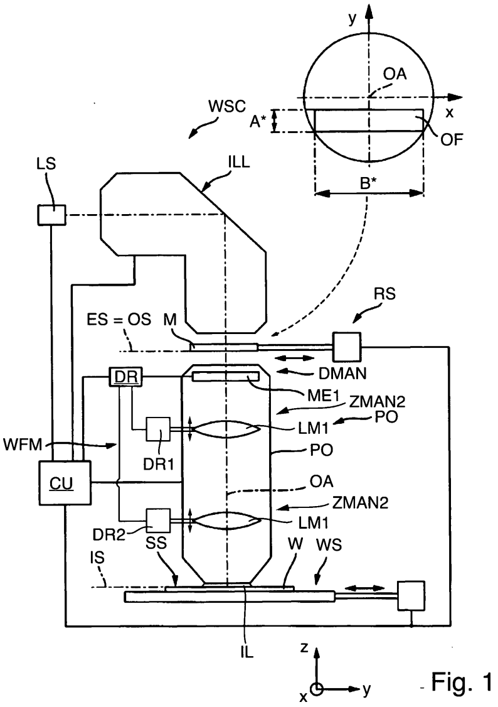

[回看原页](original.pdf#page=56)

56/72

## PDF第57页

[回看原页](original.pdf#page=57)

DE 10 2016 205 618 A1    2017.03.30

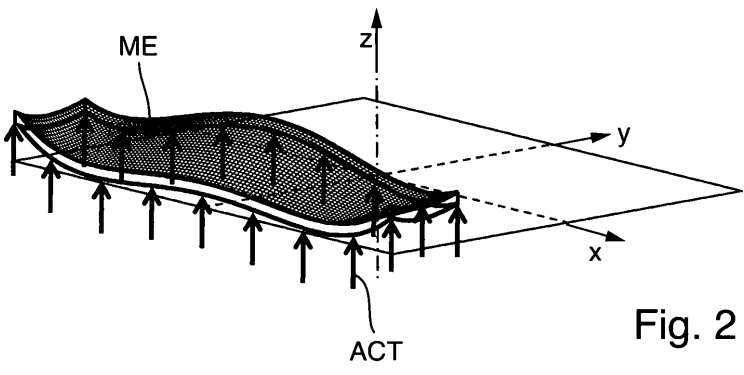

[回看原页](original.pdf#page=57)

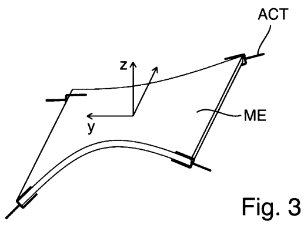

[回看原页](original.pdf#page=57)

57/72

## PDF第58页

[回看原页](original.pdf#page=58)

DE 10 2016 205 618 A1    2017.03.30

F9.4

<table><tr><td colspan="2">Target Aberrations DRUCK 50.00 nm</td><td>M235x=0.0-&gt;52.0; y=15.0-&gt;37.0</td><td>Epp</td></tr></table>

58/72

## PDF第59页

[回看原页](original.pdf#page=59)

DE 10 2016 205 618 A1    2017.03.30

Fi9.5

<table><tr><td>Focus Z4Min -0.0987, Max 0.211, rms 0.0636Min -0.0954, Max 0.0859, StDev 0.071</td><td>Tilt Z2/3IMax1 0.11, rms 0.028IMax_X1 0.07, IMax_Y1 0.05, StDev 0.077</td><td>AST Z5/6IMax1 0.235, rms 0.0593IMax1 0.22, rms 0.05, StDev 0.059</td><td></td></tr><tr><td>SPH Z9Min -0.103, Max 0.0753, rms 0.053Min -0.0965, Max 0.039, StDev 0.027</td><td>Cama Z7/8IMax1 0.105, rms 0.0323IMax_X1 0.08, IMax_Y1 0.05, StDev 0.067</td><td>AST Z12/13IMax1 0.0606, rms 0.0147IMax1 0.06, rms 0.01, StDev 0.017</td><td></td></tr><tr><td>SPH Z16Min 0.149, Max 0.32, rms 0.0397Min 0.171, Max 0.282, StDev 0.022</td><td>Cama Z14/15IMax1 0.314, rms 0.0427IMax_X1 0.14, IMax_Y1 0.07, StDev 0.084</td><td>TreFoil Z10/11IMax1 0.178, rms 0.0394IMax1 0.12, rms 0.03, StDev 0.052</td><td></td></tr><tr><td colspan="2">Residual Aberrations DRUCK 50.00 nm</td><td>M235x=0.0-&gt;52.0; y=15.0-&gt;37.0</td><td>Epp</td></tr></table>

59/72

## PDF第60页

[回看原页](original.pdf#page=60)

DE 10 2016 205 618 A1    2017.03.30

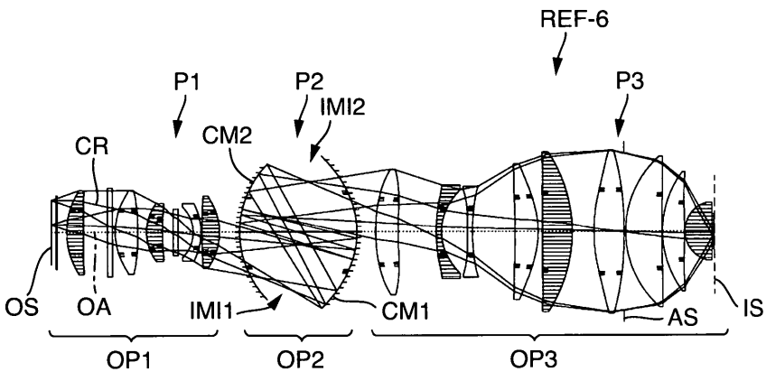

[回看原页](original.pdf#page=60)

Fig. 6A

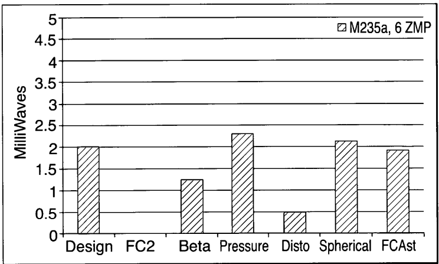

[回看原页](original.pdf#page=60)

Fig. 6B

60/72

## PDF第61页

[回看原页](original.pdf#page=61)

DE 10 2016 205 618 A1    2017.03.30

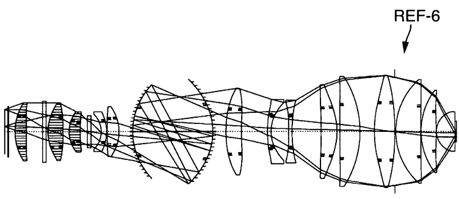

[回看原页](original.pdf#page=61)

Fig. 7A

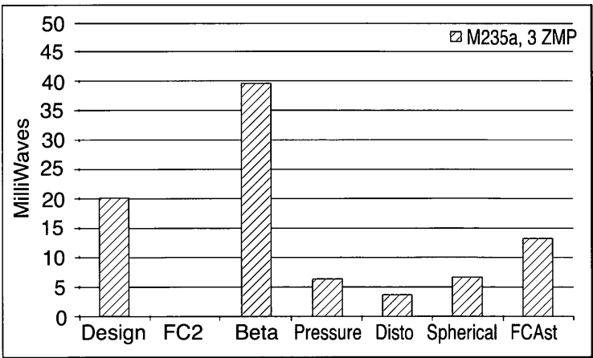

[回看原页](original.pdf#page=61)

Fig. 7B

61/72

## PDF第62页

[回看原页](original.pdf#page=62)

DE 10 2016 205 618 A1    2017.03.30

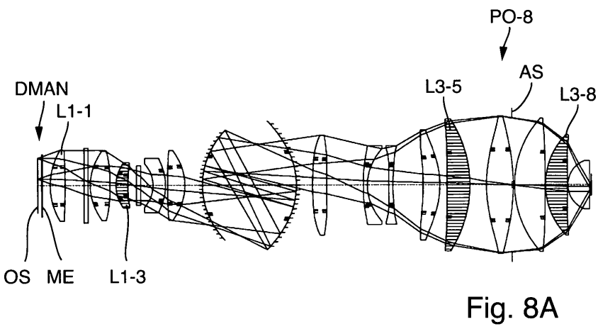

[回看原页](original.pdf#page=62)

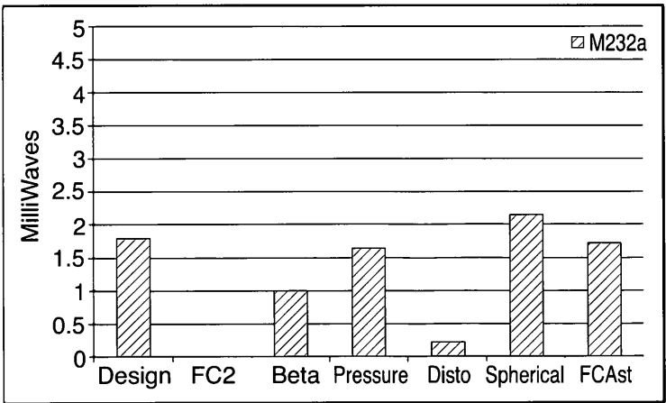

[回看原页](original.pdf#page=62)

Fig. 8B

62/72

## PDF第63页

[回看原页](original.pdf#page=63)

DE 10 2016 205 618 A1    2017.03.30

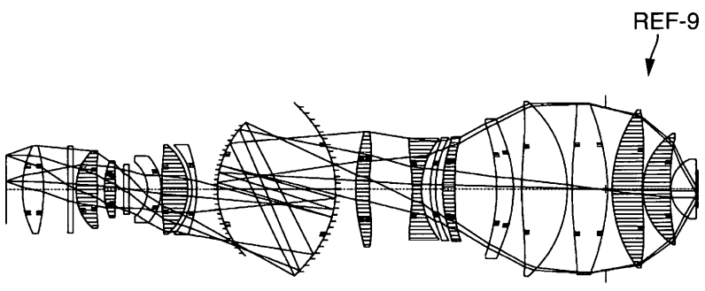

[回看原页](original.pdf#page=63)

Fig. 9A

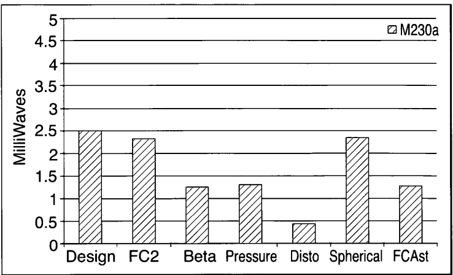

[回看原页](original.pdf#page=63)

Fig. 9B

63/72

## PDF第64页

[回看原页](original.pdf#page=64)

DE 10 2016 205 618 A1    2017.03.30

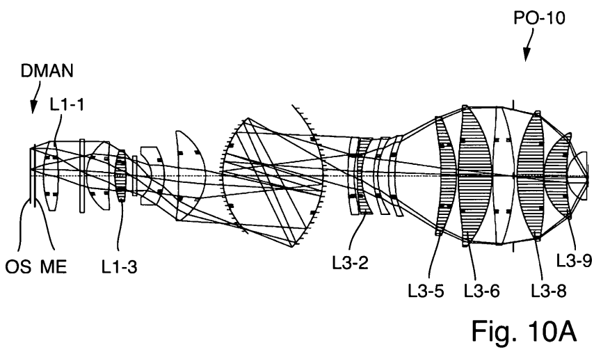

[回看原页](original.pdf#page=64)

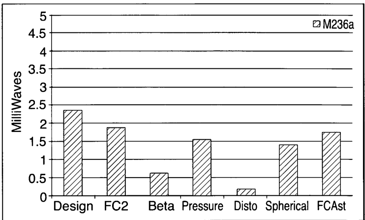

[回看原页](original.pdf#page=64)

Fig. 10B

64/72

## PDF第65页

[回看原页](original.pdf#page=65)

DE 10 2016 205 618 A1    2017.03.30

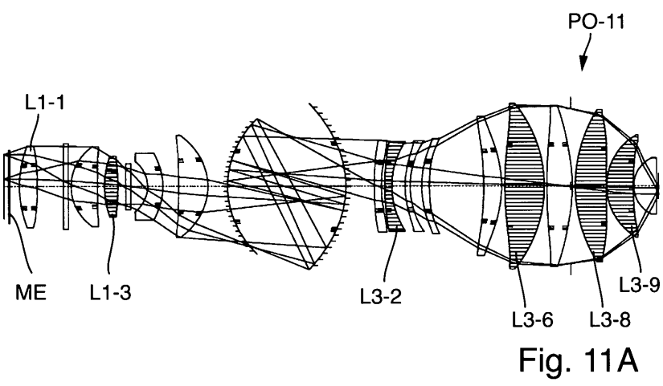

[回看原页](original.pdf#page=65)

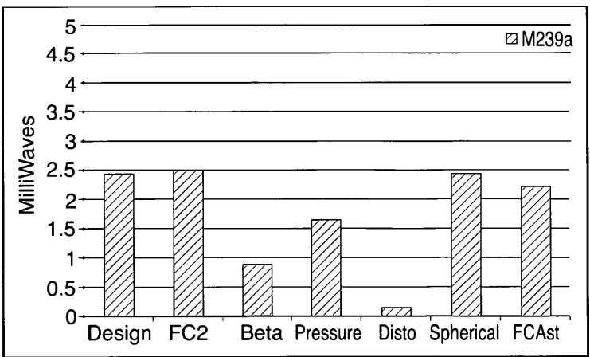

[回看原页](original.pdf#page=65)

Fig. 11B

65/72

## PDF第66页

[回看原页](original.pdf#page=66)

DE 10 2016 205 618 A1    2017.03.30

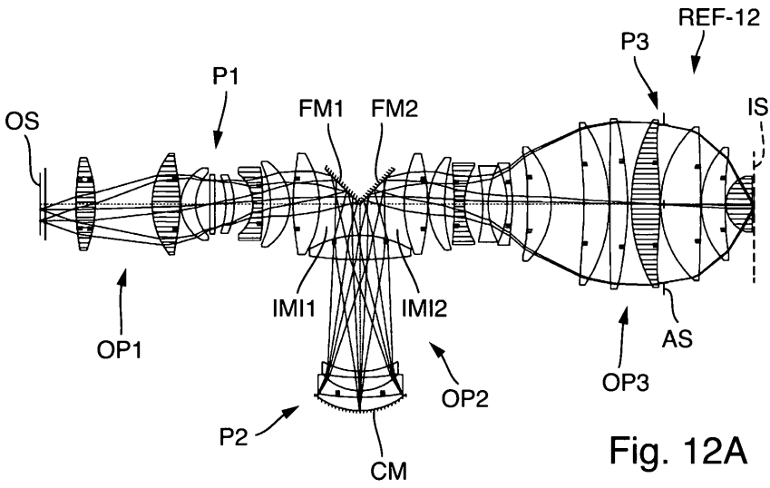

[回看原页](original.pdf#page=66)

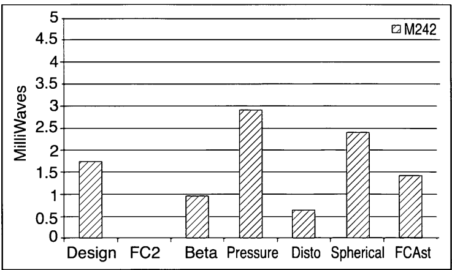

[回看原页](original.pdf#page=66)

Fig. 12B

66/72

## PDF第67页

[回看原页](original.pdf#page=67)

DE 10 2016 205 618 A1    2017.03.30

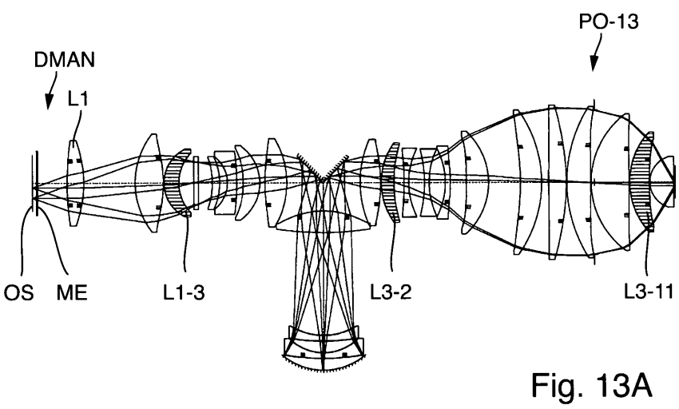

[回看原页](original.pdf#page=67)

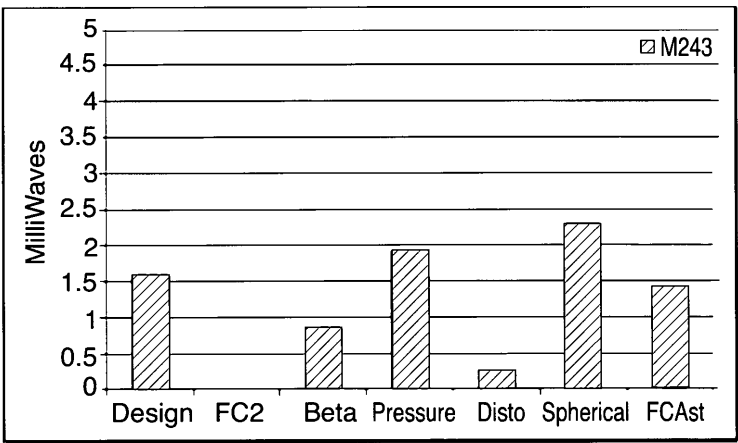

[回看原页](original.pdf#page=67)

Fig. 13B

67/72

## PDF第68页

[回看原页](original.pdf#page=68)

DE 10 2016 205 618 A1    2017.03.30

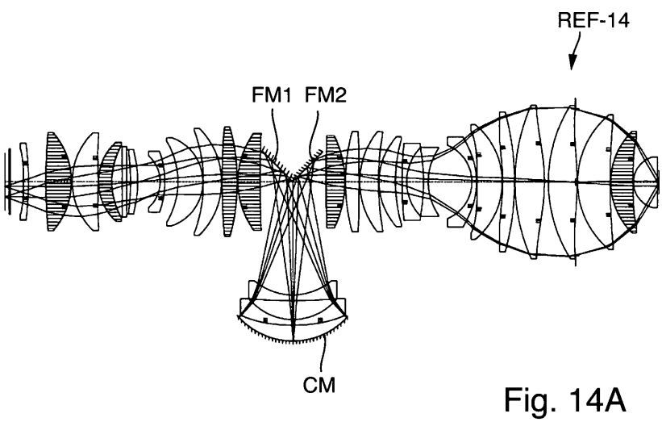

[回看原页](original.pdf#page=68)

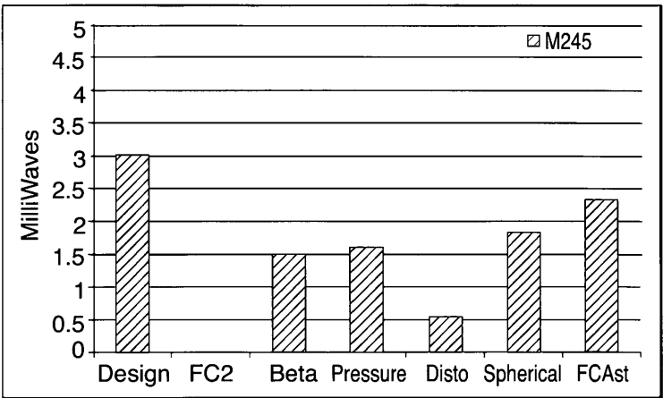

[回看原页](original.pdf#page=68)

Fig. 14B

68/72

## PDF第69页

[回看原页](original.pdf#page=69)

DE 10 2016 205 618 A1    2017.03.30

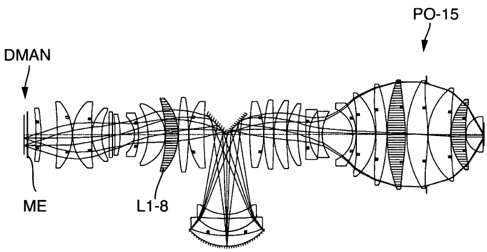

[回看原页](original.pdf#page=69)

Fig. 15A

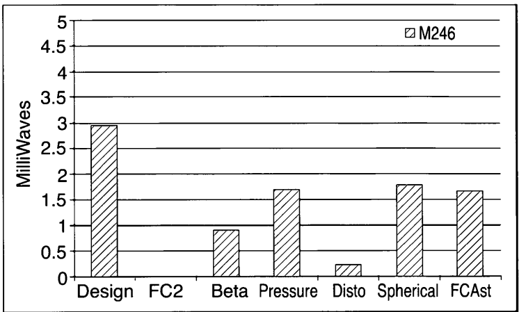

[回看原页](original.pdf#page=69)

Fig. 15B

69/72

## PDF第70页

[回看原页](original.pdf#page=70)

DE 10 2016 205 618 A1    2017.03.30

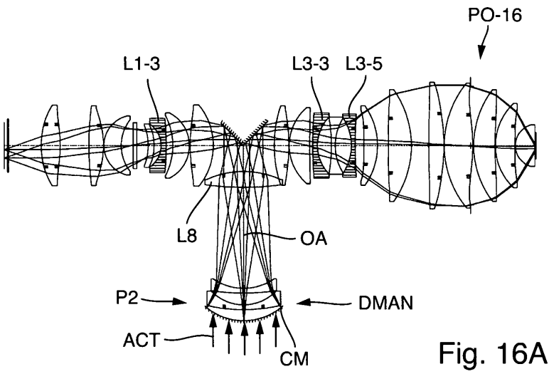

[回看原页](original.pdf#page=70)

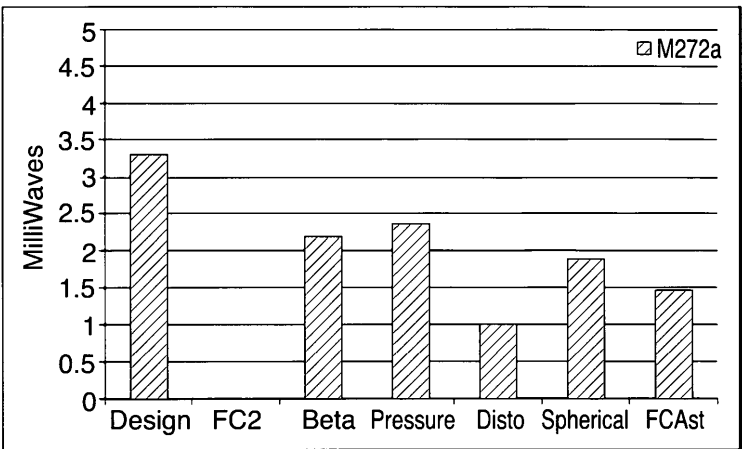

[回看原页](original.pdf#page=70)

Fig. 16B

70/72

## PDF第71页

[回看原页](original.pdf#page=71)

DE 10 2016 205 618 A1    2017.03.30

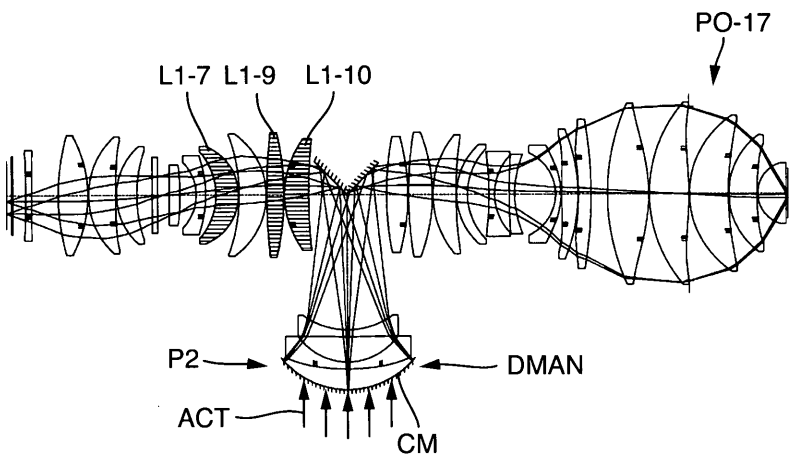

[回看原页](original.pdf#page=71)

Fig. 17A

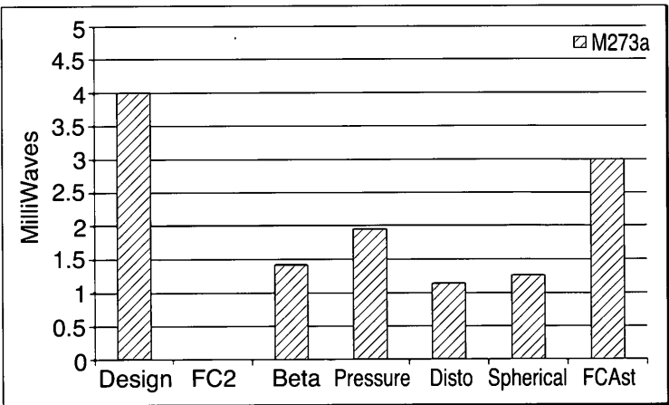

[回看原页](original.pdf#page=71)

Fig. 17B

71/72

## PDF第72页

[回看原页](original.pdf#page=72)

DE 10 2016 205 618 A1    2017.03.30

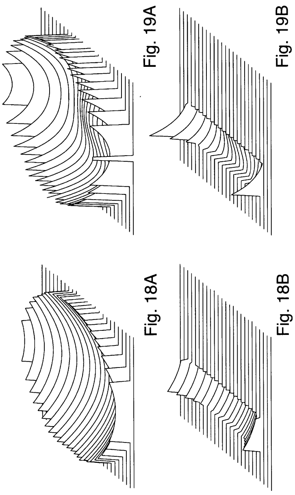

[回看原页](original.pdf#page=72)

72/72

