# JP5809458B2 — Reticle clamp system

原件：[PDF](original.pdf)；SHA-256 `6667deed44c1f8f1263c69f02ebfe7b94a1482f2e9925e80846d0d292fe4f125`。物理页码从封面计1。

转换：本地MinerU 4.0.12，standard / auto；保留原语言。资料来源与文件校验值见[清单](../manifest.json)。机器输出未逐字校勘，关键文字、公式与图表回看原件。

校核提示（独立于机器提取正文）：[转换质量与已知问题](../QUALITY.md)。

## PDF第1页

[回看原页](original.pdf#page=1)

J P 5809458 B2 2015.11.11

(19) 日本国特許庁(JP)

## (12)特許公報(B2)

(11)特許番号

特許第5809458号

(P5809458)

(45)発行日 平成27年11月11日(2015.11.11)

(24)登录日平成27年9月18日(2015.9.18)

<table><tr><td colspan="3">(51) Int. Cl.</td><td colspan="3">F 1</td></tr><tr><td>GO3F</td><td>7/20</td><td>(2006.01)</td><td>GO3F</td><td>7/20</td><td>521</td></tr><tr><td>HO1L</td><td>21/683</td><td>(2006.01)</td><td>HO1L</td><td>21/68</td><td>P</td></tr></table>

請求項の数15外国語出願 (全 19 頁)

<table><tr><td>(21) 出願番号</td><td>特願2011-139030 (P2011-139030)</td><td>(73) 特許権者 503195263</td></tr><tr><td>(22) 出願日</td><td>平成23年6月23日 (2011.6.23)</td><td rowspan="2">エーエスエムエル ホールディング エヌ. ブイ.</td></tr><tr><td>(65) 公開番号</td><td>特開2012-15508 (P2012-15508A)</td></tr><tr><td>(43) 公開日</td><td>平成24年1月19日 (2012.1.19)</td><td rowspan="3">オランダ国 ヴェルトホーフェン 5500 エーエイチ, ピー. オー. ボックス324</td></tr><tr><td>審査請求日</td><td>平成26年6月20日 (2014.6.20)</td></tr><tr><td>(31) 優先権主張番号</td><td>61/360, 316</td></tr><tr><td>(32) 優先日</td><td>平成22年6月30日 (2010.6.30)</td><td>(74) 代理人 100079108</td></tr><tr><td>(33) 優先権主張国</td><td>米国 (US)</td><td>弁理士 稲葉 良幸</td></tr><tr><td>(31) 優先権主張番号</td><td>61/418, 165</td><td>(74) 代理人 100109346</td></tr><tr><td>(32) 優先日</td><td>平成22年11月30日 (2010.11.30)</td><td>弁理士 大貫 敏史</td></tr><tr><td>(33) 優先権主張国</td><td>米国 (US)</td><td>(72) 発明者 ゾルダン, エンリコアメリカ合衆国, コネチカット州 06854, ノーウォーク, ワシントン ストリート 118</td></tr><tr><td colspan="2"></td><td>最終頁に続く</td></tr></table>

(54)【発明の名称】レチクルクランプシステム

## (57)【特許請求の範囲】

## 【請求項1】

リソグラフィ装置内の交換可能な物体を位置決めするサポート構造であって、

## チャックと、

前記チャック上に配置された少なくとも2つのクランプ機構であって、前記クランプ機構は第1方向にお互いから間隔を空けて配置されており、各クランプ機構は前記交換可能な物体を支持しかつ前記交換可能な物体にクランプ力を加えて前記交換可能な物体を保持する複数の個別の真空部分を含んでおり、前記真空部分間の離隔は前記第1方向とは異なる第2方向である、少なくとも2つのクランプ機構と、を含み、

<u>各真空部分は、隣接する真空部分に対して移動可能であるように、別々のバネ及び制振部品から構成されている、</u>サポート構造。

## 【請求項2】

<u>各真空部分を構成する別々のバネ及び制振部品が全て同様の剛性を有する、請求項1に記載のサポート構造。</u>

## 【請求項3】

前記交換可能な物体は、パターニングデバイスである、請求項1又は請求項2に記載のサポート構造。

## 【請求項4】

各真空部分は、低圧を伝達させて前記チャックに対する動きを防ぐために前記交換可能な物体をある位置で保持するためにチャネルをさらに含む、請求項1乃至請求項3のうち

10

20

## PDF第2页

[回看原页](original.pdf#page=2)

(2)

J P 5809458 B2 2015.11.11

何れか1項に記載のサポート構造。

## 【請求項5】

各真空部分は、前記交換可能な物体と接触している接触面をさらに含む、請求項1乃至請求項4のうち何れか1項に記載のサポート構造。

## 【請求項6】

前記接触面は、実質的に一定の低圧力を加えてその上に前記交換可能な物体を保持するように構成された体積を形成する、請求項5に記載のサポート構造。

## 【請求項7】

前記第2方向は、前記第1方向に対して垂直である、請求項1乃至請求項6のうち何れか1項に記載のサポート構造。

## 【請求項8】

パターン付き放射ビームを提供するパターニングデバイスからのパターンを基板上に転写するリソグラフィ装置であって、

放射ビームを提供する照明システムと、

前記パターンを含む前記パターニングデバイスを支持するサポート構造と、

前記パターン付きビームを前記基板のターゲット部分上に投影する投影システムと、前記基板を支持する基板テーブルと、

前記サポート構造上に配置された少なくとも2つのクランプ機構であって、前記クランプ機構は第1方向にお互いから間隔を空けて配置されており、各クランプ機構は前記パターニングデバイスを支持しかつ前記パターニングデバイスにクランプ力を加えて前記パターニングデバイスを保持する複数の個別の真空部分を含んでおり、前記真空部分間の離隔は前記第1方向とは異なる第2方向である、少なくとも2つのクランプ機構と、を含み、<u>各真空部分は、隣接する真空部分に対して移動可能であるように、別々のバネ及び制振部品から構成されている、</u>リソグラフィ装置。

## 【請求項9】

リソグラフィ装置内の物体を位置決めする方法であって、

前記物体を前記リソグラフィ装置のチャック上にロードすることと、

前記物体にクランプ力を加えて前記物体を保持することとを含み、

前記クランプ力は前記チャック上に配置された少なくとも2つのクランプ機構によって加えられ、前記クランプ機構は第1方向にお互いから間隔を空けて配置されており、各クランプ機構は前記交換可能な物体を支持しかつ前記クランプ力を加える複数の個別の真空部分を含んでおり、前記真空部分間の離隔は前記第1方向とは異なる第2方向であり、

<u>各真空部分は、隣接する真空部分に対して移動可能であるように、別々のバネ及び制振部品から構成されている、</u>方法。

## 【請求項10】

各真空部分は、真空源から前記物体に真空圧を伝達させるためにチャネルをさらに含み、前記方法は、前記真空圧を各真空部分に加えて前記チャックに対する動きを防ぐために前記物体をある位置で保持することをさらに含む、請求項9に記載の方法。

## 【請求項11】

前記第2方向は、前記第1方向に対して垂直である、請求項9又は請求項10に記載の方法。

## 【請求項12】

リソグラフィ装置内の交換可能な物体を保持するクランプアセンブリであって、

第1方向にお互いから間隔を空けて配置された少なくとも2つのクランプ機構であって、各クランプ機構は前記交換可能な物体を支持しかつ前記交換可能な物体にクランプ力を加えて前記交換可能な物体を保持する複数の個別の真空部分を含んでおり、前記真空部分間の離隔は前記第1方向とは異なる第2方向である、少なくとも2つのクランプ機構を含み、

<u>各真空部分は、隣接する真空部分に対して移動可能であるように、別々のバネ及び制振部品から構成されている、</u>クランプアセンブリ。

10

20

30

40

50

## PDF第3页

[回看原页](original.pdf#page=3)

(3)

J P 5809458 B2 2015.11.11

## 【請求項13】

リソグラフィ装置内の交換可能な物体を位置決めするサポート構造であって、

## チャックと、

前記チャック上のクランプ機構であって、前記交換可能な物体を支持しかつ前記交換可能な物体にクランプ力を加えて前記交換可能な物体を保持する複数のクランプ部分を含む、クランプ機構と、を含み、

<u>各クランプ部分は、隣接するクランプ部分に対して移動可能であるように、別々のバネ及び制振部品から構成されている、</u>サポート構造。

## 【請求項14】

パターン付き放射ビームを提供するパターニングデバイスからのパターンを基板上に転写するリソグラフィ装置であって、

## チャックと、

前記チャック上のクランプ機構であって、前記交換可能な物体を支持しかつ前記交換可能な物体にクランプ力を加えて前記交換可能な物体を保持する複数のクランプ部分を含む、クランプ機構と、を含み、

<u>各クランプ部分は、隣接するクランプ部分に対して移動可能であるように、別々のバネ及び制振部品から構成されている、</u>リソグラフィ装置。

## 【請求項15】

リソグラフィ装置内の物体を位置決めする方法であって、

前記物体を前記リソグラフィ装置のチャック上にロードすることと、

前記物体にクランプ力を加えて前記物体を保持することとを含み、

前記クランプ力は複数の部分に分割された少なくとも1つのクランプ機構によって加えられ、

<u>各部分は、隣接する部分に対して移動可能であるように、別々のバネ及び制振部品から構成されている、</u>方法。

## 【発明の詳細な説明】

## 【技術分野】

## 【0001】

[0001]　本発明は、リソグラフィ装置およびレチクルクランプシステムに関する。

## 【背景技術】

## 【0002】

[0002]　リソグラフィ装置は、所望のパターンを基板上、通常、基板のターゲット部分上に付与する機械である。リソグラフィ装置は、例えば、集積回路（I C）の製造に用いることができる。その場合、I Cの個々の層上に形成される回路パターンを生成するために、マスクまたはレチクルとも呼ばれるパターニングデバイスを用いることができる。このパターンは、基板（例えば、シリコンウェーハ）上のターゲット部分（例えば、ダイの一部、または1つ以上のダイを含む）に転写することができる。通常、パターンの転写は、基板上に設けられた放射感応性材料（レジスト）層上への結像によって行われる。一般には、単一の基板が、連続的にパターニングされる隣接したターゲット部分のネットワークを含んでいる。公知のリソグラフィ装置としては、ターゲット部分上にパターン全体を一度に露光することにより各ターゲット部分を照射する、いわゆるステッパ、および放射ビームによってある特定の方向（「スキャン」方向）にパターンをスキャンすると同時に、この方向に平行または逆平行に基板をスキャンすることにより各ターゲット部分を照射する、いわゆるスキャナが含まれる。パターンを基板上にスタンプまたはインプリントするなどといった他の機構により、パターニングデバイスから基板にパターンを転写することも可能である。

## 【0003】

[0003]　1つ以上の真空パッドを有するクランプ上にパターニングデバイスを配置し、真空を適用してパターニングデバイスと真空パッドとの間で引いて垂直力を生成することによってリソグラフィ装置内のパターニングデバイスなどの物体を保持することが知られ

10

20

30

40

50

## PDF第4页

[回看原页](original.pdf#page=4)

(4)

J P 5809458 B2 2015.11.11

ている。その後、垂直力は真空パッドとパターニングデバイスとの間に摩擦力を生成する

## 【発明の概要】

## 【0004】

[0004]　一般的に知られているクランプ用システムは、例えば物体の加速中のその剛性およびクランプとクランプされる物体とのインターフェースでの制限された変形力により限定されている。結果的に、クランプは、局所的応力点を生成してそれによってクランプシステム内の滑りを誘導する前に物体（例えば、パターニングデバイス）にある一定の力までを加えることができる。物体の現行の加速および速度は、物体上のクランプのグリップを弱め得る。露光された基板のスループットを上げるために加速および速度を増加できること、したがって、クランプ-物体インターフェースでのグリップを増加および/または最大にすることが望ましい。

## 【0005】

[0005]　本発明の一実施形態では、リソグラフィ装置内の交換可能な物体を位置決めするサポート構造が提供される。サポート構造は、交換可能な物体を保持するように構成されたチャックと、チャック上に配置された少なくとも2つのクランプ機構とを有する。クランプ機構は第1方向にお互いから間隔を空けて配置されており、各クランプ機構は交換可能な物体を支持しかつ交換可能な物体にクランプ力を加えて交換可能な物体を保持するように構成された複数の個別の真空部分を有する。真空部分間の離隔は第1方向とは異なる第2方向である。

## 【0006】

[0006]　本発明の一態様によると、パターン付き放射ビームを提供するように構成されたパターニングデバイスからのパターンを基板上に転写するように構成されたリソグラフィ装置が提供される。装置は、放射ビームを提供するように構成された照明システムと、パターンを含むパターニングデバイスを支持するように構成されたサポート構造と、パターン付きビームを基板のターゲット部分上に投影するように構成された投影システムと、基板を支持するように構成された基板テーブルと、サポート構造上に配置された少なくとも2つのクランプ機構とを含む。クランプ機構は第1方向にお互いから間隔を空けて配置されており、各クランプ機構は交換可能な物体を支持しかつ交換可能な物体にクランプ力を加えて交換可能な物体を保持するように構成された複数の個別の真空部分を有する。真空部分間の離隔は第1方向とは異なる第2方向である。

## 【0007】

[0007]　本発明の一態様によると、リソグラフィ装置内の物体を位置決めする方法が提供される。方法は、物体をリソグラフィ装置のチャック上にロードすることと、物体にクランプ力を加えて物体をチャックに対するある位置で保持することとを含む。クランプ力はチャック上に配置された少なくとも2つのクランプ機構によって加えられ、クランプ機構は第1方向にお互いから間隔を空けて配置されており、各クランプ機構は交換可能な物体を支持しかつクランプ力を加えるように構成された複数の個別の真空部分を有しており、真空部分間の離隔は第1方向とは異なる第2方向である。

## 【0008】

[0008]　本発明のさらなる別の態様において、リソグラフィ装置内の交換可能な物体を保持するクランプアセンブリが提供される。クランプアセンブリは、第1方向にお互いから間隔を空けて配置された少なくとも2つのクランプ機構を有する。各クランプ機構は交換可能な物体を支持しかつ交換可能な物体にクランプ力を加えて交換可能な物体を保持するように構成された複数の個別の真空部分を含んでおり、真空部分間の離隔は第1方向とは異なる第2方向である。

## 【0009】

[0009]　したがって、例えば、リソグラフィ装置内の交換可能な物体を位置決めするサポート構造を提供することが有利である。サポート構造は、交換可能な物体を保持するように構成されたチャックと、チャック上のクランプ機構とを有する。クランプ機構は交換

10

20

30

40

50

## PDF第5页

[回看原页](original.pdf#page=5)

(5)

J P 5809458 B2 2015.11.11

可能な物体を支持しかつ交換可能な物体にクランプ力を加えて交換可能な物体をチャックに対するある位置で保持する複数のクランプ部分を有する。

## 【0010】

[0010]　本発明の一態様によると、パターン付き放射ビームを提供するように構成されたパターニングデバイスからのパターンを基板上に転写するように構成されたリソグラフィ装置が提供される。装置は、交換可能な物体を保持するように構成されたチャックと、チャック上のクランプ機構とを有する。クランプ機構は交換可能な物体を支持しかつ交換可能な物体にクランプ力を加えて交換可能な物体をチャックに対するある位置で保持する複数のクランプ部分を有する。

## 【0011】

[0011]　本発明の一態様によると、リソグラフィ装置内の物体を位置決めする方法が提供される。方法は、物体をリソグラフィ装置のチャック上にロードすることと、物体にクランプ力を加えて物体をチャックに対するある位置で保持することとを含む。クランプ力は複数の部分に分割された少なくとも1つのクランプ機構によって加えられ、各部分は隣接する部分に対して移動可能である。

## 【図面の簡単な説明】

## 【0012】

[0012]　本発明のいくつかの実施形態を、単なる例として、添付の概略図を参照して以下に説明する。これらの図面において同じ参照符号は対応する部分を示す。

【図1】[0013]　図1は、本発明の一実施形態によるリソグラフィ装置を概略的に示す。

【図2】[0014]　図2は、物体を支持するサポート構造の一部の斜視図を概略的に示す。

【図3】[0015]　図3は、物体を支持する例示的クランプを有する図2のサポート構造の断面図を概略的に示す。

【図4】[0016]　図4は、本発明の一実施形態による、当該技術分野において公知である図3の例示的クランプの断面図および例示的クランプを用いて物体を取り扱う方法を概略的に示す。

【図5】[0016]　図5は、本発明の一実施形態による、当該技術分野において公知である図3の例示的クランプの断面図および例示的クランプを用いて物体を取り扱う方法を概略的に示す。

【図6】[0017]　図6は、図3および図7の構造に関連する制御図を示す。

【図7】[0018]　図7は、本発明の一実施形態による図1の装置におけるサポート構造のクランプ機構によって支持される物体を概略的に示す。

【図8】[0019]　図8は、本発明の一実施形態によるサポート構造のクランプ機構のうちの1つの詳細断面図を概略的に示す。

【図9】[0020]　図9は、本発明の一実施形態による、図7のサポート構造のクランプ機構のうちの1つの詳細断面図およびサポート構造上の物体を取り扱う方法を概略的に示す

【図10】[0020]　図10は、本発明の一実施形態による、図7のサポート構造のクランプ機構のうちの1つの詳細断面図およびサポート構造上の物体を取り扱う方法を概略的に示す。

【図11】[0020]　図11は、本発明の一実施形態による、図7のサポート構造のクランプ機構のうちの1つの詳細断面図およびサポート構造上の物体を取り扱う方法を概略的に示す。

【図12】[0021]　図12は、図7～図11のサポート構造のクランプ機構のうちの1つの真空部分の詳細斜視図を概略的に示す。

## 【発明を実施するための形態】

## 【0013】

[0022]　図1は、本発明の一実施形態によるリソグラフィ装置を概略的に示している。この装置は、

[0023]　放射ビームB（例えば、U V放射またはD U V放射）を調整するように構成さ

10

20

30

40

50

## PDF第6页

[回看原页](original.pdf#page=6)

(6)

J P 5809458 B2 2015.11.11

れた照明システム（イルミネータ）I Lと、

[0024]　パターニングデバイス（例えば、マスクまたはレチクル）M Aを保持するように構成され、かつ特定のパラメータに従ってパターニングデバイスを正確に位置決めするように構成された第1ポジショナP Mに連結されているサポート構造（例えば、マスクテーブル）M Tと、

[0025]　基板（例えば、レジストコートウェーハ）Wを保持するように構成され、かつ特定のパラメータに従って基板を正確に位置決めするように構成された第2ポジショナP Wに連結されている基板テーブル（例えば、ウェーハテーブル）W Tと、

[0026]　パターニングデバイスM Aによって放射ビームBに付与されたパターンを基板Wのターゲット部分C（例えば、1つ以上のダイを含む）上に投影するように構成された投影システム（例えば、屈折投影レンズシステム）P Sとを備える。

## 【0014】

[0027]　照明システムとしては、放射を誘導し、整形し、または制御するために、屈折型、反射型、磁気型、電磁型、静電型、またはその他のタイプの光コンポーネント、あるいはそれらのあらゆる組合せなどのさまざまなタイプの光コンポーネントを含むことができる。

## 【0015】

[0028]　サポート構造は、パターニングデバイスの向き、リソグラフィ装置の設計、および、パターニングデバイスが真空環境内で保持されているか否かなどの他の条件に応じた態様で、パターニングデバイスを保持する。サポート構造は、機械式、真空式、静電式またはその他のクランプ技術を使って、パターニングデバイスを保持することができる。サポート構造は、例えば、必要に応じて固定または可動式にすることができるフレームまたはテーブルであってもよい。サポート構造は、パターニングデバイスを、例えば、投影システムに対して所望の位置に確実に置くことができる。本明細書において使用される「レチクル」または「マスク」という用語はすべて、より一般的な「パターニングデバイス」という用語と同義であると考えるとよい。

## 【0016】

[0029]　本明細書において使用される「パターニングデバイス」という用語は、基板のターゲット部分内にパターンを作り出すように、放射ビームの断面にパターンを与えるために使用できるあらゆるデバイスを指していると、広く解釈されるべきである。なお、留意すべき点として、放射ビームに付与されたパターンは、例えば、そのパターンが位相シフトフィーチャまたはいわゆるアシストフィーチャを含む場合、基板のターゲット部分内の所望のパターンに正確に一致しない場合もある。通常、放射ビームに付けたパターンは、集積回路などのターゲット部分内に作り出されるデバイス内の特定の機能層に対応することになる。

## 【0017】

[0030]　パターニングデバイスは、透過型であっても、反射型であってもよい。パターニングデバイスの例としては、マスク、プログラマブルミラーアレイ、およびプログラマブルL C Dパネルが含まれる。マスクは、リソグラフィでは公知であり、バイナリ、レべンソン型(al t er nat i ng)位相シフト、およびハーフトーン型(at t enuat ed)位相シフトなどのマスク型、ならびに種々のハイブリッドマスク型を含む。プログラマブルミラーアレイの一例では、小型ミラーのマトリックス配列が用いられており、各小型ミラーは、入射する放射ビームを様々な方向に反射させるように、個別に傾斜させることができる。傾斜されたミラーは、ミラーマトリックスによって反射される放射ビームにパターンを付ける。

## 【0018】

[0031]　本明細書において使用される「投影システム」という用語は、使われている露光放射にとって、あるいは液浸液の使用または真空の使用といった他の要因にとって適切な、屈折型、反射型、反射屈折型、磁気型、電磁型、および静電型光学系、またはそれらのあらゆる組合せを含むあらゆる型の投影システムを包含していると広く解釈されるべきである。本明細書において使用される「投影レンズ」という用語はすべて、より一般的な

10

20

30

40

50

## PDF第7页

[回看原页](original.pdf#page=7)

(7)

J P 5809458 B2 2015.11.11

「投影システム」という用語と同義であると考えるとよい。

## 【0019】

[0032]　本明細書に示されているとおり、リソグラフィ装置は、透過型のもの（例えば、透過型マスクを採用しているもの）である。また、リソグラフィ装置は、反射型のもの（例えば、上述のプログラマブルミラーアレイを採用しているもの、または反射型マスクを採用しているもの）であってもよい。

## 【0020】

[0033]　リソグラフィ装置は、2つ（デュアルステージ）以上の基板テーブル（および/または2つ以上のサポート構造）を有する型のものであってもよい。そのような「マルチステージ」機械においては、追加のテーブル/サポート構造は並行して使うことができ、または予備工程を1つ以上のテーブル/サポート構造上で実行しつつ、別の1つ以上のテーブル/サポート構造を露光用に使うこともできる。

## 【0021】

[0034]　図1を参照すると、イルミネータI Lは、放射源S Oから放射ビームを受ける。例えば、放射源がエキシマレーザである場合、放射源とリソグラフィ装置は、別個の構成要素であってもよい。そのような場合には、放射源は、リソグラフィ装置の一部を形成しているとはみなされず、また放射ビームは、放射源S OからイルミネータI Lへ、例えば、適切な誘導ミラーおよび/またはビームエキスパンダを含むビームデリバリシステムB Dを使って送られる。その他の場合においては、例えば、放射源が水銀ランプである場合、放射源は、リソグラフィ装置の一体部分とすることもできる。放射源S OおよびイルミネータI Lは、必要ならばビームデリバリシステムB Dとともに、放射システムと呼んでもよい。

## 【0022】

[0035]　イルミネータI Lは、放射ビームの角強度分布を調節するように構成されたアジャスタA Dを含むことができる。一般に、イルミネータの瞳面内の強度分布の少なくとも外側および/または内側半径範囲（通常、それぞれσ-out erおよびσ-i nnerと呼ばれる）を調節することができる。さらに、イルミネータI Lは、インテグレータI NおよびコンデンサC Oといったさまざまな他のコンポーネントを含むことができる。イルミネータを使って放射ビームを調整すれば、放射ビームの断面に所望の均一性および強度分布をもたせることができる。

## 【0023】

[0036]　放射ビームBは、サポート構造（例えば、マスクテーブル）M T上に保持されているパターニングデバイス（例えば、マスク）M A上に入射して、パターニングデバイスによってパターン形成される。パターニングデバイスM Aを通り抜けた後、放射ビームBは投影システムP Sを通過し、投影システムP Sは、基板Wのターゲット部分C上にビームの焦点をあわせる。第2ポジショナP Wおよび位置センサI F（例えば、干渉計デバイス、リニアエンコーダ、または静電容量センサ）を使って、例えば、さまざまなターゲット部分Cを放射ビームBの経路内に位置決めするように、基板テーブルW Tを正確に動かすことができる。同様に、第1ポジショナP Mおよび別の位置センサ（図1には明示的に示されていない）を使い、例えば、マスクライブラリから機械的に取り出した後またはスキャン中に、パターニングデバイスM Aを放射ビームBの経路に対して正確に位置決めすることもできる。通常、サポート構造M Tの移動は、第1ポジショナP Mの一部を形成するロングストロークモジュール（粗動位置決め）およびショートストロークモジュール（微動位置決め）を使って達成することができる。同様に、基板テーブルW Tの移動も、第2ポジショナP Wの一部を形成するロングストロークモジュールおよびショートストロークモジュールを使って達成することができる。ステッパの場合は（スキャナとは対照的に）、サポート構造M Tは、ショートストロークアクチュエータのみに連結されてもよく、または固定されてもよい。パターニングデバイスM Aおよび基板Wは、パターニングデバイスアライメントマークM 1およびM 2と、基板アライメントマークP 1およびP 2とを使って、位置合わせされてもよい。例示では基板アライメントマークが専用ターゲット

10

20

30

40

50

## PDF第8页

[回看原页](original.pdf#page=8)

(8)

J P 5809458 B2 2015.11.11

部分を占めているが、基板アライメントマークをターゲット部分とターゲット部分との間の空間内に置くこともできる（これらは、スクライブラインアライメントマークとして公知である）。同様に、複数のダイがパターニングデバイスM A上に設けられている場合、パターニングデバイスアライメントマークは、ダイとダイの間に置かれてもよい。

## 【0024】

[0037]　例示の装置は、以下に説明するモードのうち少なくとも1つのモードで使用できる。

## 【0025】

[0038]　1.ステップモードにおいては、サポート構造M Tおよび基板テーブルW Tを基本的に静止状態に保ちつつ、放射ビームに付けられたパターン全体を一度にターゲット部分C上に投影する（すなわち、単一静的露光）。その後、基板テーブルW Tは、Xおよび/またはY方向に移動され、それによって別のターゲット部分Cを露光することができる。ステップモードにおいては、露光フィールドの最大サイズによって、単一静的露光時に結像されるターゲット部分Cのサイズが限定される。

## 【0026】

[0039]　2.スキャンモードにおいては、サポート構造M Tおよび基板テーブルW Tを同期的にスキャンする一方で、放射ビームに付けられたパターンをターゲット部分C上に投影する（すなわち、単一動的露光）。サポート構造M Tに対する基板テーブルW Tの速度および方向は、投影システムP Sの（縮小）拡大率および像反転特性によって決めることができる。スキャンモードにおいては、露光フィールドの最大サイズによって、単一動的露光時のターゲット部分の幅（非スキャン方向）が限定される一方、スキャン動作の長さによって、ターゲット部分の高さ（スキャン方向）が決まる。

## 【0027】

[0040]　3.別のモードにおいては、プログラマブルパターニングデバイスを保持した状態で、マスクテーブルM Tを基本的に静止状態に保ち、また基板テーブルW Tを動かす、またはスキャンする一方で、放射ビームに付けられているパターンをターゲット部分C上に投影する。このモードにおいては、通常、パルス放射源が採用されており、さらにプログラマブルパターニングデバイスは、基板テーブルW Tの移動後ごとに、またはスキャン中の連続する放射パルスと放射パルスとの間に、必要に応じて更新される。この動作モードは、前述の型のプログラマブルミラーアレイといったプログラマブルパターニングデバイスを利用するマスクレスリソグラフィに容易に適用することができる。

## 【0028】

[0041]　上述の使用モードの組合せおよび/またはバリエーション、あるいは完全に異なる使用モードもまた採用可能である。

## 【0029】

[0042]　本明細書中の考察はパターニングデバイスに注目しているが、本明細書中で考察される構造、方法および概念は、1つ以上の他の物体に適切に適用されてもよい。パターニングデバイスはそのような物体の一実施形態である。

## 【0030】

[0043]　上述したように、パターニングデバイスは、通常、サポート構造M Tによって保持される。図2～図5により詳細に示すように、サポート構造M Tは、例えば、チャック10およびクランプ機構12を含んでよい。チャック10は、あらゆる数の部品を含んでよく、限定されるべきではない。例えば、図示した実施形態では、チャック10は、構造結合によって接続された多数の部品を含む。例えば、結合は通常、部品を接続するために堅い。結合は、あらゆる数の材料を含んでよく、さらに、チャック10において制振または拘束要素（または層）であってよい。別の実施形態では、チャック10は単一（1つ）の部品を含んでもよく、よって結合は不要である。説明のために、チャック10の第1（または左）側を示している。図示したチャック10の第1側は、チャック10の一部であるか、または結合54を介してチャック10の一部（図示せず）に堅く接続され得るキャリア52を含む。チャック10は、結合50を介してキャリア52に接続された板バネ

10

20

30

40

50

## PDF第9页

[回看原页](original.pdf#page=9)

(9)

J P 5809458 B2 2015.11.11

51をさらに含んでもよい。図2の斜視図に示すように、（Z軸に対する）Z方向の動きに対して構造物を剛性化する領域に支持接続部58が設けられてよい。支持接続部58は、例えば、少量の糊または接着剤であってよい。

## 【0031】

[0044]　クランプ12は、例えば、結合56を介してチャック10の板バネ51に結合されてよい。クランプ12は、レチクルまたはパターニングデバイスM Aなどの物体を歪めることなくチャック10に対して正確および安定性のある位置で保持する機能を有する。上述したように、クランプ機構12は、通常、加速方向（すなわち、Y軸に沿ったY方向）に対して堅い必要がある一方、Z方向（Z軸に沿って）に対して軟らかいことによってクランプ-物体インターフェース14におけるパターニングデバイスのあらゆる非平坦性に適合することができる。さらに、物体またはパターニングデバイスM A上のクランプ12のグリップを最大にするために、Y方向の加速によって生成されるインターフェース14のあらゆる応力は、接触面全体にわたって均等に分布されるべきである。

## 【0032】

[0045]　図4により詳細に示すように、図3に示す例示的クランプ12は、「W」型のクランプ設計を含んでおり、これは当該技術分野で一般的に知られているクランプを表す。W型クランプ設計は、物体M Aを多数のインターフェース14で接触するクランプ12のベース18から延在する3つのバール16または壁を有する。真空（図示せず）による真空力をインターフェース14に加えて物体M Aをクランプ12上の適切な位置でクランプおよび/または保持することができる。しかしながら、真空がクランプ12に適用されたときに問題が生じ得る。例えば、上述したように、クランプ12はZ軸に沿って物体の形状に適合することが必要であり、それを行うためには、図4の例示的W型クランプの設計は、3つの壁16を用いて物体に対して軟らかくなるように設計されている。しかしながら、Z方向の軟らかさは、真空下のクランプ12の形状の変化の原因に寄与し、（物体M Aとクランプ12との間）の接触インターフェース14にて過剰の応力が生成される（例えば、図5を参照）。各インターフェース14における局所的応力は、真空が適用されたときのクランプの誘発された変形および/または反りによって形成および/または増加し、最終的に、滑りが生じる前に許容できる加速誘導応力を減少させる。さらに、これは、クランプ機構12にクランプされた物体M Aに対する望ましくない応力へと繋がり得る。加えておよび/または代替的に、これはチャック10における応力へと繋がり得る。

## 【0033】

[0046]　Y方向の加速によって生成される応力に加えて、チャック10の弾性的変形によってX方向の応力が生成される。通常、図5に示すX方向の応力は2つの現象によって生ずる。第1に、クランプ12と物体M Aとの間の真空によって生成される力または圧力は、少なくとも端壁16を物体M Aに対して押し（または引く）、それによって圧力がインターフェース14にて生ずる（図4の矢印Bを参照）。インターフェース14の方に向かう真空力の発揮は、図4の矢印Aに示している（よって、結果的に矢印Aの反対方向の牽引力または加圧力となる）。この圧力の結果として、接触点（すなわち、クランプ12の壁16と物体M Aの底または下面との間の各インターフェース14）において、壁16は変形し、それによってX方向の応力を生成する。第2に、真空の圧力は、図5の矢印Dで示しているように、基部18またはクランプ12の底を変形させ、物体M Aの方へと変位させる。結果として、端壁16は、図5の矢印Cで示しているように、クランプ12の中心線Xの近くに引っ張られる。これらのX方向の力の両方は、サポート構造のクランプ12にX方向の応力を生成する。

## 【0034】

[0047]　図5の記載に基づいて、当業者は、例えば、より可撓性がありかつ物体の形状（例えば、真空が加えられたときのY方向の物体の非平坦性）に適合するチャックが、当該技術分野においてチャックと物体との滑りおよび応力を減少および/または防止するためになぜ有意であるかが分かる。

## 【0035】

10

20

30

40

50

## PDF第10页

[回看原页](original.pdf#page=10)

(10)

J P 5809458 B2 2015.11.11

[0048]　例えば、図5に示すように、滑りの前の局所的最大許容応力は、平面内の結果的に生ずる（X方向およびY方向の）応力を説明する。図6（a）は、図2～図5に示す関連技術によって提供されるような物体76（例えば、パターニングデバイスM A）と接地デバイス78（例えば、チャック10）との既知の関係を示す例示的制御図を示している。示されているように、通常、物体76は、80で表すバネおよび82で表す拡散制振機構と同様の接地デバイス78への接続部（例えば、結合層および支持接続部）を有する。このバネ制振部品接続部は、通常、物体のX側にある。しかしながら、図6（a）に示すこの接続部および構成は、通常、記載した物体とデバイスとの間の応力および滑りをもたらす。

## 【0036】

[0049]　滑りを減少および/または防止する試みのための一方法は、X部品を理想的に最小またはゼロにする一方、Y部品を増加または最大にすることである（それによって速い加速が可能である）。さらに、交換可能な物体の形状に対するクランプ適合性を維持することによって、これは、クランプ/チャックと物体とのインターフェースにおける最大加速誘導応力を可能にする一方、変形による他のあらゆる応力を依然として最小にする。さらに、接触面全体にわたる摩擦応力の均一性を最適化することによって、局所的な早期の滑り状態を回避することができる。

## 【0037】

[0050]　以下にさらに説明するように、本明細書中に記載する概念は複数のクランプ機構22を含んでおり、各クランプ機構22は多数のより小さいかつ局所的な真空クランプ部分36を含む。個別の真空クランプ部分36の各々は、個別には非常に堅いが、適合性を維持するために部分36間の相対的な動きは可能である。各真空クランプ部分36は、各々の真空体積を提供して局所的クランプ力を物体30の一部に加える。各クランプ機構22はより小さい真空体積の領域および（物体の慣性に加えて）部品の変形による追加負荷を有するため、真空クランプ部分36のその領域のチャックの剛性は適宜設計される。すなわち、チャック/クランプと交換可能な物体とのインターフェースでの（滑りまたはミクロ滑りを生成する）局所的高応力を回避するために、真空クランプ部分36はチャック20に対して均一の剛性を与えるように最適化される。

## 【0038】

[0051]　図7～図12は、本発明の一実施形態による交換可能な物体30を位置決めおよび支持するためのサポート構造M Tの非限定例を示している。交換可能な物体30は、デバイスM A、レチクル、基板またはあらゆる他の物体などのパターニングデバイスであってよい。図7～図12に示す実施形態は、図1の装置などのリソグラフィ装置の一部であってよい。

## 【0039】

[0052]　サポート構造M Tはチャック20を含む。チャック20は、サポート構造M Tと一体的（よって、サポート構造M Tは本質的にはチャックである）であるか、またはそれに（取り外し可能）設置されてもよい。一般には、チャックを（例えば、制御装置を用いて）設置および移動するデバイスおよび方法が公知である。一実施形態では、チャック20は、リソグラフィ装置内の交換可能な物体30（例えば、パターニングデバイスM A）を支持するサポート構造である。一般には、チャック20は、基板を露光するために使用する放射ビームがリソグラフィ装置において投影されるときに物体30を保持および位置決めするように構成される。一実施形態では、チャック20は、チャックおよびその上のパターニングデバイスM A（または物体30）の両方をポジショナP Mによって移動できる。

## 【0040】

[0053]　サポート構造M Tは、チャック20上に配置された少なくとも2つのクランプ機構22をさらに含む。少なくとも2つのクランプ機構22は、共に合わせてクランプアセンブリとみなされてよい。図7に示すように、クランプ機構22は、第1方向またはX方向にてお互いから間隔を空けて配置されている。クランプ機構22は、交換可能な物体

10

20

30

40

50

## PDF第11页

[回看原页](original.pdf#page=11)

(11)

J P 5809458 B2 2015.11.11

30を支持しかつ交換可能な物体30にクランプ力を加えるように位置決めされ、それによって交換可能な物体30を保持する。

## 【0041】

[0054]　説明および例示のみのために、図8は、（Z-X面における）図1の装置内の交換可能な物体30を支持する、サポート構造の形態を有するチャック20の第1（または左）側の詳細断面図を示している。図2および図3に関して上述した内容と同様に、例えば、図示した実施形態では、チャック20は、構造結合によって接続された多数の部品を含む。例えば、結合は、通常、部品を接続するには堅い。結合は、あらゆる数の材料を含んでよく、かつチャック20内の制振または拘束要素（または層）であってもよい。別の実施形態では、チャック20は単一（1つ）の部品を含んでよく、よって結合は必要ではない。図示したチャック20はキャリア62を含んでおり、このキャリア62は、チャック20の一部であるか、または結合64を介してチャック20の一部（図示せず）に堅く接続されていてもよい。

## 【0042】

[0055]　チャック20は、例えば、1つ以上の結合60を介してキャリア62に接続された1つ以上の板バネ61をさらに含んでよい。この例示した実施形態では、各板バネ6 1は、水平の板バネ部分63と垂直に位置決めされた垂直端部70を含んで「L」型を形成している（すなわち、図7および図11に示すように、端部70は、水平部分63に対して垂直に下方に延在する）。垂直端70は、結合66を介してクランプ機構22の垂直延長部28に接続される。板バネ61の「L型」は、Y方向にてより大きい可撓性を提供し、これは、さらに、物体の非平坦性および/または動きと適合するようにクランプ機構21が容易に移動および/または回転することを可能にする（物体30などの物体がその上に位置決めおよびクランプされた場合）。さらに、図8に示すように、板バネ61とキャリア62との間のギャップ68は、板バネ61がチャック20に対する動きを吸収することを可能にする。一実施形態では、各クランプ機構（およびその対応部分）が堅く作られるほど、板バネ61はより適合性を有して形成される。さらに、板バネ61におけるより大きい可撓性および動きは、板バネ61/チャック20に対する寄生力を（図3の板バネ51のように、標準の板バネが変形した場合に形成されるものと比較して）減少することができる。

## 【0043】

[0056]　使用中、チャック20は交換可能な物体30を保持するように構成されている。すなわち、チャック20は物体表面を有しており、その上に交換可能な物体30が設置されかつクランプ機構22を介してクランプされてよい。クランプ機構22は、リソグラフィプロセス中の使用のために物体30をチャック20（またはサポート構造M T）にクランプするように構成されている。

## 【0044】

[0057]　クランプ機構には、適切なコントローラまたはプロセッサ（図示せず）が設けられ、および/またはそれに接続されてよい。このコントローラまたはプロセッサは、例えば、チャック20またはサポート構造M Tへの物体のクランプおよびそこからの物体の取り外しを制御するように構成されている。当業者に明らかになるように、コントローラは、適切なハードウェアおよび/またはソフトウェア（例えば、コンピュータ、プロセッサ、マイクロ電子機器および他の適切な制御手段）を含んでよい。

## 【0045】

[0058]　クランプ機構22は様々な方法で構成されてよい。一実施形態では、クランプ機構22は、真空クランプを介して物体30をチャック20にクランプするように構成されている。例えば、リソグラフィ装置は、図8および図9に真空源32として概略的に示されている真空源を含んでよく、それによってクランプ機構22を介して低圧（すなわち、真空）を物体30に加えるかまたは伝達して物体30を適切な位置に（例えば、露光のために）保持し、さらに物体の動きを減少または防止する。真空クランプに加えておよび/またはそれと代替的に、例えば、クランプ機構22は、静電クランプ、電磁クランプ、

10

20

30

40

50

## PDF第12页

[回看原页](original.pdf#page=12)

(12)

J P 5809458 B2 2015.11.11

またはさらに機械的クランプを提供するように構成されてもよい。

## 【0046】

[0059]　（上述したように）クランプ-物体インターフェースにおける局所的応力を減少しかつ滑りを防止するために、図7～図12の例示的実施形態におけるサポート構造M Tはいくつかの非限定特徴を含む。一実施形態によると、各クランプ機構22は、交換可能な物体30を支持し、かつ局所的真空クランプ力を交換可能な物体に加えて交換可能な物体30をチャック20に対するある位置で保持する。図12は、チャック20の第1または左側におけるクランプ機構22の個別の真空クランプ部分36の斜視図を詳細に示している。真空部分36間の離隔は、第1方向とは異なる第2方向である。この図示した実施形態では、真空部分36はY方向にお互いから離れており、Y方向は、クランプ22がお互いから間隔を介して配置されている第1方向、すなわちX方向とは異なる。

## 【0047】

[0060]　図8～図12に対してクランプ機構22の左側のみが示されかつ説明されているが、クランプ機構22の第2側または右側は、図7の実施形態に示す個別の真空部分3 6と同様のものを含み、かつ、実質的に、概略的に示されたクランプ機構22の左側のミラーイメージであってよく、限定的であるべきではないことが理解されたい。例えば、一実施形態では、2つより多いクランプ機構がお互いから間隔を空けてチャック上に配置されかつ個別の真空部分を含んでよい。

## 【0048】

[0061]　真空クランプ部分36は、各クランプ機構22が（例えば、運動または加速中に）交換可能な物体のより高い非平坦度に従いかつ物体の形状に対してより高い適合性を提供することを可能にする。一実施形態では、各クランプ部分36は別々に形成されている。Y方向に沿って各クランプ機構22に対して多数のクランプ部分を設けることによって、真空圧の加圧中のクランプ機構22の適合性は上昇する。

## 【0049】

[0062]　一実施形態によると、各真空クランプ部分36のサイズは、その上に配置される交換可能な物体30のおよそのサイズに基づいていてよい。例えば、約160 m m×約160 m mのレチクルまたはパターニングデバイスがクランプされる物体30であった場合、10個以上の真空クランプ部分36が設けられてよい。一実施形態では、10個以下のクランプ部分が各クランプ機構に設けられてもよい。一非限定例においては、各真空クランプ部分36は、X方向に約10 m m～約15 m mであってY方向に約10 m m～約2 0 m mであってもよい。そのような寸法は限定を意図するものではない。

## 【0050】

[0063]　真空クランプ部分36の各々は、お互いに相対的に移動可能であって付随の板バネ61の相対的な可撓性により物体30と個別に係合する。したがって、各真空部分3 6は、必要に応じて物体の形状および/または動きに適合することができる。一実施形態では、各部分36の剛性は、各クランプ機構22の真空体積（40で表されて以下に説明する）に比例する。これは、物体-クランプインターフェース34における種々の部分3 6の分離を可能にする。これは、局所的な剛性-真空面積比のより良い調整を可能とし、物体の滑り性質を最大限にする。

## 【0051】

[0064]　具体的には、図6（b）は、真空クランプ部分36を含む以下に説明する実施形態を表す例示的制御図を示している。物体慣性によるクランプ機構22の部分36への剪断応力に対して、図6（b）は、各真空クランプ部分36がどのように物体84（例えば、物体30）と接地デバイス（例えば、チャック20）との間で別々のバネおよび制振部品88および90として機能するかを表している。各クランプ機構22は、多数の平行のバネ/制振部品に分けられている。これは、物体84が加速したときに各バネ88が同じ方向に同じ分だけ変形することを可能にする（物体は平面内で変位するとき変形しない）。結果的には、相対バネ88によって各クランプ機構22の各クランプ部分に加えられる力はバネ自体の剛性に比例する。一実施形態では、変形は全てのバネに対して同様また

10

20

30

40

50

## PDF第13页

[回看原页](original.pdf#page=13)

(13)

J P 5809458 B2 2015.11.11

は同等であり、物体の変位に比例する。

## 【0052】

[0065]　全てのバネおよび制振部品88および90が同様の剛性を有し、かつ全ての表面部品（真空クランプ部分36のインターフェース34）が同等の面積を有する場合、それらは全て同じ量の物体慣性を有し、かつ同じときに滑る（全てが同じ最大許容剪断応力を有するため）。滑ることなく最大加速を可能にすることが理想的である。一部の部品がより小さな表面またはより堅いバネのいずれかを有する場合、それらはまず初めに滑る。滑り部品は剪断応力を全く有さないため、その部品上にあった負荷はここで残りの部品が担う必要がある。滑る部品の数によって、負荷分布はクランプ部分36間でより一層不均一となり、これは早期の滑り状態を決定する。

## 【0053】

[0066]　図12により詳細に示すように、各真空クランプ部分36は、物体-クランプインターフェース34で物体30の底または下面（仮想線）と接触するように構成されている。各真空クランプ部分36は、クランプ機構22上に配置されたときに物体30の底または下面と接触する交換可能な物体に向かって延在する4つの壁24を含む。例えば、各壁24の上面は、インターフェース34で物体の底と接触する。

## 【0054】

[0067]　一実施形態では、物体-クランプインターフェース34における加速によって誘導される摩擦応力を均等に分布するためには、外側または周囲壁24のみが各真空クランプ部分に設けられる（例えば、図7および図8も参照）。周囲壁24はチャック20に対してより低い剛性を有しており、壁の数を減少させることによって、チャック20の剛性はより均一となり、かつ物体-クランプインターフェース34での接触面にわたってより均等に分布することができる。

## 【0055】

[0068]　例えば、図示した実施形態に示すように、周囲壁24は各クランプ部分36の周囲に設けられて（壁の上面の）接触領域および囲い用体積40を形成する。一実施形態では、周囲壁24は正方形を成すが、他の形状（例えば、長方形または円形）または囲壁であってもよく、それらを限定することは意図していない。一実施形態では、周囲壁の形状およびサイズは各真空部分36の形状およびサイズに基づいている。

## 【0056】

[0069]　物体30の下面の一部が周囲壁24の上面に配置された場合、周囲壁24によって形成される体積40は封じ込められて真空が物体30の局所的下面に適用されてよい。体積40および周囲壁24の寸法および/またはサイズは、例えば、各クランプ部分3 6のサイズに基づいてよい。

## 【0057】

[0070]　真空圧が交換可能な物体30に加えられるようにするためには、一実施形態では、各真空クランプ部分36は、低真空圧を伝達させて交換可能な物体30を適切な位置に保持するために少なくとも1つの局所的真空チャネル48をさらに含む。例えば、図1 0および図12に示すように、局所的真空チャネル48は、真空クランプ部分36の基部26を介して真空体積40に向かって延在してよい。物体30がクランプ機構22上に位置決めされかつ真空圧または力が加えられた場合、各真空体積40は少なくともチャネル48を介して加圧されて局所的真空力が物体30の下面領域に加えられる。

## 【0058】

[0071]　真空源32から各部分36に真空圧を運ぶためには、各部分36は、少なくとも1つの局所的真空チャネル48と連通する複数のチャネル44および46を含んでよい。一実施形態では、体積40への真空加圧のためのチャネルを位置決めするためには、各クランプ機構22の各部分36は、図9および図12により詳細に示すように、基部26および垂直延長部28によって形成された「T」型を含む。例えば、T型は、あらゆる数のチャネル44および46が各クランプ機構22の各部分36内に垂直および/または水平に位置決めされることを可能にする。図示した実施形態では、第1チャネル44は、垂

10

20

30

40

50

## PDF第14页

[回看原页](original.pdf#page=14)

(14)

J P 5809458 B2 2015.11.11

直延長部28の長さに沿って水平（Y方向）に延在し、垂直に延在する局所的真空チャネル48と連通している。2つの第2チャネル46は、垂直延長部28の端部の近くに設けられて第1チャネル44と連通している。一実施形態では、図9に示すように、真空圧は、真空源32によって垂直延長部28内の第2チャネル46を介して第2チャネル44および局所的真空チャネル48に供給されてよい。それによって、真空力を体積40に加える。したがって、各部分36は、低圧源を交換可能な物体30の接触インターフェース3 4（部分36上に位置決めされた場合）に供給する性能を有し得る。

## 【0059】

[0072]　一実施形態では、各真空クランプ部分36の各第1チャネル44は、1つ以上の隣接する真空クランプ部分36の隣接する第1チャネル44と連通していてよい。

## 【0060】

[0073]　図示したチャネルは限定を意図するものではないことに留意されたい。あらゆる数のチャネル44、46および/または48は、各真空クランプ部分36内に設けられてよい。例えば、一実施形態では、2つの局所的真空チャネル48が設けられてよい。別の実施形態では、第1チャネル44を設ける必要はない。

## 【0061】

[0074]　一実施形態では、各クランプ機構22の各部分36の基部26の厚さTは、真空の加圧の際にその変形を妨げるように構成された強まった剛性からなってよい。

## 【0062】

[0075]　一実施形態では、基部26厚さTは0.3 m mよりおよそ大きくてよい。一実施形態では、厚さTは1.0 m mとほぼ同等またはそれより大きくてよい。別の実施形態では、厚さTは、約0.4 m m～約1.0 m mの間の範囲内であってよい。

## 【0063】

[0076]　各真空クランプ部分36が単一の構成要素であることを仮定すると、各真空クランプ部分36が有する（物体の慣性による）剪断応力の分数は、滑りの前のインターフェース34における許容摩擦力に比例する（例えば、インターフェースの表面\*真空圧\*摩擦係数）。さらに、真空圧および摩擦係数が各真空クランプ部分36に対して同じであると仮定した場合、表面部品（インターフェース34）は許容摩擦力を変更することができる。

## 【0064】

[0077]　本明細書中に記載されるリソグラフィ装置におけるチャック20を使用するためには、交換可能な物体30はクランプ機構22上に位置決めされ、かつ低圧力は真空源32を介して加えられてチャック20に対する適切な位置で物体30を固定してよい。物体30がチャック20に固定された後、走査および露光プロセスを開始してリソグラフィ装置における基板を露光してよい。物体が取り外されるかまたは交換された場合、真空源32からの低圧力は解放される。その後、物体は持ち上げられて取り外されてよい。

## 【0065】

[0078]　本明細書中に記載される例示的実施形態は、チャックまたはサポート構造によってクランプされる交換可能な物体（例えば、パターニングデバイスM Aまたはレチクル）の一般的な滑りおよびクランプ挙動を改善するように設計されている。

## 【0066】

[0079]　示した実施形態に加えて、多数の異なる実施形態も可能であることが理解されるであろう。例えば、実施形態においては、チャック20は、パターニングデバイスM Aをサポート構造（例えば、マスクテーブル）M T上で保持するか、または基板を基板テーブルW T上で保持するように構成されてよい。チャックは、さらに、リソグラフィ装置内のミラーなどの別の物体を保持および位置決めするために使用されてもよい。本明細書中に記載されたチャックは、インプリントリソグラフィツール、マスクレスリソグラフィツールなどといった投影光学系を含まないリソグラフィツール、ならびに本実施形態とは実質的に異なる投影光学設計を有するリソグラフィツール内で使用されてもよい。

## 【0067】

10

20

30

40

50

## PDF第15页

[回看原页](original.pdf#page=15)

(15)

J P 5809458 B2 2015.11.11

[0080]　さらに、交換可能物体に対してより大きい幅を有するクランプが使用されてもよいことも理解されたい。加えて、および/または代替的に、1つ以上の実施形態では、1つ以上のプッシャーおよび/または滑りセンサが提供されてよく、または図示した実施形態と合うように適合されてよい。

## 【0068】

[0081]　本明細書において、I C製造におけるリソグラフィ装置の使用について具体的な言及がなされているが、本明細書記載のリソグラフィ装置が、集積光学システム、磁気ドメインメモリ用のガイダンスパターンおよび検出パターン、フラットパネルディスプレイ、液晶ディスプレイ（L C D）、薄膜磁気ヘッド等の製造といった他の用途を有し得ることが理解されるべきである。当業者にとっては当然のことであるが、そのような別の用途においては、本明細書で使用される「ウェーハ」または「ダイ」という用語はすべて、それぞれより一般的な「基板」または「ターゲット部分」という用語と同義であるとみなしてよい。本明細書に記載した基板は、露光の前後を問わず、例えば、トラック（通常、基板にレジスト層を塗布し、かつ露光されたレジストを現像するツール）、メトロロジーツール、および/またはインスペクションツールで処理されてもよい。適用可能な場合には、本明細書中の開示内容を上記のような基板プロセシングツールおよびその他の基板プロセシングツールに適用してもよい。さらに基板は、例えば、多層I Cを作るために複数回処理されてもよいので、本明細書で使用される基板という用語は、すでに多重処理層を包含している基板を表すものとしてもよい。

## 【0069】

[0082]　光リソグラフィの関連での本発明の実施形態の使用について上述のとおり具体的な言及がなされたが、当然のことながら、本発明は、他の用途、例えば、インプリントリソグラフィに使われてもよく、さらに状況が許すのであれば、光リソグラフィに限定されることはない。インプリントリソグラフィにおいては、パターニングデバイス内のトポグラフィによって、基板上に創出されるパターンが定義される。パターニングデバイスのトポグラフィは、基板に供給されたレジスト層の中にプレス加工され、基板上では、電磁放射、熱、圧力、またはそれらの組合せによってレジストは硬化される。パターニングデバイスは、レジストが硬化した後、レジスト内にパターンを残してレジストの外へ移動される。

## 【0070】

[0083]　また、リソグラフィ装置は、投影システムと基板との間の空間を満たすように、比較的高屈折率を有する液体（例えば水）によって基板の少なくとも一部を覆うことができるタイプのものであってもよい。また、リソグラフィ装置内の別の空間（例えば、パターニングデバイスと投影システムの第1要素との間）に液浸液を加えてもよい。液浸技術は、投影システムの開口数を増加させることで当技術分野において周知である。

## 【0071】

[0084]　本明細書で使用される「放射」および「ビーム」という用語は、紫外線（U V）（例えば、365 n m、248 n m、193 n m、157 n m、または126 n mの波長、またはおよそこれらの値の波長を有する）、および極端紫外線（E U V）（例えば、5～20 n mの範囲の波長を有する）、ならびにイオンビームや電子ビームなどの微粒子ビームを含むあらゆる種類の電磁放射を包含している。

## 【0072】

[0085]　「レンズ」という用語は、文脈によっては、屈折、反射、磁気、電磁気、および静電型光コンポーネントを含む様々な種類の光コンポーネントのいずれか1つまたはこれらの組合せを指すことができる。

## 【0073】

[0086]　以上、本発明の具体的な実施形態を説明してきたが、本発明は、上述以外の態様で実施できることが明らかである。例えば、本発明は、上記に開示した方法の動作をもたらすように構成された1つ以上の機械読取可能命令のシーケンスを含むコンピュータプログラムの形態、またはこのようなコンピュータプログラムが記憶されたコンピュータ読

10

20

30

40

50

## PDF第16页

[回看原页](original.pdf#page=16)

(16)

J P 5809458 B2 2015.11.11

取可能 $乒  - 9$ 記憶媒体（例えば、半導体メモリ、磁気ディスクまたは光 $\mathcal { F } _ { 1 }$ スク）の形態であってもよい。

## 【0074】

[0087]　上記の説明は、制限ではなく例示を意図したものである。したがって、当業者には明らかなように、添付の特許請求の範囲を逸脱することなく本記載の発明に変更を加えてもよい。

【図1】

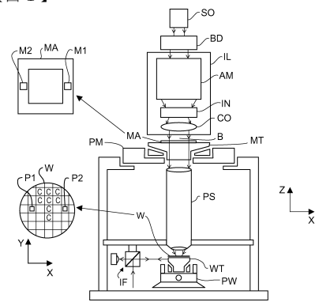

[回看原页](original.pdf#page=16)

【図3】

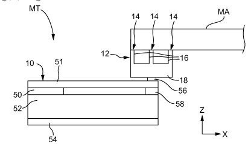

[回看原页](original.pdf#page=16)

【図4】

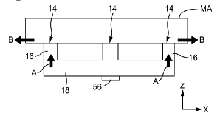

[回看原页](original.pdf#page=16)

【図2】

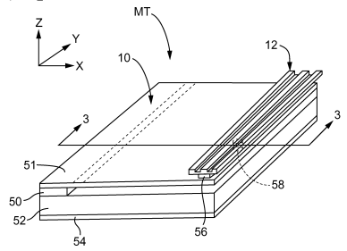

[回看原页](original.pdf#page=16)

【図5】

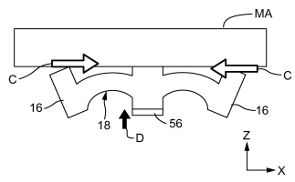

[回看原页](original.pdf#page=16)

## PDF第17页

[回看原页](original.pdf#page=17)

(17)

J P 5809458 B2 2015.11.11

【図6】

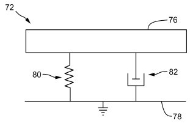

[回看原页](original.pdf#page=17)

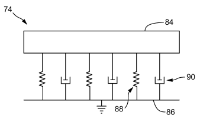

[回看原页](original.pdf#page=17)

【図7】

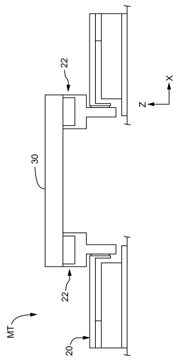

[回看原页](original.pdf#page=17)

【図8】

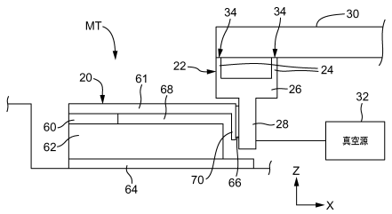

[回看原页](original.pdf#page=17)

【図10】

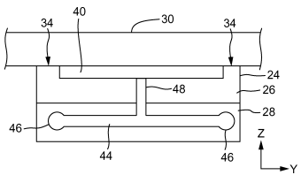

[回看原页](original.pdf#page=17)

【図9】

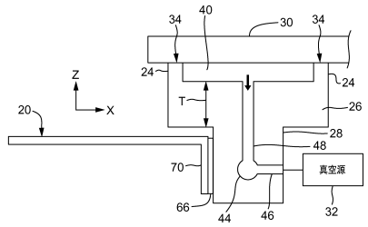

[回看原页](original.pdf#page=17)

## PDF第18页

[回看原页](original.pdf#page=18)

J P 5809458 B2 2015.11.11

【図11】

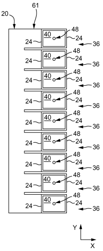

[回看原页](original.pdf#page=18)

【図12】

[回看原页](original.pdf#page=18)

## PDF第19页

[回看原页](original.pdf#page=19)

(19)

J P 5809458 B2 2015.11.11

フロントページの続き

審査官 佐野　浩樹

(56)参考文献 国際公開第99/024869（WO，A 1）特開2004-158847（J P，A）国際公開第02/065519（WO，A 1）特開2006-060241（J P，A）特開平10-316243（J P，A）特表2010-527139（J P，A）米国特許出願公開第2008/0291411（U S，A 1）特開2000-323406（J P，A）特開2005-003799（J P，A）特開昭57-034336（J P，A）特開昭57-072323（J P，A）特開昭56-130738（J P，A）特開昭57-058319（J P，A）

(58)調査した分野(Int.Cl.，D B名) G 03 F　7/20　-　7/24　、　9/00　-　9/02　、H 01 L 21/027、21/30

