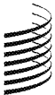
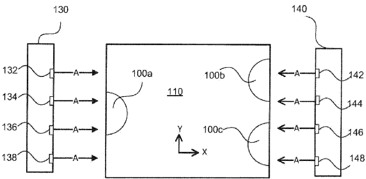
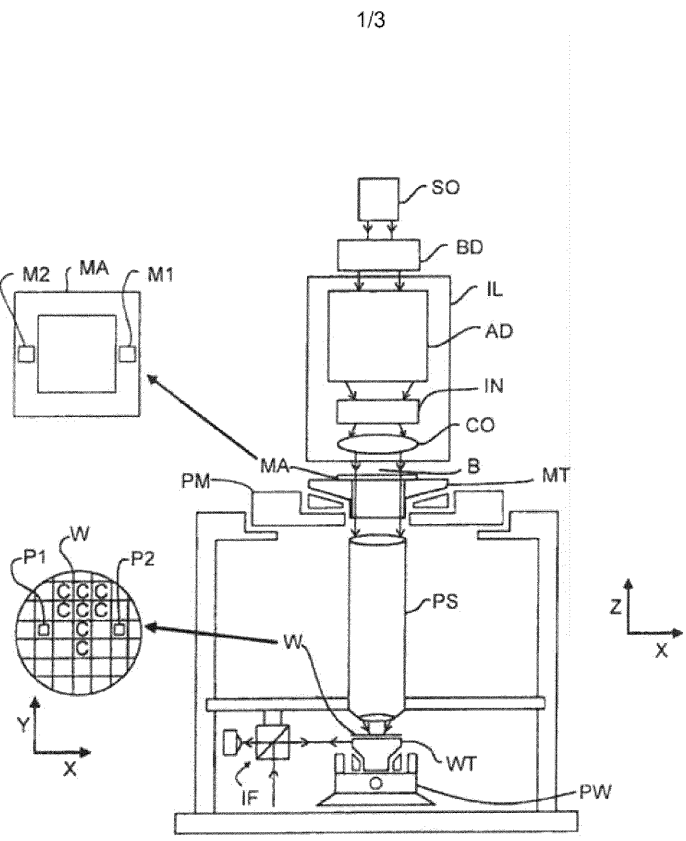
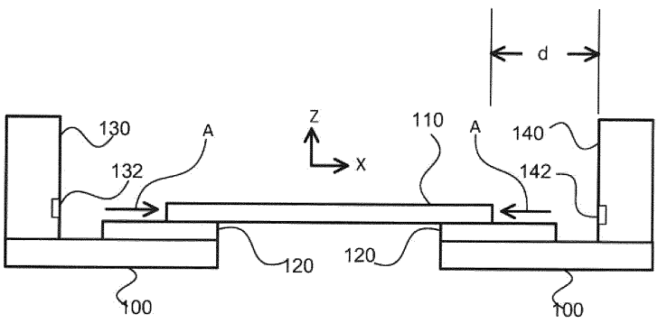
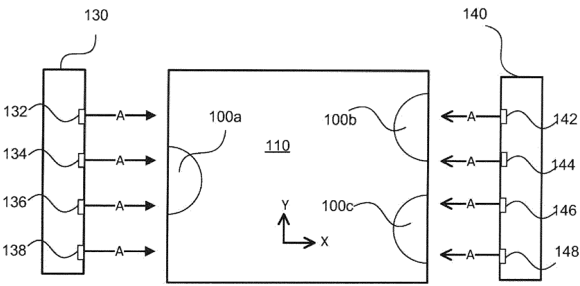
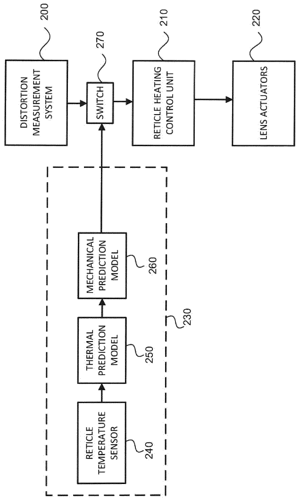

# WO2020094369A1 — Apparatus for and method of measuring distortion of a patterning device in a photolithographic apparatus

原件：[PDF](original.pdf)；SHA-256 `f881a9e96d4c5939ced23025fa13a3a51dc29ffad49720e2ac364594772a26ea`。物理页码从封面计1。

转换：本地MinerU 4.0.12，standard / auto；保留原语言。资料来源与文件校验值见[清单](../manifest.json)。机器输出未逐字校勘，关键文字、公式与图表回看原件。

校核提示（独立于机器提取正文）：[转换质量与已知问题](../QUALITY.md)。

## PDF第1页

[回看原页](original.pdf#page=1)

WO 2020/094369 A1

(12) INTERNATIONAL APPLICATION PUBLISHED UNDER THE PATENT COOPERATION TREATY (PCT)

(19) World Intellectual Property Organization
International Bureau

(43) International Publication Date 14 May 2020 (14.05.2020)

[回看原页](original.pdf#page=1)

WIPO | PCT

[回看原页](original.pdf#page=1)

(10) International Publication Number

WO 2020/094369 A1

(51) International Patent Classification: G03F 7/20 (2006.01)

(21) International Application Number: PCT/EP2019/078503

(22) International Filing Date: 21 October 2019 (21.10.2019)

(25) Filing Language: English

(26) Publication Language: English

(30) Priority Data:
62/755,590 05 November 2018 (05.11.2018) US

(71) Applicant: ASML HOLDING N.V. [NL/NL]; P.O. Box 324, 5500 AH Veldhoven (NL).

(72) Inventor: KALLURI, Ravi, Chaitanya; 77 Danbury Road, Wilton, Connecticut 06897 (US).

(74) Agent: SLENDERS, Petrus Johannes Waltherus; P.O. Box 324, 5500 AH Veldhoven (NL).

(81) Designated States (unless otherwise indicated, for every kind of national protection available): AE, AG, AL, AM, AO, AT, AU, AZ, BA, BB, BG, BH, BN, BR, BW, BY, BZ, CA, CH, CL, CN, CO, CR, CU, CZ, DE, DJ, DK, DM, DO, DZ, EC, EE, EG, ES, FI, GB, GD, GE, GH, GM, GT, HN, HR, HU, ID, IL, IN, IR, IS, JO, JP, KE, KG, KH, KN, KP, KR, KW, KZ, LA, LC, LK, LR, LS, LU, LY, MA, MD, ME, MG, MK, MN, MW, MX, MY, MZ, NA, NG, NI, NO, NZ, OM, PA, PE, PG, PH, PL, PT, QA, RO, RS, RU, RW, SA,

SC, SD, SE, SG, SK, SL, SM, ST, SV, SY, TH, TJ, TM, TN, TR, TT, TZ, UA, UG, US, UZ, VC, VN, ZA, ZM, ZW.

(84) Designated States (unless otherwise indicated, for every kind of regional protection available): ARIPO (BW, GH, GM, KE, LR, LS, MW, MZ, NA, RW, SD, SL, ST, SZ, TZ, UG, ZM, ZW), Eurasian (AM, AZ, BY, KG, KZ, RU, TJ, TM), European (AL, AT, BE, BG, CH, CY, CZ, DE, DK, EE, ES, FI, FR, GB, GR, HR, HU, IE, IS, IT, LT, LU, LV, MC, MK, MT, NL, NO, PL, PT, RO, RS, SE, SI, SK, SM, TR), OAPI (BF, BJ, CF, CG, CI, CM, GA, GN, GQ, GW, KM, ML, MR, NE, SN, TD, TG).

Published:
— with international search report (Art. 21(3))

(54) Title: APPARATUS FOR AND METHOD OF MEASURING DISTORTION OF A PATTERNING DEVICE IN A PHOTOLITHOGRAPHIC APPARATUS

[回看原页](original.pdf#page=1)

## FIG. 2B

(57) Abstract: A system for and method of measuring reticle distortion using a pneumatic sensor in which nozzles are placed along the sides of a reticle and the pneumatic sensor generates an output signal indicative of a distance between the sensor and a portion of the side of the reticle. The reticle distortion measurement from the sensor may be used as an input to a reticle heating control.

## PDF第2页

[回看原页](original.pdf#page=2)

10

5

15

20

25

WO 2020/094369

PCT/EP2019/078503

30

1

# APPARATUS FOR AND METHOD OF MEASURING DISTORTION OF A PATTERNING DEVICE IN A PHOTOLITHOGRAPHIC APPARATUS

## CROSS-REFERENCE TO RELATED APPLICATIONS

[0001] This application claims priority of U.S. Provisional Patent Application Number 62/755,590, which was filed on November 5, 2018, and which is incorporated herein in its entirety by reference.

## FIELD

[0002] The present disclosure relates to an apparatus for and method of measuring distortion of an object, for example, a patterning device such as a reticle in a lithographic apparatus.

## BACKGROUND

[0003] A lithographic apparatus is a machine that applies a desired pattern onto a substrate, usually onto a target portion of the substrate. A lithographic apparatus can be used, for example, in the manufacture of integrated circuits (ICs). In that instance, a patterning device, which is alternatively referred to as a mask or a reticle, may be used to generate a circuit pattern to be formed on an individual layer of the IC. This pattern can be transferred onto a target portion (e.g., comprising part of, one, or several dies) on a substrate (e.g., a silicon wafer). Transfer of the pattern is typically via imaging onto a layer of radiation-sensitive material (resist) provided on the substrate. In general, a single substrate will contain a network of adjacent target portions that are successively patterned. Known lithographic apparatus include so-called steppers, in which each target portion is irradiated by exposing an entire pattern onto the target portion at one time, and so-called scanners, in which each target portion is irradiated by scanning the pattern through a radiation beam in a given direction (the “scanning”-direction) while synchronously scanning the substrate parallel or anti-parallel to this direction. It is also possible to transfer the pattern from the patterning device to the substrate by imprinting the pattern onto the substrate.

[0004] In the lithographic apparatus, the radiation beam may induce thermal effects (e.g., thermal expansion) in the reticle. These thermal effects may be due to absorption of the radiation beam by non-transmissive portions of the reticle and may cause, for example, alignment errors and/or overlay errors in the patterns formed on the substrate. To correct these errors due to thermal

## PDF第3页

[回看原页](original.pdf#page=3)

WO 2020/094369

PCT/EP2019/078503

5

10

15

2

20

25

30

expansion of the reticle, current lithographic apparatus may rely on correction systems, such as reticle or wafer alignment systems, magnification correction systems, feed forward systems for expansion prediction, lens correction systems, or a combination thereof. However, with the continuing trend towards scaling down of device dimensions, these correction systems may not provide the desired level of alignment and/or overlay accuracy that may be needed for the development of these scaled-down devices.

[0005] In terms of a feed forward system for expansion prediction, current lithographic apparatus may use reticle temperature control systems (heating and/or cooling systems) in conjunction with to achieve a higher level of alignment and/or overlay accuracy. Distortion is estimated using thermal prediction models (TPM) and mechanical prediction models (MPM) which feed into reticle heating control (RHC). There are, however, limitations with this approach. For example, input to the TPM may be a one-time reticle temperature sensor (RTS) measurement of the reticle in its “cold” state, that is, its thermal state before any radiation-induced heating, and is not representative of the reticle temperature state during exposures. Also, reticles may have different properties from one another, for example, positive tone as opposed to negative tone, and the prediction models may not be accurate for all varieties of reticles. In addition, variations in stiffness between clamp assemblies make the MPM less accurate for prediction. Addressing these limitations gives rise to the subject matter disclosed herein.

## SUMMARY

[0006] The following presents a simplified summary of one or more embodiments in order to provide a basic understanding of the embodiments. This summary is not an extensive overview of all contemplated embodiments, and is not intended to identify key or critical elements of all embodiments nor delineate the scope of any or all embodiments. Its sole purpose is to present some concepts of one or more embodiments in a simplified form as a prelude to the more detailed description that is presented later.

[0007] According to one aspect of an embodiment, a pneumatic sensor is used to measure reticle distortion. The pneumatic sensor may be of an “air gauge” type in which nozzles are placed next to the reticle edge along both sides (Y-axis) of a reticle. The reticle distortion measurement from the sensor may be used as an input to a reticle heating control.

## PDF第4页

[回看原页](original.pdf#page=4)

5

15

WO 2020/094369

10

PCT/EP2019/078503

20

25

30

[0008] Further features and advantages of the present invention, as well as the structure and operation of various embodiments of the present invention, are described in detail below with reference to the accompanying drawings. It is noted that the present invention is not limited to the specific embodiments described herein. Such embodiments are presented herein for illustrative purposes only. Additional embodiments will be apparent to persons skilled in the relevant art(s) based on the teachings contained herein.

## BRIEF DESCRIPTION OF THE DRAWING

[0009] The accompanying drawings, which are incorporated herein and form part of the specification, illustrate the present invention and, together with the description, further serve to explain the principles of the present invention and to enable a person skilled in the relevant art(s) to make and use the present invention.

[0010] FIG. 1 depicts a lithographic apparatus according to an aspect of an embodiment of the invention.

[0011] FIG. 2A is a schematic illustration of a side view of an example system comprising a reticle sensing system according to an aspect of an embodiment

[0012] FIG. 2B is a schematic illustration of a plan view of an example system comprising a reticle sensing system according to an aspect of an embodiment

[0013] FIG. 3 is a functional block diagram of a system for compensating for reticle distortion according to an aspect of an embodiment

[0014] The features and advantages of the present invention will become more apparent from the detailed description set forth below when taken in conjunction with the drawings, in which like reference characters identify corresponding elements throughout. In the drawings, like reference numbers generally indicate identical, functionally similar, and/or structurally similar elements.

## DETAILED DESCRIPTION

[0015] This specification discloses one or more embodiments that incorporate features of this invention. The disclosed embodiments merely exemplify the present invention. The scope of the present invention is not limited to the disclosed embodiments. The present invention is defined by the claims appended hereto.

## PDF第5页

[回看原页](original.pdf#page=5)

WO 2020/094369

PCT/EP2019/078503

5

10

15

20

25

30

[0016] The embodiment(s) described, and references in the specification to “one embodiment”, “an embodiment”, “an example embodiment”, etc., indicate that the embodiment(s) described may include a particular feature, structure, or characteristic, but every embodiment may not necessarily include the particular feature, structure, or characteristic. Moreover, such phrases are not necessarily referring to the same embodiment. Further, when a particular feature, structure, or characteristic is described in connection with an embodiment, it is understood that it is within the knowledge of one skilled in the art to effect such feature, structure, or characteristic in connection with other embodiments whether or not explicitly described.

[0017] In the description that follows and in the claims the terms “up,” “down,” “top,” “bottom,” “vertical,” “horizontal,” and like terms may be employed. These terms are intended to show relative orientation only and not any orientation with respect to gravity. Similarly, terms such as left, right, front, back, etc., are intended to give only relative orientation.

[0018] Before describing embodiments in more detail, it is instructive to present an example environment in which embodiments of the present invention may be implemented. FIG. 1 schematically depicts a lithographic apparatus comprising an illumination system (illuminator) IL configured to condition a radiation beam, a support structure (e.g., a mask table) MT constructed to support a patterning device (e.g., a mask) MA and connected to a first positioner PM configured to accurately position the patterning device in accordance with certain parameters, a substrate table (e.g., a wafer table) WT constructed to hold a substrate (e.g., a resist-coated wafer) W and connected to a second positioner PW configured to accurately position the substrate in accordance with certain parameters, and a projection system (e.g., a refractive projection lens system) PS configured to project a pattern imparted to the radiation beam B by patterning device MA onto a target portion C (e.g., comprising one or more dies) of the substrate W.

[0019] The illumination system may include various types of optical components, such as refractive, reflective, magnetic, electromagnetic, electrostatic or other types of optical components, or any combination thereof, for directing, shaping, or controlling radiation.

[0020] The support structure bears the weight of, the patterning device. It holds the patterning device in a manner that depends on the orientation of the patterning device, the design of the lithographic apparatus, and other conditions, such as for example whether or not the patterning device is held in a vacuum environment. The support structure can use mechanical, vacuum, electrostatic or other clamping techniques to hold the patterning device. The support structure may

## PDF第6页

[回看原页](original.pdf#page=6)

WO 2020/094369

PCT/EP2019/078503

5

10

15

20

25

30

be a frame or a table, for example, which may be fixed or movable as required. The support structure may ensure that the patterning device is at a desired position, for example with respect to the projection system. Any use of the terms “reticle” or “mask” herein may be considered synonymous with the more general term “patterning device.”

[0021] The term “patterning device” used herein should be broadly interpreted as referring to any device that can be used to impart a radiation beam with a pattern in its cross-section such as to create a pattern in a target portion of the substrate. It should be noted that the pattern imparted to the radiation beam may not exactly correspond to the desired pattern in the target portion of the substrate, for example if the pattern includes phase-shifting features or so called assist features. Generally, the pattern imparted to the radiation beam will correspond to a particular functional layer in a device being created in the target portion, such as an integrated circuit.

[0022] The patterning device may be transmissive or reflective. Examples of patterning devices include masks, programmable mirror arrays, and programmable LCD panels. Masks are well known in lithography, and include mask types such as binary, alternating phase-shift, and attenuated phase-shift, as well as various hybrid mask types. An example of a programmable mirror array employs a matrix arrangement of small mirrors, each of which can be individually tilted so as to reflect an incoming radiation beam in different directions. The tilted mirrors impart a pattern in a radiation beam which is reflected by the mirror matrix.

[0023] The term “projection system” used herein should be broadly interpreted as encompassing any type of projection system, including refractive, reflective, catadioptric, electromagnetic and electrostatic optical systems, or any combination thereof, as appropriate for the exposure radiation being used, or for other factors such as the use of an immersion liquid or the use of a vacuum. Any use of the term “projection lens” herein may be considered as synonymous with the more general term “projection system”.

[0024] As here depicted, the apparatus is of a transmissive type (e.g., employing a transmissive mask). Alternatively, the apparatus may be of a reflective type (e.g., employing a programmable mirror array of a type as referred to above, or employing a reflective mask).

[0025] The lithographic apparatus may be of a type having two (dual stage) or more substrate tables (and/or two or more mask tables). In such “multi-stage” machines the additional tables may be used in parallel, or preparatory steps may be carried out on one or more tables while one or more other tables are being used for exposure.

## PDF第7页

[回看原页](original.pdf#page=7)

WO 2020/094369

PCT/EP2019/078503

5

10

15

20

25

30

[0026] The lithographic apparatus may also be of a type wherein at least a portion of the substrate may be covered by a liquid having a relatively high refractive index, e.g., water, so as to fill a space between the projection system and the substrate. An immersion liquid may also be applied to other spaces in the lithographic apparatus, for example, between the mask and the projection system. Immersion techniques are well known in the art for increasing the numerical aperture of projection systems. The term “immersion” as used herein does not mean that a structure, such as a substrate, must be submerged in liquid, but rather only means that liquid is located between the projection system and the substrate during exposure.

[0027] Referring again to FIG. 1, the illuminator IL receives a radiation beam from a radiation source SO. The source and the lithographic apparatus may be separate entities, for example when the source is an excimer laser. In such cases, the source is not considered to form part of the lithographic apparatus and the radiation beam is passed from the source SO to the illuminator IL with the aid of a beam delivery system BD comprising, for example, suitable directing mirrors and/or a beam expander. In other cases the source may be an integral part of the lithographic apparatus, for example when the source is a mercury lamp. The source SO and the illuminator IL, together with the beam delivery system BD if required, may be referred to as a radiation system.

[0028] The illuminator IL may comprise an adjuster AD for adjusting the angular intensity distribution of the radiation beam. Generally, at least the outer and/or inner radial extent (commonly referred to as σ-outer and σ-inner, respectively) of the intensity distribution in a pupil plane of the illuminator can be adjusted. In addition, the illuminator IL may comprise various other components, such as an integrator IN and a condenser CO. The illuminator may be used to condition the radiation beam, to have a desired uniformity and intensity distribution in its cross section.

[0029] The radiation beam B is incident on the patterning device (e.g., mask MA), which is held on the support structure (e.g., mask table MT), and is patterned by the patterning device. Having traversed the mask MA, the radiation beam B passes through the projection system PS, which focuses the beam onto a target portion C of the substrate W. With the aid of the second positioner PW and position sensor IF (e.g., an interferometric device, linear encoder or capacitive sensor), the substrate table WT can be moved accurately, e.g., so as to position different target portions C in the path of the radiation beam B. Similarly, the first positioner PM and another position sensor (which is not explicitly depicted in FIG. 1) can be used to accurately position the mask MA with

## PDF第8页

[回看原页](original.pdf#page=8)

WO 2020/094369

PCT/EP2019/078503

5

10

15

20

25

30

7

respect to the path of the radiation beam B, e.g., after mechanical retrieval from a mask library, or during a scan. In general, movement of the mask table MT may be realized with the aid of a long-stroke module (coarse positioning) and a short-stroke module (fine positioning), which form part of the first positioner PM. Similarly, movement of the substrate table WT may be realized using a long-stroke module and a short-stroke module, which form part of the second positioner PW. In the case of a stepper (as opposed to a scanner) the mask table MT may be connected to a short-stroke actuator only, or may be fixed. Mask MA and substrate W may be aligned using mask alignment marks M1, M2 and substrate alignment marks P1, P2. Although the substrate alignment marks as illustrated occupy dedicated target portions, they may be located in spaces between target portions (these are known as scribe-lane alignment marks). Similarly, in situations in which more than one die is provided on the mask MA, the mask alignment marks may be located between the dies.

[0030] The depicted apparatus could be used in at least a step mode or a scan mode. In step mode, the mask table MT and the substrate table WT are kept essentially stationary, while an entire pattern imparted to the radiation beam is projected onto a target portion C at one time (i.e., a single static exposure). The substrate table WT is then shifted in the X and/or Y direction so that a different target portion C can be exposed. In step mode, the maximum size of the exposure field limits the size of the target portion C imaged in a single static exposure.

[0031] In scan mode, the mask table MT and the substrate table WT are scanned synchronously while a pattern imparted to the radiation beam is projected onto a target portion C (i.e., a single dynamic exposure). The velocity and direction of the substrate table WT relative to the mask table MT may be determined by the (de-)magnification and image reversal characteristics of the projection system PS. In scan mode, the maximum size of the exposure field limits the width (in the non-scanning direction) of the target portion in a single dynamic exposure, whereas the length of the scanning motion determines the height (in the scanning direction) of the target portion.

[0032] In another mode, the mask table MT is kept essentially stationary holding a programmable patterning device, and the substrate table WT is moved or scanned while a pattern imparted to the radiation beam is projected onto a target portion C. In this mode, generally a pulsed radiation source is employed and the programmable patterning device is updated as required after each movement of the substrate table WT or in between successive radiation pulses during a scan. This

## PDF第9页

[回看原页](original.pdf#page=9)

WO 2020/094369

PCT/EP2019/078503

5

10

15

20

25

30

8

mode of operation can be readily applied to maskless lithography that utilizes programmable patterning device, such as a programmable mirror array of a type as referred to above.

[0033] Combinations and/or variations on the above described modes of use or entirely different modes of use may also be employed.

[0034] The photolithography system also preferably includes a control system. In general, the control system includes one or more of digital electronic circuitry, computer hardware, firmware, and software. The control system also includes memory which can be read-only memory and/or random access memory. Storage devices suitable for tangibly embodying computer program instructions and data include all forms of non-volatile memory, including, by way of example, semiconductor memory devices, such as EPROM, EEPROM, and flash memory devices; magnetic disks such as internal hard disks and removable disks; magneto-optical disks; and CD-ROM disks. [0035] As heat energy is absorbed by the reticle, thermal stresses can develop and thermal expansion can occur in the reticle. Thermal gradients and stresses can develop due to the relatively low thermal conductivity of the quartz material of typical reticles. Such stresses can lead to local reticle deformations. The fact that the reticle is typically clamped can lead to additional high-order deformations. At least some of this deformation can be corrected through the adjustment of the scanning lens elements. Also, heat may be added to a part of the reticle that does not encounter the exposure light or has a temperature lower than other parts of the reticle.

[0036] Thermal stresses can still develop, however, due to the fact that the reticle is typically clamped. These stresses can be relieved periodically by unclamping the reticle and allowing the reticle to relax. Upon relieving the stress in this way, the reticle can be re-clamped and re-aligned as needed. Alternatively, the selective heating device may be modulated in space and time to minimize the non-correctable portion of the heating-induced distortion. This may result in a non-uniform temperature profile in the substrate, but a minimum of non-corrected mask distortion.

[0037] Despite these measures, it remains necessary to be able to determine the reticle distortions and control the system to compensate for those distortions so that they do not result in any production errors. As discussed, this distortion may be estimated using thermal prediction models (TPM) and mechanical prediction models (MPM) which feed into reticle heating control (RHC). A temperature sensor measures the temperature of the reticle. This measured temperature is provided as an input into the TPM. The TPM uses a matrix of calculations to predict distortion of the reticle caused by thermal loading of the reticle which in turn feeds into the MPM to obtain a

## PDF第10页

[回看原页](original.pdf#page=10)

WO 2020/094369

PCT/EP2019/078503

5

10

15

20

25

30

9

feedforward control of the reticle heating correction. The predicted thermal distortion is used to perform a reticle heating correction and/or to control compensating lens actuators The MPM is an approximation of the mechanical properties of the reticle and is used to predict a mechanical distortion of the reticle caused by mechanical loading of the reticle by, for example the clamp. The reticle heating correction is performed by controlling the optical system to perform an optical correction for the calculated distortion in the reticle. In this regard, see, for example, U.S. Patent No. 8,184,265, issued May 22, 2012, and titled “Correction Method for Non-uniform Reticle Heating in a Lithographic Apparatus”, the entire contents of which are hereby incorporated by reference.

[0038] According to an aspect of an embodiment, sensors measure the positions of the sides of the reticle. In general, due to distortion, the sides will not be straight and there will be a change in the relative displacement of the sensor and the reticle edge on the order of tens of nanometers. A change in displacement between the sensor and the reticle edge will result in a change in back pressure. Measurement of this change in back pressure is used to determine the change in edge displacement. Arrangements for determining position using a nozzle and measurement of back pressure are disclosed, for example, in International Publication Number WO 2017/108336 Al, published June 29, 2017 and titled “Height Measurement Apparatus”, in U.S. Patent No. 7,021,120, issued April 4, 2006 and titled “High Resolution Gas Gauge Proximity Sensor”, and in U.S. Patent No. 7,578,168, issued August 25, 2009 and titled “Increasing Gas Gauge Pressure Sensitivity Using Nozzle-Faced Surface Roughness”, the contents of all of which are hereby incorporated by reference in their entirety.

[0039] According to an aspect of an embodiment, as shown in FIG. 2A, a chuck 100 which is part of the mask table MT supports a patterning device 110. A membrane 120 may be interposed between the patterning device 110 and the chuck 100. Also shown is a sensor 130 positioned to one side of an edge of the patterning device 110 and a sensor 140 positioned next to an opposite edge side of the patterning device 110. The sensors 130 and 140 are of an air gauge type in which a gas flow indicated by the arrows “a” is used to detect a distance “d” between the patterning device 110 and the respective sensors 130 and 140.

[0040] FIG. 2B is a top plan view of the arrangement of FIG. 2A. As can be seen the patterning device 110 is supported at three points 100a, 100 b, and 100c. The sensor 130 has a series of nozzles 132, 134, 136, and 138. The sensor 140 has a series of nozzles 142, 144, 146, and 148.

## PDF第11页

[回看原页](original.pdf#page=11)

WO 2020/094369

PCT/EP2019/078503

5

10

15

20

25

30

Although FIG. 2B shows the use of four nozzles for each edge, it will be apparent to one of ordinary skill in the art that more or fewer nozzles may be used. The nozzles blow a gas such as air onto the edge of the patterning device 110. The back pressure produced by the flow there is measured by the sensors 130 and 140 to determine a distance between the edge and the sensor.

[0041] In use, the sensors are moved away during a reticle exchange. Then, after a reticle exchange is completed, and the reticle is loaded on the chuck 100, the sensors 130 and 140 are deployed to their operational positions laterally adjacent either side of patterning device 110. In the measurement position, the sensors 130 and 140 can continuously determine the edge profile, that is, the deviations of the patterning device edge from a straight line, in the Y-direction, as the reticle is heated during exposures. Then the sensors may be moved out of the way to avoid interfering with the next reticle exchange.

[0042] FIG. 3 is a diagram explaining a system for using the distortion measurements developed by the arrangement just described to correct for lateral distortion in the patterning device. The system includes a distortion measurement system 200 as described above. A signal indicative of the magnitude of deviations of the positions of the edge of the reticle obtained in the reticle distortion measurement performed by the distortion measurement system are provided to a reticle distortion compensation unit 210. The reticle distortion compensation unit 210 then uses the signal as at least a partial basis to control lens actuators 220 in the optical system permitting optical compensation for the reticle distortion.

[0043] The distortion measurement system 200 is capable of providing sufficient information for the reticle distortion compensation unit 210 to control the lens actuators 220. Therefore, components of a conventional system such as a reticle temperature sensor, thermal prediction model, and mechanical prediction model are not necessary. For some applications, however, it may be advantageous to have the option of also having the predictions supplied by these components available as well. Thus, as also shown in FIG. 3, an optional conventional reticle distortion prediction unit 230 includes a reticle sensor temperature sensor 240 whose output is input to a thermal prediction model 250. The output of the thermal prediction model 250 is fed as an input to a mechanical prediction model 260. A software switch 270 chooses which data to input to the reticle distortion compensation unit 210.

[0044] The embodiments may further be described using the following clauses:

1. A system for compensating for distortions in a patterning device in a lithographic

## PDF第12页

[回看原页](original.pdf#page=12)

10

5

15

20

WO 2020/094369

PCT/EP2019/078503

25

30

## 11

apparatus, the system comprising:

a support for the patterning device;

at least one sensor positionable laterally adjacent to an edge of the patterning device when the patterning device is mounted on the support, the sensor being configured to generate an output signal indicative of a distance between the sensor and a portion of the edge; and

a reticle distortion compensation unit arranged to receive the output signal and configured to generate a compensation control signal based at least in part on the output signal.

2. A system of clause 1 wherein the sensor comprises at least one nozzle for expelling a flow of gas at the portion of the edge and a measurement unit that measures an amount of backpressure exerted on the flow of gas by the portion of the edge.

3. A system of clause 1 further comprising at least two sensors, a first sensor and a second sensor, the first sensor being positionable laterally adjacent to a first edge of the patterning device when the patterning device is mounted on the support, the second sensor being positionable laterally adjacent to a second edge of the patterning device when the patterning device is mounted on the support, the first sensor being configured to generate an output signal indicative of a distance between the first sensor and a portion of the first edge and the second sensor being configured to generate an output signal indicative of a distance between the second sensor and a portion of the second edge.

4. A system of clause 1 wherein the first sensor a comprises at least one nozzle for expelling a flow of gas at the portion of the edge and a measurement unit that measures an amount of backpressure exerted on the flow of gas by the portion of the first edge and the second sensor a comprises at least one nozzle for expelling a flow of gas at the portion of the edge and a measurement unit that measures an amount of backpressure exerted on the flow of gas by the portion of the second edge.

5. A system of clause 1, 2, 3, or 4 further comprising an optical system comprising at least one optical element having an optical property alterable by an actuator based at least in part on the compensation control signal.

6. A system of clause 1 wherein the at least one sensor comprises a linear array of sensor elements positioned adjacent to and extending in a direction parallel to the edge.

7. A system of clause 5 wherein each of the sensor elements comprises at least one nozzle for expelling a flow of gas at a respective portion of the edge and a measurement unit that measures

## PDF第13页

[回看原页](original.pdf#page=13)

10

5

15

20

WO 2020/094369

PCT/EP2019/078503

25

30

## 12

an amount of backpressure exerted on the flow of gas by the respective portion of the edge.

8. A system of clause 6 or 7 further comprising an optical system comprising at least one optical element having an optical property alterable by an actuator based at least in part on the compensation control signal.

9. A system for compensating for distortions in a patterning device in a lithographic apparatus, the system comprising:

a support for the patterning device;

a first sensor being positionable laterally adjacent to a first edge of the patterning device when the patterning device is mounted on the support and comprising a linear array of first sensor elements positioned adjacent to and extending in a direction parallel to the first edge of the patterning device and configured to generate a first output signal indicative of a distortions in distance between the first sensor and a portion of the first edge;

a second sensor being positionable laterally adjacent to a second edge of the patterning device when the patterning device is mounted on the support and comprising a linear array of second sensor elements positioned adjacent to and extending in a direction parallel to the second edge of the patterning device and configured to generate a second output signal indicative of a distortions in distance between the second sensor and a portion of the second edge; and

a reticle distortion compensation unit arranged to receive the first and second output signals and configured to generate a compensation control signal based at least in part on the first and second output signals.

10. A system of clause 9 wherein each of the first sensor elements comprises at least one nozzle for expelling a flow of gas at a respective portion of the first edge and a first measurement unit that measures an amount of backpressure exerted on the flow of gas by the respective portion of the first edge and each of the second sensor elements comprises at least one nozzle for expelling a flow of gas at a respective portion of the second edge and a second measurement unit that measures an amount of backpressure exerted on the flow of gas by the respective portion of the second edge. 11. A system of clause 9 or 10 further comprising an optical system comprising at least one optical element having an optical property alterable by an actuator based at least in part on the compensation control signal.

12. A method of compensating for distortions in a patterning device in a lithographic apparatus, the method comprising:

## PDF第14页

[回看原页](original.pdf#page=14)

10

5

15

WO 2020/094369

PCT/EP2019/078503

20

25

30

## 13

placing the patterning device in a support;

measuring a distance of an edge portion of the patterning device using at least one sensor positionable laterally adjacent to the edge of the patterning device to generate an output signal indicative of a distance between the sensor and the portion of the edge; and

generating a compensation control signal based at least in part on the output signal.

13. A method of clause 12 further comprising a step after the generating step of altering an optical property of at least one optical element based at least in part on the compensation control signal.

14. A method of clause 12 further comprising a step after the generating step of altering an optical property of at least one optical element using an actuator based at least in part on the compensation control signal.

15. A method of clause 12, 13, or 14 wherein the measuring step comprises expelling a flow of gas at the portion of the edge and a measurement unit that measures an amount of backpressure exerted on the flow of gas by the portion of the edge.

[0045] Although specific reference may be made in this text to the use of lithographic apparatus in the manufacture of ICs, it should be understood that the lithographic apparatus described herein may have other applications, such as the manufacture of integrated optical systems, guidance and detection patterns for magnetic domain memories, flat-panel displays, liquid-crystal displays (LCDs), thin-film magnetic heads, etc. The skilled artisan will appreciate that, in the context of such alternative applications, any use of the terms “wafer” or “die” herein may be considered as synonymous with the more general terms “substrate” or “target portion”, respectively. The substrate referred to herein may be processed, before or after exposure, in for example a track (a tool that typically applies a layer of resist to a substrate and develops the exposed resist), a metrology tool and/or an inspection tool. Where applicable, the disclosure herein may be applied to such and other substrate processing tools. Further, the substrate may be processed more than once, for example in order to create a multi-layer IC, so that the term substrate used herein may also refer to a substrate that already contains multiple processed layers.

[0046] While specific embodiments of the present invention have been described above, it will be appreciated that the present invention may be practiced other than as described. The descriptions above are intended to be illustrative, not limiting. Thus it will be apparent to one skilled in the art

## PDF第15页

[回看原页](original.pdf#page=15)

WO 2020/094369

PCT/EP2019/078503

5

10

15

20

that modifications may be made to the present invention as described without departing from the scope of the claims that follow.

[0047] It is to be appreciated that the Detailed Description section, and not the Summary and Abstract sections, is intended to be used to interpret the claims. The Summary and Abstract sections may set forth one or more but not all exemplary embodiments of the present invention as contemplated by the inventor(s), and thus, are not intended to limit the present invention and the appended claims in any way.

[0048] The present invention has been described above with the aid of functional building blocks illustrating the implementation of specified functions and relationships thereof. The boundaries of these functional building blocks have been arbitrarily defined herein for the convenience of the description. Alternate boundaries can be defined so long as the specified functions and relationships thereof are appropriately performed.

[0049] The foregoing description of the specific embodiments will so fully reveal the general nature of the present invention that others can, by applying knowledge within the skill of the art, readily modify and/or adapt for various applications such specific embodiments, without undue experimentation, without departing from the general concept of the present invention. Therefore, such adaptations and modifications are intended to be within the meaning and range of equivalents of the disclosed embodiments, based on the teaching and guidance presented herein. It is to be understood that the phraseology or terminology herein is for the purpose of description and not of limitation, such that the terminology or phraseology of the present specification is to be interpreted by the skilled artisan in light of the teachings and guidance.

[0050] The breadth and scope of the present invention should not be limited by any of the above-described exemplary embodiments, but should be defined only in accordance with the following claims and their equivalents.

## PDF第16页

[回看原页](original.pdf#page=16)

5

10

15

20

PCT/EP2019/078503

WO 2020/094369

25

30

## 15

## CLAIMS

1. A system for compensating for distortions in a patterning device in a lithographic apparatus, the system comprising:

a support for the patterning device;

at least one sensor positionable laterally adjacent to an edge of the patterning device when the patterning device is mounted on the support, the sensor being configured to generate an output signal indicative of a distance between the sensor and a portion of the edge; and

a reticle distortion compensation unit arranged to receive the output signal and configured to generate a compensation control signal based at least in part on the output signal.

2. A system as claimed in claim 1 wherein the sensor comprises at least one nozzle for expelling a flow of gas at the portion of the edge and a measurement unit that measures an amount of backpressure exerted on the flow of gas by the portion of the edge.

3. A system as claimed in claim 1 further comprising at least two sensors, a first sensor and a second sensor, the first sensor being positionable laterally adjacent to a first edge of the patterning device when the patterning device is mounted on the support, the second sensor being positionable laterally adjacent to a second edge of the patterning device when the patterning device is mounted on the support, the first sensor being configured to generate an output signal indicative of a distance between the first sensor and a portion of the first edge and the second sensor being configured to generate an output signal indicative of a distance between the second sensor and a portion of the second edge.

4. A system as claimed in claim 1 wherein the first sensor a comprises at least one nozzle for expelling a flow of gas at the portion of the edge and a measurement unit that measures an amount of backpressure exerted on the flow of gas by the portion of the first edge and the second sensor a comprises at least one nozzle for expelling a flow of gas at the portion of the edge and a measurement unit that measures an amount of backpressure exerted on the flow of gas by the portion of the second edge.

## PDF第17页

[回看原页](original.pdf#page=17)

10

5

15

20

WO 2020/094369

PCT/EP2019/078503

25

30

## 16

5. A system as claimed in claim 1, 2, 3, or 4 further comprising an optical system comprising at least one optical element having an optical property alterable by an actuator based at least in part on the compensation control signal.

6. A system as claimed in claim 1 wherein the at least one sensor comprises a linear array of sensor elements positioned adjacent to and extending in a direction parallel to the edge.

7. A system as claimed in claim 5 wherein each of the sensor elements comprises at least one nozzle for expelling a flow of gas at a respective portion of the edge and a measurement unit that measures an amount of backpressure exerted on the flow of gas by the respective portion of the edge.

8. A system as claimed in claim 6 or 7 further comprising an optical system comprising at least one optical element having an optical property alterable by an actuator based at least in part on the compensation control signal.

9. A system for compensating for distortions in a patterning device in a lithographic apparatus, the system comprising:

a support for the patterning device;

a first sensor being positionable laterally adjacent to a first edge of the patterning device when the patterning device is mounted on the support and comprising a linear array of first sensor elements positioned adjacent to and extending in a direction parallel to the first edge of the patterning device and configured to generate a first output signal indicative of a distortions in distance between the first sensor and a portion of the first edge;

a second sensor being positionable laterally adjacent to a second edge of the patterning device when the patterning device is mounted on the support and comprising a linear array of second sensor elements positioned adjacent to and extending in a direction parallel to the second edge of the patterning device and configured to generate a second output signal indicative of a distortions in distance between the second sensor and a portion of the second edge; and

a reticle distortion compensation unit arranged to receive the first and second output signals and configured to generate a compensation control signal based at least in part on the first and

## PDF第18页

[回看原页](original.pdf#page=18)

10

5

15

20

25

WO 2020/094369

PCT/EP2019/078503

30

## 17

second output signals.

10. A system as claimed in claim 9 wherein each of the first sensor elements comprises at least one nozzle for expelling a flow of gas at a respective portion of the first edge and a first measurement unit that measures an amount of backpressure exerted on the flow of gas by the respective portion of the first edge and each of the second sensor elements comprises at least one nozzle for expelling a flow of gas at a respective portion of the second edge and a second measurement unit that measures an amount of backpressure exerted on the flow of gas by the respective portion of the second edge.

11. A system as claimed in claim 9 or 10 further comprising an optical system comprising at least one optical element having an optical property alterable by an actuator based at least in part on the compensation control signal.

12. A method of compensating for distortions in a patterning device in a lithographic apparatus, the method comprising:

placing the patterning device in a support;

measuring a distance of an edge portion of the patterning device using at least one sensor positionable laterally adjacent to the edge of the patterning device to generate an output signal indicative of a distance between the sensor and the portion of the edge; and

generating a compensation control signal based at least in part on the output signal.

13. A method as claimed in claim 12 further comprising a step after the generating step of altering an optical property of at least one optical element based at least in part on the compensation control signal.

14. A method as claimed in claim 12 further comprising a step after the generating step of altering an optical property of at least one optical element using an actuator based at least in part on the compensation control signal.

15. A method as claimed in claim 12, 13, or 14 wherein the measuring step comprises expelling

## PDF第19页

[回看原页](original.pdf#page=19)

WO 2020/094369

PCT/EP2019/078503

18

a flow of gas at the portion of the edge and a measurement unit that measures an amount of backpressure exerted on the flow of gas by the portion of the edge.

## PDF第20页

[回看原页](original.pdf#page=20)

WO 2020/094369

PCT/EP2019/078503

[回看原页](original.pdf#page=20)

FIG. 1

## PDF第21页

[回看原页](original.pdf#page=21)

WO 2020/094369

PCT/EP2019/078503

2/3

[回看原页](original.pdf#page=21)

FIG. 2A

[回看原页](original.pdf#page=21)

FIG. 2B

## PDF第22页

[回看原页](original.pdf#page=22)

3/3

WO 2020/094369

PCT/EP2019/078503

[回看原页](original.pdf#page=22)

FIG. 3

## PDF第23页

[回看原页](original.pdf#page=23)

INTERNATIONAL SEARCH REPORT

<table><tr><td colspan="2">INTERNATIONAL SEARCH REPORT</td><td>International application NoPCT/EP2019/078503</td></tr><tr><td colspan="3">A. CLASSIFICATION OF SUBJECT MATTERINV. G03F7/20ADD.According to International Patent Classification (IPC) or to both national classification and IPC</td></tr><tr><td colspan="3">B. FIELDS SEARCHED</td></tr><tr><td colspan="3">Minimum documentation searched (classification system followed by classification symbols)G03F</td></tr><tr><td colspan="3">Documentation searched other than minimum documentation to the extent that such documents are included in the fields searched</td></tr><tr><td colspan="3">Electronic data base consulted during the international search (name of data base and, where practicable, search terms used)EPO-Internal, WPI Data</td></tr><tr><td colspan="3">C. DOCUMENTS CONSIDERED TO BE RELEVANT</td></tr><tr><td>Category&quot;</td><td>Citation of document, with indication, where appropriate, of the relevant passages</td><td>Relevant to claim No.</td></tr><tr><td>X</td><td rowspan="2">WO 2015/165623 A1 (ASML NETHERLANDS BV[NL]; ASML HOLDING NV [NL])5 November 2015 (2015-11-05)paragraph [0052] - paragraph [0086]figures 3-8----</td><td>1,3,6,9,12</td></tr><tr><td>Y</td><td>2,4,5,7,8,10,11,13-15</td></tr><tr><td>Y</td><td rowspan="2">JP H07 183214 A (CANON KK)21 July 1995 (1995-07-21)paragraphs [0025], [0026]; figure 2----</td><td rowspan="2">2,4,7,10,151,9,12</td></tr><tr><td>A</td></tr><tr><td>Y</td><td rowspan="2">WO 2014/048654 A1 (ASML HOLDING NV [NL];ASML NETHERLANDS BV [NL])3 April 2014 (2014-04-03)paragraph [0064]; figure 6----</td><td rowspan="2">5,8,11,13,141,9,12</td></tr><tr><td>A</td></tr><tr><td></td><td>--/--</td><td></td></tr><tr><td colspan="3">X Further documents are listed in the continuation of Box C. X See patent family annex.</td></tr><tr><td colspan="2">* Special categories of cited documents:&quot;A&quot; document defining the general state of the art which is not considered to be of particular relevance&quot;E&quot; earlier application or patent but published on or after the international filing date&quot;L&quot; document which may throw doubts on priority claim(s) or which is cited to establish the publication date of another citation or other special reason (as specified)&quot;O&quot; document referring to an oral disclosure, use, exhibition or other means&quot;P&quot; document published prior to the international filing date but later than the priority date claimed</td><td>&quot;T&quot; later document published after the international filing date or priority date and not in conflict with the application but cited to understand the principle or theory underlying the invention&quot;X&quot; document of particular relevance; the claimed invention cannot be considered novel or cannot be considered to involve an inventive step when the document is taken alone&quot;Y&quot; document of particular relevance; the claimed invention cannot be considered to involve an inventive step when the document is combined with one or more other such documents, such combination being obvious to a person skilled in the art&quot;&amp;&quot; document member of the same patent family</td></tr><tr><td colspan="2">Date of the actual completion of the international search2 December 2019</td><td>Date of mailing of the international search report11/12/2019</td></tr><tr><td colspan="2">Name and mailing address of the ISA/European Patent Office, P.B. 5818 Patentlaan 2NL - 2280 HV RijswijkTel. (+31-70) 340-2040,Fax: (+31-70) 340-3016</td><td>Authorized officerMeixner, Matthias</td></tr></table>

Form PCT/ISA/210 (second sheet) (April 2005)

page 1 of 2

## PDF第24页

[回看原页](original.pdf#page=24)

INTERNATIONAL SEARCH REPORT

<table><tr><td colspan="3">C(Continuation). DOCUMENTS CONSIDERED TO BE RELEVANT</td></tr><tr><td>Category*</td><td>Citation of document, with indication, where appropriate, of the relevant passages</td><td>Relevant to claim No.</td></tr><tr><td>A</td><td>WO 2011/012368 A1 (ASML HOLDING NV [NL]; LYONS JOSEPH [US])3 February 2011 (2011-02-03)the whole document-----</td><td>1,9,12</td></tr></table>

Form PCT/ISA/210 (continuation of second sheet) (April 2005)

2

page 2 of 2

## PDF第25页

[回看原页](original.pdf#page=25)

<table><tr><td colspan="4">International Search ReportInformation on patent family members</td><td colspan="2">International application NoPCT/EP2019/078503</td></tr><tr><td>Patent document cited in search report</td><td>Publication date</td><td colspan="2">Patent family member(s)</td><td colspan="2">Publication date</td></tr><tr><td rowspan="6">WO 2015165623 A1</td><td rowspan="6">05-11-2015</td><td>CN</td><td>106164778 A</td><td colspan="2">23-11-2016</td></tr><tr><td>JP</td><td>2017516124 A</td><td colspan="2">15-06-2017</td></tr><tr><td>NL</td><td>2014403 A</td><td colspan="2">02-11-2015</td></tr><tr><td>TW</td><td>201546576 A</td><td colspan="2">16-12-2015</td></tr><tr><td>US</td><td>2017068171 A1</td><td colspan="2">09-03-2017</td></tr><tr><td>WO</td><td>2015165623 A1</td><td colspan="2">05-11-2015</td></tr><tr><td rowspan="2">JP H07183214 A</td><td rowspan="2">21-07-1995</td><td>JP</td><td>3278303 B2</td><td colspan="2">30-04-2002</td></tr><tr><td>JP</td><td>H07183214 A</td><td colspan="2">21-07-1995</td></tr><tr><td rowspan="6">WO 2014048654 A1</td><td rowspan="6">03-04-2014</td><td>CN</td><td>104662480 A</td><td colspan="2">27-05-2015</td></tr><tr><td>JP</td><td>6069509 B2</td><td colspan="2">01-02-2017</td></tr><tr><td>JP</td><td>2015535953 A</td><td colspan="2">17-12-2015</td></tr><tr><td>KR</td><td>20150053998 A</td><td colspan="2">19-05-2015</td></tr><tr><td>US</td><td>2015212425 A1</td><td colspan="2">30-07-2015</td></tr><tr><td>WO</td><td>2014048654 A1</td><td colspan="2">03-04-2014</td></tr><tr><td rowspan="8">WO 2011012368 A1</td><td rowspan="8">03-02-2011</td><td>CN</td><td>102472614 A</td><td colspan="2">23-05-2012</td></tr><tr><td>JP</td><td>5669841 B2</td><td colspan="2">18-02-2015</td></tr><tr><td>JP</td><td>2013501213 A</td><td colspan="2">10-01-2013</td></tr><tr><td>KR</td><td>20120053019 A</td><td colspan="2">24-05-2012</td></tr><tr><td>NL</td><td>2004889 A</td><td colspan="2">02-02-2011</td></tr><tr><td>TW</td><td>201109620 A</td><td colspan="2">16-03-2011</td></tr><tr><td>US</td><td>2012120380 A1</td><td colspan="2">17-05-2012</td></tr><tr><td>WO</td><td>2011012368 A1</td><td colspan="2">03-02-2011</td></tr></table>

Form PCT/ISA/210 (patent family annex) (April 2005)

