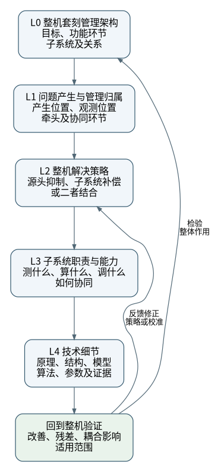

# 报告默认骨架：L0—L4

来源：2026-10-28用户提出L0—L4逻辑，并明确要求先将其作为报告骨架写入仓库。后续报告未另有特殊要求时，沿本主线撰写和修改；继承旧Markdown时也应按此结构重新组织。其他研究对象沿用相同的分层方法，将“整机套刻”替换为相应系统目标，并记录适用范围。

本文件规定研究和叙述方式，不是已经验证的光刻机架构或报告正文。现有R1尚未按此骨架重写；全部45件专利的通读与归纳属于后续报告工作，不能以本次规范入库代替。

## 总体组织方式

先建立L0整体逻辑框图，再对每个问题或一类问题沿L1—L4展开，最后回到整机验证。正文按架构和问题之间的关系组织，专利作为各层的证据；逐篇阅读记录和索引用于保证资料覆盖与追溯。L0—L4是逻辑层级，不要求机械地把全文分为五章，也不要求每件专利占据一章。

[查看可编辑框图源文件](figures/l0-l4-structure.dot)。节点按文字自动确定尺寸，长说明显式分行，预留内边距；图中文字使用矢量轮廓，避免查看端替换字体后裁切。各层完整定义同时见下表。

上图是报告组织示意图。正式报告开篇应展示根据原始资料建立的整体逻辑框图，具体表达管理环节、子系统、数据流、作用关系及反馈路径，不能仅用本组织图代替技术架构图。

## 各层定义与输出

| 层级 | 定义 | 必须回答的问题 | 应呈现的内容 |
| --- | --- | --- | --- |
| L0 | 确定整机套刻管理架构 | 套刻目标是什么？整机怎样组织测量、校准、建模、校正与验证？各环节交换什么信息、施加什么作用？ | 整体逻辑框图、概念与评价边界、功能职责及关系 |
| L1 | 问题产生与管理归属 | 误差怎样产生和表现？在哪里被观测？由哪个环节牵头，哪些环节协同？ | 问题定义、物理来源与影响路径、管理位置及适用条件 |
| L2 | 整机如何解决一个或一类问题 | 从源头抑制误差、通过子系统补偿影响，还是二者结合？为什么这样分工？剩余误差如何处理？ | 整机解决策略、处理路径、分工理由及策略之间的关系 |
| L3 | 源头抑制或补偿的子系统职责与能力 | 哪些子系统参与？各自测什么、算什么、调什么？需要什么能力才能完成任务？ | 职责分配、输入输出、量测与校准能力、执行能力及协同条件 |
| L4 | 进一步解释技术细节 | 具体物理机制、器件结构、模型、算法、参数与执行步骤是什么？效果有什么证据和边界？ | 原专利图表逐步解读、关键公式与参数、实施例、验证结果及限制 |

## 层级边界与用语

1. **问题产生位置不等于处理位置。** L1分别说明“产生位置 → 观测位置 → 管理归属 → 协同环节”；跨系统问题可以有牵头环节及多个参与环节，不能强行唯一归类。
2. **L2讲策略，L3讲职责和能力。** L2回答“采用什么办法、为什么”；L3回答“由谁完成、凭什么能够完成”，避免重复堆叠方法名称。
3. **源头处理表述为抑制套刻误差的产生。** 套刻本身是目标关系；资料只支持减小误差时，不写成完全避免或消除误差。补偿也要区分调整误差源本身和抵消其输出影响。
4. **校准、对准、补偿、验证分别解释。** 校准用于确定或更新参考关系、误差模型及参数；对准用于建立特定对象的位置关系；补偿依据已知或估计的误差实施调整；验证检查实际结果。各文献用词有差异时，结合其具体对象说明。
5. **各技术分支以整机验证收束。** 回答解决了哪部分误差、还剩什么误差、对其他环节有什么影响、如何验证整机改善。此项是贯穿闭环，不另增L5。

## L3能力分析的统一维度

| 能力 | 分析内容 |
| --- | --- |
| 量测能力 | 能观测的对象与误差分量，精度、重复性、采样覆盖、测量时刻及时间代价 |
| 建模与校准能力 | 测量值、误差状态和校正量之间的关系；参数识别、标定、更新及有效条件 |
| 执行能力 | 可调自由度、可覆盖的误差形态、调节范围、空间分辨能力、响应速度与动态限制 |
| 协同能力 | 子系统间的数据和作用关系、时序、耦合、校正分配及重复补偿处理 |

上述维度用于提出和组织问题。原始资料没有披露的能力、参数或接口标为资料缺口，不凭经验补成已知事实。

## 每类问题的展开模板

- **在L0中的位置：** 对应哪个功能环节、连接哪些子系统。
- **L1：** 问题及误差产生机制；观测位置、管理归属、协同关系。
- **L2：** 源头抑制或补偿策略；选择理由、组合方式、剩余误差处理。
- **L3：** 参与子系统、任务、输入输出及必须具备的能力。
- **L4：** 对应专利的技术实现；结合原图解释部件、箭头、坐标轴或流程步骤；解释关键公式与参数及其条件。
- **整机验证：** 已披露的效果、残差、相互影响、验证方法和证据不足之处。
- **证据定位：** 公开号、原PDF物理页、图号、段落或权利要求；明确原文披露、本文综合及外推。

## 资料覆盖与事实边界

- 本轮套刻报告后续修订须通读仓库全部45件专利，为每件建立阅读记录和L0—L4归属。相关或同族文本核对联系与差异，保留独立公开号，不把重复披露当成独立验证。
- 正文深度按技术作用和问题关系分配；没有直接支撑某层结论的文献如实说明，不为了覆盖数量强行归类。
- 核心图表、关键公式、参数和权利要求回看对应原PDF；区分权利要求、说明书实施例、仿真、实验和预期效果。
- 标注机型/工艺条件、DUV或EUV适用范围，以及空间尺度和时间尺度；不把不同条件下的方法和参数拼成已证实的整机方案。
- L0及跨专利关系明确区分原文披露与研究归纳；适当外推需显式备注，不宣称厂商采用了未经证实的组合。
- 各层均遵守[报告维护规范](README.md)中的来源管理、旧稿继承、PDF排版及交付检查要求。
