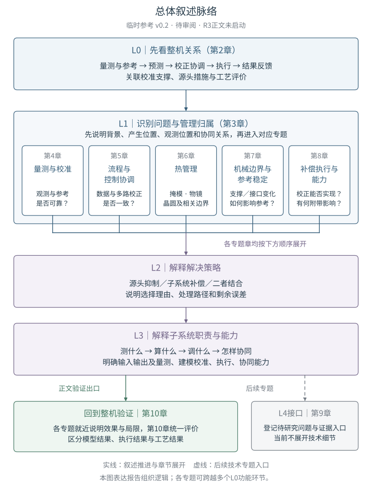

# 《先进光刻机套刻管理架构》撰写逻辑临时参考

**逻辑稿 v0.2｜2026年10月29日｜组织逻辑已获用户批准｜R3已按此撰写，正文待审阅**

> **批准记录：** 用户于2026年10月29日明确“审阅通过，按照这个逻辑撰写R3”。以下v0.2组织方案已作为[R3正文](../r3/report.md)依据；批准的是叙述逻辑，不等于R3研究结论已验收。下文保留审阅时的建议措辞和图A快照，以追溯结构决策。

基线为提交[e42db35](https://github.com/OpticsPan/Overlay2/commit/e42db35592ad78ff7d7311f3138e60c5fde8cb7e)中的[R2报告](../r2/report.md)及已确认的[L0—L4骨架](../../STRUCTURE.md)。本次只整理组织逻辑，不改写R2，也不替换已确认的骨架规范。以下章节名称、对应关系及迁移安排为当时提交审阅、现已获批的方案。

**阅读入口**

- [1 总体叙述脉络](#thread)
- [2 L0：整机关系怎样表达](#l0)
- [3 L1：问题怎样对应章节](#l1)
- [4 章内L2—L3怎样展开](#chapter-template)
- [5 第6章热管理的拟议结构](#thermal)
- [6 跨章边界与R2内容整理](#boundaries)
- [7 证据与层级边界](#evidence)
- [8 本轮审阅事项与版本记录](#review)

## 1 总体叙述脉络

> **L0：整机怎样组织套刻管理 → L1：哪类问题、在何处产生、由哪些环节管理、去哪个章节阅读 → L2：整机采取什么解决策略、为什么 → L3：哪些子系统参与、各自测什么／算什么／调什么、需要哪些能力 → 回到整机验证。**

**图A：总体叙述脉络（审阅时快照）。** 图内“待审阅／正文未启动”为当时状态，当前批准与执行状态以上方记录为准；R3另附正式章节导航。 本图依据本稿的组织建议绘制，实线表示阅读推进和章节展开，虚线表示后续L4专题接口。L1的五个专题并列，汇合线表示各章分别采用同一套L2—L3解释模板，不表示五个子系统的数据汇流或物理控制顺序。第6章统一容纳掩模、物镜、晶圆热管理；各专题就近说明效果与局限，第10章统一评价。

[查看／放大SVG原图](figures/narrative-logic.svg) · [可编辑图源与重建入口](figures/narrative-logic.py)。方框按实际字体宽度换行和内容高度布局，图中字形已固化；小屏可点击原图放大阅读。此图用于审阅文章组织方式，不替代R3正式的L0技术总图和L1章节导航图。

L4仍只保留技术细节专题接口。上述箭头表示读者理解问题的顺序，不表示机器必须依次经过五级控制器，也不把L0—L4机械对应为五章。

现有R2开篇图主要表达L0功能与信息关系，正文则按问题专题组织，两者需要显式连接。建议采用两层阅读入口：

| 表达层 | 回答的问题 | 与正文的关系 |
| --- | --- | --- |
| L0整机关系总图 | 量测、参考、预测、校正、执行和反馈怎样联系？ | 第2章解释总图；各专题开头指出其涉及的功能环节 |
| L1问题与章节导航图 | 遇到某类问题，应沿哪条专题主线阅读？ | 第3章说明分类；每个主要专题框对应第4—8章之一，并指向共同的验证出口 |
| 章内L2—L3展开 | 解决办法是什么，落实到哪些职责和能力？ | 结合原专利图／表逐步解释，不按专利清单代替问题主线 |

曾讨论的另一种方式是直接按L0的每个功能节点分章，其优点是流程与章序直接对应，但会把热管理拆散到预测、执行、反馈等章节。这里推荐保留完整问题专题，并补上L1导航；该推荐已于2026年10月29日获用户批准。

本临时稿用流程文字、映射表和图A共同表达关系；R3正式技术总图及章节导航图在逻辑审阅通过后确定。L0功能框与L1专题框允许多对多关联，L1主要专题与正文主章则保持明确的一一入口。

## 2 L0：整机关系怎样表达

### 2.1 主线：从目标到实际加工结果

沿用[R2总图](../r2/report.md#architecture)已有的功能关系作为讨论基底：

> 目标与工艺背景 → 当前对象量测及历史信息 → 误差估计与曝光时预测 → 校正协调与受约束优化 → 控制轮廓生成与执行 → 曝光及后续工艺 → 结果量测与残差评价。

| 功能环节 | 本层应说明的关系 |
| --- | --- |
| 目标与工艺背景 | 明确对象、产品／层关系、工艺路径和评价口径，为量测、优化及验证提供约束 |
| 当前对象量测及历史信息 | 提供对准、形状、状态、加工历史和已施加校正等信息，并说明其参考与适用条件 |
| 误差估计与曝光时预测 | 解释观测对应什么误差，预测曝光时的状态，区分空间分量、动态分量及层来源 |
| 校正协调与受约束优化 | 协调多个来源的校正需求，根据可用能力及相关成像约束形成方案 |
| 控制轮廓生成与执行 | 将方案转换为平台、光学等可实施动作，关联实际采用的校正和未执行分量 |
| 曝光及后续工艺 | 说明动作如何进入图案形成，以及后续工艺怎样影响被评价的结果 |
| 结果量测与残差评价 | 在明确工艺阶段和测量口径下评价结果，为后续校正或模型更新提供信息 |

这些关系用于说明信息与作用怎样连接；图上顺序不规定所有操作的固定周期，也不表示目标约束只作用于紧邻的下一个框。

### 2.2 跨环节支撑与两类反馈

- **参考、校准与能力模型支撑：** 为量测解释、状态预测和校正执行提供依据。校准得到的模型参数与当前对象的状态估计分别说明。
- **源头抑制与状态准备：** 支撑／夹持／隔离结构以及调温、装夹等运行准备作用于物理对象，减少后续需要处理的误差；结构设计与运行准备具有不同时间尺度。
- **执行侧信息回传：** 回报实际采用的校正或未执行分量，帮助协调请求与处理残差；它不是曝光后独立套刻量测。
- **加工后结果反馈：** 根据误差归属更新之后的校正或相关模型参数，不将所有残差无条件归入同一个模型。

L0应使读者理解这些关系，再进入具体问题。跨专利组合仍标注为研究归纳，不把总图写成某一商业机型已验证的统一实现。

## 3 L1：问题怎样对应章节

### 3.1 先定义问题，再安排阅读入口

每个问题先交代具体背景、误差表现及空间／时间尺度，再区分“产生位置、观测位置、管理归属、协同环节”。测到偏差的位置不自动等于误差产生位置；负责处理某个问题的环节，也不一定就是出现误差的部件。

拟议的L1导航采用以下五个主要专题，共同回到整机验证。分类用于组织解释，不假定各类误差互相独立，也不要求每件专利只能支持一个章节。

| L1问题及拟议章节 | 主要问题 | 对应的L0关系 |
| --- | --- | --- |
| 第4章：量测与校准 | 测量受工艺／噪声影响，或参考与校准结果不适合当前条件 | 量测输入；参考与校准支撑；向估计提供可解释信息 |
| 第5章：流程与控制协调 | 数据背景、校正贡献或更新机制不一致，多环可能重复或相互干扰 | 历史关联、误差估计、校正协调及反馈更新 |
| 第6章：热管理 | 掩模、物镜、晶圆及相关边界的热状态改变图案位置或成像 | 状态准备、预测、校正执行及模型更新 |
| 第7章：机械边界与参考稳定 | 支撑、夹持、接口或维护变化破坏位置与参考关系 | 源头抑制、参考保持及能力恢复 |
| 第8章：补偿执行与能力 | 理想校正无法充分执行，或动作带来动态误差与附带影响 | 能力模型、受约束优化、轮廓生成、执行及回报 |

**共同验证出口为第10章。** 各专题都需说明局部改善与实际套刻结果的关系，第10章再统一讨论模型结果、执行结果和工艺结果的区别。验证是贯穿各专题的要求，不另设一类与热误差、机械误差并列的物理误差源。

### 3.2 拟议目录及各章任务

| 章节 | 主要任务 |
| --- | --- |
| 摘要及开篇图 | 提示研究范围，展示L0总图与L1专题导航，并给出正文入口 |
| 第1章：研究边界与基本概念 | 定义套刻、对准、校准、补偿、验证及证据口径 |
| 第2章：L0整机套刻管理关系 | 解释功能联系、支撑、作用及反馈，不堆叠具体专利细节 |
| 第3章：L1问题分类与章节导航 | 建立“问题—管理位置—正文专题”的对应关系 |
| 第4—8章：五类问题专题 | 各章先定位L1，再详细展开L2策略与L3职责／能力 |
| 第9章：L4技术细节接口 | 汇总后续专题、关联问题与能力、证据入口及待研究事项 |
| 第10章：整机验证与结论 | 汇总作用链、残差、耦合、适用条件和资料缺口 |
| 参考文献及覆盖记录 | 保持全部资料可追溯，不用目录分类代替逐篇阅读 |

章节编号暂沿用R2以方便对照。L0图中的功能节点可以关联多个专题；L1图中的专题标题和章名应一致，不能一处按物理对象命名、另一处却仅列专利号。

## 4 章内L2—L3怎样展开

### 4.1 每个专题采用同一条解释顺序

| 顺序 | 需要回答的问题 | 本段交付给读者的认识 |
| --- | --- | --- |
| 1．定位L0并说明L1 | 什么工况下出现什么问题？在哪里产生、被观测、被管理？ | 理解背景、对象和管理归属，避免直接进入专利步骤 |
| 2．解释L2策略 | 如何抑制误差来源或补偿其影响？为什么需要这种分工或组合？ | 形成连贯的处理路径，理解各策略解决哪部分问题 |
| 3．展开L3职责与能力 | 谁提供信息、谁计算、谁执行、谁回报？完成任务需要什么能力？ | 看清子系统输入、输出、作用条件及协同关系 |
| 4．结合证据验证 | 原图／表支持哪一步？效果属于模拟、部件结果还是实际图形结果？ | 区分已披露效果、残余问题和待验证判断 |
| 5．保留L4接口 | 哪些模型、算法、结构或参数值得进一步研究？ | 找到后续入口，正文不展开技术实现推导 |

原专利图／表紧邻对应论述，逐项解释部件、编号、信号和箭头；不能仅在章末罗列图片。涉及专利案例时先写背景及具体问题，再解释核心方案、图示关系和限制。

### 4.2 L2与L3的区别

**L2讲策略及理由。** 例如“根据热历史预测曝光时变形，再用后续量测调整预测依据”，需要解释为何只看当前测量或只使用固定参数不足，以及源头措施和补偿怎样配合。

**L3讲任务能否落实。** 对上述策略，要分别说明历史信息如何关联到当前对象、模型需要哪些输入、校正由哪些执行环节承担、测量如何反馈，以及作用范围和耦合是否受控。只写“需要传感器、模型和执行器”仍然不够。

L3统一检查四类能力：量测能力、建模与校准能力、执行能力、协同能力。资料没有给出的精度、带宽、更新频率和接口，列为证据缺口，不自行填写数值或厂商实现。

### 4.3 结构示例：物镜热效应

以下只展示章节如何衔接，技术依据沿用[R2物镜专题](../r2/report.md#objective-thermal)，不在本临时稿新增专利论证。

| 层级 | 示例中的叙述任务 |
| --- | --- |
| L0定位 | 指向热状态预测、光学校正、量测解释及前馈参数更新等关系 |
| L1问题 | 先说明曝光受热及照明变化如何引起时变像差，再区分预测不准与校正能力不足 |
| L2策略 | 建立热响应预测、使用适用的校正能力、根据量测更新参数；能力不足时单独讨论配置／升级 |
| L3职责与能力 | 说明曝光历史、热模型、测量灵敏度、校正元件作用及反馈数据分别由哪些环节提供或使用 |
| 验证与L4接口 | 核实残差归属与适用范围；热参数辨识、温度场设计和求解算法留作后续专题 |

## 5 第6章热管理的拟议结构

第6章统一为“热管理”，先讲共同管理任务，再按掩模、物镜、晶圆三个对象分别展开。三个对象是章内并列分支，原6.6物镜专题融入这一结构。

| 拟议小节 | 组织重点 |
| --- | --- |
| 6.1 热管理在整机架构中的位置 | 解释热误差如何进入状态准备、预测、补偿、量测解释和反馈，区别对象与时间尺度 |
| 6.2 掩模热管理 | 按装载初态、装夹应力、曝光热变形、测量／预测及补偿更新组织；在内部展开L1—L3 |
| 6.3 物镜热管理 | 按热像差来源、校准预测、校正能力和生产反馈组织；区分运行补偿与校正器设计／升级 |
| 6.4 晶圆热管理 | 分清晶圆本体、支撑台及热交换边界；组织曝光热形变预测、相关温度控制和补偿依据 |
| 6.5 三类热误差的协调与验证 | 解释混合观测、已施加校正、参数更新及残差归属，回到整机套刻评价 |

三个对象采用一致的L1—L3解释模板，但不要求篇幅相同，也不把掩模方法直接套用到物镜或晶圆。具体深度由各对象的原始证据决定。

晶圆部分应审查当前R2第7.3、7.4节与热状态相关的内容：其中的温度控制、热历史和热扰动传播可为第6章提供依据；夹持、支撑、接口滑移和机械参考保持仍在第7章详细解释。支撑台温度、晶圆温度与晶圆形变不是同一观测量，章节整理时须保留这种区别。

6.5讨论三类对象之间的联系，不预设它们在同一商用系统中共用一个热模型、执行器或控制周期。

## 6 跨章边界与R2内容整理

一件专利可能同时支持管理策略与子系统能力。建议为每项核心问题安排一个详细解释位置，其他章节用简短说明及链接连接，避免反复完整解读同一张图。

| 交叉内容 | 拟议的解释分工 |
| --- | --- |
| 前馈参数更新：第5章与第6章 | 第5章解释通用的信息关联及反馈职责；第6章解释不同热对象的参数含义、观测转换和具体应用 |
| 热作用与机械边界：第6章与第7章 | 第6章解释热状态如何演化、预测和控制；第7章解释结构如何传递或隔离扰动、保持位置参考 |
| 物镜热补偿与光学能力：第6章与第8章 | 第6章围绕热误差闭合问题主线；第8章解释光学及扫描执行的共通能力、限制和伴生影响 |
| 维护与能力恢复：第7章与第8章 | 第7章解释装配和参考保持条件；第8章解释恢复后的校正能力与适用范围，避免把“可更换”当作“性能已恢复” |
| 专题效果与整机验证：第4—8章与第10章 | 专题就近说明自己的效果及限制；第10章汇总评价口径，不重复全部案例 |

R2现有标题中以公开号为主的部分，拟改为具体问题或策略标题，公开号留在紧邻的依据说明中。现有第3章仅列掩模热问题的分类项，应与三对象热管理同步更新。资料覆盖、原图定位及逐篇记录继续保留。

本轮仅记录这些整理方向，尚未迁移R2段落、改动图号或创建R3正文。若后续未新增“从零撰写”要求，可按仓库默认规则复制R2作为修订基底，再依据审阅通过的逻辑重组与核验；复制本身不代表内容已复核。

## 7 证据与层级边界

后续R3仍依据仓库原始资料撰写，遵循[报告维护规范](../../README.md)及[资料规则](../../../docs/SOURCES.md)。本临时稿整理的是解释方式，不是新增的设备技术结论。

- 分开标注专利明确披露、跨专利研究归纳及外推／待验证判断；不同机型、波段和工况不拼接为已证实的统一方案。
- 专利解读保留具体问题、核心内容、原图／表及原PDF定位；不因章节重组而缩成一句结论。
- 保持L0—L3正文深度；L4仅登记后续问题与证据入口，不展开公式推导、器件设计和算法实现。
- 每个专题明确残差、耦合和适用边界；资料未给出整机套刻指标时不自行推导数值。
- 逻辑通过后再复核全部资料的章节归属与覆盖，必要处回看原PDF。本轮只核对R2组织及既有规则，不宣称重新通读全部45件专利。
- 正式图按审阅通过的对应关系绘制，保证标题与章名一致、文字完整、尺寸合理、连线清楚；L1导航连线不伪装成物理信号流。

## 8 本轮审阅事项与版本记录

请优先审阅以下组织判断，而不是将本文件作为R3研究结论验收：

1. 是否采用“L0整机关系总图＋L1问题与章节导航”的两层阅读入口？
2. 第4—8章的五个问题专题及其边界是否合适，是否有需要独立成章的重要问题？
3. 每章是否按“定位与背景—L2策略—L3职责／能力—验证—L4接口”展开？
4. 第6章是否采用“共通关系—掩模—物镜—晶圆—协调与验证”的组织方式？
5. 跨章内容是否按本稿[第6节](#boundaries)的分工设置详细解释位置，以链接保留协同关系？

**当前状态：用户已批准v0.2组织逻辑，R3据此撰写，正文待内容审阅。** 审批依据为本轮用户明确回复；保存、推送或仓库检查通过本身均不等于用户验收。

| 版本 | 日期 | 基线与范围 | 审阅状态 |
| --- | --- | --- | --- |
| v0.1 | 2026-10-29 | 基于R2提交e42db35及既有骨架，整理层级、章节映射、热管理结构和跨章边界；R2与专利原件未改 | 历史审阅状态：待审阅 |
| v0.2 | 2026-10-29 | 基于临时稿提交beb31e1，新增总体叙述逻辑图及可编辑图源；区分并列专题、章内共用模板、验证出口与L4接口，章节建议不变 | 2026-10-29用户明确批准 |

本稿关联REQ-004、REQ-006，属于用户指定保存的临时参考文件。后续即使被R3采用，也保留审阅记录以追溯结构决策；它不是报告发布版本。

图A可在仓库根目录以 `python reports/advanced-overlay-management/planning/figures/narrative-logic.py --preview-dir work/r3-narrative-diagram` 重建；依赖Matplotlib、fontconfig和Noto Sans CJK SC。图的来源、文件哈希、文字边界及网页检查见[本次验证记录](../../../docs/validation/2026-10-29-r3-logic-diagram.json)。
