# 先进光刻机套刻管理架构

**R2｜基于仓库全部45件专利的分层研究｜初稿：2026年10月28日｜8.2节修订：2026年10月29日｜待内容审阅**

> 本稿按用户要求从零撰写。正文解释L0—L3，L4只保留后续技术专题接口。全文中的整合框架属于研究归纳，不代表某一商业光刻机已经采用全部专利方案。页码均为原始PDF从封面起计的物理页。

## 整体逻辑框图

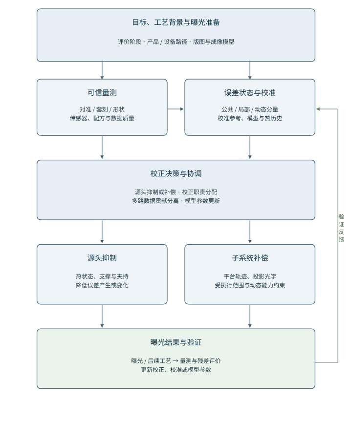

**图1：本文综合绘制的整体逻辑框图。** 上方是目标和工艺背景，中部是量测、状态估计和校正决策，下方区分源头抑制与子系统补偿，最后由曝光及后续工艺结果闭环。箭头表达功能依赖，不规定软件部署、通信协议或实际任务周期。图中各分支的专利依据在下文分别说明；它们是可供理解的不同方案，不能直接拼接成已验证的产品设计。[查看矢量大图](figures/architecture.svg) · [可编辑图源](figures/architecture.py)

**阅读目录**

- [摘要](#abstract)
- [1 研究边界与基本概念](#scope)
- [2 L0：整机如何组织套刻管理](#l0)
- [3 L1：先辨认问题，再确定管理归属](#l1)
- [4 L2—L3：从量测可信度到校准参考](#measurement)
- [5 L2—L3：流程管理与多环协调](#control)
- [6 L2—L3：掩模与晶片热状态的管理](#thermal)
- [7 L2—L3：支撑、夹持与源头误差抑制](#mechanics)
- [8 L2—L3：光学与扫描补偿能力](#execution)
- [9 L4：技术细节专题接口](#l4)
- [10 整机验证与结论](#conclusion)
- [资料覆盖与参考文献](#references)

## 摘要

高精度套刻是图案在多次加工中的相对位置控制问题，涉及量测可信度、参考关系、工艺背景、误差模型、执行能力及结果验证。本文以仓库收录的45件专利为研究范围，按L0整机管理架构、L1问题归属、L2解决策略、L3子系统职责与能力、L4技术专题接口组织材料。研究将不同方法归纳为相互关联的三条路径：首先使测量和校准能够可靠表达待控制的误差；其次在支撑、夹持和热状态等环节抑制误差产生；最后通过平台、光学及扫描控制补偿可观测、可执行的剩余分量，并利用后续测量更新模型和控制。正文结合原专利图解释这些路径如何工作，以及为什么需要区分模型误差、量测偏差与真实几何变形。所收录文献跨越不同年代、波段、设备结构和工艺条件，不能据其组合推定某一商业机型的实现，也不能合成为统一的纳米级整机指标。本稿不展开L4的公式推导、算法实现或器件设计。

**关键词：** 光刻；套刻；校准；对准；过程控制；热变形；支撑与夹持；补偿能力

## 1 研究边界与基本概念

### 1.1 本报告回答什么

本报告回答的是：当某一类因素影响图案相对位置时，整机如何识别该问题，由哪个功能环节管理，采取什么抑制或补偿策略，哪些子系统必须具备相应能力。L0—L4是解释的深度，并不是机器内实际存在的五层控制器。后文按问题分章，每章内部沿L1→L2→L3展开，避免把同一问题拆散到相隔很远的章节。

“先进”在此表示面向高精度的管理和控制方法，不限定某一节点或机型。资料中既有早期基础方案，也有较新的校准与控制方法；早期文献用于解释能力基础，不能把其公开年代、适用条件和后续商业采用情况混为一谈。

### 1.2 几个容易混淆的概念

| 概念 | 本文使用的含义 | 阅读时应区分的对象 |
| --- | --- | --- |
| 套刻 | 不同图案层或不同曝光之间的相对位置关系及其误差 | 图形结果，不等于某一台面传感器读数 |
| 对准 | 通过标记等观测建立待曝光对象与参考的位置关系 | 曝光前信息，不直接等于曝光后套刻 |
| 校准 | 确定或更新测量、坐标、模型及执行作用之间的参考关系 | 参考和参数的可靠性，不只是把当前误差调小 |
| 状态估计 | 根据观测及历史推断当前或未来的状态 | 温度、形变、漂移等可能并非直接实测 |
| 源头抑制 | 减少误差产生或降低其变化程度 | 热条件、接触、夹持、机械约束等 |
| 补偿 | 调整可控自由度，抵消已知或估计误差对曝光的影响 | 有限范围、有限动态能力和作用耦合 |
| 验证 | 在约定测量对象和工艺阶段检查实际结果 | ADI、AEI、标记与器件不能自动等同 |

表1为本文的阅读用语整理；具体专利用语以其上下文为准。支撑这些区别的实例包括生产控制与前馈参数更新（US11300886B2）、不同工艺阶段量测贡献分离（WO2021032376A1）以及形状到温度再到补偿的转换（CN120344910A）。

### 1.3 资料使用规则

资料基线为 [edd7a4e](https://github.com/OpticsPan/Overlay2/commit/edd7a4e13fdddc994befcbc22147a7ac59013385)，共45件、1,114个PDF物理页。逐篇阅读记录与报告正文分开保存，记录说明书和权利要求的阅读范围、关键原页复核及所选原图；通读机器全文不等于逐字校勘全部PDF，图片中不可搜索的内容通过原图核对。来源哈希、覆盖范围和交付检查见本目录的来源及交付记录。

本文用“**专利披露**”表示原文明确的方案，用“**本文综合**”表示跨文献的解释框架，用“**外推／待验证**”表示资料尚不能直接证明的系统级判断。正文各汇总表均为本文整理，不伪称专利原表；嵌入的专利图片保留原内容，并提供原图号及页定位。实施例、模拟曲线、可能的效果与实际整机测试分别对待。

## 2 L0：整机如何组织套刻管理

### 2.1 把信息流、加工流和作用流分清楚

**本文综合：** 图1中的“整机架构”首先是功能职责的组织。加工流是晶片经过曝光、显影及后续处理；信息流是对准、套刻、形状及工艺背景进入状态估计；作用流是配方、校正或机构调整影响下一次曝光。加工流产生结果，信息流解释结果，作用流改变结果。缺少其中任何一种，单个高性能部件都不足以构成完整的套刻管理。

US11300886B2的生产单元图给出一项直接依据：监督系统SCS利用量测信息并经设备控制单元LACU作用于光刻设备。它说明“把数据送到负责调整的环节”是控制结构的一部分；该背景图并未披露一套完整的软件产品架构。

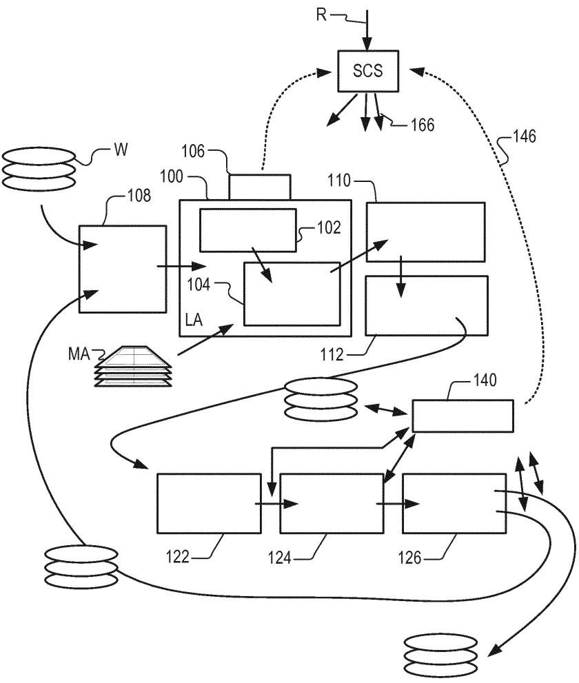

**图2：US11300886B2，Fig. 1，物理页3。** [原PDF](../../../references/patents/US11300886B2/original.pdf#page=3) · [说明文字，页9](../../../references/patents/US11300886B2/mineru.md#p0009)

图中的光刻设备100负责曝光，LACU 106负责设备控制；涂胶、烘烤、显影和后续加工处于晶片的工艺路径上；量测装置140把结果沿146送回上部SCS。配方R和控制信号166表达“量测结果怎样影响后续加工”的另一条路径。读图时应把晶片移动和数据反馈分别看待：晶片已经完成的物理加工并不因控制器更新而自动改变；反馈通常改变之后的操作，或支持适用条件下的返工决策。

### 2.2 管理职责如何分配

| 功能环节 | 管理对象 | 必须向下一环节交付的信息 |
| --- | --- | --- |
| 目标与工艺背景 | 评价阶段、产品/批次、设备与工艺路径 | 明确的数据归属及控制目标 |
| 量测与参考 | 标记、测量配方、传感器响应、坐标关系 | 可解释且适用的观测量 |
| 校准与状态估计 | 校准指纹、公共与组特有分量、热状态 | 带适用条件的误差预测 |
| 决策与协调 | 源头处理或补偿、全局与局部控制贡献 | 各控制环应承担的校正内容 |
| 子系统执行 | 支撑与夹持、平台、投影光学 | 实际可实现的作用，而非仅理想设定 |
| 结果验证 | 曝光及后续工艺后的偏差与残差 | 对校正、模型或校准的更新依据 |

表2为功能归纳。原专利中的控制器可以位于设备内部、监督系统或外部计算环境；本表不据此指定六个独立控制器，也不虚构它们的实时周期或通信接口。

### 2.3 精度管理同时跨越三个尺度

在**空间上**，晶片整体、曝光场、场内局部和扫描狭缝不是同一控制对象。局部误差可能投影到全局模型，校正轮廓也可能被曝光时的空间积分改变。在**时间上**，长期校准漂移、批次背景、掩模装载与热演化、扫描动态不能用同一更新频率概括。在**工艺上**，对准、显影后量测（ADI）与刻蚀后量测（AEI）反映不同阶段的状态。

**本文综合：** 高精度管理需要在每次解释数据时明确这三个尺度；否则可能把不同阶段或不同坐标含义的量直接相减，把一个控制环的动作又当成另一个环的新误差。第5章解释相关专利如何处理这类问题。

## 3 L1：先辨认问题，再确定管理归属

### 3.1 问题分类不是按部件名称简单分箱

“测到偏差”只说明观测有变化，并不能直接证明误差源就在传感器、晶片台或掩模。需要分别追问：偏差在哪里产生，通过什么途径影响图像，在哪里被观测，由哪个功能环节解释和处理。下面的分类用于组织证据，并非宣称任何误差都能被唯一归因。

| 问题类别 | 主要管理位置 | 可能协同的子系统 |
| --- | --- | --- |
| 测量受标记工艺、配方或噪声影响 | 量测可信度与参考管理 | 对准传感器、套刻量测、配方与过滤模块 |
| 校准结果不适合当前曝光条件 | 校准模型及适用性管理 | 校准测量、曝光布局和设备控制 |
| 多路数据或多个校正环相互干扰 | 上层流程与校正贡献管理 | 全局控制、局部控制、ADI/AEI评价 |
| 工艺组稀疏、公共漂移更新不足 | 工艺背景与模型状态管理 | 分组、量测调度、联合估计 |
| 掩模热状态未知或随生产变化 | 热历史、状态估计和预测管理 | 形状/对准量测、热模型、平台与光学 |
| 夹持和支撑使图案或参考发生变化 | 机械边界及源头抑制 | 掩模/晶片支撑、夹持、装卸与状态检测 |
| 理想校正超出执行能力 | 补偿分配与执行管理 | 平台、光学操纵器、扫描控制 |
| 单项改善不能代表最终图形效果 | 整机验证与工艺评价 | 曝光后量测、后续加工、模型更新 |

表3为本文综合分类。一个问题可以跨越多行：掩模热变形既涉及状态估计，也涉及夹持边界和补偿能力；对准传感器测得的漂移既可能来自对象变化，也可能来自测量过程。后续各章据具体专利说明其处理路径。

### 3.2 L2与L3的分界

L2回答“为何选择这一条路径”：是降低源头形变、提高观测可靠性、更新预测模型，还是利用其他子系统抵消输出影响。L3回答“这条路径靠什么实现”：谁提供测量，谁建立对应关系，谁施加动作，彼此需要什么能力和时序。

例如，“用平台或光学系统补偿掩模热变形”是L2策略；“必须先估计装载热状态，并把预测形变映射到平台或光学可调整的自由度”才是L3能力说明。当前正文解释到这一层，具体热模型推导和执行器参数留作L4专题。

## 4 L2—L3：从量测可信度到校准参考

### 4.1 为什么先处理“测得是否可信”

**L1定位。** 对准或套刻的测量结果同时受到被测对象与测量过程影响。工艺使标记形状不对称，可能改变不同波长、偏振或角分布下的响应；如果系统把这种变化全部当作位置变化，就会产生错误校正。因此，这类问题首先归属量测与参考管理，而不是立即归属平台执行。

US11175593B2围绕工艺敏感性补偿，利用测量条件变化及响应信息识别或减小对准位置误差；其不同实施分支涉及滤波和衍射分布观测。US11703772B2进一步区分精密度和准确度：重复测得相近结果，并不能排除系统性偏差。说明书讨论配方之间的一致性，授权权利要求还特别涉及测量对辐射角分布依赖的参数。**不能仅凭题名把该授权文本概括为“多数配方一致就是真值”。**

**L2策略。** 利用对工艺偏差具有不同敏感性的测量信息，辨别或减轻测量偏差。**L3能力。** 传感器必须提供相应通道或响应信息，处理系统需要把配方、标记条件与位置结果关联起来，而不是只上传最终坐标。相关细分机制、图号与原页见[量测组逐篇记录](review/measurement.md)。

### 4.2 US20240184221A1：先识别不对称模式，再选择组合方式

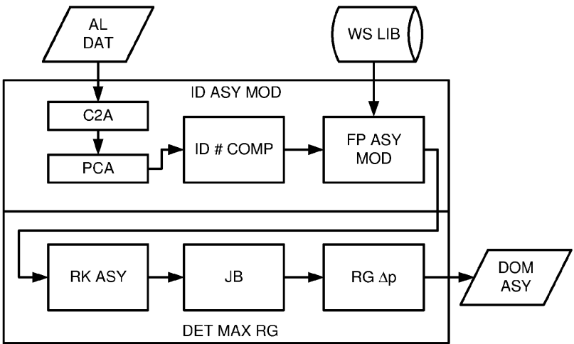

**图3：US20240184221A1，Fig. 4，物理页4。** [原PDF](../../../references/patents/US20240184221A1/original.pdf#page=4) · [机器全文](../../../references/patents/US20240184221A1/mineru.md)

图上部从AL DAT（对准数据）出发，经C2A、PCA及分量识别模块，将各分量在晶圆上的空间指纹与WS LIB中预定义的不对称模式指纹匹配。下部对模式按重要性排序，结合标记模型的灵敏度JB及实测投影数据，估计各模式的变化幅度范围RG Δp，输出DOM ASY所表示的主导模式及相关范围。这里的关键是先认识多通道观测中存在什么变化，再决定如何组合信息；本文不展开图中统计处理的数学实现。

这张图属于识别阶段，而不是最终平台指令输出图。专利后续利用主导模式构造多色测量的组合权重，模式库中缺少合适匹配时可触发更新。**L3所需能力**不仅是具有多个测量颜色，还包括灵敏度信息的适用性管理、模式辨识与权重更新。固定一套权重并不能自动覆盖全部工艺变化。

### 4.3 US10884345B2：校准要与实际曝光布局对应

**L1定位。** 同一设备在不同场尺寸、位置及扫描／步进组合下，可能呈现不同的套刻指纹。每种产品都重新完整校准有时间代价，而直接沿用某一种布局的校准也可能不适用。

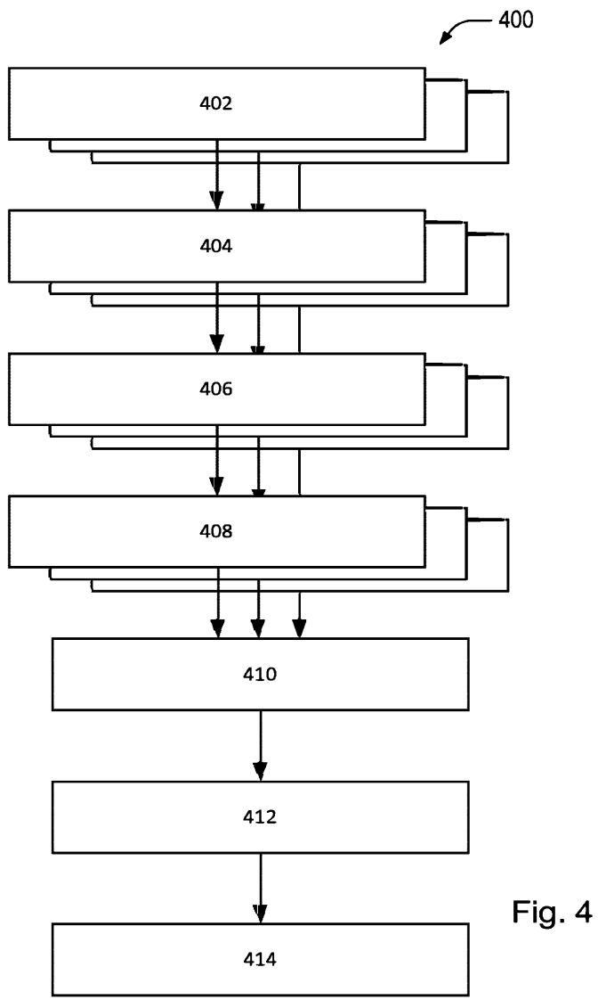

**图4：US10884345B2，Fig. 4，物理页5。** [原PDF](../../../references/patents/US10884345B2/original.pdf#page=5) · [流程解释，页16起](../../../references/patents/US10884345B2/mineru.md#p0016)

402在不同场尺寸条件下形成校准图案；404测量；406按扫描、步进等条件分组；408分别提取场内与场间指纹。图中前四步的叠层方框表示针对多种条件重复进行。随后410建立预测关系，412根据产品实际场尺寸或曝光序列预测表现，414据此形成控制设备的校正模型。

**L2策略。** 把多条件校准转换为对产品条件可查询的预测能力。**L3能力。** 系统需要记录校准时的场尺寸、位置和曝光序列，能够区分不同空间尺度，并把预测映射回产品布局。其管理对象是“校准结果在什么条件下有效”，不只是存储一组永久通用的校正系数。超出已验证条件时的预测可靠性仍须检查。

### 4.4 观测能力扩展：从局部标记到形变与平台参考

| 专利 | 补充的观测或校准能力 | 对整机的意义与边界 |
| --- | --- | --- |
| WO2023126174A1 | 利用标记局部位置、梯度或旋转相关信息增强对准 | 为晶片网格估计提供局部信息，尤其关注边缘外推；不是任意区域的全域直接实测 |
| WO2020094369A1 | 通过掩模侧边的测量观测其变形，结合预测支持光学校正 | 扩展对掩模动态状态的观测；预测与实测模式必须区分 |
| US7362446B2 | 编码器与干涉测量共用光学单元，并组成多自由度位置计量 | 提供平台参考与运动测量；平台位置准确不直接等于图形套刻准确 |
| US20190041758A1 | 从面外形貌推断膜层机械性质，校准面内形变预测 | 区分产品相关参数校准和逐片形貌输入；预测能力受材料与模型适用性限制 |

这些专利共同说明，L3的“量测能力”包含观测对象、参考关系与信息解释能力，不能简单以传感器数量评价。表中每件的全文阅读、关键原页和原图定位见[量测记录](review/measurement.md)。

### 4.5 US11513444B2：保留真实的大误差，排除伪误差

**L1定位。** 即使测量流程已经确定，异常值仍可能来自靶标损伤、污染或非对称影响。直接按照幅值删除大误差，又可能误删实际应补偿的系统性分量。

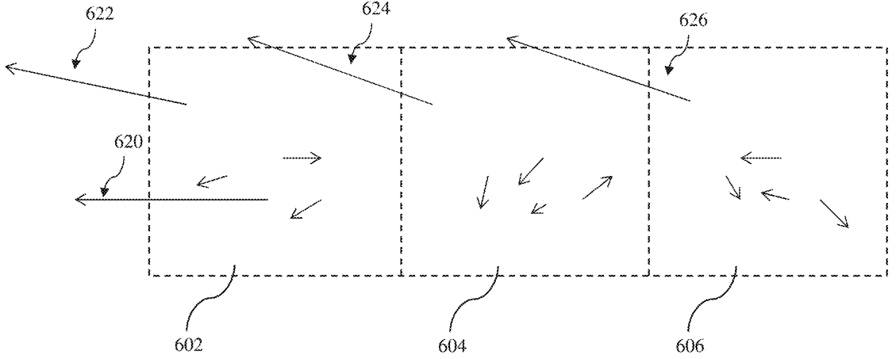

**图5：US11513444B2，Fig. 6，物理页9。** 展示层顺时针旋转90°，内嵌PNG字节与原图一致。 [原PDF](../../../references/patents/US11513444B2/original.pdf#page=9) · [说明文字，页14起](../../../references/patents/US11513444B2/mineru.md#p0014)

图中相邻曝光场602、604、606内存在若干异常向量。622、624、626在相似位置重复出现，可能属于系统性影响；620缺少这种重复表现，在该示例中被判为噪声。由此，**L2策略**是先识别异常，再区分可解释的系统性误差和噪声；**L3能力**则包括场内与跨场关联、模型解释和过滤后校正计算。该文献广义使用“reticle effects”描述某些系统性影响，不能把所有重复误差都归因于掩模材料。

图示解释了分类理由，并没有证明任何孤立异常必然是噪声，也不能从箭头长度读出统一的整机收益。过滤阈值属于判据条件，不能当作设备套刻规格。

### 4.6 US6961116B2：建立可信的对准与曝光坐标联系

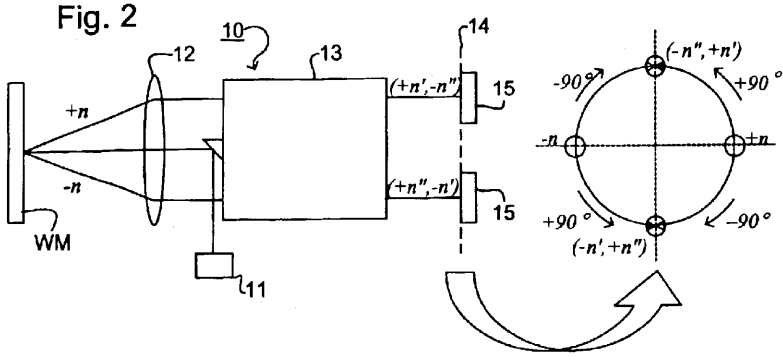

**图6：US6961116B2，Fig. 2，物理页3。** [原PDF](../../../references/patents/US6961116B2/original.pdf#page=3) · [参考链及原件勘误记录](review/execution.md)

图中11照明标记WM，12收集衍射光送入干涉仪13，14为瞳面，15在不同位置检测。两路相对旋转的光学图像提供位置和不对称信息；图中的旋转箭头不是晶片台旋转指令。其**L2策略**是通过不同衍射信息辨认真实位置与工艺标记影响，利用稳定前端和可配置探测后端减少测量干扰。

**L3能力**还包括坐标参考的传递：离轴传感器可以先测标记相对晶片台参考的位置，换站后再建立台参考与投影系统之间的关系。只有两段参考关系均有效，测量站得到的位置才对曝光具有意义。从不对称信号推导过程修正仍需要适用模型，不能将观测到不对称等同于已经消除误差。本件附有权利要求勘误，引用时需连同物理页29—32阅读；本稿不使用已知存在OCR负号错误的公式。

## 5 L2—L3：流程管理与多环协调

### 5.1 问题并非总在硬件：两个正确校正也可能相互干扰

**L1定位。** WO2021032376A1处理的是不同采样密度、不同工艺阶段以及不同控制动作的贡献相互混合。密集数据有助于估计局部指纹，较频繁的稀疏数据适于更新全局校正；但局部指纹在稀疏测量位置上可能表现出低阶分量。局部校正一旦更新，全局控制可能把它造成的变化再次当作漂移处理。

**L2策略。** 先恢复量测与曝光时已施加校正之间的关系，再在相同采样网格上比较不同控制贡献，最后合成校正。其目标不仅是提高拟合能力，还包括防止重复补偿以及监测指标跳变。

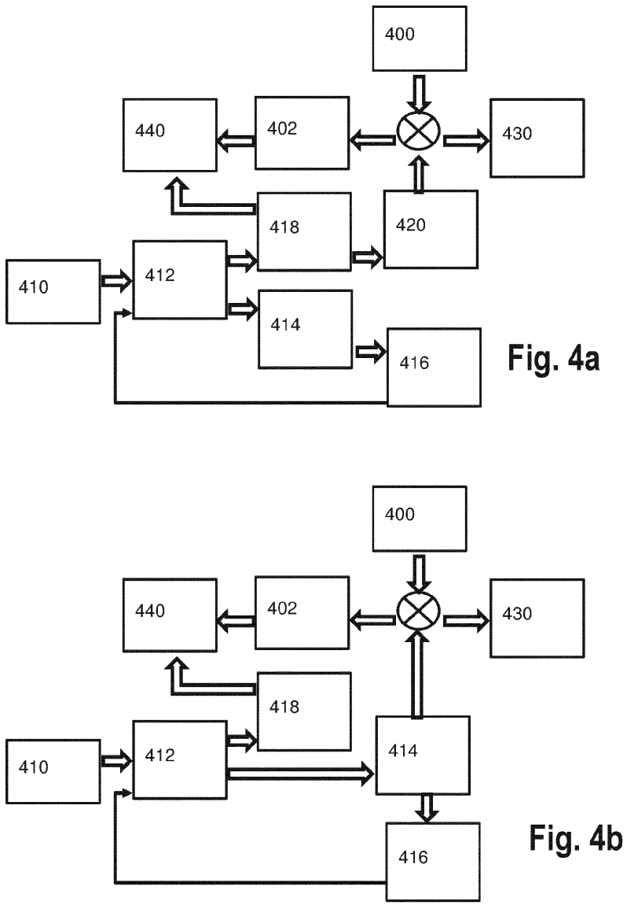

**图7：WO2021032376A1，Fig. 4a、4b，物理页30。** [原PDF](../../../references/patents/WO2021032376A1/original.pdf#page=30) · [说明书0041—0044，页12起](../../../references/patents/WO2021032376A1/mineru.md#p0012)

Fig. 4a中，密集数据410通过去除已施加校正的影响，形成可比较的数据412；414把信息映射到稀疏网格，416表示相应的全局控制贡献。局部CPE校正418需要剥离这部分贡献，避免承担全局环已经能够处理的内容。另一方面，418在稀疏网格上的表现420用于修正稀疏数据400，再确定全局动作402。最终402与418合成440，监测KPI 430也采用相容的贡献口径。Fig. 4b为另一种实现，不能当作Fig. 4a之后必须追加的工序。

**L3能力。** 上层系统必须知道测量位置、历史校正及各模型作用范围，具备把校正影响映射到另一测量网格的能力。这里的数据接口不仅传递一个“校正值”，还需要保留该值对应的空间位置和控制背景。专利披露支持这种功能依赖，但没有给出统一数据库格式。

同件专利Fig. 5进一步把ADI和AEI关联：附加工艺及器件相关贡献可用于修正对最终结果的评价，局部校正投影到稀疏网格产生的非零偏移则需另行处理。**工艺贡献和控制串扰不是同一个偏移项。** 正式权利要求对两路数据所处工艺阶段有自身限定，不能用说明书全部可选场景替代其限定。详见[物理页24权利要求](../../../references/patents/WO2021032376A1/original.pdf#page=24)。

### 5.2 分组管理：既保留差异，又利用公共漂移信息

**L1定位。** US11754931B2关注工艺背景造成的分组。不同腔室、工作台或工艺路径可能产生不同指纹；分组过细后，每一组的新数据可能很少，校正因此陈旧。这属于背景信息与估计更新问题，不能靠增加平台定位带宽直接解决。

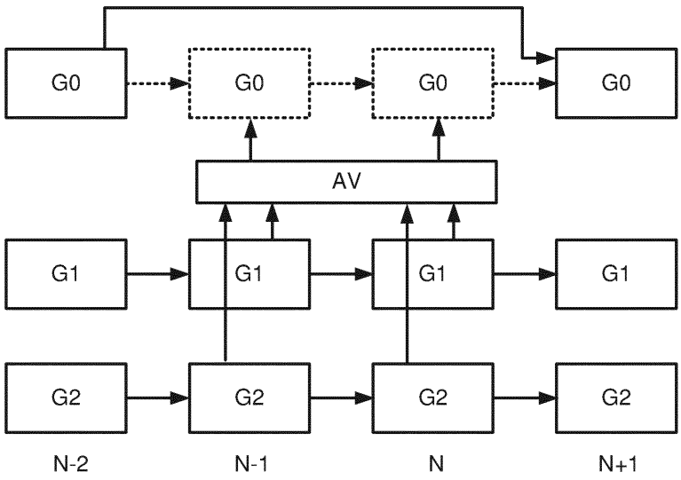

**图8：US11754931B2，Fig. 4，物理页5。** [原PDF](../../../references/patents/US11754931B2/original.pdf#page=5) · [说明文字，页13起](../../../references/patents/US11754931B2/mineru.md#p0013)

图中G0、G1、G2代表不同组，横向为批次推进。G0缺少中间批次数据时，如果只依赖自己的历史，其估计更新会落后。AV路径引入其他组的新信息，用于更新可以共享的部分。图表达的不是直接把G1的原始误差复制到G0，而是利用组间相关性，同时保留各组特有分量。

**L2策略。** 校正模型同时表达公共分量和组特有分量，使公共变化和组特有差异能够被分别管理。同一设备的共同漂移是一种物理例子；模型公共项本身是统计相关分量，不自动对应唯一物理原因。**L3能力。** 系统必须有可靠的加工历史或指纹相似性信息、正确的组关联及相应观测；只有具有共同性的分量才具备共享依据。权利要求1见[原PDF物理页19](../../../references/patents/US11754931B2/original.pdf#page=19)。联合估计的数值算法不在本稿展开。

### 5.3 前馈模型也必须被反馈校验

**L1定位。** US11300886B2指出：前馈每次算出新的校正，并不意味着所用模型参数仍然正确。静态校准得到的时间行为或热响应参数，可能与实际生产状态偏离；仅更新输出端偏移不一定能修复这一差异。

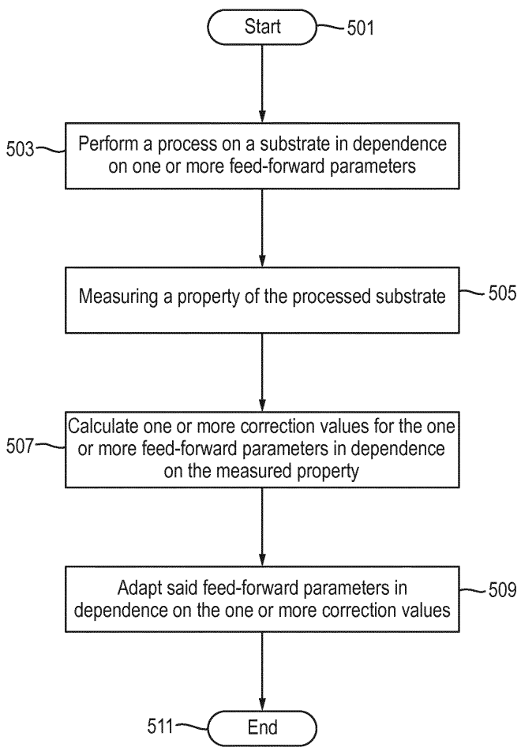

**图9：US11300886B2，Fig. 5，物理页7。** [原PDF](../../../references/patents/US11300886B2/original.pdf#page=7) · [说明文字，页10起](../../../references/patents/US11300886B2/mineru.md#p0010)

图中503用当前前馈参数执行工艺，505测量加工后属性，507计算参数修正，509更新参数。闭环更新的对象可以是模型参数，也可以是由模型得到的前馈参数；反馈从而改变之后的预测或补偿。专利Fig. 3B还把反馈连接到可适应的参数数据库，体现“测量结果改变之后的预测方式”。

**L2策略。** 将生产量测用于调整前馈参数。**L3能力。** 控制系统需具备关联已执行校正、量测残差与具体模型参数的能力，并保留热历史等输入。镜头、掩模和晶片热行为采用不同参数含义，不能把全部残差无条件归到一个“温度系数”。正式权利要求见[物理页13](../../../references/patents/US11300886B2/original.pdf#page=13)。

**外推／待验证：** 如果工艺漂移或量测偏差也进入残差，参数更新可能吸收错误原因。因此整机应用还须验证参数能否被现有数据辨识。专利给出了反馈更新路径，不能由此推断任意误差均可被唯一分解。

### 5.4 上层还要管理量测策略和评价目标

WO2017108453A1把问题推进到控制策略本身：对准与套刻量测可能受相关的工艺偏差影响，如果两个通道带有共同偏差，彼此吻合未必构成独立验证。文献讨论利用参考量测评价或校正相关策略，以及并行评估备选控制方案。

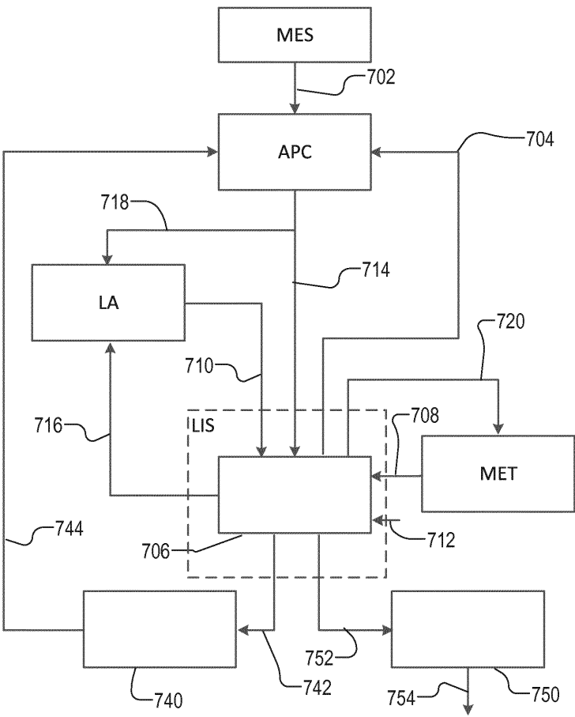

**图10：WO2017108453A1，Fig. 7，物理页40。** [原PDF](../../../references/patents/WO2017108453A1/original.pdf#page=40) · [逐篇解释](review/control.md)

图中的MES、APC、LIS、LA和MET区分生产管理、过程控制、光刻信息、曝光设备和量测。批次及历史进入APC，原始对准与套刻数据进入LIS；LIS向LA发送修正、向MET提供配方，同时向在线与离线评估分支提供数据。它使读者看到，量测策略和控制策略可以作为上层管理对象，并非所有调整都发生在扫描器执行机构内。**L3能力**包括关联生产背景、取得参考数据、评价策略输出以及保持正式控制与备选评价的区别。图示不能被读成某一产品必须采用这些名称的独立服务器。

US11599027B2则从器件区域的重要性提出另一种目标组织方式：不同位置可能具有不同工艺窗口，对所有测量点等权优化未必最符合器件要求。

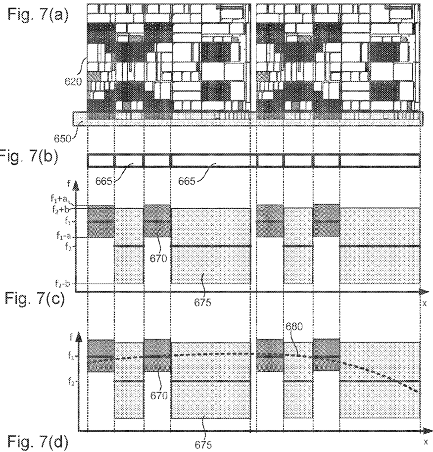

**图11：US11599027B2，Fig. 7，物理页7。** [原PDF](../../../references/patents/US11599027B2/original.pdf#page=7) · [逐篇解释](review/control.md)

图7(a)中650表示经过重复器件图案620的曝光狭缝；(b)把功能边界映射为网格665；(c)以较窄焦点窗口670和较宽焦点窗口675表达关键区与非关键区的容许范围；(d)中的虚线680表示沿狭缝的加权焦点设置。该原图具体以焦点为例，不能把纵轴f直接改标为套刻nm；将区域关键性用于套刻，是原文更广框架中的能力组织思路。该图说明为什么某些位置需要更强的采样或控制关注。**L2策略**是使量测或优化服务于关键区域；**L3能力**是将器件布局、窗口和区域信息映射到测量位置及可用校正。需要特别区分：授权独立权利要求重点落在检测配置，说明书对曝光补偿有更广的讨论；本报告不把所有讨论均写成独立权利要求的必要限定，也不将其中个别改善表述外推到其他器件。

### 5.5 曝光准备阶段也有源头处理

US11886124B2提供的是图案化过程优化流程，包括与实际成像条件相对应的模型及优化协同。遮拦、非等倍率条件、掩模三维效应及坐标转换会影响预测和优化；在曝光前使这些模型相互一致，是源头处理的一种形式。

**图12：US11886124B2，Fig. 17，物理页16。** [原PDF](../../../references/patents/US11886124B2/original.pdf#page=16) · [图中流程与适用边界](review/control.md)

图中1600建立模型和初始条件，1610进行正向模拟，1620配置设计变量，1630评价目标与约束，1640判断终止条件；N返回1610迭代，Y通向1650输出。说明书对图17还强调在1×晶圆层面进行制造规则检查，再按实际变倍率转换到掩模坐标。方框编号自身不含这些物理解释，需结合正文理解。

这里的管理含义是把光源／掩模优化、光学邻近校正及掩模规则等准备过程放到相容的成像条件下理解。它与曝光后校正漂移的APC不是同一时间尺度，也不是台面伺服。**L3能力**体现在模型与坐标的一致性，以及优化结果能够进入后续制造或曝光准备流程。专利中的成像质量仿真并不是整机套刻实测；本文不引用存在单位疑点的具体数字，详见阅读记录。

### 5.6 US9772561B2：抽样、模型与更新频率共同安排

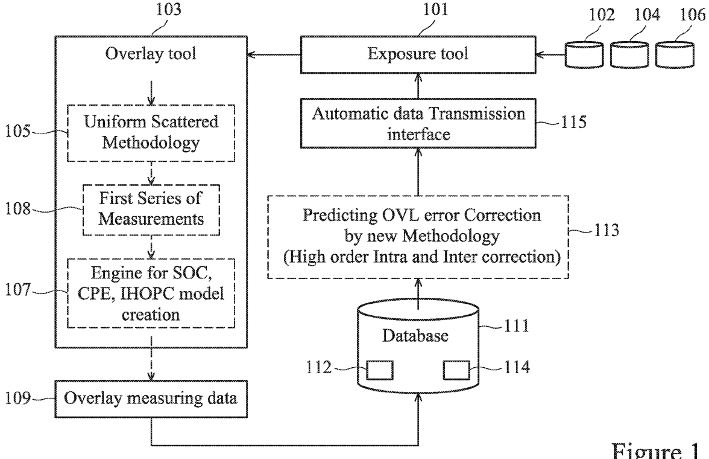

**图13：US9772561B2，Fig. 1，物理页2。** 仅在展示层旋转90°，原图字节不变。 [原PDF](../../../references/patents/US9772561B2/original.pdf#page=2) · [试验分组与原表/图定位](review/execution.md)

图中连续晶片102、104、106由曝光工具101处理，再由量测工具103按均匀分散采样方法105取得数据108。建模引擎107输出109，经数据库111、预测113及接口115返回曝光工具；数据库还接收掩模与偏置信息。**L2策略**是以分散抽样及中央补充采样，结合一阶、场内高阶及场间高阶模型更新后续晶片校正。**L3能力**在于按晶片顺序衔接采样、建模、存储与执行，并确保模型生成的“伪全采样”点与真实测量点有所区分。

“每片都测量”不等于“每片所有位置都实测”。原文给出不同抽样方案的测试比较，但不同例子的点数、数据组与改善比例不能混用，分散采样也不是每项残差都更小。本报告据其解释精度、采样成本和更新频率的关系，不把所示抽样方案当作所有先进设备的统一标准。

## 6 L2—L3：掩模与晶片热状态的管理

### 6.1 同为热误差，管理任务仍然不同

**L1定位。** 掩模从哪里来、装载时是什么温度、夹持后是否带有应力、曝光时怎样吸热和冷却、边缘测量能否代表图像区，是五个不同问题。热管理因此跨越物流、调温、夹持、量测、模型及曝光执行。温度接近目标不等于形状已经稳定，模型参数不再变化也不直接等于最终套刻合格。

### 6.2 CN120344910A：把装载初态变成预测输入

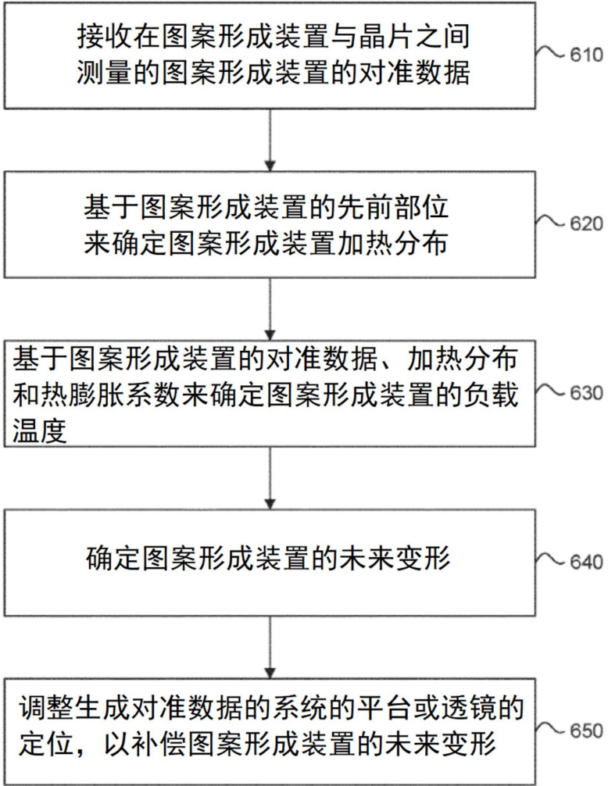

**图14：CN120344910A，图6，物理页24。** [原PDF](../../../references/patents/CN120344910A/original.pdf#page=24) · [说明书0099，页14](../../../references/patents/CN120344910A/mineru.md#p0014)

610接收对准数据；620根据掩模先前所处位置确定加热轮廓；630把对准、历史热信息和材料特性结合，估计装载温度；640预测未来变形；650调整平台或透镜定位。框间箭头是步骤顺序，编号旁的弯线是引线，不能当作额外反馈。原图没有画出完整的曝光后验证闭环，把它纳入图1属于本文综合。

**L2策略**是利用几何观测估计热初态，再预测曝光时的变形并补偿。**L3能力**包括对准／形状量测、先前库位及热历史、材料信息、预测模型和平台／光学接口。这里的“先前位置”指掩模此前所在的设备位置及相关历史，不能解释为掩模版内上一个采样点。温度是推断状态，不是直接温度计读数；几何补偿与主动加热／冷却属于不同动作。

WO2024132326A1与该中文文本对应同一申请链，主流程与图号相应，但页码、段落不同；两件不能被计为两次独立验证。原文中部分形变参数的命名存在内部不一致，中文机器提取还存在温度数字错误，本稿不使用这些有歧义的参数定义或未经核验数字，详见[热管理阅读记录](review/thermal.md)。

### 6.3 US12663725B2：把调温、减应力和校准分成不同阶段

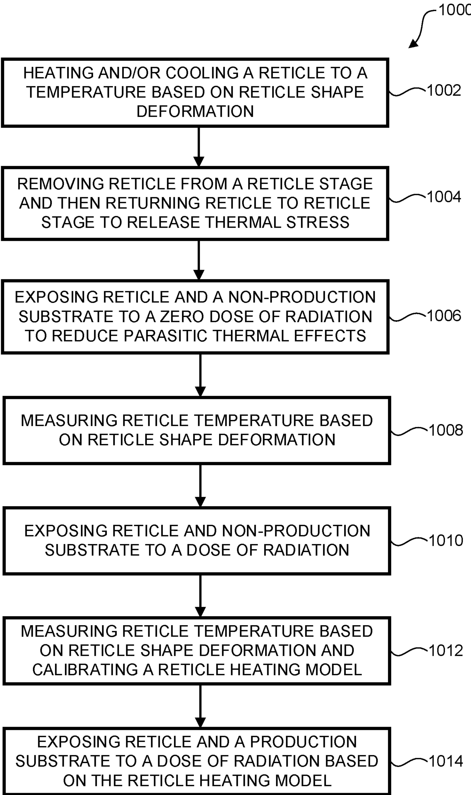

**图15：US12663725B2，Fig. 10，物理页10。** [原PDF](../../../references/patents/US12663725B2/original.pdf#page=10) · [正式权利要求，页26](../../../references/patents/US12663725B2/original.pdf#page=26)

1002根据形状估计的温度状态调温；1004卸下并重新装夹；1006为零剂量步骤；1008基于掩模形状变形推断温度；1010施加剂量；1012测量形状变形、计算温度并用于校准；1014进入生产。应注意，图的1010标签写的是剂量曝光，正式授权权利要求1明确其为非零剂量，不能把权利要求用语悄悄改写成图内原字。

**L2策略**是先使热机械初态具有可重复性，再通过非生产片上的曝光进行热效应校准，之后进入生产。从管理上可理解为：零剂量阶段与非零剂量校准分开，使应力释放及寄生效应不与曝光加热完全混在一起。说明书还允许以RA/RSD等状态判据决定是否继续调温，以及生产期间继续更新模型。

**L3能力**包括调温、解夹和重夹、对准／形状状态检查、非生产片调度、校准计算及生产切换。每一步都需要合适的状态信息，不能只按固定等待时间推定已经达到要求；原文也有其他可选时间或片数安排，不应把某个判据写成唯一实现。

US20250021017A1是同一美国申请的公开阶段，正式权利要求与B2并不相同：B2增加了零剂量减应力、非零剂量校准及形状测量／温度计算等限定。两版的温度曲线属于同源示意，不能作为两个独立试验。对B2的公开号、2026年6月23日日期和申请链已核对原件，相关核验不代替法律状态调查。

### 6.4 US10429749B2与US8184265B2：预测要与测量及已执行校正协调

US10429749B2把曝光、冷却等时间输入转成热变形预测，再形成平台相对位置或投影参数调整。其**L1问题**是复杂热行为怎样成为曝光节拍内可用的预测，以及如何处理测量噪声和初态；**L2策略**是校准动态模型、结合测量形成校正；**L3能力**包括带时间的输入记录、适用对象的模型、形变测量、已施加校正和预测残差验证。

该文Fig. 3让同一输入同时驱动物理系统P和模型M，并在预测与测量汇合时扣除已经施加校正的作用。它说明“当前测得的量”不能脱离此前校正来解释。下方系统辨识链是模型的校准来源，不表示每次曝光都重新完整辨识。原图及逐信号解释见[热管理记录图T2](review/thermal.md)。文中的数据预处理不是把掩模加热至热稳态，二者必须区分。

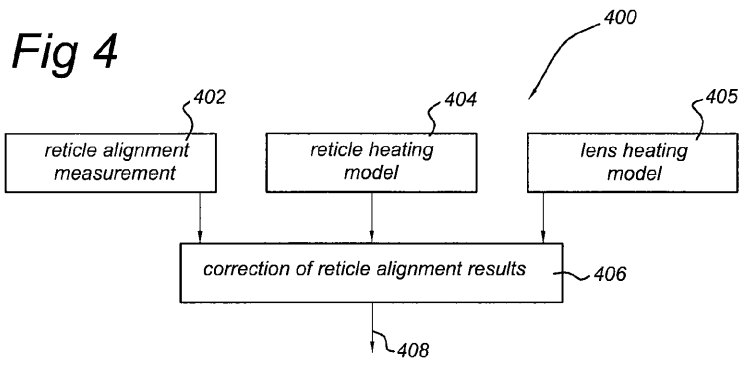

**图16：US8184265B2，Fig. 4，物理页7。** [原PDF](../../../references/patents/US8184265B2/original.pdf#page=7) · [流程及表1，页12](../../../references/patents/US8184265B2/original.pdf#page=12)

图中402为掩模对准测量，404为掩模热模型，405为透镜热模型，三路进入对准结果修正406，输出408。三路是信息来源，不是三个执行器；透镜热项为相关可选方案，不能因为图中画出就断言所有实施例必须启用。

其**L1问题**是图像区与边缘标记受热不同，标记膨胀不一定代表图像区膨胀。**L2策略**是结合实测与预测解释这个差别，并区分透镜热影响。**L3能力**是测量位置、曝光区域、热历史及模型之间的映射。原表1也显示收益依赖条件：20×20 mm²例中，中心值4.2 ppm、标记测量4.18 ppm、组合4.0 ppm，组合并不比标记值更接近中心；因此不能概括成“所有场尺寸均改善”。这些是膨胀量比较，不是全场校正后套刻nm指标。

### 6.5 US7423725B2：先用对照辨识热历史，再做校准

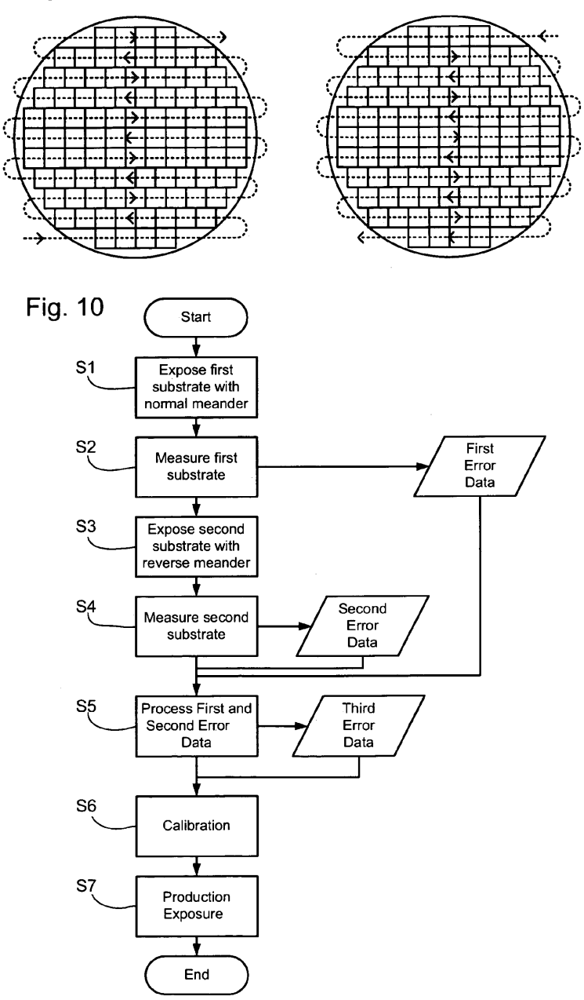

**图17：US7423725B2，Fig. 8—10，物理页5；裁切上缘部分图号未保留，须结合原页。** [完整原PDF页](../../../references/patents/US7423725B2/original.pdf#page=5) · [原图与仿真性质核对](review/thermal.md)

图8、9分别表示相反方向推进的目标场次序；图10由S1、S2取得第一组曝光与测量，再由S3、S4取得另一组，S5比较处理得到第三组数据，S6用于校准，之后S7进入生产。第三组是处理结果，不是第三次独立测量，也不是补偿后的产品残差。

**L2策略**是有控制地改变曝光次序、速度或相关材料／热条件，使历史相关误差显现。**L3能力**是可复现的调度、相同位置数据的对应、变化条件记录，以及将对照差异转化为校准信息的解释能力。本件图6、7相关数据原文明确来自有限元模拟，不能作为整机实测。对照能显现随条件变化的成分，但不能仅凭差分唯一恢复全部静态与热误差。

## 7 L2—L3：支撑、夹持与源头误差抑制

### 7.1 先问是哪两个对象之间发生了变化

**L1定位。** 机械接口上的滑移、接触载荷重新分配或热变形，会改变图案与计量参考之间的关系。但不同接口不能混为一谈：JP5809458B2主要讨论掩模与真空夹持结构；US8269949B2关注镜块与晶片台之间的支撑接口；US10120292B2关注浸没液抽取结构与晶片承载结构的耦合。三者都可能进入套刻误差链，却不具有相同的处理位置。

### 7.2 JP5809458B2：通过夹持边界减少位置变化

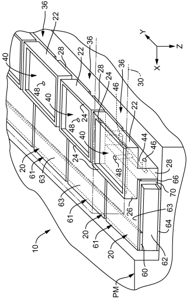

**图18：JP5809458B2，Fig. 12，物理页18。** [原PDF](../../../references/patents/JP5809458B2/original.pdf#page=18) · [图6—7对比及图12结构解读](review/mechanics.md)

图中36为分开的真空单元，24周壁围成40真空空间；44、46、48提供分配和入口关系，61柔性连接与68间隙允许分区间适当顺应。编号引线指认部件，不是控制信号。其作用逻辑是：夹持要能可靠承受局部载荷，同时允许不同支撑位置之间具有适当顺应性，降低不均匀受力与局部先滑移后引发载荷重新分配的风险。**L2策略**是改善夹持边界，从源头减小对象位置变化；**L3能力**体现为接触、刚度与有效受力面积分布的协调，而不是用软件把任何夹持变形都拟合掉。

该专利是掩模真空夹持方案，不能不加条件推广到不同材料、不同夹持方式或所有EUV掩模系统。具体结构与权利要求范围见阅读记录；本稿不展开夹具尺寸设计。

### 7.3 US10120292B2：把抽液扰动与晶片承载隔开

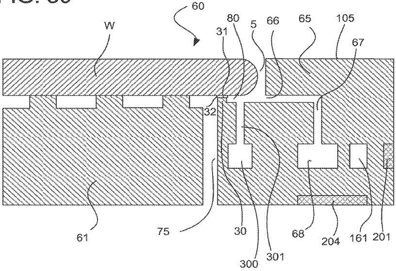

**图19：US10120292B2，Fig. 30，物理页17。** [原PDF](../../../references/patents/US10120292B2/original.pdf#page=17) · [说明书及权利要求定位](review/mechanics.md)

浸没工况下，边缘两相抽取和蒸发冷却可能使抽取结构发生温度变化及变形。若这种扰动直接传给晶片承载结构，就会影响被曝光对象。图中抽取结构65与承载结构61由间隙75分开；液体从晶片边缘间隙5经开口66、通道67进入抽取通道68。突出部30在晶片下方形成薄液封32，不能把它误读为与晶片硬接触的支撑点。通道300／301辅助抽取，161及周边201、204等元件参与温度调节。这些关系分别服务液体边界、热机械隔离和残余温差控制。

**L2策略**是降低扰动从抽取功能传播到承载功能的程度。**L3能力**包括维持抽取任务、支撑任务及它们之间的热机械隔离关系。授权权利要求1还包含两个抽取口、延伸到晶片边缘下方及热机械解耦等限定；摘要中的其他结构描述不能替代这些限定。该方案针对其浸没环境，不能直接当作真空曝光系统的通用结构。

### 7.4 支撑台需要同时管理空间不均匀性和热历史

US10747126B2说明，边缘与内部支撑条件不同，同样温变未必造成同样的面内位移。其方案讨论边缘换热、刚度以及结合台位置进行温度控制；授权权利要求对边缘热元件布置等有具体限定。

**图20：US10747126B2，Fig. 8，物理页6。** [原PDF](../../../references/patents/US10747126B2/original.pdf#page=6) · [图8及权利要求解读](review/mechanics.md)

图中的控制器31与位置信息50、存储信息51及温度信息52相关联。这说明热控制可以利用工作台的运行背景，不能仅把它理解为一个与运动无关的恒温器。其**L3能力**同时包括适合边缘条件的热交换结构和可使用的位置／历史信息；本图不等于授权独立权利要求全部限定，也不证明某个通用温控算法适用所有工作台。

US8269949B2则在镜块与晶片台之间采用柔性支撑、隔槽或分区刚度等结构，以降低接口滑移带来的残余位置偏置。它强调参考结构与承载结构的连接方式；若计量镜块自身相对晶片台发生变化，即使传感器重复性良好，所测位置与晶片位置也可能不再保持原来的对应关系。US8208120B2则在浸没液边界协调供液、多孔抽取、通环境压力的凹槽、气刀及外侧气体回收。气流有助于抑制液体外逃，却可能增加蒸发和扰动计量光路；因此其策略是同时约束液体、蒸发与外逸气体，而不是单纯加大气刀。图18的具体流路及权利要求见[机械组记录](review/mechanics.md)。本组方案不应被合并成一套已经验证的共同硬件。

### 7.5 维护与更换也影响能力是否能够恢复

CN117234040A和US20230400772A1主要涉及光学模块的更换工具与流程。它们不直接提供套刻控制算法，而是围绕模块更换后的姿态、安装与应力状态，支持光学能力的恢复或升级。因此本文把它们放在“子系统能力的维护条件”下，而不是作为独立的套刻性能闭环。

**图21：CN117234040A，图12，物理页29。** [原PDF](../../../references/patents/CN117234040A/original.pdf#page=29) · [中英版本对照与工具结构](review/mechanics.md)

图中S1—S4对应升高脱离、旋转避让、下降和横向移出，S5替换模块，S6—S9按反向过程装入。箭头表示维护顺序。工具把更换前姿态与校准参考转移给替换模块；释夹、轻微抬起和重新落座以减小装配应力的步骤来自说明书，不能硬加为图中已有节点。其输出是复位的姿态与支承状态，仍不能直接当作晶片套刻验收结果。

原文中某些升级实例涉及不同操纵器类型，但不能因此推断已有机型一定完成某项升级。两份文本对更换后部分测量步骤的表述还存在差异，不能以其中一份替代另一份；精确对照见[逐篇阅读记录](review/mechanics.md)。**本文综合：** 高精度不只在曝光时被管理，设备维护后能否恢复原先的参考与作用关系，同样决定既有校正是否继续适用。

## 8 L2—L3：光学与扫描补偿能力

### 8.1 US8947630B2：上层请求需要转换为机器能执行的动作

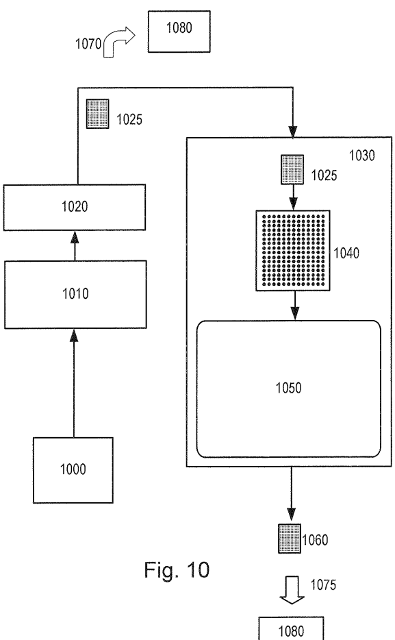

**图22：US8947630B2，Fig. 10，物理页8。** [原PDF](../../../references/patents/US8947630B2/original.pdf#page=8) · [说明书及更正证书](review/mechanics.md)

图中计量1000进入稳定性模块1010，经通用接口1020形成请求网格1025。请求进入扫描器边界1030后，转换为机内网格1040，再由专用模型和硬件1050处理；底部1060输出实际采用的校正网格。1070和1075分别从请求及实际校正侧抽取信息供分析1080使用。

**L1问题**是不同设备的模型和自由度不相同，上层期望不一定全部可执行。**L2策略**是分开通用校正表达和机型专用实现。**L3能力**包括坐标与网格转换、投影到设备可实现空间、实际校正回报及分析。图本身没有画1060返回1010的闭环箭头；说明书物理页16进一步说明可以将实际校正反馈给稳定性模块，以调整之后的请求。1060是实际采用的校正数据，不能冒充曝光后独立套刻量测。

本件物理页19包含正式更正证书，权利要求需按更正后的文本理解。该接口方案提供功能分工依据，但没有证明任何高阶请求都能够完整实现。

### 8.2 US20210096472A1：轨迹拟合不等于曝光结果

#### 8.2.1 背景：测得需要校正多少之后，还要确定曝光时怎样动作

**本专利要解决的具体问题：** 当校正需求随扫描位置快速变化时，怎样生成动态控制轨迹，使真实扫描曝光得到所需的位置校正，同时控制图像模糊，并改善曝光场首尾芯片的校正条件。其题名为《扫描曝光装置的控制方法》。在本报告的L0架构中，它主要连接“误差建模／校正优化”与“动态执行”，处理已知误差怎样通过曝光动作得到有效补偿。

原文[0036]—[0038]说明，扫描机接收多种校正来源，包括曝光前量测形成的前馈、已加工晶片量测形成的反馈，以及掩模／晶片受热模型、晶片台形状校准和版图相关校正。设备按次曝光组合这些校正，并由起滤波作用的算法转换为平台及透镜／反射镜的设定点。设定点可表示为随时间变化的轨迹，例如曝光期间掩模台和／或晶片台的相对定位与倾斜。这里的**控制轮廓（control profile）**，就是沿扫描位置或时间变化的校正设定曲线。[原PDF页8，[0036]—[0038]](../../../references/patents/US20210096472A1/original.pdf#page=8)

专利[0048]、[0055]给出的代表性场景是：在某些3D NAND工艺中，芯片内应力相关的套刻误差可以表现为**每颗芯片沿扫描方向的倍率变化**。原文用“a magnification in the scanning direction, per die”说明其基本单元是die。一个曝光视场可以包含多颗die；若沿扫描方向排列的die重复出现类似的芯片内误差，沿这一方向观察就可能得到锯齿状指纹。这里的“指纹”指具有特定空间形状的误差分布。[原PDF页10，[0048]、[0055]](../../../references/patents/US20210096472A1/original.pdf#page=10)

| 空间层级 | 本例中应理解的对象 |
| --- | --- |
| 一颗die内部 | 沿扫描方向的倍率误差使不同位置具有不同的位置偏差；这是芯片内分量 |
| 一个曝光视场内部 | 多颗die沿扫描方向排列，重复的芯片内分量可形成锯齿状分布；视场中还可叠加其他背景误差 |
| 整片晶片范围 | 多个曝光视场分别进行曝光；场内指纹可在不同场中重复，同时存在场间变化，不能据此断定每个场的幅度和形状完全一致 |

**本文解释（简化示意，非原文实验数据）：** 若一颗die沿扫描方向发生尺度变化，其内部位置偏差会随位置逐渐变化；进入下一颗die后，相似的局部形状再次出现，将它们沿扫描坐标排列便可能形成锯齿。该解释只说明倍率变化与锯齿形状的联系，不补充原文未给出的应力来源、材料结构或幅度。原Fig. 3没有标出曝光场的起止边界；“按一个视场内的多颗die理解重复关系”还须结合Fig. 2及[0041]—[0043]，不能仅凭锯齿数量判断一幅图覆盖多少个视场。

#### 8.2.2 L1：有限曝光时间窗和场边界，使拟合轨迹与曝光结果出现差异

扫描曝光使用的照明狭缝在扫描方向具有有限宽度。晶片上的一个点从进入狭缝到离开狭缝，会在一段时间内持续接收光照。因此，评价某一点的曝光结果，需要考虑这段时间内掩模图像相对于晶片的位置变化，以及狭缝内部的光强分布。

原文[0007]、[0045]—[0047]用两个指标说明位置控制与成像之间的关系：

| 指标 | 评价对象 | 对曝光的影响 |
| --- | --- | --- |
| MA：移动平均误差 | 一个点曝光时间窗内，相对位置误差的平均值 | 平均位置偏差引起图像偏移，与套刻误差相关；原文也讨论其对焦距评价的意义 |
| MSD：移动标准差 | 同一时间窗内，相对位置误差的波动程度 | 波动使图像模糊、对比度降低，即文中的fading |

**本文解释（定性示例）：** 即使一个点曝光期间的位置偏差先正后负、平均值接近零，期间的移动仍可能使图像变模糊。因此，平均位置接近期望，并不自动表示成像对比度也好。这个示例用于区分MA与MSD，不代表专利给出了该条件下的实测结果。

在上述锯齿状场景中，误差形状在较短扫描距离内变化，需要相应的高空间频率校正。专利[0046]指出，若只拟合输入误差并最小化轨迹的均方根残差，相当于忽略有限狭缝的影响；在高频轨迹下，这种近似会使实际曝光的平均位置响应偏离拟合结果，并带来MSD所表征的成像损失。问题因此归属于**控制轮廓生成与曝光执行模型**：既要知道需要补偿什么，也要预测这条轨迹经过真实曝光过程后能产生什么作用。[原PDF页5，[0007]](../../../references/patents/US20210096472A1/original.pdf#page=5) · [原PDF页9，[0045]—[0047]](../../../references/patents/US20210096472A1/original.pdf#page=9)

另一个问题发生在曝光场首尾。[0039]—[0040]指出，扫描方向存在空间尺度上的控制限制，各die的校正条件可能不同；[0056]进一步说明，去卷积在边界处需要场外设定点才能得到更合理的结果。因此，控制还须处理扫描进入和退出曝光场时的边界条件。这里讨论的是控制轮廓边界与可控性，原文未将其归因于平台行程端点。[原PDF页8—9，[0039]—[0040]](../../../references/patents/US20210096472A1/original.pdf#page=8) · [页10，[0056]](../../../references/patents/US20210096472A1/original.pdf#page=10)

#### 8.2.3 L2策略一：分清误差分量，延伸曝光场前后的控制轮廓

第一条策略是在正常曝光场开始之前和结束之后，继续定义控制设定点，使真实场内的边缘die也获得较完整的控制邻域。专利将其目的描述为使关注的die“实际上都成为中间die”。延伸长度可与功能区／die的尺寸有关；所延伸的是控制轮廓，附加区域不表示新增实际曝光的产品芯片。

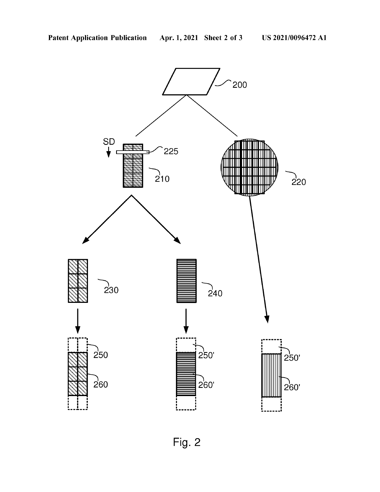

**图23(a)：US20210096472A1，Fig. 2，物理页3。** [原PDF](../../../references/patents/US20210096472A1/original.pdf#page=3) · [说明书[0041]—[0044]，页9](../../../references/patents/US20210096472A1/mineru.md#p0009)。本报告图23分为(a)、(b)两幅，分别对应专利原Fig. 2、Fig. 3；(a)采用原PDF整页渲染，完整保留编号220，(b)沿用原图裁切，两图内容均未重绘。[查看图(a)原尺寸](figures/us20210096472a1-page3.png)

图23(a)应从上向下读。输入**200**是相关原始数据，可来自待曝光晶片的调平／对准量测，也可来自已加工晶片的套刻／焦距／CD反馈。第一层把数据分为**210：各曝光场内倾向于重复的分量**和**220：场间分量**；图中**225**为曝光狭缝，**SD**箭头表示扫描方向。第二层再从210提取**230：每颗die内重复的分量**，扣除后得到**240：剩余的场内背景分量**。

图的底部说明三类分量不能不加区分地向场外复制：

- **230，重复的芯片内分量：** 用相同的、例如平均的die轮廓补到真实场内die **260**的前后，形成虚框所示的附加区**250**。
- **240，场内背景分量：** 可通过外推，把真实场区域**260′**的背景延伸到**250′**。
- **220，场间分量：** 可利用附加区域对应的场间数据进行拟合，使校正覆盖同一扩展范围。

随后，可以在扩展区域上共同优化这些分量的校正。该做法把芯片重复性、视场背景和跨场变化分别利用起来，为扫描进入、退出以及后续边界计算提供信息；本节未将“芯片内重复”外推为整片晶片完全相同的误差。

#### 8.2.4 L2策略二：考虑狭缝的作用，反求更合适的执行轮廓

第二条策略把狭缝在扫描方向的宽度及其内部光强分布纳入控制。有限狭缝使不同扫描时刻的贡献在曝光过程中加权汇合，原文用**卷积**描述其对校正轮廓的作用；**去卷积**则利用已知狭缝特性计算经过补偿的控制轮廓，以减小这种作用造成的偏差。

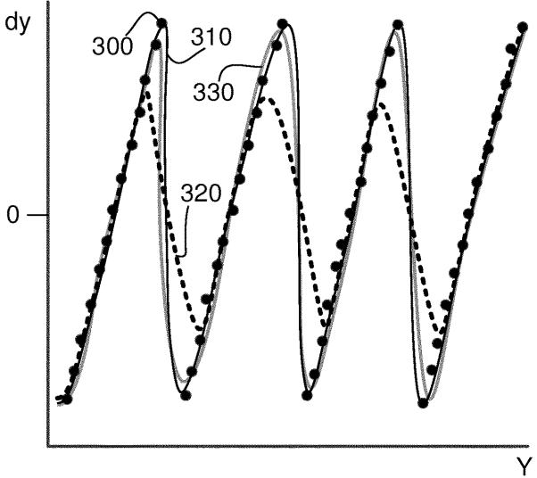

**图23(b)：US20210096472A1，Fig. 3，物理页4。** [原PDF](../../../references/patents/US20210096472A1/original.pdf#page=4) · [说明书[0048]—[0054]，页10](../../../references/patents/US20210096472A1/mineru.md#p0010)。横轴Y为扫描方向位置，纵轴dy为该方向的套刻相关偏差；图中没有数值刻度或曝光场边界标记。

| 图中标记 | 原文所指内容 | 读图时的含义 |
| --- | --- | --- |
| 300：黑色数据点 | 示例输入数据，例如测得的误差指纹 | 表示需要据以生成校正的空间变化 |
| 310：实线 | 按数据拟合、准备执行的校正轮廓 | 它贴合输入，并不保证曝光平均响应也同样贴合 |
| 320：虚线 | 原方法下，轮廓与狭缝光强卷积后的预测MA结果 | 展示有限狭缝如何使响应偏离拟合轮廓，尤其是在快速变化位置 |
| 330：灰线 | 原文所述卷积及去卷积处理后的轮廓 | 相比320更接近310，用于说明所提方法的改善方向 |

这张图的关键是区分“拟合得到的轮廓”和“经过狭缝作用后的响应”。310、320和330并非三组曝光后残余套刻实测曲线，不能从曲线接近程度直接报出整机纳米级收益。

原文[0049]—[0054]以Wiener滤波为一个实施方式，在反向恢复轮廓与噪声平滑之间作取舍。其噪声项可作为调节MA／MSD平衡的参数：文中描述较小的值更有利于MA、但可能使MSD变差；较大的值则反向调节。因此，算法必须根据位置精度与成像对比度／工艺窗口的需要选择折中，不能把“平均位置最优”等同于“全部曝光指标最优”。本节只说明该参数的作用，不展开滤波公式或参数整定。

两条策略可以组合。[0056]明确指出，在去卷积时提供场外设定点，有利于改善控制轮廓边界处的结果；[0065]还允许在首次生成控制轮廓时就考虑场外延伸和有限狭缝尺寸，而不必限定为先生成旧轮廓、再进行修改。[原PDF页10，[0049]—[0056]](../../../references/patents/US20210096472A1/original.pdf#page=10) · [页11，[0065]](../../../references/patents/US20210096472A1/original.pdf#page=11)

#### 8.2.5 L3：哪些环节参与，需要具备什么能力

下表依据原文[0036]—[0047]、[0065]—[0075]及[0085]—[0088]按功能归纳职责；这些功能名称不是对厂商实际软件部署的认定。

| 功能环节 | 输入与任务 | 输出或必要能力 |
| --- | --- | --- |
| 量测与误差建模 | 接收当前晶片前馈及先前晶片反馈，识别die布局，分解芯片内、场内背景和场间分量 | 提供含空间位置与重复关系的校正需求，并区分哪些分量可重复、需外推或需拟合 |
| 控制轮廓生成 | 综合校正需求、狭缝宽度／光强分布及曝光场边界 | 生成扫描进入、场内及退出的时间设定点，并考虑有限狭缝作用 |
| 平台与光学执行 | 接收分配给相关平台、透镜／反射镜的设定点 | 动态改变成像位置或焦点等；控制轮廓须符合相关执行器的动态能力与控制空间分辨率 |
| 曝光质量优化 | 根据应用要求评价MA、MSD及功能区的曝光质量 | 对平均位置、模糊／对比度和可执行性作协调，而非仅评价输入轨迹拟合残差 |

原文后部[0083]—[0096]还讨论以满足规格的die数量为目标的控制：按控制空间分辨率划分区域、生成可执行的动态轮廓，并在无法使全部die达标时研究释放部分die约束。它补充了有限控制能力下如何选择优化目标的问题，不构成所有die均能达标的保证；求解细节不在本节展开。[原PDF页13—14，[0083]—[0096]](../../../references/patents/US20210096472A1/original.pdf#page=13)

#### 8.2.6 效果边界与L4专题接口

**原文披露的边界：** 本公开文本权利要求1将场外延伸与去卷积写为“和／或”，二者可单独或组合使用；权利要求9列举剂量、焦距、套刻及调平等控制对象；权利要求16还覆盖在生成轮廓时考虑场外范围和／或狭缝尺寸。说明书以3D NAND芯片内应力相关误差为具体例子，并在[0055]说明可用于扫描方向的其他高阶套刻或焦距指纹，不能据此认定任意误差形状都能完全校正。[原PDF页15，权利要求1、9、16](../../../references/patents/US20210096472A1/original.pdf#page=15)

**本文综合的验证思路：** 应分别比较场首／中部／场尾die的校正表现，区分控制轨迹拟合残差、曝光时间窗内的MA／MSD预测，以及曝光后的套刻与成像量测。图23(b)没有提供可据以计算整机改善量的数值刻度；本节据此解释作用机制，不给出纳米级实测收益或商业机型采用结论。

**L4接口：** 后续沿第9章T08研究狭缝响应模型、场边界延拓、Wiener滤波的MA／MSD取舍，以及动态执行能力如何约束设定点。原文入口为Fig. 2—5及[0040]—[0056]、[0085]—[0088]；当前正文保留这些专题问题，不展开公式、算法实现和整定参数。

### 8.3 EP4632488A1：本层补偿还须考虑下一层能力

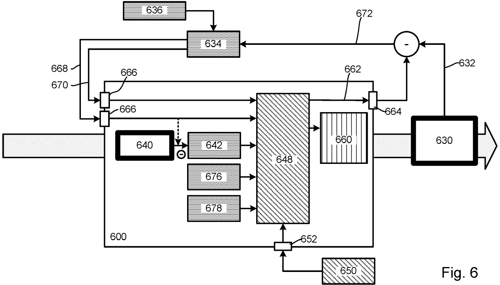

**图24：EP4632488A1，Fig. 6，物理页20。** 仅在展示层旋转90°，原图字节不变。 [原PDF](../../../references/patents/EP4632488A1/original.pdf#page=20) · [说明书0060—0066，页10](../../../references/patents/EP4632488A1/mineru.md#p0010)

**L1问题**是相对套刻中混合了前层与本层的误差。如果把它们压缩成一个总校正，优化端可能丢失来源。某层有能力紧跟前层的畸变，不代表下一层也具有同样的跟随能力。

图中外部量测630提供632；扣除此前不可执行残差662后，672进入估计634，分成前层668和本层670，经接口666进入优化648。对准640及模型642提供另一输入，热预测676、678也进入648；650经652提供优化设置。648向执行660输出校正，并通过664返回不可执行部分。前层分量还可在对准建模前扣除，以减少重复处理。

**L2策略**是保留误差来源，按关键层间套刻窗口及下一层能力分配本层校正；不同条件下可充分补偿，也可限制跟随或在两组层间目标间平衡。**L3能力**是取得或估计分层信息，维护各层设备能力和评价条件，反馈无法实现的分量，防止控制不断累积无效请求。专利不保证任意两层的误差仅凭一个相对量测就能唯一分离，也不能据个别场景断言某一设备类别总比另一类别补偿能力更强。

### 8.4 多控制域需要共享评价，但职责仍要清楚

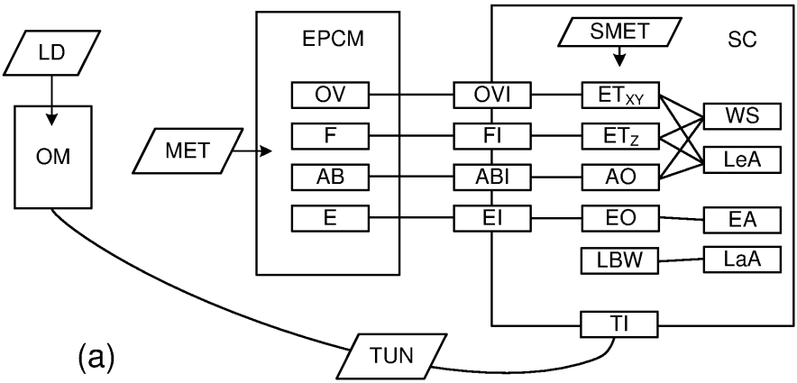

**图25：US20220146946A1，Fig. 6(a)，物理页6。** [原PDF](../../../references/patents/US20220146946A1/original.pdf#page=6) · [说明书0072—0077，页15](../../../references/patents/US20220146946A1/mineru.md#p0015)

US20220146946A1针对分立控制目标可能相互矛盾的问题。图中机外MET与EPCM提供产品量测及配置，SMET提供当前晶片的信息；LD→OM→TUN表达设计相关的模型与调谐输入。机内ETxy、ETz、AO、EO、LBW分别涉及套刻轨迹、调平、像差、剂量和激光带宽，并通过WS、LeA、EA、LaA等作用于设备。

图中的交叉连接说明同一执行能力可能影响多个成像指标。**L2策略**是至少两个控制域使用共同评价，并结合当前晶片状态优化；**L3能力**是产品窗口、各控制域敏感度及执行约束能够被共同使用。共同评价不等于取消子系统分工，也不等于把EPE、套刻、焦点与CD视为同一个指标。通过剂量或光学动作改善离焦条件下的成像，并不意味着这些动作实际改变了晶片的几何高度。

US20200089127A1提供一个具体耦合例子：光学操纵器改变像差时也可能改变远心度，进而把高度或离焦变化耦合为位置误差。因此光学动作的分配需要计入远心度灵敏度及行程限制。其从初始参考和动作模型监视变化的方案，不等于存在实时绝对远心度传感器；具体图12及控制关系见[执行组记录](review/execution.md)。

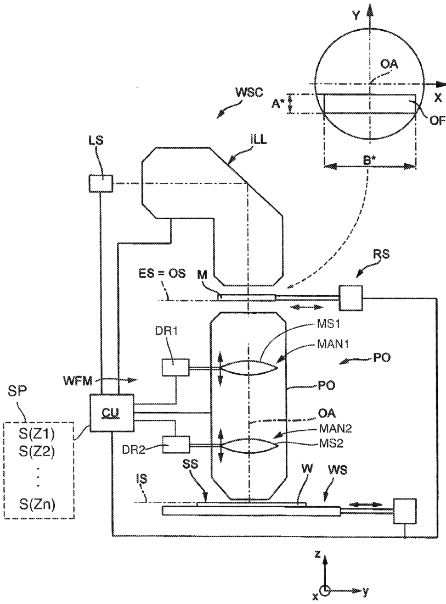

**图26：US20200089127A1，Fig. 12，物理页9。** [原PDF](../../../references/patents/US20200089127A1/original.pdf#page=9)

SP保存各成像影响的灵敏度，CU据此计算受约束动作，DR驱动MAN改变相应光学面MS；CU还连接掩模台RS和晶片台WS。图上平台扫描与局部光学调节分别画出。其远心度监视依赖初始参考和动作模型预测，图中没有当前绝对远心度的直接测量反馈线。这个例子说明，L3能力不仅要声明“能调节什么”，还要知道调节会附带改变什么。

### 8.5 执行器的历史状态不能被设定值掩盖

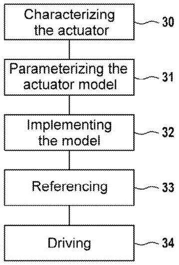

**图27：US20250110413A1，Fig. 10，物理页8。** [原PDF](../../../references/patents/US20250110413A1/original.pdf#page=8) · [说明书0104—0123，页13](../../../references/patents/US20250110413A1/mineru.md#p0013)

同页原PDF的Fig. 9（不在上述裁切图中）中，短横线表示未校正曝光，圆点表示校正曝光；前者在大动作后的首批曝光偏差较大。图以定性方式表示这些变化，坐标没有足以推导整机收益的数值和统计定义。图10的30—34依次涉及表征、建模、实现、参考和驱动，其中参考步骤为可选。**L1问题**是相同命令可能因迟滞、蠕变和历史状态产生不同响应。**L2策略**是把这些效应纳入驱动模型，必要时恢复确定参考。**L3能力**是参数识别、状态维护、参考动作调度以及命令与实际响应之间的检查。

说明书包括较广的表征方案，而当前权利要求1对在投影曝光设备内进行表征有明确限定。即使通过成像误差识别执行器参数，也必须有适当的作用模型，不能把全部成像偏差自动归因于某一执行器。

### 8.6 光学能力的核心是独立作用，而不只是执行器数量

DE102016205618A1将光学元件Z向移动与旋转对称变形联合使用，以增加不同的光学响应。原文中的“三个或更少”针对Z操纵器，不是整机只有三个总自由度；相关例子还使用变形模式以及掩模、晶片或波长调整。其**L2策略**是通过不同作用类型组合改善像差控制；**L3能力**是知道每种动作改变哪些模式、同时引起什么副作用，以及何时仍在可用范围内。

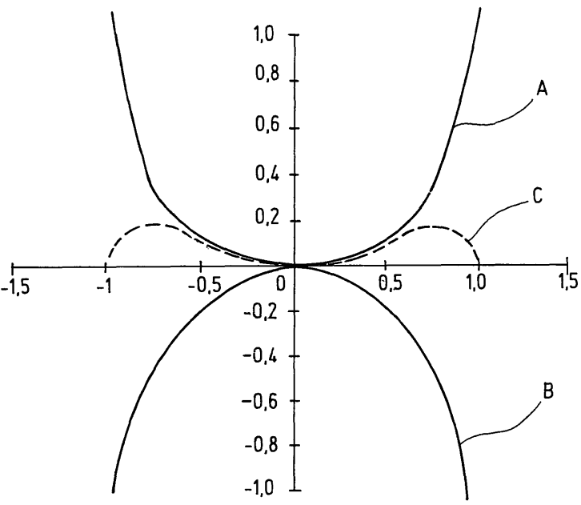

**图28：US9069263B2，Fig. 1，物理页3。** [原PDF](../../../references/patents/US9069263B2/original.pdf#page=3) · [光学组详细证据](review/optics.md)

US9069263B2进一步解释了“增加不同作用”的含义：图中A、B是两片透镜具有不同形状和符号的波前作用，虚线C是叠加后的分布。原文通过选择具有不同响应的两片主动变形透镜，使主阶及其对应的更高阶像差能够较独立地调整。图不是晶片上的套刻实测曲线，也没有给出可直接换算位置误差的数值坐标。两片透镜的几何、位置及施力关系都重要，不能把“安装两片”视为充分条件。

其他两件资料从不同方向补充能力基础。US20020008861A1在适合的光学位置利用压力或气体组分改变折射率，主要提供球差校正，并讨论另一气隙的场曲作用；出厂气体偏置与现场环境补偿相联系，但未给出曝光中高速气动带宽保证。US20090207511A1通过柔顺支承和相对独立的调整方向，降低装调约束力及寄生变形；其一次性装调方案不能直接当成高速重复校正机构。这些分别是相对专用的光学作用和可标定的机械基础，不能统称为同一类“自适应镜片”。原图和各自波长／使用条件见[逐篇记录](review/optics.md)。

### 8.7 US20180081281A1：动作会改变模型的适用条件

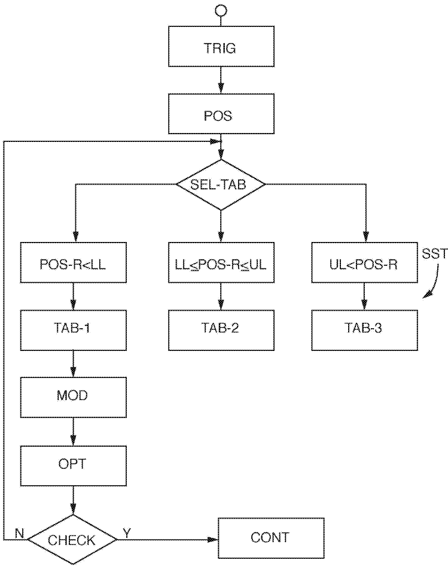

**图29：US20180081281A1，Fig. 9，物理页7。** [原PDF](../../../references/patents/US20180081281A1/original.pdf#page=7) · [说明书0099—0116，页17起](../../../references/patents/US20180081281A1/mineru.md#p0017)

**L1问题**是近场校正器的光学作用会随掩模位置或相对几何改变，同样行程未必产生同样效果。图中TRIG触发检查，POS获取位置，SEL-TAB结合上下界选择适用表；图中示例路径由TAB-1进入MOD、OPT和CHECK。CHECK判断优化后的状态是否仍在适用范围，N回到选择步骤，Y进入CONT。

**L2策略**是管理一系列适用区间及相应灵敏度，并在必要时协调校正器的位置。**L3能力**包括当前几何状态、带范围的校准信息、动作规划以及规划后的有效性检查。仅在优化开始前选择一次模型不一定足够，因为优化建议本身可能改变模型依赖的状态。该文与题名相近的DE102016205618A1申请链不同，不能直接按同族互替。两件的DUV例子和几何约定也不能不加转换地拼到EUV模型中。

### 8.8 配方变化、模块更换与图形相关误差

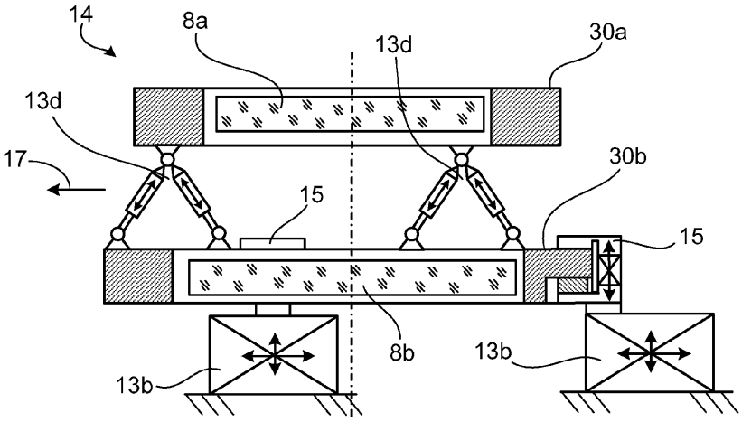

**图30：US8659745B2，Fig. 7，物理页11。** [原PDF](../../../references/patents/US8659745B2/original.pdf#page=11) · [图7—8与参考关系](review/optics.md)

8a、8b为两块光学板，30a、30b为安装座；13d控制板间相对运动，13b控制整体运动，15为夹紧件，17箭头表示抽出／更换方向。它不是曝光扫描箭头。该专利的**L2策略**包括根据变化的成像需求选择或更换校正模块；**L3能力**既要保持板间相对参考，也要恢复整个模块相对物镜的基准。两个板件彼此正确，不代表整体安装位置正确；模块能动，也不证明更换后的成像能力已恢复。

US20130188160A1提示另一种不能充分由公共位移解决的问题：非对称像差引起的像位置误差会随图形节距、方向和照明变化。其利用偏振作为图形相关补偿通道，需要掩模及下游光学的偏振传递条件与之匹配。**像位置误差与不同层之间的套刻相关，但二者不是同一个指标。** 此件图2的仿真单元编号与正文存在差异，阅读记录保留了这一问题，没有擅改原图。

US20230077090A1则以弯曲板产生非等向倍率，以瞳区旋转板处理伴生像散，并需要等向倍率与最佳焦面等协同调整。它提供的机制启示是“图像尺度调整与附带像差必须成组处理”。然而其小于1 nm拟合残差的计算例采用NA 0.065、250×250 mm像场和363—370 nm波段，并明确排除主物镜其他误差及制造误差。**该数字不能写成先进DUV或EUV整机实现了小于1 nm套刻。**

**本文综合：** 光学子系统向整机交付的应当是可用作用模式、条件、范围及副作用，而不仅是元件名称。安装、环境、照明或掩模状态发生变化后，还须重新确认基准与能力模型是否有效。如何测定这些响应、求解组合及设计器件，保留在T07等L4专题接口中。

## 9 L4：技术细节专题接口

本章仅登记后续可展开的技术主题。正文已经回答相关问题由谁管理、采取何种策略、需要哪些能力；下面的接口用于继续研究“怎样具体实现”，不代表这些专题已经完成，也不构成待执行的工程设计。

| 接口 | 关联问题与能力 | 候选证据入口 | 后续研究问题 |
| --- | --- | --- | --- |
| T01 量测工艺敏感性 | 第4章：可信量测 | US11175593B2；US20240184221A1；measurement阅读记录 | 不对称模式、通道响应及权重的辨识条件是什么？ |
| T02 校准迁移与参考 | 第4章：校准适用性 | US10884345B2 Fig. 4；US7362446B2；measurement记录 | 曝光布局变化和参考误差怎样分别表达与验证？ |
| T03 多控制环协调 | 第5章：贡献分离 | WO2021032376A1 Fig. 4a/4b；control记录 | 网格映射、去校正与局部/全局分量如何计算？ |
| T04 公共与组特有估计 | 第5章：背景分组 | US11754931B2 Fig. 4；control记录 | 何时允许信息共享，如何识别错误关联？ |
| T05 热模型校准与初态 | 第6章：预测能力 | CN120344910A 图6；US12663725B2；thermal记录 | 初态与模型参数如何区分，热历史怎样进入计算？ |
| T06 支撑和夹持边界 | 第7章：源头抑制 | JP5809458B2；US10120292B2；US8269949B2；mechanics记录 | 接触、摩擦、热机械耦合怎样影响稳定性和重复性？ |
| T07 光学可控空间 | 第8章：光学校正能力 | US20180081281A1；DE102016205618A1；optics记录 | 灵敏度、作用耦合和校正基函数怎样建立？ |
| T08 扫描动态与限制 | 第8章：可执行校正 | US20210096472A1 Fig. 3—5；US20200089127A1；execution记录 | 狭缝积分、执行器动态及附带光学影响如何共同约束指令？ |
| T09 校正接口及多层关系 | 第8章：协调与回报 | US8947630B2 Fig. 10；EP4632488A1 Fig. 6 | 请求、实现、残差及层来源如何保持可追溯？ |

表4为专题接口。各组阅读记录给出精确物理页、图号及权利要求位置，见下方资料入口。未来专题应另行记录适用条件、证据与修订，避免把尚未核实的算法细节补写进现有正文。

## 10 整机验证与结论

### 10.1 闭环至少要区分三种“结果”

第一种是**模型结果**：模型对输入数据的拟合或预测。它可以说明模型在某些条件下能表达误差，但不能单独证明量测没有系统偏差。第二种是**执行结果**：设备接受并实际采用的设置或校正分量。它能够说明期望校正是否落在设备可实现范围内，却不等于图案已经正确转移。第三种是**工艺结果**：约定阶段的图形、标记或器件量测。它更接近所关心的套刻表现，但仍需要明确ADI/AEI、采样范围、量测偏差及统计口径。

US8947630B2对请求与已实现校正的区分、US20210096472A1对控制轮廓与曝光平均响应的区分、WO2021032376A1对工艺阶段与贡献口径的区分，分别支撑上述不同边界。**本文综合：** 把这三种结果分别管理，是判断控制是否有效的必要阅读框架；本文没有把它们推定为某厂商的固定验收流程。

### 10.2 如何理解“实现高精度”

本报告能从原始材料解释高精度的形成机制：可信量测减少错误控制输入；校准和背景管理使观测与当前工况相对应；源头抑制减小后续补偿负担；状态预测为曝光时刻而不是仅为测量时刻提供校正；多环协调避免相互抵消或重复处理；执行能力管理使模型输出落到实际可实现的动作；结果量测再更新校准、模型或校正。

这条作用链不能被简化为“某一部件精度高，所以整机套刻必然好”。更高阶模型需要相应的信息支撑和执行自由度；更多传感器只有在参考关系与工艺敏感性受控时才提供更可靠的观测；更大补偿幅度可能伴随动态或光学副作用。专利中的不同方案正是在这些具体约束下解决不同问题。

### 10.3 材料仍不足以回答的问题

这45件文献不是同一机型、同一工艺、同一量测口径下的一套整机测试数据。它们没有共同给出完整误差预算、统一接口时序、全部控制环的稳定性证明或产品级套刻验收结果。因此本文不从单项仿真、设计残差、过滤阈值或热变形例子推导整机纳米指标，也不假定不同误差源独立并进行数值合成。

**外推／待验证：** 若后续用于具体设备，应先明确对象、工艺阶段、统计口径和参考不确定度，再比较源头处理及补偿前后的残差，同时检查未参与优化的位置、其他成像指标与产能影响。还需验证维护、换版和工艺变更后模型是否继续适用。这些是由本研究提出的验证问题，不能作为专利已经完成的整机试验引用。

### 10.4 结论

按L0—L4理解套刻管理，首先应在L0建立目标、量测、校准、决策、执行和验证之间的关系；在L1辨认问题产生、观测和管理的位置；在L2选择源头抑制或补偿策略；在L3说明参与子系统及其量测、建模、执行和协同能力。L4则按需要继续研究实现细节。这样的组织方式能够将分散的专利还原为有边界、有责任分工的作用链，同时保留各方案的适用条件。

本稿的核心结论是：高精度套刻依赖可靠的参考、正确的误差归属、受约束的执行能力和持续的结果闭环。所收录专利为这些环节提供了不同层面的机制证据；跨专利的整体框架是研究归纳，仍须以具体设备和工艺数据验证。

## 资料覆盖与参考文献

以下45个公开号均按独立文本读取；同族版本保留各自定位，不重复计为独立性能证据。参考文献题名按资料库登记，未另行开展法律状态检索。详细记录包括完整阅读批次、关键PDF核对页、原图解读和边界；正文按问题组织，记录按资料分组，二者互补。

| 阅读记录 | 件数 | 原PDF页数 |
| --- | ---: | ---: |
| [流程与控制](review/control.md) | 7 | 195 |
| [量测与校准](review/measurement.md) | 8 | 205 |
| [热状态](review/thermal.md) | 7 | 156 |
| [支撑、夹持与接口](review/mechanics.md) | 8 | 188 |
| [光学能力](review/optics.md) | 8 | 225 |
| [执行与协同](review/execution.md) | 7 | 145 |

### 完整参考文献表

[1] CN117234040A. 方法和更换工具[P]. [原PDF](../../../references/patents/CN117234040A/original.pdf) · [全文](../../../references/patents/CN117234040A/mineru.md) · [阅读记录](review/mechanics.md)。

[2] CN120344910A. 基于掩模版形状测量来推断和估计掩模版温度的方法[P]. [原PDF](../../../references/patents/CN120344910A/original.pdf) · [全文](../../../references/patents/CN120344910A/mineru.md) · [阅读记录](review/thermal.md)。

[3] DE102016205618A1. Projektionsobjektiv mit Wellenfrontmanipulator, Projektionsbelichtungsverfahren und Projektionsbelichtungsanlage[P]. [原PDF](../../../references/patents/DE102016205618A1/original.pdf) · [全文](../../../references/patents/DE102016205618A1/mineru.md) · [阅读记录](review/optics.md)。

[4] EP4632488A1. A method of lithography and associated apparatuses[P]. [原PDF](../../../references/patents/EP4632488A1/original.pdf) · [全文](../../../references/patents/EP4632488A1/mineru.md) · [阅读记录](review/execution.md)。

[5] JP5809458B2. Reticle clamp system[P]. [原PDF](../../../references/patents/JP5809458B2/original.pdf) · [全文](../../../references/patents/JP5809458B2/mineru.md) · [阅读记录](review/mechanics.md)。

[6] US10120292B2. Support apparatus, lithographic apparatus and device manufacturing method[P]. [原PDF](../../../references/patents/US10120292B2/original.pdf) · [全文](../../../references/patents/US10120292B2/mineru.md) · [阅读记录](review/mechanics.md)。

[7] US10429749B2. Method of reducing effects of reticle heating and/or cooling in a lithographic process[P]. [原PDF](../../../references/patents/US10429749B2/original.pdf) · [全文](../../../references/patents/US10429749B2/mineru.md) · [阅读记录](review/thermal.md)。

[8] US10747126B2. Support table for a lithographic apparatus, lithographic apparatus and device manufacturing method[P]. [原PDF](../../../references/patents/US10747126B2/original.pdf) · [全文](../../../references/patents/US10747126B2/mineru.md) · [阅读记录](review/mechanics.md)。

[9] US10884345B2. Calibration method for a lithographic apparatus[P]. [原PDF](../../../references/patents/US10884345B2/original.pdf) · [全文](../../../references/patents/US10884345B2/mineru.md) · [阅读记录](review/measurement.md)。

[10] US11175593B2. Alignment sensor apparatus for process sensitivity compensation[P]. [原PDF](../../../references/patents/US11175593B2/original.pdf) · [全文](../../../references/patents/US11175593B2/mineru.md) · [阅读记录](review/measurement.md)。

[11] US11300886B2. Method of adapting feed-forward parameters[P]. [原PDF](../../../references/patents/US11300886B2/original.pdf) · [全文](../../../references/patents/US11300886B2/mineru.md) · [阅读记录](review/control.md)。

[12] US11513444B2. Noise reduction for overlay control[P]. [原PDF](../../../references/patents/US11513444B2/original.pdf) · [全文](../../../references/patents/US11513444B2/mineru.md) · [阅读记录](review/control.md)。

[13] US11599027B2. Lithographic process and apparatus and inspection process and apparatus[P]. [原PDF](../../../references/patents/US11599027B2/original.pdf) · [全文](../../../references/patents/US11599027B2/mineru.md) · [阅读记录](review/control.md)。

[14] US11703772B2. Recipe selection based on inter-recipe consistency (US11703772B2)[P]. [原PDF](../../../references/patents/US11703772B2/original.pdf) · [全文](../../../references/patents/US11703772B2/mineru.md) · [阅读记录](review/measurement.md)。

[15] US11754931B2. Method for determining corrections for lithographic apparatus[P]. [原PDF](../../../references/patents/US11754931B2/original.pdf) · [全文](../../../references/patents/US11754931B2/mineru.md) · [阅读记录](review/control.md)。

[16] US11886124B2. Flows of optimization for patterning processes[P]. [原PDF](../../../references/patents/US11886124B2/original.pdf) · [全文](../../../references/patents/US11886124B2/mineru.md) · [阅读记录](review/control.md)。

[17] US12663725B2. Methods and systems to calibrate reticle thermal effects (US12663725B2)[P]. [原PDF](../../../references/patents/US12663725B2/original.pdf) · [全文](../../../references/patents/US12663725B2/mineru.md) · [阅读记录](review/thermal.md)。

[18] US20020008861A1. Projection lens, in particular for microlithography[P]. [原PDF](../../../references/patents/US20020008861A1/original.pdf) · [全文](../../../references/patents/US20020008861A1/mineru.md) · [阅读记录](review/optics.md)。

[19] US20090207511A1. Assembly for adjusting an optical element[P]. [原PDF](../../../references/patents/US20090207511A1/original.pdf) · [全文](../../../references/patents/US20090207511A1/mineru.md) · [阅读记录](review/optics.md)。

[20] US20130188160A1. Optical System of a Microlithographic Projection Exposure Apparatus and Method of Reducing Image Placement Errors[P]. [原PDF](../../../references/patents/US20130188160A1/original.pdf) · [全文](../../../references/patents/US20130188160A1/mineru.md) · [阅读记录](review/optics.md)。

[21] US20180081281A1. Projection lens with wave front manipulator and related method and apparatus[P]. [原PDF](../../../references/patents/US20180081281A1/original.pdf) · [全文](../../../references/patents/US20180081281A1/mineru.md) · [阅读记录](review/optics.md)。

[22] US20190041758A1. Methods of determining a mechanical property of a layer applied to a substrate, control system for a lithographic apparatus and lithographic apparatus[P]. [原PDF](../../../references/patents/US20190041758A1/original.pdf) · [全文](../../../references/patents/US20190041758A1/mineru.md) · [阅读记录](review/measurement.md)。

[23] US20200089127A1. Projection exposure method and projection exposure apparatus for microlithography[P]. [原PDF](../../../references/patents/US20200089127A1/original.pdf) · [全文](../../../references/patents/US20200089127A1/mineru.md) · [阅读记录](review/execution.md)。

[24] US20210096472A1. Control method for a scanning exposure apparatus[P]. [原PDF](../../../references/patents/US20210096472A1/original.pdf) · [全文](../../../references/patents/US20210096472A1/mineru.md) · [阅读记录](review/execution.md)。

[25] US20220146946A1. Method for controlling a lithographic apparatus and associated apparatuses[P]. [原PDF](../../../references/patents/US20220146946A1/original.pdf) · [全文](../../../references/patents/US20220146946A1/mineru.md) · [阅读记录](review/execution.md)。

[26] US20230077090A1. Magnification adjustable projection system using deformable lens plates[P]. [原PDF](../../../references/patents/US20230077090A1/original.pdf) · [全文](../../../references/patents/US20230077090A1/mineru.md) · [阅读记录](review/optics.md)。

[27] US20230400772A1. Method and swapping tool[P]. [原PDF](../../../references/patents/US20230400772A1/original.pdf) · [全文](../../../references/patents/US20230400772A1/mineru.md) · [阅读记录](review/mechanics.md)。

[28] US20240184221A1. Alignment method and associated alignment and lithographic apparatuses[P]. [原PDF](../../../references/patents/US20240184221A1/original.pdf) · [全文](../../../references/patents/US20240184221A1/mineru.md) · [阅读记录](review/measurement.md)。

[29] US20250021017A1. Methods and systems to calibrate reticle thermal effects[P]. [原PDF](../../../references/patents/US20250021017A1/original.pdf) · [全文](../../../references/patents/US20250021017A1/mineru.md) · [阅读记录](review/thermal.md)。

[30] US20250110413A1. Method for compensating actuator effects of actuators[P]. [原PDF](../../../references/patents/US20250110413A1/original.pdf) · [全文](../../../references/patents/US20250110413A1/mineru.md) · [阅读记录](review/execution.md)。

[31] US6961116B2. Lithographic apparatus, device manufacturing method, and device manufactured thereby[P]. [原PDF](../../../references/patents/US6961116B2/original.pdf) · [全文](../../../references/patents/US6961116B2/mineru.md) · [阅读记录](review/execution.md)。

[32] US7362446B2. Position measurement unit, measurement system and lithographic apparatus comprising such position measurement unit[P]. [原PDF](../../../references/patents/US7362446B2/original.pdf) · [全文](../../../references/patents/US7362446B2/mineru.md) · [阅读记录](review/measurement.md)。

[33] US7423725B2. Lithographic method[P]. [原PDF](../../../references/patents/US7423725B2/original.pdf) · [全文](../../../references/patents/US7423725B2/mineru.md) · [阅读记录](review/thermal.md)。

[34] US8184265B2. Correction method for non-uniform reticle heating in a lithographic apparatus[P]. [原PDF](../../../references/patents/US8184265B2/original.pdf) · [全文](../../../references/patents/US8184265B2/mineru.md) · [阅读记录](review/thermal.md)。

[35] US8208120B2. Lithographic apparatus and device manufacturing method[P]. [原PDF](../../../references/patents/US8208120B2/original.pdf) · [全文](../../../references/patents/US8208120B2/mineru.md) · [阅读记录](review/mechanics.md)。

[36] US8269949B2. Lithographic apparatus and device manufacturing method[P]. [原PDF](../../../references/patents/US8269949B2/original.pdf) · [全文](../../../references/patents/US8269949B2/mineru.md) · [阅读记录](review/mechanics.md)。

[37] US8659745B2. Optical system with an exchangeable, manipulable correction arrangement for reducing image aberrations[P]. [原PDF](../../../references/patents/US8659745B2/original.pdf) · [全文](../../../references/patents/US8659745B2/mineru.md) · [阅读记录](review/optics.md)。

[38] US8947630B2. Lithographic apparatus and device manufacturing method[P]. [原PDF](../../../references/patents/US8947630B2/original.pdf) · [全文](../../../references/patents/US8947630B2/mineru.md) · [阅读记录](review/mechanics.md)。

[39] US9069263B2. Method for improving the imaging properties of a projection objective, and such a projection objective[P]. [原PDF](../../../references/patents/US9069263B2/original.pdf) · [全文](../../../references/patents/US9069263B2/mineru.md) · [阅读记录](review/optics.md)。

[40] US9772561B2. Semiconductor manufacturing method and tool[P]. [原PDF](../../../references/patents/US9772561B2/original.pdf) · [全文](../../../references/patents/US9772561B2/mineru.md) · [阅读记录](review/execution.md)。

[41] WO2017108453A1. Methods of controlling a patterning process, device manufacturing method, control system for a lithographic apparatus and lithographic apparatus[P]. [原PDF](../../../references/patents/WO2017108453A1/original.pdf) · [全文](../../../references/patents/WO2017108453A1/mineru.md) · [阅读记录](review/control.md)。

[42] WO2020094369A1. Apparatus for and method of measuring distortion of a patterning device in a photolithographic apparatus[P]. [原PDF](../../../references/patents/WO2020094369A1/original.pdf) · [全文](../../../references/patents/WO2020094369A1/mineru.md) · [阅读记录](review/measurement.md)。

[43] WO2021032376A1. Method for controlling a semiconductor manufacturing process[P]. [原PDF](../../../references/patents/WO2021032376A1/original.pdf) · [全文](../../../references/patents/WO2021032376A1/mineru.md) · [阅读记录](review/control.md)。

[44] WO2023126174A1. Enhanced alignment for a photolithographic apparatus[P]. [原PDF](../../../references/patents/WO2023126174A1/original.pdf) · [全文](../../../references/patents/WO2023126174A1/mineru.md) · [阅读记录](review/measurement.md)。

[45] WO2024132326A1. Method to infer and estimate reticle temperature based on reticle shape measurements[P]. [原PDF](../../../references/patents/WO2024132326A1/original.pdf) · [全文](../../../references/patents/WO2024132326A1/mineru.md) · [阅读记录](review/thermal.md)。

### 修订与核验记录

R2为本次独立新写稿，R1作为历史版本保留。本稿只交付Markdown及依赖图片、来源清单和阅读记录，未生成R2 PDF；R1 PDF仍仅对应R1。版本方式、文件哈希、验证命令和已检查的显示范围见[交付记录](delivery.json)，资料出处见[来源清单](sources.json)。仓库校验只证明结构与来源完整性，研究结论仍待内容审阅。

2026年10月29日：基于R2提交[b0168c3](https://github.com/OpticsPan/Overlay2/commit/b0168c3554ec52ccbbf580f19d583430c1a330fb)重写[8.2节](#section-8-2)，先交代3D NAND案例背景与die／曝光视场／晶片的空间层级，再结合原Fig. 2、Fig. 3解释场外延伸、狭缝作用与L3能力。原图23改为图23(a)、(b)，其他章节正文不改；本次局部修订继承R2，不改变R2最初从零撰写的来源记录。
