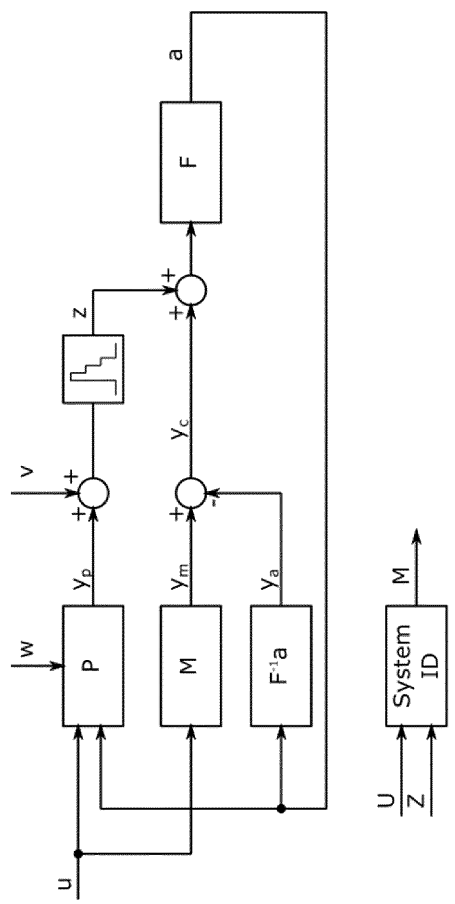

# R2独立阅读记录与章节草稿：热状态、掩模变形与热误差辨识

本稿面向《先进光刻机套刻管理架构》R2，从七件原始资料重新建立论证，不以R1为内容基底。任务对应REQ-004／REQ-006。只维护本文件，不改原始PDF、MinerU全文、图片或仓库管理文件，不提交Git。读取基线为`edd7a4e13fdddc994befcbc22147a7ac59013385`；本轮`git ls-remote origin refs/heads/main`返回同一提交，工作分支为`docs/overlay-report-r2`。已读AGENTS、README、CONTRIBUTING、REQUIREMENTS、STATUS、SOURCES、manifest及QUALITY。

“原文披露”表示资料中明确记载的内容；“综合判断”表示跨文献的架构归纳；“工程外推”表示用于整机设计或验收的建议。专利披露的示例数值、可选实施方式及预期效果均不自动成为具体商业机型的已验证能力。下文页码均为从封面计数的PDF物理页；授权文本没有段落编号时使用物理页与印刷栏号定位。

## 一、全文覆盖、原件核验与同族关系

### 1. 完整阅读记录

七件资料合计156个PDF物理页。所有`mineru.md`均按连续行范围完整读取，包括背景、实施例、附图入口、说明书中的示例条款、正式权利要求，以及文件所附检索报告或更正证书；未以摘要或关键词命中替代通读。阅读机器全文与逐字校勘整份PDF是不同工作，本轮只对下面列出的关键原页进行目视核验。

| 公开号 | 全文连续读取范围（行，首尾均含） | PDF组成／阅读覆盖 | 已目视回看的原PDF关键页 |
| --- | --- | --- | --- |
| CN120344910A | 1–300、301–600、601–878 | 第1–26页；权利要求1–15；说明书[0001]–[0145]；图1–8 | 第2页权利要求1、2、7；第12页[0080]–[0087]；第13页[0088]–[0098]；第24页图6对应已有裁切 |
| WO2024132326A1 | 1–310、311–620、621–930、931–1190 | 第1–33页；说明书[0001]–[0105]；权利要求1–15；图1–8；第31–33页国际检索报告及同族附表 | 第1页身份；第14页[0079]续、[0080]–[0084]；第20、21页权利要求1–13 |
| US10429749B2 | 1–290、291–570、571–850、851–1100；另补读800–850以覆盖一次合并输出尾端截断 | 第1–16页；说明书栏1–18及权利要求1–20；图1–5 | 第10页栏7–8输入、执行接口及图3逻辑；第12页栏11–12模型验证；第15页权利要求1等；第5页图3已有裁切 |
| US8184265B2 | 1–280、281–560、561–854 | 第1–15页；说明书栏1–14；权利要求1–15；图1–4；第15页更正证书 | 第12页栏9–10、表1及图4说明；第13页权利要求1–9；第15页更正证书；第7页图4已有裁切 |
| US12663725B2 | 1–310、311–620、621–930、931–1240、1241–1552 | 第1–26页；说明书栏1–30及其中30条示例条款；正式权利要求1–13；图1–10 | 第1页公开号、日期、申请链；第26页栏31–32全部正式权利要求；第10页图10已有裁切 |
| US20250021017A1 | 1–260、261–460、461–650、651–820、821–1052 | 第1–26页；说明书[0001]–[0220]；正式权利要求1–15；图1–10 | 第1页申请链；第25、26页正式权利要求；第6页图6已有裁切 |
| US7423725B2 | 1–260、261–530、531–888 | 第1–14页；说明书栏1–14及权利要求1–31；图1–10 | 第5页完整图8–10；第9页栏7–8仿真来源及差分逻辑；第13页栏15–16、权利要求7–24等 |

原PDF以仓库`.venv`内的`pypdfium2`渲染；由于该虚拟环境没有Pillow，使用已有系统Python载入该虚拟环境的pypdfium2包和已有Pillow，仅在`/tmp/thermal-<公开号>-p<页>.png`保存检查用栅格，不修改资料。原图详解使用仓库已有裁切，见第三部分。表中列出的目视检查不意味着未列出的所有图纸都已逐部件目视。

### 2. 同族及版本处理

**CN120344910A与WO2024132326A1是一组证据。** CN首页记载PCT/EP2023/082417、WO2024/132326、2024-06-27，以及优先权US63/433,709（2022-12-19）；WO原首页相同。CN申请公布日为2025-07-18，WO国际公布日为2024-06-27。二者核心系统和方法权利要求均为15项，主流程、图号和技术内容对应；段落编号与版式不同，不能直接沿用页号。中文本可用于中文表述，英文原文用于交叉辨识含混翻译和数字，但引用CN版本时仍回看CN原页。两件共同支持“由形状／对准量推断装载温度”，不构成两次独立验证。

**US12663725B2与US20250021017A1是同一美国申请的不同公开阶段。** 已目视两件原首页：申请号均为18/704,532，PCT号均为PCT/EP2022/078447，PCT申请日2022-10-12，优先权US63/272,472（2021-10-27）。B2原首页明确列出此前公开US2025/0021017A1（2025-01-16）和PCT公开WO2023/072603（2023-05-04）。B2原首页及图纸页印有`US 12,663,725 B2`和`Jun. 23, 2026`，不是依据目录名或当前日期推定；本轮还读取[Google Patents来源页](https://patents.google.com/patent/US12663725B2/en)，HTTP状态200，其`DC.date`的`issue`值为`2026-06-23`，与原件一致。这一交叉核验确认本轮所读文献的标识与出版日期，未据此判断权利存续、许可范围或实施自由。

两件校准专利的说明书和图1–10高度对应，不能重复计为两组性能证据。A1正式权利要求15项，B2正式权利要求13项，不能用说明书中保留的30条“clauses”代替正式权利要求。A1权利要求1为预调温、减应力、以掩模和非生产衬底接受一定剂量来校准；B2权利要求1明确加入**零剂量减应力**以及**非零剂量校准、测量掩模形状变形、计算掩模温度**。B2装置及介质独立权利要求12、13也有这些限定。生产片曝光及在线更新是说明书的重要阶段，但不能写成两版独立方法权利要求1中均必含的第四步。

**两组新近专利有引用关系，但不是同一族。** 温度推断组的WO正文[0074]引用PCT/EP2022/078447；其第31页检索报告将WO2023/072603列为X、P类文献并关联权利要求1–15。这里足以证明校准组是温度推断组明确讨论的相关先前资料；不能把检索分类改写为司法结论，也不能把两个PCT号合并为同一申请。

US10429749B2属于PCT/EP2016/070157／WO2017/050523申请链，US8184265B2源于US61/076,314优先权和12/492,473申请，US7423725B2属于11/516,050及所列部分继续申请链。它们与上述两组不应因共同申请人或相互引用而被并成同族。

## 二、逐篇技术证据与架构归属

### 1. CN120344910A：把装载热状态变成可用的控制输入

原文入口：[全文](../../../../references/patents/CN120344910A/mineru.md)；[权利要求第2页](../../../../references/patents/CN120344910A/original.pdf#page=2)；[核心说明第12页](../../../../references/patents/CN120344910A/original.pdf#page=12)。

**核心问题与L1归属。** [0006]指出曝光辐射以及输送、平台中的机电部件都可能使掩模升温；非均匀温度分布引起图像变形和套刻误差。[0007]、[0080]指出直接温度传感器RTS具有自身温度梯度、老化及测量开销，难以充分跟踪快速指数热过程。[0085]–[0087]进一步把问题推进到装载入口：掩模由外部、曝光站、检查站、内部库进入，先前位置和停留历史影响到达温度。责任不能只交给曝光中的平台位置环；它包含掩模物流提供历史、量测提供形状、热模型估计初态以及曝光控制接收预测结果。

**L2策略。** [0084]及[0099]将对准数据、基于先前位置的加热轮廓和材料热膨胀系数结合，推断负载／装载温度，再预测未来变形，最后调整平台或透镜定位。权利要求1覆盖照射路径、检测路径和控制器的状态估计链，权利要求2加入补偿及平台／透镜接口；独立方法权利要求7把“历史—温度—未来变形—执行”写成完整链。[0094]、[0097]还披露按预测加热或冷却进行反向热调节，因而同时出现源头热调节和成像后果补偿两类执行方式，不能混写成一个动作。

**L3输入、输出与能力。** 测量子系统接收经掩模相互作用后的辐射信号，输出物理尺寸、放大／变形特征或RA数据；模型接收这些量、先前位置及已知材料特性，输出装载温度和未来变形；控制器把变形预测交给平台或透镜，把温度状态交给热控制。[0069]–[0071]给出掩模300、夹具250、RA标记310和边缘标记320，后者服务RSD；[0091]列出PARIS作为可用测量例，并不要求另装专用温度计。说明书中夹持与快速交接是相关环境与可用手段，不能都写成该独立权利要求的必要构成。

**证据与适用边界。** 原第12页[0087]实际为RTS再现性约0.6 K、所述方法约0.05 K，RA约1秒与RTS超过约5秒的示例比较；机器文本的“10.6 K”不是正确引文。该段比较的是测量再现性／单次测量开销，不能写成整机套刻提高12倍或产能提高5倍。原第12页[0086]是外部约20–24℃、曝光站约22–24℃、IRIS约22.2–22.5℃等示例，机器文本出现的“120℃”“122℃”为识别错误。[0090]与[0093]提供材料系数和放大到温度的示意换算，本稿不把其近似换算推广为任意材料和夹持状态的通用测温精度。热与机械形变能否唯一分开、所测边缘能否代表图像区，仍需实际模型及残差验证，这是综合判断而非该文已完整证明的结论。

### 2. WO2024132326A1：温度推断组的英文原文与边界交叉核验

原文入口：[全文](../../../../references/patents/WO2024132326A1/mineru.md)；[第14页](../../../../references/patents/WO2024132326A1/original.pdf#page=14)；[权利要求第20页](../../../../references/patents/WO2024132326A1/original.pdf#page=20)。

**独立阅读所得。** 说明书[0042]–[0050]定义寄生热效应、生产／非生产衬底、模态热模型、KPI和在线实时校准；[0052]–[0071]按整机、光刻单元、控制器、掩模平台、交接机构展开环境；[0072]–[0089]提出RTS限制和由形状推断温度；[0091]–[0093]解释图6–8；[0094]所列20条是示例条款；第20–22页才是15项正式权利要求。第31–33页的国际检索报告也已读入，不能把它省略后宣称读过全部33页。

**架构贡献。** [0078]中的“previous location”确实指掩模先前所处位置及历史，而不是图案版内上一个空间采样点。[0091]对应CN[0099]，明确先由历史与RA估计装载温度，再预测未来变形并调用平台或透镜。L1归属是热初态的可观测性与模型初始条件；L2为测量与历史信息融合后的预测补偿；L3要求物流／库位记录、RA／RSD测量、材料信息和控制执行接口互通。

**与中文本的差异和限制。** 英文[0079]–[0083]对应中文[0087]–[0091]，两版报告数值属同一个披露来源。英文[0048]将k4描述为Y向放大、k18为Y向桶形畸变；但[0084]解释图5时使用“relative peak power change”“(in)voluntary imbalance”，CN[0092]也保留这一不同命名。原英文第14页和中文第13页均有这段文字，因此不是单纯OCR错误。报告宜采用明确的形变参数定义说明管理接口，并注明图5相关命名不一致；不能把k4直接改写成独立功率传感器，也不能假称已统一校勘。[0086]热调节和[0091]平台／透镜补偿为不同实施路径。第31页引用相关校准专利，显示技术背景的连续性，不增添新的独立实验。

### 3. US10429749B2：将热预测能力接入曝光校正与模型验证

原文入口：[全文](../../../../references/patents/US10429749B2/mineru.md)；[第10页栏7–8](../../../../references/patents/US10429749B2/original.pdf#page=10)；[第12页栏11–12](../../../../references/patents/US10429749B2/original.pdf#page=12)；[权利要求](../../../../references/patents/US10429749B2/original.pdf#page=15)。

**核心问题。** 第7页栏1–2指出，掩模加热、冷却及其空间形变会影响套刻与焦点；复杂FEM模型的计算量可能不能及时服务后续晶片。这里需要的不是减少热量的单一器件，而是把复杂热行为转换成在曝光节拍内可用的预测量。L1归属是热变形预测、测量噪声与实时校正能力的衔接。

**策略及数据流。** 第10–12页披露利用系统辨识校准线性时不变模型；以剂量、曝光面积、辐照功率／透过率及自适应冷却量等历史输入预测变形；把结果表示成套刻／焦点参数或模态形状，再由控制器调整掩模与晶片相对定位，也可调整投影系统参数。校正可在批次前、晶片之间或曝光期间实施。第9–10页还讨论用观察器处理噪声和未充分预调温掩模的初态。源头冷却量既是可控输入，又可能本身引起非均匀形变，必须进入模型。

**L3能力分配。** 工艺控制提供带时间的信息；冷却系统提供施加的冷却输入；量测提供形变样本、模态幅值或套刻／焦点数据；模型服务输出未来时刻／位置的变形；执行协调把预测变形转换成位置或光学调整。第11页栏9说明可按单个掩模校准，或对形变行为相近的类别共用；校准数据可以来自实测、过程数据或其他模型。不能仅凭“都是石英掩模”就共用模型。第13–14页栏14–15强调有限边缘标记上的多项式拟合可能不足以描述复杂场内形状，物理相关模态帮助从有限采样推断感兴趣位置，但模态数量和覆盖范围仍是前提。

**验证与权利要求边界。** 第12页栏11–12明列数据预处理、模型阶数选择、辨识、验证迭代；验证包含预测误差、残差与输入的相关性、残差自相关以及数据是否充分激励系统。这支持R2把“模型残差检查”列为整机管理职责。三至五阶模型及四个主要空间模态是说明书示例，不是普遍最小配置，也没有承诺某个nm指标。正式权利要求1要求校准LTI模型、预测、计算并施加校正，以及用套刻参数／模态表达变形；其文字并未把摘要中的“system identification method”作为同样的显式限定，不宜混引。L4的子空间辨识、观察器和模态求解只保留专题接口。

### 4. US8184265B2：避免把边缘测量量直接当作图像区热变形

原文入口：[全文](../../../../references/patents/US8184265B2/mineru.md)；[第11页栏7–8](../../../../references/patents/US8184265B2/original.pdf#page=11)；[第12页表1与流程说明](../../../../references/patents/US8184265B2/original.pdf#page=12)；[权利要求第13页](../../../../references/patents/US8184265B2/original.pdf#page=13)。

**核心问题与归属。** 局部曝光使图像区与邻近对准标记处的温度不同。第11页指出，按边缘标记距离变化进行均匀放大校正，会低估局部受热图像区的膨胀。L1属于掩模非均匀热误差及测量代表性，而不是量测仪器坐标读数错误。测量位置、曝光面积和热历史必须共同解释观测量。

**L2策略。** 对准测量给出实际标记位置／方向／放大信息；热模型使用曝光条件与时间预测膨胀；控制器把实测膨胀与预测量加权，生成估计放大校正，修正对准结果。第12页图4说明还加入可选透镜热模型，避免通过投影系统测得的表观放大变化全部被归因于掩模。权利要求1明确要求实测与预测时间热膨胀的加权组合；权利要求2–9限定部分组合及输入形式，权利要求15对应透镜热项。

**L3接口与能力。** 晶片台上的像传感器获得掩模标记空中像；处理器提取位置、转角、放大量。工艺软件提供曝光强度／能量、透过率、场尺寸与曝光时间；掩模模型输出随时间和空间变化的标记位移或膨胀估计；透镜模型提供独立热放大修正；协调环输出用于平台相对定位和投影放大设定的校正对准数据。该文不同段落对透过率符号的称谓有差异，架构章节保留“实际能量、相关透过率及定义来源”接口，不展开符号公式。

**定量证据边界。** 第12页表1的5×5 mm²例给出图像中心实测2.79 ppm、标记测量0.66 ppm、预测9.0 ppm、组合校正2.8 ppm，适合说明为什么需要结合两类信息。但是20×20 mm²例为中心4.2 ppm、标记4.18 ppm、组合4.0 ppm，组合并不比标记值更接近中心值。故原文关于较好逼近的叙述不能升级为“所有场尺寸均改善”或“完全消除热误差”；这里也没有全场校正后nm残差验收。第15页正式更正证书将权利要求9中总曝光时间记号的`to`改为`te`，公式专题必须连同更正阅读。

### 5. US12663725B2：以受控初态和明确校准步骤管理热模型

原文入口：[全文](../../../../references/patents/US12663725B2/mineru.md)；[身份与日期](../../../../references/patents/US12663725B2/original.pdf#page=1)；[正式权利要求第26页](../../../../references/patents/US12663725B2/original.pdf#page=26)。

**核心问题。** 第17页栏14将RTS误差、测量时间、在内部库中等待过久、校准前热机械状态不一致及生产片返工作为共同问题。其管理对象是“校准何时开始、以什么状态开始、用什么片校准、何时转入生产以及生产中是否继续修正”，因此是跨热控、夹持物流、量测与生产调度的管理流程。

**L2分阶段策略。** 图5为调温—校准—生产三个阶段；图6增加独立减应力阶段。第18–22页披露通过RA／RSD或KPI判断预调温状态，必要时继续测量；通过卸夹移交再夹持以及零剂量步骤降低寄生热效应；用非生产片／CTC片施加剂量校准和适应曝光热负载；随后生产曝光并继续基于RA更新模型。第20页栏20示例使用当前及前三次RA观察变化，有变化则继续调温，无变化则结束；它是状态驱动的结束判定示例，不是所有系统必需的四样本判定规则。

**L3输入输出与能力。** 掩模库／调温槽执行加热或气流调温；交接与夹持系统提供解夹、移交及重夹动作；RA／RSD系统输出每阶段的形状状态；控制器判断调温结束与校准收敛，调度非生产片和生产片，并把更新后的模型交给预测补偿环。第22页栏23还列出预先确定的FEM、集中数据池及扫频曝光分辨掩模和透镜时间常数的可选路径；这些说明能力可以分布于机内和上层数据服务，未提供一个普遍适用的免校准保证。

**正式版本差异。** 第26页权利要求1、12、13明确零剂量减应力、非零剂量校准、测RSD并计算温度，不能用A1的宽泛权利要求替代。权利要求11再加入变形预测和生产衬底相对掩模的对准校正。说明书中的生产在线更新及图6温度曲线属于共同披露，不是授权后新增的独立实验证据。22℃±0.2℃、约1–5分钟及至少90%收敛是所列条件或实施例；“90%”没有自动映射为整机套刻nm残差。图6为示意曲线，坐标没有足以读取实际温度及绝对工时的刻度。

### 6. US20250021017A1：校准流程的公开申请文本及接口补充

原文入口：[全文](../../../../references/patents/US20250021017A1/mineru.md)；[第20页调温与减应力](../../../../references/patents/US20250021017A1/original.pdf#page=20)；[第25页权利要求1](../../../../references/patents/US20250021017A1/original.pdf#page=25)；[第26页权利要求](../../../../references/patents/US20250021017A1/original.pdf#page=26)。

**完整文本的结构与重点。** [0001]–[0045]列背景和各实施方式；[0058]–[0071]定义热模型、KPI、非生产片等；[0072]–[0091]解释整机、光刻单元、控制器、掩模及交接机构；[0092]–[0143]逐阶段解释图5–8；[0144]–[0157]解释图9–10；[0158]–[0209]为30条示例条款；[0210]–[0220]为适用说明；末尾为15项正式权利要求。逐篇登记并不意味着把与B2重复的正文重新计为不同研究结果。

**L1—L3归属。** [0097]–[0104]将热初态、校准片和模型收敛联在一起；[0118]–[0125]说明图6各阶段及解夹释放应力；[0126]–[0137]区分非生产片校准与生产片持续更新；[0138]给出集中数据和掩模／透镜联合校准的可选接口。源头抑制对应调温及释放应力；补偿对应在校准后的状态模型上预测变形、调整对准；量测既用于估计状态，也用于决定何时离开当前阶段。特别是[0137]允许每阶段进行RA、而RSD可仅在阶段内测一次，表明不同测量服务不同调度层次，不能统一写成“每片都完整扫描全部形状标记”。

**适用边界和版本差异。** A1权利要求1只列预调温、减应力、以非生产衬底校准，不强制具体零剂量／非零剂量组合；零剂量减应力见从属权利要求8，校准时RSD和温度计算见权利要求9。申请文本的范围与B2收窄后的文字须并列说明。[0069]给出实时计算速率2.56秒或更短的例子，不是每个测量、每个交换动作及整批校准均在2.56秒完成。[0140]–[0143]用k4、k18的收敛辅助判断，图7、8纵轴为任意单位，不能按图直接提取nm套刻提升。集中数据池是否能跨掩模复用，需要匹配状态、材料、夹持和工艺条件，是工程外推。

### 7. US7423725B2：防止把曝光历史引起的晶片冷却写进静态校准

原文入口：[全文](../../../../references/patents/US7423725B2/mineru.md)；[第9页栏7–8](../../../../references/patents/US7423725B2/original.pdf#page=9)；[第10页栏9–10](../../../../references/patents/US7423725B2/original.pdf#page=10)；[第13页权利要求](../../../../references/patents/US7423725B2/original.pdf#page=13)。

**核心问题与责任归属。** 浸没液残留在晶片上并蒸发会带走热量，使晶片发生随路径、速度和先前曝光顺序变化的局部收缩。抗蚀剂层影响导热，顶涂层影响蒸发。第6页栏2明确指出，直接把传统测得的套刻图作为设备静态校准，可能不能消除甚至加剧误差。L1属于晶片热状态与校准误差归因，源头在浸没流体／晶片／涂层，处理位置却在整机校准与曝光调度。

**L2辨识策略。** 使用不同曝光顺序、路径方向、速度／停顿、热负载或涂层热物性获得至少两组位置／套刻数据，再比较以辨别热历史贡献。图8、9给出正反蛇形顺序；第9页区分保持场内扫描方向与反转场内方向，可分别帮助隔离全片和局部热作用。第10页还讨论同路径不同速度、不同抗蚀剂／顶涂层和液温变化。不是只提出一种反向扫描，也不是要求生产每片固定交替正反方向。

**L3接口与能力。** 曝光调度需复现并有控制地改变目标场次序、扫描方向及速度曲线；量测需把两组相同位置的测试结构配准并输出位置或套刻数据；校准计算需保留工艺材料和热负载元数据，分辨历史相关项后生成可用于设备校准的数据；执行环再将校准结果用于生产定位。第11页栏11说明跨机使用时需先处理机间差异；同片可减少材料差异，但分层重做耗时会引入漂移，连续使用两片可能更利于减小时间漂移。这是明确的实验设计权衡。

**证据性质与边界。** 第9页栏7虽出现“experimental data”措辞，紧接着明确这些数据来自模拟热效应的有限元分析，且后文写“Instead of simulated data, measured data could have been taken”。因此图6、7须标为仿真示例。图7是正向与反向两组数据相减，不是执行校正后的残差图。两图的最大向量数值和绘图比例尺不同，不能凭箭头大小作改善百分比。两组差值暴露的是随条件变化的成分，单凭差分并不唯一给出全部静态误差或全部热误差；生产补偿仍须相应物理／统计假设和验证。正式权利要求1、23覆盖不同路径的校准方法，权利要求24进一步覆盖曝光序列、导热或蒸发性质的差异，权利要求25–31细化热负载、速度和材料等条件。

## 三、原图目视与逐部件解读

以下六组均已实际打开原始裁切图；US7423725B2还打开完整PDF第5页核对裁切外的图8、9标题。部件引线与真正的数据／流程箭头分别说明。

### 图T1：CN120344910A图6——从状态估计走到执行端

原图路径为`references/patents/CN120344910A/figures/p0024-0012.png`，原件[物理第24页](../../../../references/patents/CN120344910A/original.pdf#page=24)，文字解释为第14页[0099]，方法权利要求7在第2页。

1. **610**接收在图案形成装置与晶片之间测得的对准数据，表示量测信息进入控制器，不是直接温度读数。
2. 向下箭头通往**620**，使用先前位置确定加热分布。这里需要物流历史，说明对准测量单独不足以定义热初态。
3. 再向下到**630**，合并对准、加热分布与材料热膨胀系数，输出负载温度。它是状态估计节点，不能与热控制执行混同。
4. **640**利用该状态确定未来变形，把当前测量变成对未来曝光有意义的预测。
5. **650**调整产生对准数据的系统的平台或透镜定位，补偿预测变形。末端明确是执行接口，说明书也允许其他热调节路径，但没有画在这条图6链上。

每个框右侧的弯曲细线只是编号引线；框间竖直带箭头线表示步骤顺序。图中没有回到610的闭环箭头，也没有残差验收框。将其放进整机循环需要另行标为综合架构，不能声称原图已画出完整闭环。

### 图T2：US10429749B2图3——物理系统、预测模型和已施加校正的协调

原图路径为`references/patents/US10429749B2/figures/p0005-0004.png`，原件[物理第5页](../../../../references/patents/US10429749B2/original.pdf#page=5)，说明位于第10页栏8至第11页栏9。已有图为侧向排布，阅读时沿信号箭头追踪。

1. **u**一支进入真实系统**P**，另一支进入模型**M**，说明同一曝光／冷却输入同时驱动实体和预测。
2. **P**的输出标为**yp**；过程扰动**w**进入P，测量噪声**v**在其后加到信号上。之后的小阶梯形模块体现测量信号的采样／离散更新，输出**z**。原图未给该小模块专用名称，本稿不将其指定为某一具体滤波器。
3. 模型**M**输出**ym**。执行调整**a**经下方的**F⁻¹a**映射为**ya**，在中间求和点以负号与ym组合，得到**yc**。这条支路扣除已经通过对准策略施加的修正，避免同一热变化在模型与对准量中重复补偿。
4. **z**与**yc**在右端求和，再经**F**转成执行调整**a**，a回到实体支路，并回到F⁻¹a支路。
5. 下方独立的**System ID**接收时间序列**U、Z**，输出模型**M**。这里画的是模型校准来源，不能把它误读为每次曝光都要重新做完整辨识。

图的架构价值在于同时管理物理扰动、测量、预测和已经施加的执行量。整机接口需知道校正的基准与生效历史，这是由图示作出的综合要求；具体矩阵、滤波增益和离散算法留给L4专题。

### 图T3：US8184265B2图4——三类信息进入一个对准修正节点

原图路径为`references/patents/US8184265B2/figures/p0007-0009.png`，原件[物理第7页](../../../../references/patents/US8184265B2/original.pdf#page=7)，解释为第12页栏9–10。

**402**是reticle alignment measurement，输出实际测得的掩模对准量；**404**是reticle heating model，输出随时空变化的热位移／膨胀信息；**405**是lens heating model，输出透镜热放大变化。三条向下箭头均指向**406**“correction of reticle alignment results”，表示融合后的对准修正，而不是三种独立执行器。406向下输出**408**校正后的对准数据，供平台及投影系统使用。**400**的弯引线标识整套方法，并非额外信号。

405在说明书中是可选联合路径；原图虽然画出三路，不能据此要求每个实施例都同时启用透镜模型。该图把“热误差源位于掩模／透镜”和“处理发生在对准结果解释与定位环节”清楚分开。表1的场尺寸边界还提醒读者：融合策略的有效性需要逐工况验证。

### 图T4：US20250021017A1图6——调温、应力释放、校准与生产的阶段切换

原图路径为`references/patents/US20250021017A1/figures/p0006-0010.png`，原件[物理第6页](../../../../references/patents/US20250021017A1/original.pdf#page=6)，对应[0118]–[0137]；同族B2图6在物理第7页。

纵轴**602**表示掩模温度，横轴**604**表示过程推进；上方分段双向尺寸箭头标出阶段范围，不是反馈信号。**610**为调温阶段，曲线**612**从较热初态下降；**611**为初始RA与RSD，虚线标记**614、616、618**为必要时追加的RA测量。它们在过程线上定位测量时点，不表示四个不同传感器。

**620**为减应力阶段，底部**621**指移出平台／再装夹，**622**指零剂量步骤，**623**指零剂量阶段RA与RSD核验，**624**是该阶段的温度状态示意。注意温度已接近目标仍保留减应力阶段，说明温度接近目标与夹持应力释放不是同一条件。

进入**630**校准阶段后，**631**核验RA与RSD，曲线**632**随非生产片剂量曝光升高；到**640**生产阶段开始，**641**再次检查RA与RSD，**642**示意生产中的热状态趋于平稳。曲线的连续性表示阶段间热状态会传递，并不要求每次转段都冷却回室温。图没有实际温度或时间数值刻度，不能据其长度读出等待时间、吞吐量或热稳定精度。

### 图T5：US7423725B2图8–10——改变曝光历史后再解释校准数据

原图路径为`references/patents/US7423725B2/figures/p0005-0009.png`；裁切上缘未保留全部图号，已打开[完整物理第5页](../../../../references/patents/US7423725B2/original.pdf#page=5)确认左为图8、右为图9，下为图10。说明见第9–10页栏7–9。

图8左侧晶片网格代表目标场，虚线箭头从左下进入，逐行交替前进并向上推进；图9从右上进入，沿相同总体蛇形路径反向前进。它们改变目标场经历热负载的次序。正文特别说明场内扫描的额外往返运动为简洁起见没有画出，不能把图上的每条箭头直接当成一条完整的场内曝光扫描。

图10沿主干从**S1**正蛇形曝光第一片，到**S2**量测第一片；S2右侧箭头输出**First Error Data**。随后**S3**反蛇形曝光第二片，**S4**量测第二片并输出**Second Error Data**。两组数据各自通过折线进入**S5**处理节点，S5输出**Third Error Data**并交给**S6 Calibration**，之后进入**S7 Production Exposure**。右侧平行四边形是数据集，方框是动作；不能把“第三组数据”误写成第三次实测或最终残差。

这张图说明辨识与校准之间有独立的数据处理步骤。热历史差值需要被解释后才能服务设备校准；它不是“测一张热图便永久写入静态补偿”。原文允许同片或不同片、同机或先校准机差后的不同机，以及更一般的速度／材料／热负载差异，图10只是其中一条实例路径。

### 图T6：US12663725B2图10——零剂量与校准剂量分属不同任务

原图路径为`references/patents/US12663725B2/figures/p0010-0014.png`，原件[物理第10页](../../../../references/patents/US12663725B2/original.pdf#page=10)，说明位于第23页栏25–26，正式权利要求位于第26页栏31–32。

**1002**根据掩模形状变形对应的温度状态进行加热／冷却；**1004**把掩模从平台移走再装回，以释放热机械应力；**1006**明确写掩模和非生产片接受“ZERO DOSE OF RADIATION”，用于减小寄生热效应。下一步**1008**通过形状变形测量掩模温度，说明应力释放后还要再次核验状态，不能沿用释放前的状态估计而不检查。

**1010**对掩模和非生产片施加剂量；**1012**再次基于形状测量温度并校准热模型；**1014**才在该模型基础上曝光生产片。所有框间箭头朝下，描述示例流程的状态依赖；右侧弯曲线为步骤编号引线。图中文字1010只写“a dose”，**非零剂量**的明确限定来自B2正式权利要求1、12、13，不应把解释后的限定误写成图上原有字样。图10在A1中也已存在，不能称为授权阶段新增的图示证据。

图中没有解释零剂量的器件级实现，也没有证明“零辐射自身主动加热并释放应力”。架构层只应忠实描述原文所列无曝光剂量阶段、移交动作与状态核验；若要解释其物理机制和工艺时序，须由后续专题补充证据。

## 四、R2可纳入正文的章节草稿：热扰动的整机管理架构

### 4.1 L0：热管理在套刻链中的位置

【综合判断】热管理应贯穿掩模进入设备、校准、曝光和验证全过程。热源并不只来自曝光光束：掩模输送与夹持状态影响装载初态，主动冷却可能改变掩模空间形状，浸没液蒸发则使晶片局部冷却。它们最终都表现为图案位置变化，却需要不同的状态信息和处理动作。整机需要把“物体当前是什么状态”“接下来会怎样变化”“哪个子系统能够抑制或补偿”“校正后是否仍有结构性残差”接起来。

【原文披露】US10429749B2第10页给出曝光／冷却输入到变形预测、再到平台或投影系统校正的路径；CN120344910A图6补上装载温度估计；US20250021017A1图6把调温、减应力、校准和生产安排为连续过程；US7423725B2图10则表明热历史的识别应先于把数据用于设备校准。这些资料共同支持一条上层逻辑：接收并约束初始热机械状态，测量当前形变，预测曝光中的变化，分配抑制与补偿动作，再验证预测和生产残差。上述串联是报告综合架构，并非任何单件专利已经给出的完整商用系统。

### 4.2 L1：先分清误差来自哪里、观测到了什么

【原文披露】掩模吸收曝光能量后产生随时间和空间变化的变形。US8184265B2进一步指出，局部曝光区域比邻近标记更热，因此边缘标记测得的膨胀不能直接代表图像区。US10429749B2也指出，有限标记上拟合的多项式可能无法充分描述复杂场内形状。量测提供的是对特定位置、特定光学路径的观测，控制器必须判断它与待校正图像位置之间的关系。

【原文披露】热初态是另一类问题。CN120344910A和WO2024132326A1说明，来自外部、检查站、内部库和曝光站的掩模具有不同温度历史；即使做过预调温，也需要知道实际装载状态。校准组进一步指出，掩模到达目标温度后仍可能保留夹持引入的应力。因而“温度合格”“形状稳定”“校准有效”是相互关联、但不能替代的状态。

【原文披露】晶片侧还有另一条热路径。US7423725B2描述浸没液残留蒸发造成的收缩，受场次序、扫描速度、抗蚀剂导热和顶涂层蒸发特性影响。这种误差带有曝光历史，不能直接当成固定的位置标定误差。该文对不同顺序进行对照，目的首先是分辨误差归属，然后才谈校准与补偿。

【综合判断】因此整机责任分配不能仅按“误差最后在哪里被测出”决定。掩模热形变归热模型和掩模状态管理，观测偏差归量测解释，平台与投影系统承担可实现的补偿，晶片蒸发冷却则需要曝光调度、浸没系统和工艺材料信息参与。一个量测结果可能同时含有掩模、透镜、晶片和静态设备项，管理层应维护来源解释，避免同一变化被多个子系统重复修正。

### 4.3 L2：源头调节、预测补偿与对照辨识共同工作

【原文披露】源头调节的第一步是建立可复现初态。校准组允许在调温槽中加热或用气流冷却，并以RA、RSD或形变KPI判断何时结束。图6在调温后单独设置解夹移交、重夹和零剂量阶段，以减小寄生热机械效应，再用非生产片接受剂量进行校准。它减少模型需要解释的初始不确定性，也减少把校准工作转嫁给生产片的需要。预调温结束与转入生产可以依状态判据决定，说明书中的固定片数或等待时间只是其他可选实施方式。

【原文披露】预测补偿用于处理曝光中继续出现的形变。US10429749B2将剂量、透过率、曝光面积和冷却等时间输入转换成变形预测，交给相对定位或投影参数调整。它允许在晶片之间和曝光期间应用校正。CN／WO温度推断组把RA／形状信息与历史、材料特性结合，估计装载温度，改善这一预测链的初始条件。冷却不仅是“减少温升”的措施，其产生的形状变化也可作为预测输入。

【原文披露】在观测不能充分代表目标误差时，需要融合测量与模型。US8184265B2图4将实测对准量、掩模热模型和可选透镜热模型汇入同一个修正节点。其核心是解释图像区与标记区的差别，而不是一味增加标记数量。US10429749B2以物理相关空间模态从有限测量推断场内变形，提供另一种实现能力。二者均支持把“测量覆盖范围与模型外推范围”作为接口信息，而不是默认边缘测量等于全场真值。

【原文披露】对难以归属的热误差，对照曝光提供辨识手段。US7423725B2通过正反蛇形、不同速度或材料热特性取得对照数据；保持场内扫描方向可帮助研究全片次序影响，反转场内方向则可研究局部作用。两组之差能揭示条件变化引起的误差，但还需要模型解释和基准关系才能生成适当的生产校正。把差分图本身标为“校正后残差”会跳过专利明确设置的数据处理环节。

【综合判断】这三种策略应同时存在于L2：通过调温和释放应力抑制不受控初态，通过预测与执行能力补偿可预知变化，通过对照测量区分尚未解释的误差来源。没有任何一条可以保证独立覆盖所有热误差；它们的组合范围取决于实际机型可测量什么、可执行什么，以及工艺节拍允许什么。

### 4.4 L3：子系统必须交付可管理的能力

【综合判断】热管理的接口至少需要同时包含数值、时间与适用条件。只传一个“当前温度”不能支持未来场的变形预测，只传一个“补偿量”也不足以让其他环路知道它已经何时生效。依据上述专利，可将子系统职责整理如下；表中具体接口组织是报告综合，不是原文统一规定的通信协议。

| 子系统 | 进入该子系统的信息 | 向整机交付的输出／能力 | 对套刻管理的作用 |
| --- | --- | --- | --- |
| 掩模物流、库位与调温 | 先前位置、停留／曝光历史、目标状态 | 实际到达状态、调温动作、结束判据及可用时间 | 使模型初态有来源，协调等待与生产节拍 |
| 夹持与交接 | 当前夹持状态、减应力请求 | 解夹、移交、重夹完成状态及后续可测条件 | 减少把机械应力误当纯温度变化 |
| RA／RSD与光学量测 | 标记布局、测量时刻、当前工艺状态 | 对准与形状特征、采样范围、重复性及测量开销 | 把局部观测转成有边界的状态信息 |
| 热模型与校准服务 | 初态、剂量、曝光面积、透过率、冷却输入、形状与套刻反馈 | 未来形变、适用掩模／工艺、校准状态及预测残差 | 给执行环提供可及时使用的校正依据 |
| 平台及投影系统 | 分配的定位／放大／其他可实现调整 | 已执行量、生效时刻、剩余可校正空间 | 将预测转成图案位置改善，并避免重复补偿 |
| 曝光调度、浸没与工艺接口 | 场次序、速度、液体与涂层热条件 | 可复现的测试／生产序列及状态记录 | 分辨晶片冷却与静态设备误差 |
| 整机验证与上层控制 | 测量、预测、执行记录和生产结果 | 接受、继续校准、追加测量或调整工况的判断 | 将局部功能闭合到全片／全场套刻表现 |

【原文披露】模型服务还需要区分校准与生产中的更新。校准组在非生产片上建立初始模型后，允许生产阶段继续基于RA修正；RSD测量可按阶段组织，并非每片都执行完整形状扫描。US10429749B2允许按单个掩模或行为相似的类别校准，意味着模型复用需要对应的对象和适用条件。集中数据池是校准组的可选来源，不能自动免除这种匹配。

【工程外推】整机可将模型版本、掩模身份、适用工艺、有效时间、状态置信度和执行记录绑定管理。若装载状态超出校准范围，或残差保留与曝光输入相关的结构，应重新估计初态、补充校准或扩大测量范围。这些是从专利接口需求推导出的管理建议，所需阈值须按实际设备验证，不能从“90%收敛”直接换算成某个nm门限。

【综合判断】这些能力还存在三种不同时间尺度。物流和调温面对装载及阶段切换，重点是何时具备进入下一阶段的条件；热预测面对下一晶片或下一曝光时刻，重点是输入历史是否及时以及预测能否在执行前到达；生产反馈面对模型是否持续有效，重点是残差是否随剂量、次序或材料条件出现系统变化。把三者合并成一个笼统的“实时闭环”，会丢失测量开销、模型更新和执行生效之间的先后关系。

【原文披露】US10429749B2图3另有一项重要协调关系：模型的预测在与测量相加之前，需要考虑已经由对准策略施加的校正。这说明执行历史本身也是状态解释的一部分。对准量改善可能来自前一轮补偿，不能把它全部解释成掩模自然冷却或模型参数改变。同样，US8184265B2的透镜热模型支路提醒控制器，经投影系统测得的掩模像会包含投影系统自身变化，测量路径上的其他状态必须被识别或补偿。

【工程外推】子系统交付时应把“能测到”与“能用来控制”分别验收。量测需要说明有效采样位置、当前信噪条件和对应时刻；模型需要说明从这些位置推断哪些区域、在多长预测窗口内有效；执行器需要说明可校正的变形分量及调整是否引入其他成像影响。不能因平台能够平移就假定能够消除任意高阶场内畸变，也不能因存在透镜调节接口就假定所有预测分量都能被独立实现。上述能力边界应在整机分配补偿时可见，而不隐藏在各子系统内部。

【综合判断】非生产片也不是一个单纯的耗材选择。校准组利用它把初态核验、热负载激励和模型建立安排在正式生产之前；生产片则继续提供真实生产条件下的反馈。两者的数据用途不同：前者需要足够清楚的状态与激励，后者需要控制测量开销及对正常生产的影响。整机管理应维持这一角色区别，避免把生产中的相关性直接当成已经完成受控校准。

### 4.5 回到整机残差与L4专题接口

【原文披露】US10429749B2不仅给出预测，还要求分析模型是否捕获数据中的动力学：残差与输入仍相关，可能表示缺失驱动；残差自身仍有结构，可能表示遗漏动力学或非线性。这为整机验证提供了比“模型成功运行”更严格的判断依据。US8184265B2的表1也说明，不同场尺寸的收益不能假设一致；US7423725B2则提醒，相同空间位置在不同曝光历史下可能有不同误差。

【综合判断】所以验收应同时考察初态、场内位置、晶片次序、曝光路径及校正后的生产残差。温度稳定、模型参数稳定和最终套刻稳定分别证明不同环节，不能互相代替。专利中的0.05 K、单次测量约1秒、调温时间或收敛比例，只能按其原场景引用；它们没有共同组成一份已实现的整机性能规格。

【工程外推】一种可审阅的整机验证安排，是分别覆盖热掩模与接近目标温度掩模的装载、不同曝光场尺寸与剂量、不同冷却输入，以及阶段切换后的首片和稳定生产中的后续片。每项比较都应记录采用的模型、实际校正量和相同坐标处的残差。晶片冷却分支还应保持或有控制地改变材料、扫描方向和顺序，先确定差异源于哪个变化，再判断补偿是否可迁移到生产条件。这是验证场景建议，专利没有给出统一的完整验收矩阵。

【工程外推】若残差只在装载后的早期出现，应优先检查初态与调温结束判据；若残差随曝光场尺寸改变，应检查边缘量测到图像区的映射；若换扫描顺序后误差图改变，应检查晶片热历史，而不是直接重写静态设备校准。这样的诊断顺序把异常返回到其责任环节，使“继续测量、重新校准、调整热条件、改变补偿分配”成为有依据的动作，而不只是扩大拟合自由度。

【工程外推】L4后续专题可分别承接形状到温度的可辨识性、热模型辨识与验证、空间模态及采样设计、掩模／透镜联合校准、夹持应力释放，以及浸没冷却的对照实验设计。R2上层章节只规定这些专题需要向整机交付的状态、预测、边界和验证证据；公式、器件设计和具体算法实现留在专题中展开。

## 五、交付前局部核验说明

- 仅本文件为本子任务正式产物，原图均引用已有路径；没有新建报告PDF。
- 已完整读取七件机器全文，并对核心权利要求、关键数值及六组原图执行以上目视核验。
- 来源与日期核验、同族去重、申请／授权权利要求差异及仿真／实测区别均已写入本稿。
- 本稿中的OCR问题与原文内部不一致属于独立人工校核记录，未改写机器全文。需由主任务决定是否同步既有QUALITY管理记录。
- 已运行本文件链接解析与七件原PDF SHA-256对比：本地链接目标均存在，七件原件均与manifest记录相符，`git diff --name-only -- references/patents`为空。全仓库单元测试和最终整合校验由主任务在报告组装后统一执行，不在此冒称已经通过。
