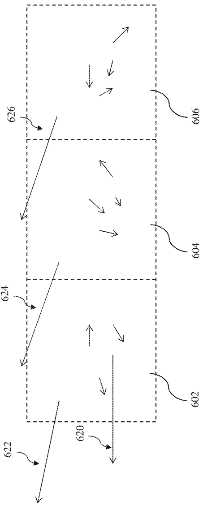

# 摘要

高精度套刻涉及量测、工艺背景、模型更新和执行机构之间的协同。本文以 Overlay2 已收录的45件专利为资料池，选择六件直接涉及管理与控制逻辑的专利进行重点解读，围绕“如何把量测结果转化为可持续、可执行的曝光校正”展开分析。原始资料揭示了若干互补机制：上层监督控制协调光刻与量测；按工艺路径划分的控制组共享公共漂移信息；频繁稀疏量测与低频密集量测通过采样映射和去校正处理减少相互干扰；异常点识别保留具有重复性的真实误差；曝光后反馈更新热效应前馈参数；掩模形状量测支持装载温度及未来变形估计；扫描轨迹优化考虑有限狭缝的积分效应与执行能力。本文将这些机制归纳为目标、数据、估计、决策、执行和验证六个功能层次。该分层是跨专利的解释性综合，不是某一厂商公开的整机软件框图。本文不据专利披露推定商业机型已采用全部机制，也不将单项示例换算为整机套刻性能承诺。

**关键词：** 光刻；套刻；先进过程控制；多尺度控制；前馈与反馈；掩模热变形；扫描曝光

# 1 引言与研究方法

## 1.1 问题界定

套刻关注不同曝光所形成图形之间的相对位置误差。曝光前的对准用于建立当前晶片与参考之间的位置关系，曝光后套刻量测则检查图形转移和后续工艺的结果；二者服务于同一目标，但测量对象、时刻和误差组成不同。[1，物理页9；3，段落0028–0030]

本报告把“上层建筑”解释为目标、信息组织、控制职责及闭环关系；把“管理架构”解释为数据由谁使用、模型何时更新、校正如何分配以及结果如何评价。这里的“先进”指所研究的高精度控制方法，不指定某个制程节点、数值孔径或商业机型。报告重点是解释精度如何被管理，不是根据专利为具体设备编制性能规格。

## 1.2 证据范围与阅读规则

资料基线为仓库提交 `dd7ee03acec72b6db251f59b2bcf798aa1ff2aed`。资料池包含原始PDF、MinerU提取文本和原图裁切。本文从目录筛选与管理架构直接相关的六件资料作为核心证据；对其关键说明、权利要求和所用图纸进行了定位核对。没有对45件专利逐篇作同等深度的技术审查。

本文使用三类表述：**“专利披露”**指原文明确描述的结构或方法；**“本文综合”**指将多件专利组织为解释框架；**“外推/工程建议”**指资料未直接给出、但为工程应用提出的条件或管理建议。后两类不能作为原专利的逐字结论引用。图像来自对应公开号资料，图注同时给出报告图号、专利图号与PDF物理页。本文各表均为研究整理表，不是专利原表。

A1、A类文献按公开文本解读，B2按所收录授权文本解读；说明书中的实施例、编号条款与末尾正式权利要求分开处理。本文不核查法律有效性、不评判专利新颖性，也不以同族文本替换具体公开号。所说“核心”是与本报告主题相关的技术核心，不是对保护范围的法律意见。

## 1.3 核心资料选择

表1 核心专利与所回答的架构问题（本文整理）

| 编号与公开号 | 技术核心 | 报告中的作用 |
| --- | --- | --- |
| [1] US11300886B2 | 利用套刻/对准反馈修正前馈参数 | 上层监督控制、热模型自适应 |
| [2] US11513444B2 | 从异常点中区分真实系统性误差与噪声 | 量测可信度与校正输入治理 |
| [3] WO2021032376A1 | 多路量测的贡献估计及校正/KPI计算 | 全局与局部解耦、ADI/AEI衔接 |
| [4] US11754931B2 | 组特有与公共校正分量联合估计 | 工艺背景分组与跨组信息共享 |
| [5] CN120344910A | 从形状/对准信息估计掩模负载温度 | 状态观测、变形预测与补偿 |
| [6] US20210096472A1 | 场外轨迹延拓及有限狭缝反卷积 | 校正指令到实际曝光的转换 |

仓库还含有对准传感器、支撑与夹持、波前操纵器和光学元件调节等资料。这些是进一步研究硬件可观测性、可控性的候选来源；本文不将仅由题名识别的内容写成已经核实的器件性能。本文范围内对平台和投影系统的讨论，限于上述六件资料明确描述的控制接口与约束。

# 2 高精度套刻的上层管理框架

## 2.1 从生产单元到曝光控制器

{width=78%}

图1来源：[原PDF第3页](../../references/patents/US11300886B2/original.pdf#page=3)，解释依据为[第9页](../../references/patents/US11300886B2/mineru.md#p0009)。

图1中，光刻设备100与控制单元LACU 106、涂胶装置108、烘烤装置110、显影装置112、量测装置140及刻蚀等后续设备构成生产流程。上部SCS为监督控制系统，R为配方，166为控制信号；量测结果沿146反馈到SCS。图中实体加工流与控制信息流具有不同职责：晶片经历工艺步骤，数据返回监督系统，用于决定后续加工的调整。

专利进一步说明，MES可调度APC量测并传递结果，数据处理单元将量测特征转为设备配方；SCS再经LACU控制设备。这给出了管理上的三个区别：**调度决定何时获得信息，APC处理决定如何解释偏差，设备控制负责执行配方。** 这是对[1]第9页背景架构的解释，不应误认为该专利对MES本身提出了新的完整实现。

高精度套刻因此不只取决于某次定位是否准确，还取决于偏差能否被及时测出、被送到正确的控制对象，以及校正是否对下一次曝光仍然有效。资料支持这种闭环结构，但没有给出整套系统的通信协议、任务周期、数据库设计或实时操作系统配置。

## 2.2 六个功能层次

表2 套刻管理的功能分层（本文综合，不是厂商组织图）

| 层次 | 核心问题 | 输入与输出 | 主要证据 |
| --- | --- | --- | --- |
| 目标与评价 | 控制的是哪一工艺阶段、何种性能指标？ | 产品/工艺需求 → KPI与控制目标 | [3]0030、0062–0063；[6]0083–0095 |
| 数据与背景 | 数据属于哪一晶片、工艺路径和采样位置？ | 量测与工艺背景 → 可用于建模的数据 | [2]Fig. 6；[4]第12–15页 |
| 状态与误差估计 | 偏差由哪些公共、局部、动态分量组成？ | 数据、历史与模型 → 指纹/热状态 | [3]0035–0044；[4]式(2)；[5]0099 |
| 校正决策 | 哪部分交给哪个控制环，怎样避免重复补偿？ | 指纹与执行能力 → 全局/CPE/前馈校正 | [3]Fig. 4a；[1]Fig. 3B |
| 曝光执行 | 期望校正如何变为可实现的轨迹？ | 校正轮廓 → 平台/光学系统设置 | [6]0045–0056；[5]权利要求7 |
| 验证与更新 | 校正是否有效，模型是否过时？ | 新量测 → KPI、参数更新或返工决策 | [1]Fig. 5；[3]0063 |

六层不是六台独立计算机。专利[1]允许相关计算在LACU、SCS或两者组合中实现；[2]也说明量测和控制模块可以集成或分布部署。因此，理解功能边界比假设某种物理部署方式更有资料依据。

## 2.3 空间尺度、时间尺度和工艺尺度

**空间尺度。** 晶片全局指纹、曝光场局部指纹及芯片内重复指纹不应混为同一对象。[3]区分全局模型与场内高阶模型；[6]进一步讨论芯片内、场内和场间分量，以及沿扫描方向的动态控制。增加模型自由度必须与采样和执行分辨能力相匹配。

**时间尺度。** 批次间漂移、批次内部热演化和单次扫描期间的轨迹变化需要不同处理。[1]指出仅对整批晶片施加相同APC校正不能覆盖批内漂移；[6]讨论扫描过程中连续变化的控制轮廓。本文据此区分“跨批次估计”“曝光前状态预测”“扫描时执行”，不为它们指定原文未给出的毫秒级刷新率。

**工艺尺度。** 显影后量测ADI与刻蚀后量测AEI并非同一个性能截面。[3]指出AEI可能包含附加工艺贡献，量测靶标与器件特征对工艺变化的响应也可能不同。某个ADI指标改善，不足以单独证明最终器件套刻已改善。

# 3 量测输入治理：US11513444B2详细解读

## 3.1 要解决的问题

专利[2]第13–15页描述：靶标损伤、污染或非对称性可能产生不代表真实物理失配的量测值。如果将这些值直接交给校正模型，模型会为了追随异常点而牺牲邻近位置。Fig. 5以“未经去噪”和“去噪后”两种流程说明这种风险。这里的关键不是简单把最大误差删除，而是区分**需要校正的真实误差**和**不应驱动控制的量测噪声**。

## 3.2 Fig. 6：异常值不等于噪声

{height=105mm}

图2来源：[原PDF第9页](../../references/patents/US11513444B2/original.pdf#page=9)；解释见[第14–15页](../../references/patents/US11513444B2/mineru.md#p0014)。

图中602、604、606为三个相邻曝光场。620、622、624、626都可能在场内比较中表现为异常向量，但622、624、626在不同场的类似区域重复出现，因而可能代表系统性误差；620缺少这种重复性，在该例中被视为噪声。跨场比较使控制器有机会保留“大但真实”的误差。

原文把多种系统性误差广义称为“reticle effects”。这个术语在该文献中不只表示掩模材料本身的缺陷，还包括设备、工艺和晶片等系统性影响；本文不据该名称把全部重复误差归因于掩模版。

## 3.3 控制流程与权利要求

其说明书流程为：先获取套刻向量；通过场内幅值、相对变化或统计条件识别异常点；再利用场间/场内模型识别系统性分量；将异常点中不能认定为相应系统性分量的部分排除；由保留的数据计算补偿并调整设备。说明书还给出可选的再次过滤过程。

正式权利要求1的关键链条是“识别异常点集合—在其中识别非reticle effects的误差为噪声—排除噪声—基于过滤结果计算补偿”；权利要求2进一步涉及向图案化工具反馈补偿。不能把说明书列举的全部阈值、模型阶数和附加过滤步骤都当成权利要求1的必要限定。[2，原PDF第16页]

说明书示例中，系统性分量的判定使用原始向量与场间、场内模型合成结果之间的残差，阈值可取1–7 nm。**这是特定过滤判据的示例区间，不是整机套刻指标，更不是推荐所有产线照搬的参数。** 本文不复写机器提取中出现排版异常的场内过滤公式，以免引入未经充分校勘的数学表达。

## 3.4 管理意义与边界

该方法把“数据是否可信”放在“如何补偿”之前。它同时利用幅值和空间重复性，避免只按大小筛选。但重复性判定和模型仍可能误分类：对新出现的真实局部缺陷，仅凭既有模型不能证明它是噪声。**外推/工程建议：** 应保留原始数据、剔除理由和过滤前后结果；具体异常复核规则需要产线数据验证。专利图没有提供足够的重复试验数据，不能从箭头长度量化其整机收益。

# 4 双路量测与控制解耦：WO2021032376A1详细解读

## 4.1 为什么不能把两种校正直接相加

专利[3]段落0035–0040描述一类双流控制：较频繁的稀疏量测用于批次间全局控制，较低频的密集量测用于曝光场等较小区域的校正。文献给出的点数和批次频率是例子，甚至在相邻段落使用不同频率区间，本文不将其统一为行业标准。

问题在于全局模型和局部模型通常并不正交。一个局部指纹在稀疏采样位置上可能呈现非零的低阶投影。密集数据触发局部校正更新后，全局环可能把该变化解释为新的全局漂移，KPI也可能跳变。故“两个校正分别都拟合得很好”并不保证合成控制稳定。

## 4.2 Fig. 4a：先界定贡献，再合成控制

{height=125mm}

图3来源：[原PDF第30页](../../references/patents/WO2021032376A1/original.pdf#page=30)；解释见[段落0041–0044，物理页12–13](../../references/patents/WO2021032376A1/mineru.md#p0012)。

Fig. 4a可按以下步骤理解：

1. **恢复量测的控制背景。** 密集数据410先对曝光时已经施加的CPE和低阶校正作去校正处理，形成412。去校正是结合历史校正重建数据含义，不是简单删除历史记录。
2. **估计全局可处理部分。** 将密集数据映射到稀疏量测网格414，结合设备控制特性估计全局控制动作416；从密集数据中扣除该贡献，形成局部CPE校正418。
3. **让全局环看到局部环的影响。** 将418的校正指纹下采样为420，并从稀疏数据400中减去该指纹，再求全局校正402。
4. **使用一致口径监测。** 同一贡献处理也用于KPI 430，减少局部校正更新所造成的监测跳变。
5. **合成执行。** 402与418合成为控制动作440，用于后续批次。

这里“下采样”的意义是让两个环在相同量测位置上比较影响，而不只是减少数据量。Fig. 4b给出另一种实现：将下采样并去校正的密集指纹414，或其模型表示，用于修正稀疏数据。两幅图是可选流程，不能误写成必须串行执行的两个阶段。

## 4.3 Fig. 5：从ADI转向AEI评价

{width=65%}

图4来源：[原PDF第31页](../../references/patents/WO2021032376A1/original.pdf#page=31)；解释见[段落0062–0066，物理页15–16](../../references/patents/WO2021032376A1/mineru.md#p0015)。

500为ADI数据，510为AEI数据。由AEI对应信息确定的MTD贡献512加入ADI后得到502，使其更接近刻蚀后性能；对502建模并在密集网格上评价，得到504。AEI数据510扣除504形成剩余数据514，进一步确定CPE内容516。将516在稀疏网格上评价得到非零偏移NZO 518，再由ADI数据500减去518得到506，从而降低低阶校正与CPE之间的串扰。

MTD与NZO有不同任务：在这里MTD承接与最终器件/附加工艺有关的偏移，NZO用于修正采样与模型之间的不匹配。二者不能仅因都是“offset”而合并成一个常数。上述图示中的量可以是空间指纹，而不仅是单个平移量。

段落0063还提出一种防御性使用方式：当前批次ADI结合历史MTD预测刻蚀后套刻，如果预测超过阈值，可在仍能去胶重做曝光的阶段决定返工。该披露说明上层目标可以延伸到后续工艺结果；它不证明使用历史MTD对任何工艺变化都有效。

## 4.4 权利要求与适用边界

权利要求1围绕两路不同工艺阶段的量测，估计控制动作和/或附加工艺的贡献，再结合第一路数据确定KPI或校正。权利要求6明确涉及把控制影响映射到第一路量测网格并减去其影响。[3，原PDF第24页]

说明书还讨论第二路同为ADI的实现，但正式权利要求1对第二路数据的工艺阶段有自身表述，不能把说明书全部场景等同于独立权利要求的范围。**本文综合：** 该专利最重要的架构启示是“管理控制量的相互作用”；它不只是用更多测量点拟合更高阶模型。

# 5 工艺背景与公共漂移：US11754931B2详细解读

## 5.1 控制分组为什么既必要又有代价

同一晶片可能经历不同刻蚀腔室、设备工作台和其他工艺站。这种工艺背景形成不同指纹，因此独立分组控制有合理性。然而，组合越细，同一组再次出现的间隔可能越长。只使用该组自己的历史数据，会使其校正陈旧，即使其他组刚刚提供了与共同设备漂移有关的新信息。[4，物理页12–13]

该专利提出保留组之间差异，同时共享有相关性的公共分量。公共并不意味着任意设备、任意产品之间都能共享，而是模型需要反映数据之间确有的共同性。

## 5.2 Fig. 4中的缺失数据与替代信息

{width=90%}

图5来源：[原PDF第5页](../../references/patents/US11754931B2/original.pdf#page=5)；解释见[物理页13–15](../../references/patents/US11754931B2/mineru.md#p0013)。

G0、G1、G2是三个组，横轴为N−2、N−1、N、N+1批次。G0在N−1、N缺少新量测，虚线框表达这一缺失。若只沿G0自己的历史线传播，N+1仍依赖N−2。AV路径将G1、G2的新信息引入G0相关估计，使公共变化可以被更新，同时保留G0的组特征。

图中的“替代”不能理解为把G1晶片的原始套刻向量无条件复制给G0。正文要求利用组间公共性/相关性，处理共享部分与组特有部分。否则，所谓信息共享可能反而抹掉刻蚀腔室造成的真实差异。

## 5.3 联合估计的含义

专利式(2)将校正系数分成公共项和组特有项，对跨组量测联合拟合；可选正则项抑制过大的系数、缓解退化，可选先验项利用前批次状态。本文用下列文字化表达概括其结构：

> 预测指纹＝公共基函数分量＋组特有基函数分量；估计目标＝跨组拟合误差＋可选的系数约束＋可选的历史状态约束。

这是对式(2)的解释，不是替代其原始公式的工程实现。没有在本报告中设定正则权重，也没有将机器文本中排版混乱的概率式转录为可计算算法。

正式权利要求1包含按加工历史和/或指纹相似性获得组结构、取得具有组间相关性的量测、使用至少包含组特有和公共分量的模型确定校正；参数以空间基函数系数表示。权利要求6涉及正则化，权利要求10涉及按校正需求分类/排序并安排量测。[4，原PDF第19页]

## 5.4 管理意义

该架构让“组标签”成为控制信息的一部分。错误的背景标签可能把数据送入错误的模型；过细的组别可能造成数据不足；过粗的组别可能掩盖真实差异。**外推/工程建议：** 在实际系统中应记录设备、工作台/腔室、工艺路径和模型版本，并验证共享关系在维护或工艺变更后是否仍成立。资料不支持假设一个跨所有产品通用的共享模型。

# 6 前馈模型的反馈更新：US11300886B2详细解读

## 6.1 校正结果与校正模型是两个更新对象

专利[1]指出，基于低频校准得到的静态前馈参数可能与生产中的实际校准状态不符。即使前馈模型每次都计算新的校正，其内部参数仍可能陈旧。因此它提出用生产中的套刻或对准误差计算前馈参数的修正，而不是只更新批次间APC偏移。[1，物理页10–11]

镜头、掩模和晶片加热在文中对应不同参数表达：镜头热行为可由Zernike漂移相关时间参数描述；掩模热行为可通过热机械模式参数表达；晶片热变形则可根据有限元预测指纹进行缩放。不能把这三类参数都笼统写成“温度补偿系数”。

## 6.2 Fig. 5的闭环与Fig. 3B的数据库变化

{height=95mm}

图6来源：[原PDF第7页](../../references/patents/US11300886B2/original.pdf#page=7)；另参见[Fig. 3A/3B原PDF第5页](../../references/patents/US11300886B2/original.pdf#page=5)。

501为开始；503用前馈参数执行工艺；505测量加工后属性；507根据测量计算前馈参数修正；509更新前馈参数；511结束。该流程展示的是模型参数的更新环，而非单次扫描的高速伺服环。

Fig. 3A中的301/302为静态参数存储及掩模加热数据库，303为温度传感器扫描，304为热机械预测，305为套刻/对准数据，306为APC建模参数。Fig. 3B新增到可适应参数数据库307/308的反馈路径。核心区别在于量测结果可回到前馈参数源头，影响未来预测，而不只停留在输出端的APC纠偏。

正式权利要求1涉及依据套刻/对准误差计算前馈模型参数或由模型确定的参数的修正；权利要求3、4进一步涉及更新及批内更新；权利要求6–10区分时间常数和晶片热变形缩放等情形。[1，原PDF第13页]

## 6.3 采样和可辨识性

正文比较密集、固定稀疏和混合采样。混合采样通过不同晶片采用不同稀疏位置，堆叠后获得较密的空间覆盖。其优势是利用跨晶片信息，而不是免费获得每片晶片的全域瞬时测量。[1，物理页11]

原文还说明可对已施加前馈校正进行去校正，形成残差信息，再调整相关参数。它没有给出适用于所有热源、所有工艺的唯一反演器。**外推/工程建议：** 将残差归因于某个热模型前，应验证传感器、工艺漂移和模型灵敏度；否则把所有误差吸收到热参数中可能破坏模型的物理含义。

# 7 掩模状态观测：CN120344910A详细解读

## 7.1 从几何量测估计温度

专利[5]以形状或对准测量提供掩模热状态信息。权利要求1包含照射路径、检测路径和控制器，由信号确定物理特性或对准信息，再估计图案形成装置“负载温度”。本文沿用该中文公开文本的术语，并将其理解为与掩模装载状态相关的温度量，不把它等同为整块掩模任意位置的直接温度实测值。

权利要求7把方法串为：接收对准数据；根据先前部位确定加热轮廓；结合对准、热轮廓和热膨胀系数确定负载温度；预测未来变形；调整平台或透镜定位进行补偿。这里包含“观测—状态估计—预测—执行”，而不是仅将测得位置误差直接反号施加。[5，原PDF第2页]

## 7.2 Fig. 6的五个信息转换

{height=120mm}

图7来源：[原PDF第24页](../../references/patents/CN120344910A/original.pdf#page=24)，解释见[段落0099，物理页14](../../references/patents/CN120344910A/mineru.md#p0014)。

610输入几何量测；620输入先前位置所关联的热历史；630通过材料与热状态模型将几何信息转成负载温度；640预测未来变形；650改变系统平台或透镜位置。因而，上层系统需要掌握掩模从何处到达、处于何种热历史，而不只是一个当前偏移读数。

说明书0089–0096还涉及线性时不变掩模加热模型、有限元模拟以及k4/k18等热机械参数。它说明形状可成为温度估计的观测通道，但不证明仅凭一个标记即可重建任意空间温度场。温度引起的几何补偿与直接加热/冷却也不是同一执行动作；本文以权利要求7和图6的几何补偿链为重点。

## 7.3 数值例子的校核与限度

原PDF第13页给出石英热膨胀系数约 $5.5\times10^{-7}\,\mathrm{K}^{-1}$，并用每厘米约2 nm的放大变化示例说明约0.4 °C的温升。为检查数量级，在均匀、自由线性热膨胀这一简化条件下：

$$
\Delta T \approx \frac{\Delta L/L}{\alpha}
=\frac{2\times10^{-9}/10^{-2}}{5.5\times10^{-7}}
\approx 0.36\ \mathrm{K}.
$$

这是**本文对原文示例的量纲复核**，约0.4 °C为其舍入数量级；它不是掩模夹持约束下的完整温度反演，也不是0.36 nm的套刻结果。原文还给出1 nm/cm约对应0.2 °C的示例，量纲复核约为0.18 K。温差的K与°C数值相同。上述例子不支持把热膨胀系数直接乘上任意尺寸来宣称整机预算已满足。

资料的机器文本在温度数字、上标及k参数说明附近存在明显排版风险，关键数字以原PDF为准；本文不引用未经核验的温度范围或把k4/k18名称翻译扩展为新的物理结论。该方法的泛化还受材料参数、形状量测噪声及非热变形影响；这些是工程应用中需要验证的边界。

# 8 校正如何真正写到晶片上：US20210096472A1详细解读

## 8.1 有限狭缝使“轨迹拟合好”不等于“曝光结果好”

专利[6]段落0045–0047指出，一个图像点在有限宽度的照明狭缝中经历一段曝光时间。平台相对运动对最终图像的作用涉及该时间窗口内的平均和波动。MA为移动平均，MSD为移动标准差；高空间频率的校正轨迹会与狭缝强度分布卷积。因此，直接按误差点最小二乘拟合的平台轨迹，不一定得到同样准确的曝光平均位置。

## 8.2 Fig. 3的三条曲线

{width=85%}

图8来源：[原PDF第4页](../../references/patents/US20210096472A1/original.pdf#page=4)，解释见[0048–0054，物理页10](../../references/patents/US20210096472A1/mineru.md#p0010)。

横轴Y为扫描方向，纵轴dy为套刻相关位置量。点300代表输入数据，实线310为拟合的目标校正轮廓；虚线320是考虑有限狭缝卷积后预期获得的MA结果，已偏离目标；330表示采用反卷积处理后较接近目标的响应。图展示机制差异，但未给出可供读者独立复算的完整数值坐标和重复试验，不能从图上读出统一的纳米级改善比例。

Fig. 4以 $r=h*s$ 表示狭缝分布与控制轮廓的卷积，再加入噪声得到可用量；Fig. 5转到频域求解。说明书0051给出的Wiener滤波表达式，经原PDF核对为：

$$
G(f)=\frac{H^*(f)S_{\mathrm{PSD}}(f)}{|H(f)|^2S_{\mathrm{PSD}}(f)+N_{\mathrm{PSD}}(f)}.
$$

这里 $H$ 对应狭缝分布的频域表示，星号表示复共轭，$S_{\mathrm{PSD}}$ 与 $N_{\mathrm{PSD}}$ 分别是信号与噪声功率谱密度。分母中的噪声项使方法在反卷积与噪声平滑之间折中。原文0052说明降低噪声项可改善MA而使MSD变差，提高噪声项则反向权衡；因此控制目标不是无条件提高高频补偿幅度。

## 8.3 场边界、执行能力与权利要求

该专利的另一条主线是把控制轮廓延伸到曝光场之外，为扫描进入和退出阶段提供合理设定。延拓可与反卷积结合，改善边界点行为。正式权利要求1将按功能区尺寸延拓和/或按照明轮廓扫描方向尺寸反卷积作为配置控制轮廓的方式；权利要求2涉及执行器随时间变化的设定值，权利要求9列举剂量、焦点、套刻和调平。[6，原PDF第15页]

说明书0083–0095进一步讨论Dies In Specification目标：按与控制空间分辨率相关的子区域优化，并考虑实际执行约束。它提出在不能让所有芯片都满足约束时选择约束释放的思路，但没有给出某产线可直接采用的通用牺牲芯片策略。本文引用其目的在于说明“最小平均误差”与“最大合格芯片数”可能对应不同优化问题。

**本文综合：** 上层估计得到的高阶指纹，必须通过具有执行能力和成像积分含义的接口，才能成为有效套刻校正。执行器的幅值、动态能力和狭缝效应限制了可校正内容；原文不支持“模型阶数越高，整机套刻必然越好”。

# 9 跨专利综合：精度来自哪些管理机制

## 9.1 一条完整的信息链

基于上述证据，本文将可解释的管理链概括为：**界定工艺评价目标 → 选择采样与背景分组 → 识别可信数据 → 估计公共/局部/动态指纹 → 消除控制环耦合 → 预测曝光时状态 → 生成可执行校正 → 量测验证并更新模型。** 该链是本文综合，不是六件专利已经完成系统集成的证据。

一个典型的解释场景是：稀疏ADI发现批次漂移，密集数据更新局部CPE，组间数据提供公共漂移线索，热模型预测本片曝光期间的变化，扫描控制将目标校正变为考虑狭缝效应的轨迹。各环节单独存在资料依据，但它们同时运行时的接口、时序、稳定性和收益仍需整机实验验证。

## 9.2 机制与失效之间的对应

表3 管理机制为何有助于精度（本文综合）

| 潜在失效 | 对应机制 | 能减少的风险 | 不能据此保证的结果 |
| --- | --- | --- | --- |
| 靶标噪声驱动错误补偿 | 场内异常识别与跨场一致性判断[2] | 追随伪误差、牺牲正常点 | 所有异常均正确分类 |
| 局部更新引起全局反向响应 | 网格映射、贡献扣除、统一KPI口径[3] | 重复校正与监测跳变 | 任意两个模型自动正交 |
| 稀有工艺组长期没有新量测 | 公共与组特有分量联合估计[4] | 公共漂移信息陈旧 | 任意组之间可迁移 |
| 热前馈仍使用旧校准参数 | 由生产量测反馈更新前馈参数[1] | 模型与真实状态脱节 | 热参数可由任意残差唯一识别 |
| 掩模初始热状态未知 | 几何量测、历史及材料模型联合估计[5] | 初始条件错误传播到预测 | 任意材料和夹持状态均同等有效 |
| 校正轮廓被狭缝积分改变 | 延拓、反卷积与MA/MSD权衡[6] | 轨迹拟合和曝光响应不一致 | 无限带宽或无限高阶校正 |

## 9.3 关于高精度“指标”的严谨回答

所选文献说明了降低套刻误差的机制，但没有形成同一机型、同一工艺条件、同一统计口径的整机实测数据集。因此，本文不报告由这些专利共同“实现”的某个绝对nm值。过滤阈值、温度重复性、热变形示例和套刻验收值属于不同量，不能相互替代。

**外推/工程建议：** 若要把本文转成整机验收方案，应先明确测量对象是对准、ADI、AEI还是器件图形，统计量是均值、标准差、最大值或其他口径，采样覆盖哪些场/芯片，是否包含机间匹配、层间差异和热稳定过程。之后再逐项测量控制前后的残差及不确定度。本资料不足以支持为这些项目分配数值预算，也不足以证明各误差源独立而直接作均方根合成。

## 9.4 工程管理建议及其证据边界

表4 从专利机制外推的工程管理项目（全部为建议）

| 建议记录/验证的对象 | 原因 | 与原文的关系 |
| --- | --- | --- |
| 数据工艺阶段、采样网格和历史已施加校正 | 支持正确去校正及ADI/AEI贡献比较 | 从[3]的数据依赖关系外推 |
| 设备、工作台/腔室和组标签 | 防止错误共享与错误归组 | 从[4]背景分组机制外推 |
| 过滤前后数据、阈值与排除理由 | 便于核查真实缺陷是否被误删 | 从[2]两阶段判定外推 |
| 前馈模型参数、适用条件及更新历史 | 便于判断模型漂移与参数错误 | 从[1]自适应更新外推 |
| 掩模热历史、材料模型及预测残差 | 检查初始温度估计的有效性 | 从[5]图6外推 |
| 设定轨迹、执行响应和MA/MSD评价 | 区分拟合误差与实际曝光响应 | 从[6]狭缝卷积机制外推 |

这些项目适合转化为后续系统设计输入，但专利没有规定统一的字段名称、版本库形式、审批步骤或回退阈值。上述建议不以原文已披露的整机实现名义呈现。

# 10 结论

先进套刻管理可以从三个层面理解。第一，监督控制和工艺背景组织决定信息如何进入控制：量测必须有正确的对象、位置和历史。第二，模型管理决定误差如何被解释和分配：公共与组特有分量、全局与局部分量、静态与动态分量需要在有证据的条件下区分，并处理彼此耦合。第三，执行管理决定校正能否成为曝光结果：预测的热状态、平台和光学补偿、有限狭缝及动态能力共同约束实际效果。

六件核心专利分别提供数据过滤、贡献分离、信息共享、模型自适应、状态观测和曝光响应优化的具体路径。它们支持“高精度需要闭环、分层、跨尺度管理”的综合结论，但不证明任何商业设备已经完整集成这些路径或达到一个由本文推导的套刻规格。后续深入研究应以明确机型/工艺和可复核实测数据补齐硬件能力、统计预算与系统稳定性证据。

# 参考文献

[1] US11300886B2. *Method of adapting feed-forward parameters*[P]. [原始PDF](../../references/patents/US11300886B2/original.pdf)，[机器全文](../../references/patents/US11300886B2/mineru.md)。重点：图1、3、5；物理页9–11；权利要求1–12，物理页13。

[2] US11513444B2. *Noise reduction for overlay control*[P]. [原始PDF](../../references/patents/US11513444B2/original.pdf)，[机器全文](../../references/patents/US11513444B2/mineru.md)。重点：图2、5、6；物理页13–16；权利要求1–5，物理页16。

[3] WO2021032376A1. *Method for controlling a semiconductor manufacturing process*[P]. [原始PDF](../../references/patents/WO2021032376A1/original.pdf)，[机器全文](../../references/patents/WO2021032376A1/mineru.md)。重点：0035–0044、0062–0066；图4a/4b、5；权利要求1–6，物理页24。

[4] US11754931B2. *Method for determining corrections for lithographic apparatus*[P]. [原始PDF](../../references/patents/US11754931B2/original.pdf)，[机器全文](../../references/patents/US11754931B2/mineru.md)。重点：图4；物理页12–15；权利要求1–12，物理页19。

[5] CN120344910A. 基于掩模版形状测量来推断和估计掩模版温度的方法[P]. [原始PDF](../../references/patents/CN120344910A/original.pdf)，[机器全文](../../references/patents/CN120344910A/mineru.md)。重点：权利要求1–7，物理页2；0089–0101，物理页13–14；图6，物理页24。

[6] US20210096472A1. *Control method for a scanning exposure apparatus*[P]. [原始PDF](../../references/patents/US20210096472A1/original.pdf)，[机器全文](../../references/patents/US20210096472A1/mineru.md)。重点：0045–0056、0083–0095；图3–5；权利要求1–12，物理页15。

# 附录A 证据核对与阅读注意事项

表A1 本报告的原页核对范围

| 资料 | 核对位置 | 用途 |
| --- | --- | --- |
| [1] | 原PDF第3、5、13页；正文第9–11页定位阅读 | 监督架构、前馈参数反馈路径、正式权利要求 |
| [2] | 原PDF第9、16页；正文第13–15页定位阅读 | 异常向量重复性、噪声判定与权利要求 |
| [3] | 原PDF第24、30、31页；0035–0044、0062–0066定位阅读 | 两路数据、贡献映射、ADI/AEI流程 |
| [4] | 原PDF第5、19页；正文第12–15页定位阅读 | 跨组信息共享、模型分量与权利要求 |
| [5] | 原PDF第2、13、24页；0099–0101定位阅读 | 温度推断链、量纲例子、图6 |
| [6] | 原PDF第4、10页；第15页权利要求文本定位核对 | 曲线含义、Wiener公式与方法限定 |

“定位阅读”包括利用既有MinerU文本阅读说明，并回看列出的关键PDF页；不等于对整件专利逐字校勘。原文中的“可”“例如”“实施例”按条件性表述保留。报告引用的图不含自行添绘的专利结构，表1–4及架构分层为本文整理。PDF中的原件相对路径用于和仓库文件配合阅读；单独分发报告PDF时，可用公开号与物理页定位原件。

# 附录B 版本与后续修订

本稿为R1，来源为上述仓库资料基线，状态为待审阅。后续报告如未明确要求从零撰写，优先复制已完成的Markdown报告，再按新范围修订；复制后必须重新检查题名、摘要、证据、图号、引用路径、外推标记及结论。不得把旧报告结论自动视为新任务已经验证的事实。PDF由对应Markdown生成；每次交付记录二者哈希、资料基线、修改摘要和验证结果。
