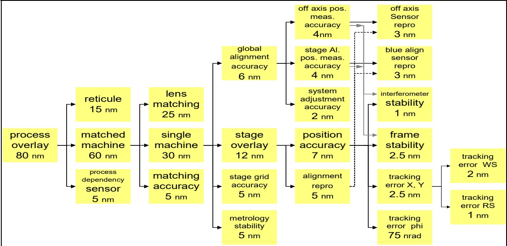

# 《On the Systematic Use of Budget-Based Design》图3套刻预算分配审阅

日期：2026-11-09 · 修订：V1 · 范围：论文学习与图3的工程合理性分析 · 状态：分析稿，待内容审阅

**判断：图3的分层思路合理，混合使用不同误差合成规则也有依据；公开数字只支持有条件的自洽检查，尚不足以直接作为设备指标分配或验收规格。** 特别需要核清单机30 nm预算中的2 nm差额、共享误差的相关性、75 nrad转角的位移折算及各指标的统计口径。不能因为某层不能直接相加就判图错，也不能因为几组数字相加相等就证明整机必然达标。

本篇围绕“整机目标—问题来源—分配策略—子系统能力—整机验证”分析图3，下列原图给出整体层级关系。**“最新”指仓库最新上传的论文；论文本身发表于2006年，不是最新设备性能资料。**

[原论文全文](../../references/papers/on-the-systematic-use-of-budget-based-design/mineru.md) · [原PDF物理第9页](../../references/patents/On%20the%20Systematic%20Use%20of%20Budget-Based%20Design.pdf#page=9) · [数值复算](calculations.json) · [来源及哈希](sources.json)

图3原图，未经重绘或修改；物理第9页，印刷页码796。可[打开大图](../../references/papers/on-the-systematic-use-of-budget-based-design/images/page_8_image_0.jpg)核对数值与共享连接。

阅读入口：[论文要点](#paper) · [目标与分工](#structure) · [逐层数值核验](#arithmetic) · [关键缺失条件](#conditions) · [怎样用于工程](#engineering) · [来源与验证边界](#evidence)

## 1. 这篇论文值得学习的内容

论文研究的是**怎样用可量化预算支持系统设计决策**。它用光刻机套刻和复印机功耗两个案例说明：先确定目标及适用场景，再选择分解方式，用测量、模型和已有产品数据给各项赋值，最后在方案与预算之间反复迭代。预算既给子系统下达要求，也接收子系统测量结果的反馈。图3是这种方法的案例，不是一套公开的完整套刻误差模型。[原文§2.1—2.4、§3](../../references/papers/on-the-systematic-use-of-budget-based-design/mineru.md#p0004)

关于图3，原文特别说明：适用于典型工况；沿用前代设备分解与测量数据；上层目标来自技术路线规划；随机、系统性及混合效应使用不同合成方式；分配通过工程讨论与迭代形成。论文展示了分配流程，没有公布使每一支路都可独立重算的全部系数、协方差、工况或试验数据。[原文§3.1—3.5，物理第8—9页](../../references/papers/on-the-systematic-use-of-budget-based-design/mineru.md#p0008)

还有一项决定如何使用这些数字的来源信息：论文引用的Muller方法文献，在作者站公开版本§6.6、图7中呈现同一主要预算图，并说明其来自ASML TwinScan系统设计规格，因保密作过小幅修改。本次读取的是**2023-07-03、v0.8公开版本**，不是声称已取得2005年原始内部规格。因此，这些数值有实际工程背景，但不能当成某商业机型未经修改的指标，更不能自动外推到当前设备。[Muller，§6.6，PDF物理第11页／页脚10](https://www.gaudisite.nl/MultiDomainMethodsPaper.pdf#page=11)

## 2. 整机目标与问题分工：架构为什么基本合理

图3从左向右表达目标和误差来源的分解。它把工艺套刻、机器间匹配、单机能力、平台及传感器放在不同层，避免把整机套刻简单等同于平台定位精度。下表的中文功能说明属于依据图中标签的工程解读；原文没有为每项给出完整测量定义。

| 图中层级与指标 | 表达的工程问题 | 判断与边界 |
| --- | --- | --- |
| Process overlay：80 nm | 最上层工艺套刻目标 | 应首先明确层间比较对象、统计量、空间范围及工况；不能当成所有工况下已实测达到80 nm |
| Reticule：15 nm；matched machine：60 nm；process dependency sensor：5 nm | 把掩模、设备及工艺相关传感因素分开 | 分工有用；“process dependency sensor”并未证明涵盖所有晶圆工艺形变，掩模项也需说明是否已折算到晶圆面 |
| Lens matching：25 nm；single machine：30 nm；matching accuracy：5 nm | 区分单机能力与机器间匹配问题 | 不能把25 nm直接当成某一物镜的全部成像误差；matching accuracy与lens matching之间的具体边界未完全披露 |
| Global alignment：6 nm；stage overlay：12 nm；stage grid：5 nm；metrology stability：5 nm | 把全局对准、局部平台表现、坐标网格及计量稳定性分开 | 有利于分配校准、对准、运动控制和计量任务，但必须明确各项之间的空间／时间边界，避免重叠 |
| Position accuracy：7 nm；alignment repro：5 nm | 区分位置表现与对准重复性 | 重复性与准确度不是同一指标，两者分开有工程意义；各自是否包括偏差及校准残差需另行定义 |
| 传感器、干涉仪、框架、平移／转角跟踪误差 | 把上层能力分解到可测的子系统指标 | 有助于设计与集成；右侧共享连接说明该图不能按“所有叶节点各加一次”的简单树处理 |

这张图体现的合理性主要在**把问题分到可实现、可测量的子系统，再把结果合成为整机表现**。它并未给出足够信息证明“15、60、5”或“25、30、5”是成本、进度、风险意义上的最优比例。[原文§2.1、§3.3、§3.5](../../references/papers/on-the-systematic-use-of-budget-based-design/mineru.md#p0004)

## 3. 分配和合成策略：逐层检查数字

RSS指平方和开方。下表刻意区分原文明确的运算与为核查而提出的候选运算。除了原文明确举例的全局对准，以及明确说采用线性合成的平台层，**“某种运算恰好对得上”不等于已找回ASML的内部模型**。

| 父项 | 图中直接相关分项 | 可复算结果 | 能据此作出的判断 |
| --- | --- | --- | --- |
| 工艺套刻80 nm | 15、60、5 nm | 线性和80 nm | 在把分项视作同一输出口径的线性预算额度时闭合；不能把这些额度当成已知独立随机标准差 |
| 匹配机器60 nm | 25、30、5 nm | 线性和60 nm | 同样可由线性预算解释；仅凭图仍不能证明全部物理合成关系 |
| 单机30 nm | 6、12、5、5 nm | 线性和28 nm，差额2 nm | 图中未标明差额用途。可能涉及预留、舍入、未展开项或公开图修改，**均未获原文证实** |
| 全局对准6 nm | 离轴位置测量4、平台对准位置测量4、系统调整2 nm | RSS = √(16+16+4) = 6 nm | **原文§3.3明确给出**。还需同一统计口径、正确灵敏度及相关性条件才能作为实际模型 |
| 平台套刻12 nm | 位置7、对准重复性5 nm | 线性和12 nm | **原文§3.3明确把平台层作为线性合成的对照**；不能擅自改成√(7²+5²)=8.602 nm |
| 两项位置测量各4 nm | 对应传感器重复性3，以及图中灰色共享连接的干涉仪1、框架2.5 nm | 候选RSS = 4.031 nm | 与4 nm接近，可由舍入解释，但论文未给该局部公式；若4.000 nm是硬上限，则该候选计算略超限，不能直接判“通过” |
| 对准重复性5 nm | 虚线关联的两路传感器重复性各3 nm | 候选RSS = 4.243 nm；线性和6 nm | 5 nm可作为有条件的预算额度，但它不是这两种简单合成的精确等式；差额0.757 nm不能直接认证为预留 |
| X/Y跟踪2.5 nm | WS跟踪2、RS跟踪1 nm | 同平面、不相关条件下候选RSS = 2.236 nm | 2.5 nm可能容纳舍入或余量，但必须先确定WS／RS的折算与相关性，不能把差额0.264 nm直接认作余量 |
| 位置精度7 nm | 干涉仪1、框架2.5、X/Y跟踪2.5 nm，以及转角75 nrad | 混合了长度和角度，不能直接求和或RSS | 需要先给出角度到位移的灵敏度，再指定合成规则，当前公开信息不足以完整核验 |

数值来自原图，公式由[复算脚本](verify_budget.py)计算，完整结果见[calculations.json](calculations.json)。其中4.031、4.243、2.236 nm只说明**某些假设下可解释**，不是被论文验证的内部模型。

特别是30与28：如果把30 nm理解成上限，而把28 nm理解成某候选模型下的已分配总量，那么28≤30并不构成矛盾；但在没有明示管理规则前，不能把这2 nm拿来重新分配给某个子系统。上层80和60又都是可见线性和恰好等于父项，图里没有独立列出整机预留，并不证明实际项目不存在内部余量。原文[§2.4](../../references/papers/on-the-systematic-use-of-budget-based-design/mineru.md#p0006)与[§5.1余量段](../../references/papers/on-the-systematic-use-of-budget-based-design/mineru.md#p0014)讨论余量，未对这个2 nm差额作说明。

## 4. 子系统指标必须补齐的条件

### 4.1 先统一统计口径，不能把“随机”当成RSS的充分条件

若输出误差在工作点附近可线性化为各输入误差的组合，其标准差传播可写为：

$$
\sigma_y^2 = \sum_i c_i^2\sigma_i^2 + 2\sum_{i<j}c_i c_j\operatorname{Cov}(e_i,e_j).
$$

这里$c_i$是带符号、带必要单位变换的灵敏度；$\sigma_i$必须对应明确的统计量和同一工况。忽略协方差只适用于相关性可忽略的情形。GUM第5章给出的是**测量不确定度传播**，并不直接定义光刻机套刻规格；本报告借用其灵敏度与协方差框架解释为何不能随意RSS。[JCGM 100，第5.1—5.2节](https://www.iso.org/sites/JCGM/GUM/JCGM100/C045315e-html/C045315e_FILES/MAIN_C045315e/05_e.html)

图3没有逐项说明1σ、3σ、RMS、最大值、均值加某个倍数标准差、单轴还是二维向量。不同统计口径的数字不能直接混合；把所有节点都叫“nm精度”仍然不够。原文提出系统性效应线性相加，这是案例中的预算策略；一般工程处理中，带符号偏差、最坏情况界限与校正后的残余不确定度仍需区分。

**仅用于敏感性说明的假设例：** 假设图中两个4 nm都是标准差，灵敏度均为+1，两者相关系数为ρ，而2 nm项与两者不相关，则

$$
\sigma_{\mathrm{GA}}=\sqrt{4^2+4^2+2^2+2\rho\times4\times4}=\sqrt{36+32\rho}\ \mathrm{nm}.
$$

| 假设ρ | 合成标准差 |
| --- | --- |
| 0 | 6.000 nm |
| 0.25 | 6.633 nm |
| 0.50 | 7.211 nm |

这不是论文机型的实测相关性，也不证明其6 nm错误；它说明“各分项数值满足要求”与“上层指标一定满足要求”之间，还隔着一个必须验证的模型。若实际是带相反符号的差分、相同参考误差部分抵消，上式的相关项符号也会变化。

### 4.2 共用计量链必须防止重复统计，也不能一概删除

原图右侧的干涉仪、框架和对准传感器通过不同连接进入多个性能指标。它们可能在不同时间、位置和工况下贡献误差，也可能含有共模成分。因此，图作为预算关系图可以成立，但若把其全部末端数字展开相加，可能重复统计同一个物理来源；若简单只计一次，又可能漏掉不同时刻的残余差值。

需要明确每个量测／曝光状态下的误差变量、测量时刻和传递系数，识别哪些共用误差相消、哪些叠加。线型与颜色没有给出足以恢复这些规则的统计图例，不能仅凭实线或虚线判断相关性、独立性或某种合成算子。此处是对原图的工程审阅，不是声称已发现作者内部模型重复计数。[原图物理第9页](../../references/patents/On%20the%20Systematic%20Use%20of%20Budget-Based%20Design.pdf#page=9)

### 4.3 75 nrad必须先换成对应位置的位移

对小角度平面旋转，若有效作用臂为$r$，位移幅值约为$r\theta$；分量关系则取决于点坐标，如$\delta x=-y\theta$、$\delta y=x\theta$。因此75 nrad的作用不能脱离有效几何尺度：

| 假设有效作用臂 | 75 nrad对应位移幅值 |
| --- | --- |
| 10 mm | 0.75 nm |
| 20 mm | 1.50 nm |
| 100 mm | 7.50 nm |

这些作用臂仅为单位与灵敏度示例，**不是论文设备的几何参数**。若为了数值闭合而分别假设所有位置分项线性合成或RSS合成，使父项恰为7 nm，会反推得到约13.33 mm或79.44 mm两种不同作用臂；这恰好说明不能用“配出7 nm”来辨认真实模型。

必须补充φ代表哪个实体的转角、绕何参考点、在哪个曝光位置求位移，以及是否为单轴／二维、瞬时／时间平均的值。转角项暂时无法完整核验是**模型信息不足**，并不是角度预算本身不合理。

### 4.4 WS与RS要统一到同一坐标面

按常用名称理解，WS与RS分别对应晶圆台和掩模台；图中没有给其位置误差的坐标面和缩倍率定义。若$e_{RS}$仍是掩模面物理位移、$m$为掩模到晶圆的有符号投影倍率，则一个候选相对位移模型为$e_{\mathrm{rel}}=e_{WS}-m e_{RS}$，实际符号由坐标约定确定。若输入已折算到晶圆面，则不应再次乘$m$。

因此，直接算√(2²+1²)的前提必须是两者已转为同一输出面、具有一致统计口径，且在该组合下相关性可忽略。本文没有依据为图中的RS另行指定4倍或其他缩倍率。

### 4.5 预算有物理解释，还要有验证条件

典型工况并不是温度、速度、掩模／晶圆状态、校准间隔和测量采样范围的完整定义。图中未单列某一物理效应，不一定说明作者漏算——它可能被包含在上层指标；但要用于新设备，必须说明热漂移、空间畸变、工艺相关误差及动态误差分别归到哪里。

类似地，“metrology stability 5 nm”和“interferometer stability 1 nm”未必重复：前者可能是更高层参考关系的稳定性，后者是某条测量链的分项；没有定义时既不能认定重复，也不能保证已隔离。对任何新分配都应登记其归属与测量边界。

## 5. 怎样把它用于实际分配和整机验证

建议保留这张图的分层思路，把每一条关键父子关系补成可计算、可验收的预算记录。以下是本报告的工程建议，不是论文已经公开的实施细节。

| 需要补充的内容 | 最低可用信息 | 为什么影响合理性判断 |
| --- | --- | --- |
| 顶层规格 | 套刻比较对象、校正前后状态、单轴／二维指标、覆盖的场／晶圆／批次、通过准则 | 决定80 nm到底约束什么 |
| 数值来源 | 测量／仿真／估算／设计额度的标识，数据范围与版本 | 不能用分配值冒充已实现能力 |
| 每条合成关系 | 线性、RSS或完整带系数模型；系数单位及适用范围 | 让每一个父项能由已知输入核验 |
| 相关性与共用误差 | 共享源、测量时刻、协方差及相消／叠加关系 | 防止错误RSS或重复统计 |
| 空间及时间换算 | 角度的作用臂、物像面倍率、曝光／采样时间定义 | 使nrad、掩模面nm与晶圆面nm可正确衔接 |
| 余量及不确定度 | 已分配额度、设计预测、实测结果、可释放余量、未展开项分别记录 | 不能把30−28自动当成可用2 nm |
| 子系统责任与验收 | 对准、计量、控制、光学／掩模及工艺接口各自的测量方式和交付数据 | 预算必须能被独立检查并回到整机 |
| 整机闭合 | 在相同条件下比较底层模型预测与实测套刻分布，说明剩余差值 | 子系统各自合格不自动证明整机合格 |

后续L4专题接口可限于：①共享计量链协方差识别；②φ到曝光位置位移的映射；③WS／RS坐标与时间窗统一；④校准后残差及测量不确定度的预算记录。只有在取得具体设备定义与数据后，才适合进一步做数值指标分配。

**最终评价：可以学习它“以整机目标牵引、以子系统证据反馈”的预算方法；不能直接照抄其公开数值，也不能把80 nm按比例缩小后当作新设备方案。** 当前证据支持架构与方法层面的合理性，支持部分算术闭合，但不支持宣称全部指标已严格自洽、分配最优或某设备可通过验收。

## 6. 来源与验证边界

- 主论文：H.J.M. Freriks、W.P.M.H. Heemels、G.J. Muller、J.H. Sandee，INCOSE 2006；[仓库原件](../../references/patents/On%20the%20Systematic%20Use%20of%20Budget-Based%20Design.pdf)，16页。重点核对§2.1—2.4、§3.1—3.5、§5.1及图3；已阅读其方法、两案例与结论。
- 图的来源背景：Gerrit Muller，[Do Useful Multi-Domain Methods Exist?](https://www.gaudisite.nl/MultiDomainMethodsPaper.pdf#page=11)，作者站2023-07-03 v0.8公开版，§6.6／图7；不把该版本当作未改动的内部设计规格。
- 合成公式的外部依据：[JCGM 100第5章](https://www.iso.org/sites/JCGM/GUM/JCGM100/C045315e-html/C045315e_FILES/MAIN_C045315e/05_e.html)。仅用于说明灵敏度、统计量与相关性，不冒充套刻行业验收规范。
- 本次实际执行：核对原PDF图3及原文平方和公式、核对补充文献来源说明、以Python标准库复算表内数值；[脚本](verify_budget.py)、[结果](calculations.json)、[来源清单](sources.json)和[交付检查](delivery.json)可追溯。
- 没有取得ASML内部误差模型、原始测量数据或具体机型验收协议；没有复现实机性能、执行设备实验或给出新设备的nm配额。候选RSS、ρ与作用臂示例均明确列为假设，不将它们反写进原文。

[返回仓库首页](../../README.md#latest-results)
