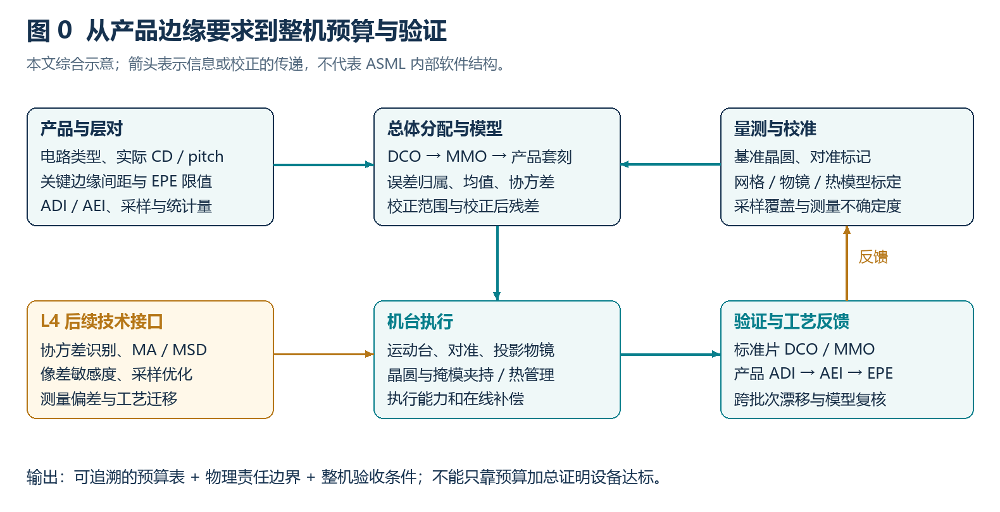
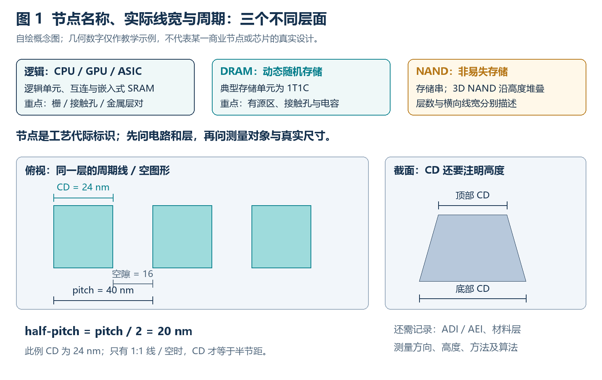
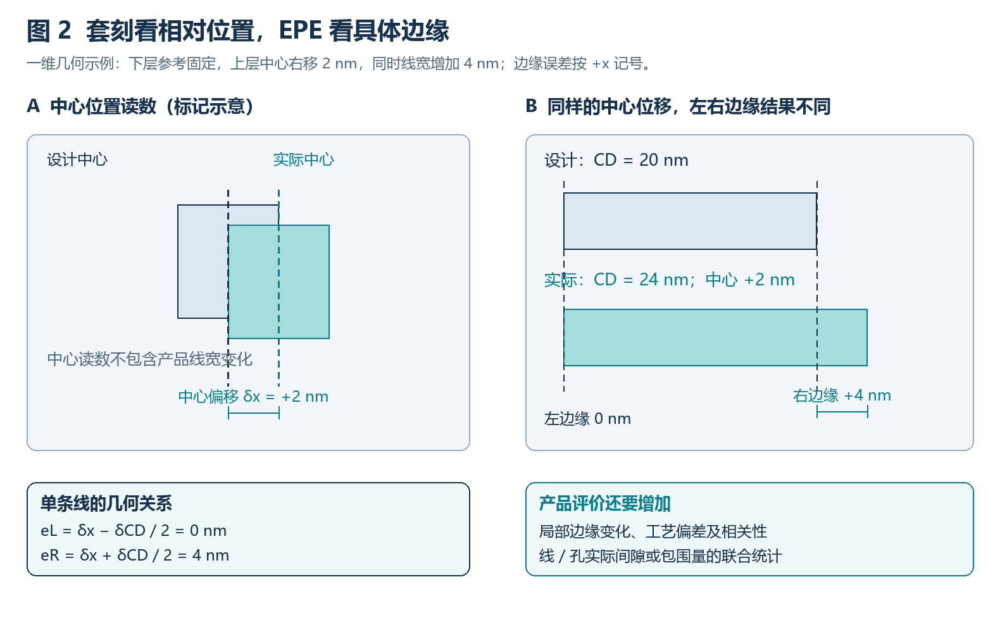
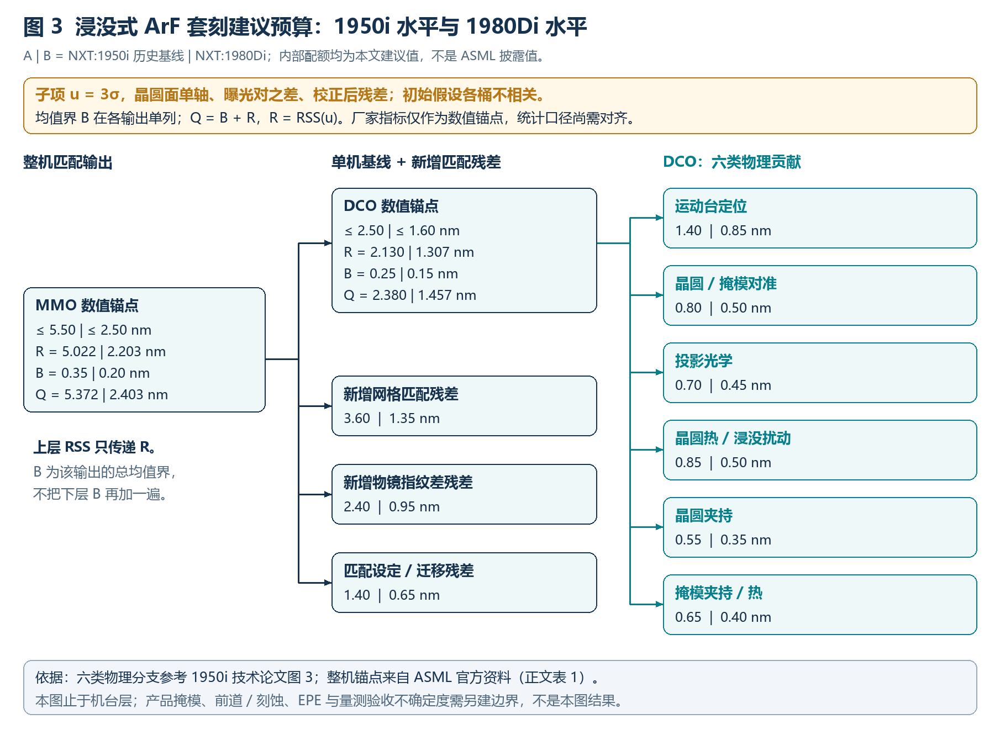

# 浸没式 ArF 光刻机套刻预算与建模控制调研报告 · R2

**修订日期：2026-11-09。** 本稿从用户最新上传的[调研原稿](../../references/lithography_overlay_error_allocation_survey.md)复制后修订，原稿保留。对象限定为 **ASML TWINSCAN NXT:1950i 至 NXT:1980Di 水平的 193 nm 浸没式扫描机**；“1980i”在本文按厂家正式型号 NXT:1980Di 处理。本文是总体工程的候选分配与研究依据，尚未经过设备数据验证。

**主要结论：** 可以沿用预算树的分层方法，但应重新确定统计量、坐标面、机台/工艺边界和误差相关性。本文采用公开 DCO **2.5 / 1.6 nm**、MMO **5.5 / 2.5 nm**作为两档数值锚点，其中 1950i 的两项来自不同年份的历史基线资料。图 3 中的内部数值是**建议配额**，不是厂家内部预算；在本文零交叉协方差假设下，分别得到 DCO **2.380 / 1.457 nm**、MMO **5.372 / 2.403 nm**。这些算术结果不等于机台验收通过，更不直接等于产品 EPE。

快速阅读：[概念与线宽](#concepts) · [公开机台参数](#machine-level) · [图 3 与配额](#budget-tree) · [研究方向及职责](#research) · [整机验证](#validation) · [文献获取与原稿修正](#reference-audit)

*图 0　本文综合的整机管理闭环。量测与校准提供参考和模型，机台执行补偿，标准片与产品验证更新模型。它是技术组织建议，不代表 ASML 内部实现。* [放大 PNG](figures/fig0-system-loop.png) · [SVG](figures/fig0-system-loop.svg)

## 1. L0：先定义产品、几何尺寸与评价对象

### 1.1 工艺节点和电路类型

**工艺节点**是某一制造工艺代际的名称，通常关联晶体管密度、性能、功耗和设计规则。现代“7 nm”“5 nm”等节点名称不表示芯片上所有线条的实际宽度，也不能直接充当套刻预算的分母。应同时注明厂商/工艺版本、电路类型和关键层对。Intel 对节点命名的说明也明确区分了节点名称与实际物理尺寸。[Intel 官方工艺命名说明](https://www.intc.com/news-events/press-releases/detail/1486/intel-accelerates-process-and-packaging-innovations)

| 电路类型 | 简要概念 | 套刻/EPE 常关心什么 |
| --- | --- | --- |
| 逻辑：CPU、GPU、ASIC 等 | 通过逻辑单元执行运算；芯片中通常还包含 SRAM 和多层互连 | 栅与接触孔、金属与通孔、切割/阻挡图形之间的实际包围量和间隙 |
| DRAM | 动态随机存储器；典型存储单元由一个晶体管和一个电容组成（1T1C），需要刷新 | 有源区、字线、位线、接触孔与电容等规则阵列之间的关系 |
| NAND Flash | 非易失存储器，以存储串组织单元；3D NAND 沿高度方向堆叠存储层 | 沟道孔、切割、接触和外围电路的层间关系；堆叠层数与横向线宽分别描述 |

类型说明依据 [ASML 芯片基础](https://www.asml.com/en/technology/all-about-microchips/microchip-basics)和 [Micron DRAM 说明](https://www.micron.com/content/micron/us/en/products/memory/dram-components/ddr5-sdram.html)。表中关键层对是工程示例，具体结构以产品版图和工艺流程为准。

### 1.2 “实际物理线宽”要定义哪些量

**关键尺寸 CD（critical dimension）**是指定结构上需要控制的尺寸，可以是线宽、孔径、沟槽宽度、栅长等。它必须附带测量对象与条件，而不能只写“该节点线宽是多少”。

- **线宽/CD**：一条线两侧边缘之间的距离；应注明材料层、方向、截面高度，以及量测方法和边缘判据。侧壁倾斜时，顶部、中部、底部 CD 不同。
- **节距 pitch**：重复图形的周期，例如相邻同类线条中心间的距离。**半节距 half-pitch = pitch/2**；只有线/空宽度相等的 1:1 图形，半节距才等于线宽。
- **栅长与栅节距**：栅的物理长度、晶体管的电学有效沟道长度和相邻栅的节距是不同量；接触栅节距也不等于节点名称。
- **ADI 与 AEI**：ADI（after-develop inspection）看显影后的胶图形；AEI（after-etch inspection）看刻蚀后的结构。刻蚀偏差、沉积/应力和量测判据可改变 CD 与边缘位置，二者不能直接混成同一预算。

*图 1　自绘教学图。例子为 CD 24 nm、空隙 16 nm、pitch 40 nm、half-pitch 20 nm；这些数字不对应任何指定商业节点。* [放大 PNG](figures/fig1-node-cd-pitch.png) · [SVG](figures/fig1-node-cd-pitch.svg)

同样，光学分辨率关系 $R=k_1\lambda/NA$ 中的 $R$ 需要结合图形、照明和工艺条件解释，不能直接当成节点名。NXT:1980Di 官方页同时列出 **193 nm、NA 1.35、38/40 nm 分辨率**，而技术论文讨论其服务 7 nm/5 nm 生产节点；多重图形化和具体层的工艺路线使这两类数字可以同时成立。[ASML NXT:1980Di](https://www.asml.com/en/en/products/duv-lithography-systems/twinscan-nxt1980di) · [机型论文 A02](https://doi.org/10.1117/12.2220589)

### 1.3 套刻、对准与 EPE

**套刻误差 Overlay**：两个图形层，或同一工艺层不同次图形化之间，实际相对位置偏离设计相对位置的量，通常用晶圆面上的二维矢量 $(\Delta x,\Delta y)$ 表示。设计本来存在的偏置要先扣除。必须注明层对、空间位置、校正状态以及是单轴统计、矢量模长还是极值。

**对准 Alignment**是曝光前/曝光中建立晶圆、掩模与设备坐标关系的测量和定位过程；**套刻量测**是在形成图形后检查相对位置的过程。对准传感器重复性只是整机套刻的一个贡献，不能替代最终套刻指标。IBO 与 DBO 测的是特定标记，标记与器件边缘的相关性仍需验证。[R30：光刻套刻误差测量技术](https://doi.org/10.3788/LOP202259.0922023)

**边缘放置误差 EPE（edge placement error）**：实际轮廓相对于目标轮廓的局部法向位置偏差。它既受位置误差影响，也受 CD、局部边缘变化和工艺转移影响。对线/孔的连接或短路风险，还应评价两条相关边缘的实际间隙或包围量，而不是把两个单边 EPE 当成独立随机量。[R03：Overlay and edge placement control strategies](https://doi.org/10.1117/12.2085761)

对一条直线，以下用同一正 $x$ 方向表示左右边缘位移（左边缘的符号不采用外法向约定）：

$$e_L=\delta x-\frac{\delta CD}{2}+\eta_L,\qquad e_R=\delta x+\frac{\delta CD}{2}+\eta_R$$

$\delta x$ 是中心位置偏差，$\delta CD$ 是宽度变化，$\eta_L,\eta_R$ 只表示**尚未被中心/CD 变量包含**的局部边缘项。若下层固定、上层中心右移 2 nm，同时 CD 增大 4 nm，忽略局部项，则左右边缘分别移动 **0 nm 和 4 nm**。套刻中心读数 2 nm 不能完整表达边缘风险。

*图 2　自绘几何示例，非器件测试数据。A 表示中心位置读数，B 单独展示产品线条的两侧边缘。* [放大 PNG](figures/fig2-overlay-epe.png) · [SVG](figures/fig2-overlay-epe.svg)

原稿的 EPE 公式左侧写成 $3\sigma$，右侧却使用 $1\sigma$ 分量，缺少整体因子 3。在线性、互不相关、分量没有重复计入且采用上述简化几何的条件下，单边的随机分量应写为：

$$3\sigma_{EPE}=3\sqrt{\sigma_{\rm pos}^2+\frac{\sigma_{CD}^2}{4}+\sigma_{\rm edge}^2}$$

这里全部 $\sigma$ 均为标准差；若输入本身已是 $3\sigma$，则在平方和内直接用这些 $3\sigma$ 数值，外面不再乘 3。均值偏差另计。更一般地，$\operatorname{Var}(e)=\mathbf c^T\Sigma\mathbf c$，必须保留协方差。LWR、LCDU、LER 的定义与相互关系不同，不能一律除以 2，也不能把已计入 CD 的局部粗糙度再计一次。误差传播形式参考 [JCGM GUM 第 5 章](https://www.iso.org/sites/JCGM/GUM/JCGM100/C045315e-html/C045315e_FILES/MAIN_C045315e/05_e.html)，它本身不是光刻设备验收规范。

原稿“套刻通常为 half-pitch 的 20%”来自特定年代 DRAM 的预算背景，不能推广成所有逻辑、DRAM 和 NAND 的统一比例。整片大量关键边缘的尾部失效、系统偏差和非高斯局部缺陷，也不能由一个 $3\sigma$ 数字直接保证良率。[R01](https://doi.org/10.1117/12.804663) · [R03](https://doi.org/10.1117/12.2085761)

## 2. L0：1950i—1980Di 的公开参数与比较边界

**表 1　公开机台水平并排比较。所有套刻数字单位为 nm；“未公开”表示所用公开页面未完整说明。**

| 项目/条件 | NXT:1950i | NXT:1980Di | 对分配的含义 |
| --- | --- | --- | --- |
| 平台 | 193 nm ArF 浸没式，NA 1.35；双工件台 | 193 nm ArF 浸没式，NA 1.35；双工件台，4×缩小 | 统一到晶圆面；不能混用掩模面 nm |
| 专用卡盘套刻 DCO | **2.5**：ASML 2010 资料，slide 21 | **≤1.6**：单机 dedicated chuck，全晶圆覆盖 | 本文 DCO 数值锚点；不推广到任意换卡盘/换工艺条件 |
| 匹配套刻 MMO | **5.5**：2013 资料中列出的 **2011 基线**；2012 扩展为 4.5，2013+ 为 3.5 | **≤2.5**：相对参考晶圆，全晶圆覆盖 | 本文 A 档取历史 5.5，不把所有 1950i/升级包视为同一性能 |
| 论文中的演示结果 | 2010 论文报告 dedicated-chuck 能力到 1.5、matched 可到 4.5 | 2016 论文讨论基准晶圆匹配、高阶校正及改进 | 演示值与发布规格、样本条件分别引用；不混成统一验收值 |
| 单次曝光分辨率 | 2008 发布资料为 38 nm | 38 nm（dipole）、40 nm（C-quad） | 分辨率、节点、CD 与 pitch 不能互相替代 |
| 统计量/验收流程 | 上述公开资料没有提供可直接复用的完整统一验收协议 | 产品页未完整说明均值/σ组合、校正阶次和采样判据 | 本文 $Q$ 与厂家指标的等价性**尚未建立** |

表 1 来源：[B01：1950i 发布资料](https://www.asml.com/en/news/press-releases/2008/asml-launches-the-twinscan-nxt1950i-immersion-lithography-system)、[B03：2010 ASML/SEC，slide 21](https://www.sec.gov/Archives/edgar/data/937966/000095012310057756/u09166exv99w1.htm)、[B04：2013 ASML/SEC，slide 7](https://www.sec.gov/Archives/edgar/data/937966/000119312513102119/d500315dex991.htm)、[B02：1980Di 官方页](https://www.asml.com/en/en/products/duv-lithography-systems/twinscan-nxt1980di)、[A01](https://doi.org/10.1117/12.847025)、[A02](https://doi.org/10.1117/12.2220589)。A 档的 DCO/MMO 是两个历史公开数值的工程参照，不是声称来自同一台机器、同一测试批次的一组数据。

DCO（dedicated-chuck overlay）强调特定卡盘使用条件，是单机套刻的一种限定情形；一般 SMO（single-machine overlay）是否包含换卡盘、换掩模等，要查具体定义。MMO 强调匹配对象和校准条件；相对参考晶圆的 MMO 不能自动替代任意两台机器、任意两产品层之间的套刻。OPO（on-product overlay）还包含产品掩模、工艺形变、标记与器件差异等。**不存在无需条件即可套用的 MMO = √2 × SMO。**

1950i 技术论文特别说明了从长、变光程干涉仪向短固定光程的网格板编码器测量概念的变化。因此，把通用激光干涉仪预算或离线物镜检测台的误差数字直接填入 NXT 工件台预算，会错配测量架构。[A01，第 3 节](https://doi.org/10.1117/12.847025)

## 3. L1—L3：按机台水平重绘套刻预算树

### 3.1 分配原则与物理责任边界

[此前的图 3 审阅](../budget-based-design-figure3-review/report.md)已指出：预算式设计论文的 80/60/30 nm 图经过公开示例处理，不能直接当成某个商业机型的真实规格。本稿沿用“整机 → 子系统 → 可验证误差项”的方法，**不对旧图整体按比例缩小**。

六类单机分支采用 1950i 机型论文图 3 的分类：运动台定位、光学、晶圆/掩模对准、晶圆热/浸没、晶圆夹持、掩模夹持/热。机型论文通过 Sci-Bot 获得文本；本次未取得该论文可独立检查全部图像的原始 PDF，因此**没有从原图反读各柱数值**。下面所有内部配额均为本文新设的候选值。[A01](https://doi.org/10.1117/12.847025)

本轮分配采用以下工作约定：

1. **统一输出**：晶圆面、单轴、两个曝光结果之差、指定校正之后的残差。X/Y 应各建一张预算；图中数值不是径向矢量长度。既已定义为曝光对之差，就不再额外乘 √2。
2. **随机项与均值分开**：分支 $u_i=3\sigma_i$；各层输出 $Q=B+R$，$B$ 为该输出的总绝对均值上界，$R$ 为随机分量的合成 $3\sigma$。对各层的 $B$ 不重复相加。
3. **初始零交叉协方差**：此时 $R=\sqrt{\sum u_i^2}$。一般式为 $R^2=\sum u_i^2+2\sum_{i<j}\rho_{ij}u_i u_j$。固定空间指纹与随时间波动的误差不能未经定义便视为独立样本。
4. **先独占归属，再合成**：控制链路共享的噪声、同一热源及同一校准数据只计一次；通过机制和试验定义各桶边界，而不是因为“属于两个子系统”就重复填表。
5. **配额是待验证设计输入**：按文献指出的主要物理来源，对运动台保留较大的单机配额，对跨机网格/光学匹配设置独立增量，并留出小幅算术余量。这是满足所选数值锚点的起始方案，尚无实测成本、协方差和灵敏度数据，**不称为最优分配**。

### 3.2 图 3：A/B 两档候选配额

*图 3　本文建议预算，A/B 两列分别对应 1950i 历史数值基线和 1980Di 水平。图内的厂家数值锚点与内部建议值已经分开；协方差假设、均值处理及产品边界写在图中。* [放大 PNG](figures/fig3-immersion-overlay-budget.png) · [SVG](figures/fig3-immersion-overlay-budget.svg) · [可编辑配额数据](budget.json) · [绘图源码](draw_figures.py)

**表 2　DCO 子项：$u_i=3\sigma_i$，单位 nm，均为本文建议。** 百分比是该列随机预算的**方差份额**，不是 nm 振幅百分比。

| 物理项 | A：1950i 水平 | B：1980Di 水平 | 方差份额 A / B | 牵头、残差边界与验证 |
| --- | ---: | ---: | ---: | --- |
| 运动台定位 | 1.40 | 0.85 | 43.2% / 42.3% | 运动/计量；冷态基线下编码器、同步 MA 与结构/姿态映射的未补偿残差；热/浸没专项增量放到对应桶 |
| 晶圆/掩模对准 | 0.80 | 0.50 | 14.1% / 14.6% | 对准；基准标记的读取、坐标建立及采样残差；产品 WIS 增量另评 |
| 投影光学 | 0.70 | 0.45 | 10.8% / 11.9% | 光学；校正后的像移/畸变及镜头热补偿残差；跨机新增指纹差另列 |
| 晶圆热/浸没扰动 | 0.85 | 0.50 | 15.9% / 14.6% | 热/浸没与运动协同；指定温度/剂量/流量历程相对基线的增量 |
| 晶圆夹持 | 0.55 | 0.35 | 6.7% / 7.2% | 晶圆台；固定卡盘下重复装卸、接触条件和残余面内形变 |
| 掩模夹持/热 | 0.65 | 0.40 | 9.3% / 9.4% | 掩模台；夹持重复性及掩模热历程残差；产品掩模写入误差不在此重复加入 |

上述边界是建模要求。若浸没力扰动已计入实际“运动台定位”试验，应从热/浸没桶中移出同一部分，或改用联合协方差；不能机械套用表 2。

将六项合成，A/B 分别得到 $R_{DCO}=2.130141/1.306713$ nm；给定总均值界 $B_{DCO}=0.25/0.15$ nm，得 $Q_{DCO}=2.380141/1.456713$ nm。相对于 2.5/1.6 nm 数值锚点的余量为 **0.120/0.143 nm**。

**表 3　从 DCO 工作模型到 MMO 的新增残差：单位 nm，均为本文建议。**

| 项目 | A | B | 计入规则 |
| --- | ---: | ---: | --- |
| 已用单机随机预算 $R_{DCO}$ | 2.130141 | 1.306713 | 只上传随机方差，不上传含均值的 $Q_{DCO}^2$ |
| 新增网格匹配 $u_{grid}$ | 3.60 | 1.35 | 基准晶圆/两机网格差校正后的新增残差 |
| 新增物镜指纹差 $u_{lens}$ | 2.40 | 0.95 | 同机光学残差之外的机间差异，需由对比实验辨识 |
| 匹配设定/迁移 $u_{setup}$ | 1.40 | 0.65 | 匹配参数设定、维护及工况迁移的未计入残差 |
| MMO 总均值界 $B_{MMO}$ | 0.35 | 0.20 | 已包含下层均值的总体上界；不再加 $B_{DCO}$ |

$$R_{MMO}^2=R_{DCO}^2+u_{grid}^2+u_{lens}^2+u_{setup}^2,\qquad Q_{MMO}=B_{MMO}+R_{MMO}$$

在这些候选边界和不相关假设下，$Q_{MMO}=5.371703/2.403406$ nm，相对于 5.5/2.5 nm 数值锚点的余量为 **0.128/0.097 nm**。这是一种“单机基线 + 可独立辨识的新增匹配残差”的账目模型；真实 MMO 若不满足这种分解，需要从机台/参考晶圆的联合误差模型重新分配。

### 3.3 运动台再下分一级

| 运动台建议子项（晶圆面 $3\sigma$，nm） | A | B | 必需的验证条件 |
| --- | ---: | ---: | --- |
| 编码器与校准残差 | 0.45 | 0.25 | 参考网格、传感器噪声与标定残差；明确带宽和采样 |
| 曝光加权同步 MA 残差 | 1.15 | 0.70 | 使用相同扫描速度、狭缝加权和曝光窗口 |
| 结构/转角投影残差 | 0.65 | 0.40 | 由实际作用臂/雅可比换算到像面；不直接混入 nrad |
| 子项 RSS | **1.395529** | **0.844097** | 分别不超过上级 1.40/0.85 nm 配额 |

上层使用 1.40/0.85 的分配上限，不用子项计算值反复释放小数位余量。掩模台与晶圆台相对误差要先投影到同一像面，例如采用一致扫描方向约定时 $e_{rel}=e_{WS}-e_{RS}/4$；不能把掩模面 nm 直接与晶圆面 nm 相加。转角项先经几何映射，再进行方差合成。[A01 的相对同步误差讨论](https://doi.org/10.1117/12.847025)

### 3.4 配额余量较小，相关性会改变判断

把“运动台定位”与“对准”两桶的相关系数假设为 $\rho=+0.3$，其余不变，DCO 的 $Q$ 会变为 A **2.532 nm**、B **1.551 nm**；A 已超过所选 2.5 nm 锚点。这只是敏感性示例，**不是测得的相关系数**，但说明零协方差时的通过不能视作鲁棒通过。

图 3 停在机台层。扩展到产品时，应再定义产品掩模残差、产品相对基准片的形变/标记差异、刻蚀引起的图形移动、APC 延迟/执行残差及其交叉项，随后映射到具体层对的 EPE。表 2 已包含的夹持、热和对准分量不能再整体重复添加。量测不确定度若已通过反馈造成实体误差，要与最终验收的读数不确定度分开；后者可通过判定保护带处理，不能不加区分地塞入物理预算两次。

## 4. L1—L3：五个研究方向、职责与证据修正

### 4.1 整机匹配、基准晶圆与对准

**问题与管理归属。** 相对哪张基准晶圆、在哪个卡盘、哪些校正开启的条件下匹配，是总体/校准团队负责的边界；对准、网格和光学团队协同。单机重复性与机间系统差异要分别识别。

**策略与能力。** 1980Di 技术论文描述了带有已校准刻蚀网格的参考晶圆、晶圆误差校正文件、密集全片套刻量测，以及机台网格和高阶光学校正。其价值在于建立共同参考和可追溯模型，不是把所有工艺层都假设为一张理想网格。[A02，第 2.3 节](https://doi.org/10.1117/12.2220589)

原稿引用的 1997 年 step-and-scan 论文属于早期 DUV 平台，可作架构历史；其第一作者是 Gerard de Zwart，不能把它当成 1950i 浸没式规格来源。本次仅核实书目信息，未取得可核查全文。[R12](https://doi.org/10.1117/12.276002) EUV/ArF mix-match 文献可借鉴跨平台匹配方法，具体 EPE、High-NA 拼接与反射掩模热条件不能直接纳入本次 ArF 配额。[R15](https://doi.org/10.1117/12.2219169)

### 4.2 同步运动、MA/MSD 与位移计量

**策略与能力。** 运动团队应同时控制像面平均位移和曝光内运动模糊，计量团队给出参考、噪声带宽与姿态映射。对矩形均匀曝光窗口，定义：

$$MA(t)=\frac{1}{T}\int_{t-T/2}^{t+T/2}e(\tau)\,d\tau,\qquad MSD(t)=\sqrt{\frac{1}{T}\int_{t-T/2}^{t+T/2}[e(\tau)-MA(t)]^2\,d\tau}$$

真实狭缝强度不均匀时应使用归一化曝光权重。MA 更直接对应平均像移；MSD 描述窗口内波动并影响成像。高频对 MA 的贡献由窗口传递函数决定，**不一概为零**；运动模糊也不必然等于随机 LER 增大。应把 MA 与成像允许的 MSD 分别验证。[R16：Butler，Position Control in Lithographic Equipment](https://doi.org/10.1109/MCS.2011.941882)

原稿引用的杜婧等论文中，表 1 的仪器误差合成 **1.55 nm（3σ）**对应离线投影物镜畸变检测台、40 mm 行程、80 mm 死程等条件。表 2 在给定阿贝臂、倾角和测量范围下，比较了采用六自由度模型与未采用时的几何误差 **1.08 / 30.52 nm**；其中还包含反射镜面形项。它说明“几何解算和面形校准很重要”，不能证明 NXT 编码器或扫描整机恰好具有这些配额。已回看原 PDF 物理第 7、8 页（印刷页 220226-6、-7）。[R21 原 PDF](https://www.researching.cn/ArticlePdf/m00029/2023/50/2/220226.pdf)

原稿的 5000–10000 N 反作用力、0–6 nm MSD 等数字缺少与所选机型/条件的可核查对应，本稿不作为预算输入。R18/R19/R20 已定位 DOI，但全文尚未取得，因此光源-掩模优化对台稳定性的定量收益仅列为后续研究问题，未当成已验证的机械指标放宽依据。

### 4.3 光学像移、掩模与热效应

**问题与归属。** 波前变化通过图形/照明相关的灵敏度转化为像移，物镜、掩模和工艺的影响未必能由一个全局平移量代表。光学牵头建立灵敏度，掩模/热/运动协同确定可执行补偿。

**策略与能力。** 相移光栅的晶圆量测可用于反演像差并联系套刻，R22 的第一作者是 S. van Haver；方法的适用性依赖目标和模型条件，不能认为每个 Zernike 系数都独立贡献固定 nm。[R22](https://doi.org/10.1364/AO.53.002562) 1980Di 论文讨论掩模主动温控与光学热效应补偿，支持本稿为掩模/物镜热残差保留责任边界，但没有公开本文所列配额。[A02](https://doi.org/10.1117/12.2220589)

掩模写入、对准标记放置和夹持/热变形要分别考虑。已取得的 Zeiss 2019 原 PDF 实际题名是 *The impact of the reticle and wafer alignment mark placement accuracy on the intra-field mask-to-mask overlay*，原稿汇总表题名不准确。[R25](https://doi.org/10.1117/12.2535900) BACUS 2018 文章还提醒：相同平台/条件下有些 pellicle 影响可共同抵消，而跨平台时不一定；因此不能对所有场景无条件重复加入完整 pellicle 误差。[R08 原件](https://spie.org/documents/Membership/BacusNewsletters/BACUS-Newsletter-July-2018.pdf)

热变形补偿应检查整批曝光历史、剂量和冷却条件，验证模型外的残差。EUV 掩模吸热及 High-NA 拼接研究保留在文献索引供扩展阅读；本轮只获取 R02 摘要，不把其未核查数值迁移到 ArF。

### 4.4 高阶模型、工艺形变与 APC

**策略与能力。** 用晶圆/视场模型描述可观测的误差形态，再由有能力覆盖该形态的执行器补偿；拟合阶次、采样和时间更新共同设计。所谓“可校正”不意味着预算中为零，还需计入估计不确定度、执行残差、延迟和漂移。前道应力、夹持和刻蚀后的图形移动需要有区分工艺阶段的测量；R11 支持把刻蚀诱导位移纳入光刻/刻蚀协同控制。[R11](https://doi.org/10.1117/12.2260000)

**原稿对 Zernike–Legendre 的结论需要反转。** R28 讨论的是：在合适的晶圆/视场采样下，正交基减弱项间耦合，可减少对双遍/级联拟合的依赖；在相同拟合能力下，并非天然产生更小的套刻残差。不能把它概括成“Zernike–Legendre 级联法一定显著改善 APC”。连续区域正交也不保证离散、有权重、缺点的真实采样仍正交；应检查设计矩阵、条件数和跨批次系数统计。[R28](https://doi.org/10.1117/12.2085074)

原稿用 SPIE 论文集目录支撑“PWG 聚类显著压缩预算”等具体结论，证据粒度不足。相关方向保留为候选专题，只有找到具体论文、层次和实验条件后才能填写收益；不能凭目录页给出百分比。

### 4.5 套刻量测与标记不对称

**策略与能力。** IBO 从图像结构提取相对位置；DBO 借助叠层周期标记的衍射信号及预置偏差解算套刻。不同方法的精密度、准确度、目标面积、工艺敏感性和采样时间需在同一堆栈上比较。高重复性并不排除工艺不对称产生的系统偏差。[R30](https://doi.org/10.3788/LOP202259.0922023) · [R31](https://doi.org/10.3788/LOP51.021201)

原稿把同一个 2025 年中文 PDF 同时称为“光刻对准关键技术的发展与挑战（2023）”和套刻标记建模论文。原件实际是邱俊、齐月静等的 **《套刻标记光学模型建立及性能参数仿真方法》**，发表于《光学学报》2025 年 45(4)，0405001。其主题是结合光瞳采样与 RCWA 评估衍射效率、量测灵敏度和叠层灵敏度，不支持原稿借它声称的“12 波长对准系统发展综述”。[R13 原 PDF](https://www.researching.cn/ArticlePdf/m00006/2025/45/4/0405001.pdf)

量测预算应把重复性、工具偏差、标记/堆栈诱导偏差、采样和器件相关性分别记录。“必须占整机 10%–15%”并非已核实通用规则，本稿不再沿用。

## 5. 回到整机验证：怎样使候选配额可用

**第一步，统一协议。** 给每项指标填写机台版本/升级包、卡盘、掩模、晶圆、层对、ADI/AEI、场内/全片采样、剔点规则、校正自由度、均值与标准差、曝光条件和评价时长。先对齐表 1 的统计口径，再判断本文 $Q$ 是否可作为合同/研发验收指标。

**第二步，分离贡献并估计协方差。** 用重复曝光、换卡盘/换掩模/换机台、温度和剂量历程、重新装卸以及独立计量构建实验矩阵。采用物理模型和可识别实验区分表 2、3 的桶，记录不可辨识部分。不要把单次残差按主观百分比重新分装。

**第三步，按层级关闭预算。** 先检验 DCO，再检验与参考晶圆/另一机台的 MMO，最后在产品上比较 ADI 和 AEI，并计算关键边缘的 EPE/包围量。随机方差向上合成，确定性偏差按符号或保守界处理，验收量测另列不确定度。

**第四步，验证时间稳定性和生产代价。** 观察跨晶圆、跨批次、维护前后和热稳态过渡；同时记录采样点数、扫描工况和吞吐量。降低速度、增加采样不必然在所有工况获得同等收益，需实测精度—产能曲线。

| L4 后续接口 | 对应问题/能力 | 建议输出及入口证据 |
| --- | --- | --- |
| T1：差分误差与协方差识别 | DCO/MMO 边界、相关性 | 实验设计、协方差矩阵、含置信区间的合成；A01/A02 |
| T2：曝光加权运动误差 | MA/MSD 与像面换算 | 使用实际狭缝权重、速度和控制带宽的映射；R16，R18–R20 待补全文 |
| T3：图形依赖光学灵敏度 | 像差/热到位置与 CD | 特定版图与照明的灵敏度及验证目标；R22/A02 |
| T4：采样与 APC | 高阶模型、漂移和执行残差 | 设计矩阵条件数、交叉验证、批次预测误差；R28/R11 |
| T5：标记到器件 EPE | 量测偏差、CD 与层对 | 同一堆栈的量测准确度、器件相关性、边缘联合统计；R03/R13/R30/R31 |

本次实际完成的是**建议分配、文献核查及算术/图稿验证**，没有开展设备实验或复现厂家性能。[verify_budget.py](verify_budget.py)采用标准库 Decimal 复算预算、方差份额、正相关敏感性和边缘示例；输入、输出分别见 [budget.json](budget.json)、[calculations.json](calculations.json)。仓库检查和图稿审阅记录见 [delivery.json](delivery.json)。

## 6. 参考文献获取、核查范围与修订记录

已使用互联网、出版社/机构原始资料和 Sci-Bot 对原稿 **31 个去重引用链接**逐项检索。取得 **8 份 PDF（共 224 个物理页，含学位论文和通讯）**、另 **8 篇原稿论文的 Sci-Bot 文本**；新增 **2 篇 1950i/1980Di 机型论文文本**。这不等于 31 篇论文全部取得全文：其中有 3 项只是论文集目录、5 项是网页媒体/封面消息，其余 7 篇具体论文仍缺可核查全文。

- [逐项参考文献与获取状态](references.md)：含原链接、规范题名/DOI、可访问来源、纠错及使用边界，可直接点击下载或打开来源。
- [机器可读来源清单](sources.json)：记录原稿哈希、获取方式、原 PDF 页数/哈希、Sci-Bot 文本获取状态与关键证据位置。
- 原始 PDF 与 Sci-Bot 返回文本保存在本机 D 盘项目的文献获取包；仓库保存本报告、原创图稿、参考入口和核查记录。Sci-Bot 提取文本不是出版社 PDF，本次也未将这些返回文本冒充 MinerU 转换件。

**表 4　原稿中影响结论的主要修正。**

| 原稿问题 | 本次处理 |
| --- | --- |
| 节点、实际线宽、半节距相混；套刻固定按 20% 规则 | 增加电路/尺寸定义，按实际层对和边缘余量制定目标 |
| EPE 的 $3\sigma$ 与 $1\sigma$ 混写 | 改正因子，加入均值/协方差及重复计数条件 |
| 用 2100i、NXE 或 High-NA 的数字讨论 1950i—1980Di | 核心机型数字改用官方资料；其他平台留作扩展参考 |
| 原稿五类占比区间相加可达 90%–115%，含义不明 | 改成显式 nm 配额、随机方差份额与单列均值 |
| Zernike–Legendre 被写为必需的级联方法 | 改为有条件地减少对级联拟合的依赖，采样与模型联合检查 |
| 同一中文 PDF 两个题名；Zeiss PDF 题名不符 | 按原 PDF 首页/DOI 修正 R13、R25，并保留原链接追溯 |
| 离线物镜检测台数字被延伸到扫描整机 | 补设备、行程和几何条件，只作为方法示例 |
| 论文集目录、网页消息被当成具体论文实验证据 | 分类登记；未取得全文的条目不支撑精确配额或收益结论 |

修订基线：用户原稿位于提交 `4f35fa464981e10991e331bc2ce9e7460364a837`；本轮仓库起点 `1a7e0f671cdfc84f132bebf6222470a9aeaf16dc`。本稿保留原有五条研究方向，补充基础概念和整机层级、重新设计预算并核查引用；没有改写用户原文件，也没有生成报告 PDF。技术内容仍待用户审阅，数值建议需由项目实际数据收敛。
