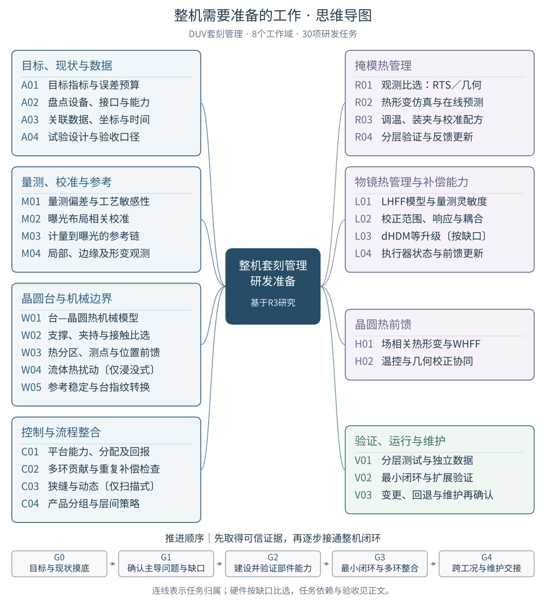

# 整机需要准备的工作 · 思维导图

**V1｜DUV｜2026年10月30日｜《整机需要准备的工作》的配套导图**

[放大SVG矢量图](figures/work-mindmap.svg) · [查看／下载PNG](figures/work-mindmap.png) · [报告正文](report.md) · [原推进路线图](figures/work-roadmap.svg)

从中心向外读：**整机研发目标 → 8个工作域 → 30项具体任务**。蓝色为目标／观测／物理边界与整合，紫色为三对象热管理及物镜能力，绿色为验证与维护。连线表示任务归属；底部G0—G4表示建议推进阶段，具体前置条件和阶段出口见[正文第10章](report.md#stages)。有证据支持的任务可以并行。

本图概括报告中的**工程建议**。RTS是候选观测路线，测温准确不能单独证明整条掩模热校正有效；dHDM及其他硬件升级要按已确认的能力缺口比选。W04只适用于浸没式，C03的狭缝与扫描内容只适用于扫描式。本图不增加专利事实或设备性能结论。

## 可点击的任务目录

小屏可直接使用以下目录，点击任务进入正文，查看具体动作、依赖、交付物、检查及原文依据。

### 目标、现状与数据

- [A01 定义套刻目标、评价口径和误差预算](report.md#a01)
- [A02 盘点当前设备、接口和可用校正能力](report.md#a02)
- [A03 建立贯穿量测、预测、请求和执行的数据合同](report.md#a03)
- [A04 设计能区分误差来源的试验和验收表](report.md#a04)

### 量测、校准与参考

- [M01 表征对准与套刻量测的工艺敏感性](report.md#m01)
- [M02 建立随曝光布局变化的校准能力](report.md#m02)
- [M03 验证测量站、曝光站和被测对象之间的坐标链](report.md#m03)
- [M04 按残差需要补充局部、边缘及形变观测](report.md#m04)

### 晶圆台与机械边界

- [W01 建立并校准台—晶圆系统的热机械模型](report.md#w01)
- [W02 比较支撑、夹持和接触方案的实际收益](report.md#w02)
- [W03 根据形变敏感性规划热分区、测温和位置前馈](report.md#w03)
- [W04 在浸没式设备上评估抽取、蒸发和气流边界](report.md#w04)
- [W05 保持计量参考，并建立测量到曝光的台指纹转换](report.md#w05)

### 掩模热管理

- [R01 比较RTS、RA／RSD及直接形变量测的观测路线](report.md#r01)
- [R02 建立掩模热仿真、形变模型及在线预测算法](report.md#r02)
- [R03 准备掩模调温、装夹、减应力和校准配方](report.md#r03)
- [R04 分层验证RHC，并确定怎样反馈更新](report.md#r04)

### 物镜热管理与补偿能力

- [L01 建立物镜热仿真与LHFF参数化模型](report.md#l01)
- [L02 表征现有物镜的响应、耦合和可用校正空间](report.md#l02)
- [L03 按缺口评估dHDM或其他光学能力升级](report.md#l03)
- [L04 把操纵器状态与热FF运行条件纳入执行模型](report.md#l04)

### 晶圆热前馈

- [H01 建立曝光场相关的晶圆热形变仿真与WHFF模型](report.md#h01)
- [H02 明确温控与几何补偿各承担多少，并验证更新](report.md#h02)

### 控制与流程整合

- [C01 建立校正请求、受约束分配及执行回报接口](report.md#c01)
- [C02 管理热FF、对准、APC及局部校正的贡献边界](report.md#c02)
- [C03 将场内校正需求转换为考虑狭缝与动态限制的轮廓](report.md#c03)
- [C04 管理产品、工艺组、层来源及多个成像目标](report.md#c04)

### 验证、运行与维护

- [V01 建立分层测试台、离线重放和独立验证数据](report.md#v01)
- [V02 选一个来源可辨的主导问题，形成最小整机闭环](report.md#v02)
- [V03 建立模型、配置和维护变更后的再确认规则](report.md#v03)

## 来源与维护

依据[准备工作报告V1](report.md)，内容基线为提交[3f58b7e](https://github.com/OpticsPan/Overlay2/commit/3f58b7e6830c9e9ace6496838356eae67e135c0b)。本次只做任务结构的可视化，原报告、原推进图和专利资料保持原字节。

图中名称为便于阅读的缩写，任务ID与正文逐项对应。可编辑源为[任务数据](figures/work-mindmap.json)和[绘图脚本](figures/work-mindmap.py)；来源哈希、布局、网页及仓库检查见[导图交付记录](mind-map-delivery.json)。SVG固化中文字形，PNG用于通用查看；本次未生成PDF。
