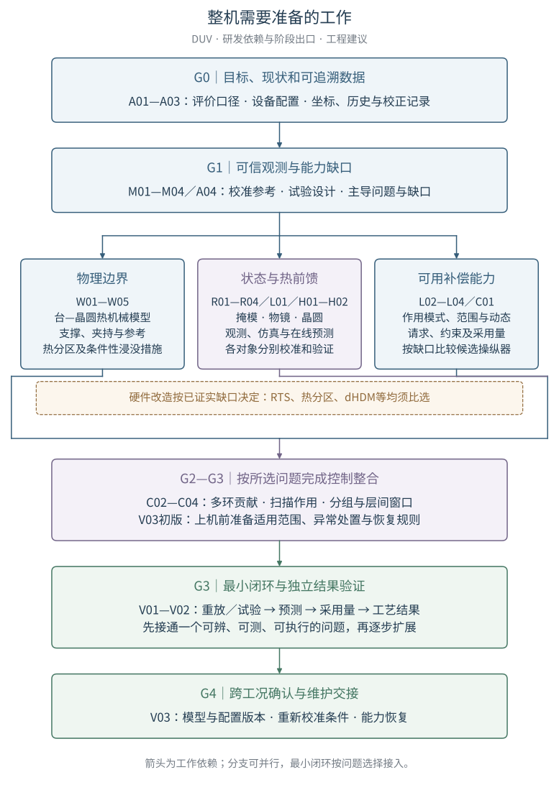
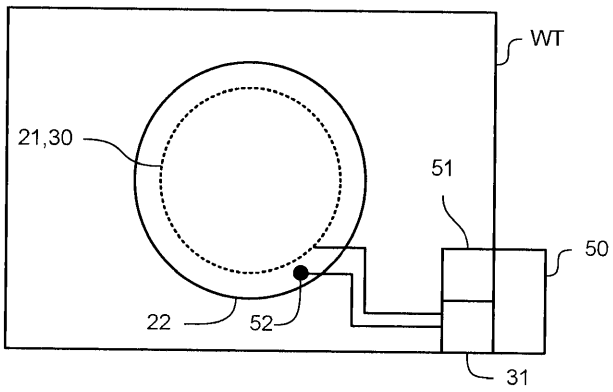
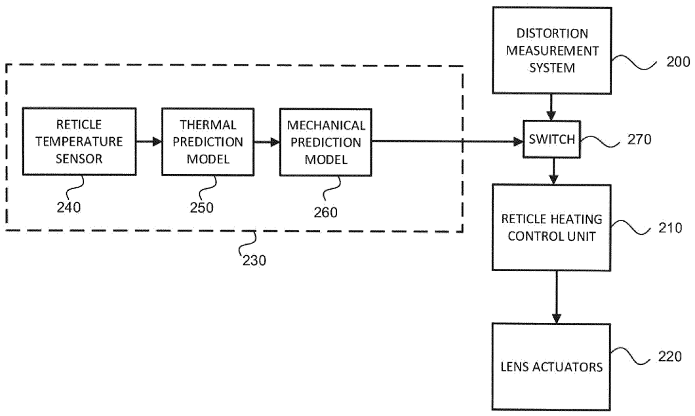
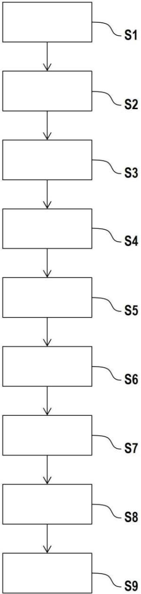

# 整机需要准备的工作

**V1｜面向DUV光刻设备的套刻管理研发工作清单｜2026年10月29日｜基于R3研究｜待内容审阅**

> 本报告回答：为了把[R3《先进光刻机套刻管理架构》](../advanced-overlay-management/r3/report.md)落实到设备研发，整机应准备哪些工作、先后依赖是什么、各方交付什么、怎样判断工作有效。按用户本次要求，正文采用工作清单和推进阶段组织，不受L0—L4目录限制。本文提出研发建议，尚未开展设备试验或硬件改造。

## 摘要

整机套刻管理的落地需要形成六类相互衔接的能力：明确可验证的套刻目标；取得可信且可关联的观测；使物理边界和装夹状态具有可重复性；预测曝光时的掩模、物镜与晶圆状态；把预测转换为设备能够执行的校正；以独立的加工结果检查并更新上述关系。本报告将R3的研究结论转化为30项准备工作，覆盖需求与数据、量测校准、Wafer table及机械边界、三类热前馈、物镜能力、多环协调及验证。每项列明具体动作、依赖、交付物和检查方式，并区分普遍需要的能力与有条件采用的硬件方案。对RTS和dHDM等候选方案，先提出能力缺口、比较试验和采用门槛，不将用户举例直接转为采购或改造结论。报告面向DUV；干式或浸没式、波长、当前设备配置及目标指标尚未提供，因而不编造设计尺寸、传感器精度、执行带宽、纳米收益或完成工期。

**关键词：** DUV光刻；套刻管理；研发工作分解；热前馈；晶圆台；量测校准；物镜补偿；系统验证

## 1 总体工作与推进逻辑

### 1.1 整机需要交付什么

建议把研发交付对象定义为一条能够复现和检查的链：**一份数据能追溯到具体对象和工况；一个模型能说明自己预测什么；一条校正能说明实际执行了多少；一次改善能在约定的图形量测中被验证。** 沿这条链，硬件、传感器、仿真、算法、软件接口和工艺试验各有明确任务。

**图1：本文提出的研发推进关系。** 箭头表示工作依赖与阶段推进，不是某商用扫描机的信号图；三条能力建设分支可以并行，具体任务还须满足正文列出的前置条件。硬件改造由已确认的能力缺口触发，不必等到所有软件完成，也不由某一个误差曲线直接触发。[放大矢量图](figures/work-roadmap.svg) · [可编辑图源](figures/work-roadmap.py)。小屏可放大原图，或使用下表导航。

| 工作域 | 任务编号及入口 | 首要交付物 | 建议牵头角色 |
| --- | --- | --- | --- |
| 目标、现状和数据 | [A01—A04](#foundation) | 验收口径、现状清单、数据合同、试验矩阵 | 整机系统／项目技术负责人 |
| 量测、校准和参考 | [M01—M04](#metrology) | 可信观测、布局校准、坐标链、局部／形变观测能力 | 量测与校准 |
| Wafer table及机械边界 | [W01—W05](#wafer-table) | 热机械模型、接触／参考改进方案、温控和边界表征 | 晶圆台／机械／热控 |
| 掩模热前馈与状态准备 | [R01—R04](#reticle) | 观测路线、热形变模型、准备配方、分层验证结果 | 掩模系统／热模型 |
| 物镜热前馈与执行能力 | [L01—L04](#lens) | 热像差预测、可用作用范围、升级决策、状态模型 | 光学／操纵器／模型控制 |
| 晶圆热前馈 | [H01—H02](#wafer-heating) | 曝光热形变指纹、参数更新与温控协同关系 | 晶圆热模型／整机校准 |
| 控制、扫描与流程整合 | [C01—C04](#coordination) | 可执行校正接口、多环贡献分配、扫描及跨层方案 | 控制软件／系统算法 |
| 试验、放行和维护 | [V01—V03](#verification) | 独立验证集、最小闭环、变更后能力确认 | 系统验证／工艺／维护 |

牵头角色是建议分工，不假定已有对应部门，也不分配具体人员。每项技术负责人仍须与整机系统负责人约定输入输出；模型组完成模型、机械组完成装配，均不能单独替代整机验收。

### 1.2 三种工作状态

- **基础工作：** 目标、配置、参考、数据和验证口径应先建立。已有能力可经检查后复用，不要求重复研发。
- **能力建设：** 需要预测、校准、协调和可执行补偿能力；实现可以复用现有模型或软件，也可以新增。
- **条件改造：** 增加RTS、改变支撑布局、增加热分区、更换为dHDM等，只有在确认缺口且比较结果支持时进入设计。未采用某件硬件，不代表该能力可以缺失。

本文中的“验收／通过”均指**建议的未来检查**，不表示已取得结果。所有数值门限由A01与A04确定，并保留来源；缺少门限时只能完成摸底或比较，不能宣称已满足最终精度。

### 1.3 依据与工程建议如何区分

**【原文依据】** 指原专利明确披露的机制、流程或实施例，原PDF页从封面起计；关键定位见[证据索引](#evidence)。**【工程建议／外推】** 指本文据R3提出的任务、接口字段、交付物、团队分工、试验与阶段门槛；原专利没有共同规定这些项目管理安排。以下全部工作卡的“动作、依赖、产物、检查”均属于这一类，具体采用仍须设备数据支持。

本次沿用R3覆盖45件专利的研究与全文阅读记录，对工作判断涉及的原页进行定向复核；不宣称本轮再次通读全部45件。没有新增机型性能、厂商内部接口或商业采用信息。DUV中的浸没措施单独标明，不默认本机为193 nm浸没式；涉及EUV、特殊低NA例子或其他场景的方案，只能在重新确认条件后参考。

**阅读目录：** [基础](#foundation) · [量测](#metrology) · [晶圆台](#wafer-table) · [掩模](#reticle) · [物镜](#lens) · [晶圆热前馈](#wafer-heating) · [协调](#coordination) · [验证](#verification) · [推进阶段](#stages) · [证据与R3覆盖](#evidence)

## 2 首先建立可判断“做好了没有”的基础

### A01 定义套刻目标、评价口径和误差预算

**要解决的问题：** “精度提高”必须对应层对、工艺阶段、空间范围和统计定义，否则各子系统会优化不同目标。

**具体动作。**

1. 列出优先产品／测试图形、层对、晶圆与曝光场布局、扫描方向，以及ADI、AEI或其他评价阶段；分别定义全片、场内、die内和边缘的评价范围。
2. 约定采用的统计量、异常值处理和量测不确定度，区分校正前观测、模型残差、实际采用校正及加工后残差；同时列出需保护的焦点、CD／成像质量和节拍指标。
3. 建立误差来源与观测的关联表，区分可重复、动态、量测偏差及尚未归因的分量。先识别相关性，再决定预算如何分配，不默认各项独立并平方和相加。

**前置／产物。** 无技术前置；需要产品、工艺和设备目标输入。产物是《套刻验收定义》《误差预算与未知项清单》。**检查方式。** 同一测试批次交给两个分析人员，按同一配置应得到一致的指标与纳入样本；预算中每个数值标出来源及置信边界。目标数值未给出时明确标为待整机项目确定。

**研究入口：** [E01](#e01)、[E13](#e13)、R3第10章。

### A02 盘点当前设备、接口和可用校正能力

**具体动作。**

1. 确认波长、NA、步进／扫描式、干式／浸没式、物镜与晶圆台版本、计量参考结构、掩模装夹和交换方式；记录当前可取得的测量及执行日志。
2. 对每种平台／光学／热控动作登记作用对象、位置／行程范围、响应时序、标定条件、使用限制及是否可回读。未知项列为待测，不把产品名称或执行器数量当成能力规格。
3. 选取现有稳定配方作基线，记录换版、停机再启、换片、维护前后和不同曝光次序下的状态，形成“已有且验证、已有待验证、缺失、不可访问”四类清单。

**前置／产物。** 可与A01并行；产物是《设备配置与接口清单》《基线工况数据包》《能力缺口候选表》。**检查方式。** 每项“已有能力”能对应实物、接口说明或测量记录；无法访问的操纵量不能作为后续优化器自由度。

**研究入口：** [E08](#e08)、[E09](#e09)、[E11](#e11)。

### A03 建立贯穿量测、预测、请求和执行的数据合同

**具体动作。**

1. 给数据关联晶圆、掩模、层、场、die、产品配方、设备版本和时间；注明坐标系、单位、方向、参考状态及采样位置。对象身份与时间关联不可靠的数据先隔离。
2. 分开存储原始量测、经过去校正的数据、估计指纹、请求校正、已采用校正和未执行分量；模型版本、参数版本和热历史一起保存。
3. 明确各接口的数据到达时限、缺失／过期判定、重复消息处理及拒绝使用条件，检查时钟偏差，制作可离线重放的样例包。重放只能使用当时已到达的数据，后到量测不能回填到过去的决策输入。实际期限根据设备时序测得，不在本报告预定毫秒数。

**前置／产物。** A01、A02；产物是《数据字典与坐标约定》《校正贡献记录格式》《重放样例》。**检查方式。** 用同一输入和模型版本重放一次计算，能说明输出的来源，并追溯哪一条命令被接受；不能只保存最终“overlay correction”数值。

**研究入口：** [E10](#e10)、[E11](#e11)、[E12](#e12)。字段设计属于工程建议，不是专利披露的通信协议。

### A04 设计能区分误差来源的试验和验收表

**具体动作。**

1. 将模型辨识试验、能力表征试验、算法比较试验和整机验收试验分开；为每项列输入变化、保持条件、观测位置、重复次数设计依据及预期区分的原因。
2. 安排曝光／冷却、不同剂量、照明、掩模、扫描次序、场尺寸和等待时间等有依据的变化；不要同时更改多个无法分开的条件后，把改善全归给一个模型。
3. 将训练／校准集与验证集分开，保留未参与调参的工况及边缘位置；定义测量噪声、参考漂移、温度测点偏差和模型残差各自的评估方式。

**前置／产物。** A01—A03；量测能力需由M01确认。产物是《试验矩阵》《门限与不确定度表》《数据集划分规则》。**检查方式。** 每个试验能回答一个明确判断；混杂因素尚不能排除时，结论降为“存在关联”，不写成已经分离物理来源。

**研究入口：** [E04](#e04)、[E07](#e07)、[E14](#e14)。

## 3 准备可信的量测、校准和参考

### M01 表征对准与套刻量测的工艺敏感性

**具体动作。** 建立标记／工艺／波长与偏振等可用通道的配方矩阵；测重复性、通道间差异及已知位置变化的响应；识别不对称或污染引起的偏差，区分真实大误差与伪异常。对过滤规则用跨场重复模式和独立参考检验，保留被删点及原因。

**前置／产物。** A01、A02；产物是《量测配方适用表》《偏差与不确定度表》《异常处理规则》。**检查方式。** 重复性良好、多个配方一致都不能单独证明准确；应采用有独立依据的参考／已知变化试验。真实系统性大偏差不应被阈值过滤掩盖。

**研究入口：** [E02](#e02)，R3第4.1、4.2、4.5节。

### M02 建立随曝光布局变化的校准能力

**具体动作。** 覆盖本机实际场尺寸、场位置、扫描／步进次序和边缘跳场方式，采集校准指纹；分开场内与场间分量；建立产品布局到校准模型的选择或预测关系，并为未覆盖布局设置适用性检查。

**前置／产物。** A02、A03、M01；产物是《布局校准库》《产品布局映射规则》《外推条件表》。**检查方式。** 用未参与拟合的布局检查预测残差；场尺寸相同而曝光次序不同的情况也应纳入比较。专利中“第三布局”是预测输入，不必一定与前两个布局都不同。

**研究入口：** [E03](#e03)，R3第4.3节。

### M03 验证测量站、曝光站和被测对象之间的坐标链

**具体动作。** 将对准传感器、台参考、投影参考及晶圆／掩模各坐标关系画成可检查的参考链；按本机实际结构检查换站、运动、装夹和维护前后的转换；对计量镜块或其他参考构件单列其与承载台的相对稳定性。

**前置／产物。** A02、M01；产物是《坐标及参考链》《参考保持试验》《重新校准触发条件》。**检查方式。** 用重复往返、装夹和有控制的扰动检查参考是否恢复；台的位置读数重复不能代替晶圆图案参考稳定。没有镜块的机型应映射到其实际参考结构，不照搬镜块方案。

**研究入口：** [E03](#e03)、[E06](#e06)，R3第4.6、7.4节。

### M04 按残差需要补充局部、边缘及形变观测

**具体动作。** 对边缘或局部残差判断现有采样能否识别所需空间分量；比较增加采样、局部梯度／旋转信息及晶圆面外形貌等途径。若采用形貌推断面内形变，先校准材料方向性和工艺相关参数，分开可复用参数与逐片输入；若使用掩模侧边观测，检查其到图像区形变的关系。

**前置／产物。** M01—M03、A04；产物是《观测缺口与路线比较》《形貌／局部观测到校正的模型及适用范围》。**检查方式。** 在留出位置和工况检验预测；面外高度、局部旋转和面内位移不能相互直接替代。只有确认信息缺失才进入新增量测模块评估。

**研究入口：** [E04](#e04)、[E05](#e05)，R3第4.4节。

## 4 Wafer table与机械边界：把“改进设计”变成可判定的任务

本章区分晶圆—承载面、承载结构—热交换边界、计量参考—台体三个关系。接触、刚度、热传导和运动载荷可能相互影响，设计修改应围绕已测得的主导传递路径进行。

### W01 建立并校准台—晶圆系统的热机械模型

**具体动作。**

1. 收集台体、晶圆、支撑／夹持、热交换结构的几何及材料信息；列出曝光、驱动、运动、夹持与流体等实际热源和载荷。
2. 对接触热阻、约束条件及位置相关载荷作灵敏度分析，输出晶圆面内位移、面外变化和台参考变化，分别命名；未知接触参数通过受控试验辨识。
3. 用不同位置、负载和热历史的实测数据校准模型，再找出主要误差传递路径。原型比较不仅看最高温度，还看曝光位置相关的形变。

**前置／产物。** A02—A04、M03；产物是《热源与边界清单》《经校准的热机械模型》《设计敏感项排序》。**检查方式。** 温度、形变和参考移动分别验证；模型拟合一条温度曲线，不足以证明位移预测正确。

**研究入口：** [E06](#e06)、[E07](#e07)，R3第6.4、7章。模型范围和试验安排为工程建议。

### W02 比较支撑、夹持和接触方案的实际收益

**具体动作。** 对W01确认的敏感位置，比较支撑分布、局部顺应性、夹持载荷和热接触条件；制作可代表真实边界的部件或台架样件，测重复装夹、热循环与运动后的滑移、变形和残余偏置。将边缘和中心分别评价，避免以“全台更硬”“全部接触更软”作为统一改进方向。

**前置／产物。** W01、M03；产物是《候选结构对比》《样件试验结果》《是否改件的决策依据》。**检查方式。** 改善应在参考稳定、热交换和运动性能之间保持可接受权衡；装夹力学问题不能直接转为更多高阶软件系数。

**研究入口：** [E06](#e06)。JP5809458B2是掩模夹持实例；US8269949B2的凸点位于镜块与台之间，两者不能当成同一个晶圆热接触方案。

### W03 根据形变敏感性规划热分区、测温和位置前馈

**【原文依据】** US10747126B2讨论边缘与中心约束不同，同样温变不一定产生同样位移；原Fig. 8还将位置、历史及测温与热调节联系起来。

**图2：US10747126B2，Fig. 8，物理页6。** [原PDF](../../references/patents/US10747126B2/original.pdf#page=6) · [边缘响应及控制解释，页19、24—26](../../references/patents/US10747126B2/original.pdf#page=19)。50为位置相关信息，51为存储信息，52为温度信息，31为控制器，21、30为热调节元件；22为支撑件。52主要关联支撑件，也可涉及晶圆，不能一概称作晶圆温度传感器；输出是热调节，不是直接的套刻校正。

**具体动作。** 根据W01的位移敏感区和换热路径确定候选分区与测点；测量各区动作到温度、形变的时滞与交叉作用；将台位置、运动／曝光历史、装载前状态接入调节策略，比较恒定设定、仅反馈和有背景前馈等适用方案。

**前置／产物。** W01、A03；产物是《分区与测点方案》《热作用响应及耦合表》《位置／历史前馈接口》。**检查方式。** 边缘较小温变能否减少位移变化须验证；不强求所有位置同温，也不根据传感器规格预先认定晶圆形变已经受控。新增分区或传感器须有观测／作用不足的证据。

### W04 在浸没式设备上评估抽取、蒸发和气流边界

**启动条件。** A02确认属于浸没式DUV，且相关扰动进入待解决误差；干式DUV把本项记为不适用，并说明实际环境边界另如何管理。

**具体动作。** 检查抽取结构到晶圆承载结构的热机械传递，比较隔离、局部热调节及密封／抽取边界方案；对气刀和气体回收同时测液体约束、蒸发冷却和计量光路影响；用不同曝光次序和等待条件识别热历史贡献，并观察浸没液温度／折射率路径。

**前置／产物。** A02、A04、W01；产物是《流体—热—机械扰动路径》《有条件的结构／运行修改方案》。**检查方式。** 抽取功能、形变、计量和成像一起检查；液体不外逃不代表热扰动已经最小。跨机对照先处理机间差异，不将次序差分直接称为补偿后残差。

**研究入口：** [E07](#e07)，R3第6.4.4、6.4.5、7.3节。

### W05 保持计量参考，并建立测量到曝光的台指纹转换

**具体动作。** 表征参考构件相对台体在运动、温度和夹持变化后的漂移；将测量时刻、曝光时刻及中间历史关联，分开稳定台指纹与时变分量；根据M03结果比较结构改进、重新校准和预测补偿各自能够处理的部分。

**前置／产物。** M03、A03、W01；产物是《参考稳定性试验》《测量到曝光的指纹模型》《维护或漂移触发条件》。**检查方式。** 既检查传感器读数，也检查该读数到晶圆图案位置的映射；补偿后通过独立参考或加工结果验证。台指纹不能在晶圆热FF中无记录地再次计入。

**研究入口：** [E06](#e06)、[E11](#e11)，R3第7.4、8.1节。

## 5 掩模：建立从状态观测到RHC有效性验证的完整工作链

本章以RHC（Reticle Heating Correction，掩模热校正）指相关校正能力，其中热前馈路径不仅需要一个温度值，还需要热状态到图像区形变、形变到可执行动作的关系。以下R01—R04应共同定义，不由传感器选型单独决定算法路线。

### R01 比较RTS、RA／RSD及直接形变量测的观测路线

**【原文依据】** WO2020094369A1给出直接形变量测与可选温度预测支路；CN120344910A则讨论利用形状／对准与历史推断装载温度，并指出RTS具有测量开销和自身误差。因此，“需要知道热状态”不能直接推成“必须新增RTS”。

**图3：WO2020094369A1，Fig. 3，物理页22。** 本展示仅旋转原图以便阅读，图像内容不改。[原PDF](../../references/patents/WO2020094369A1/original.pdf#page=22) · [说明书[0042]—[0044]，页11](../../references/patents/WO2020094369A1/original.pdf#page=11)。200是形变量测；可选230支路中，240 RTS→250热预测→260机械预测；两路经270 SWITCH选择后进入210控制单元，220为LENS ACTUATORS。原图不是要求两路必然融合的闭环，也未画出完整曝光后套刻验证。

**具体动作。**

1. 明确当前需要观测的是装载初温、平均温度、温度梯度、夹持后几何状态，还是图像区变形；为每个模型状态列能用的观测及不可辨识分量。
2. 对RTS检查测量对象、位置覆盖、响应时间、偏置／漂移、校准和进入曝光前的时间差；测点读数到掩模热状态的关系需要验证。对RA／RSD路线检查材料系数、装夹应力及边缘到图像区映射。
3. 在同一组有控制的热工况下比较这些路线的预测信息、节拍影响和设备集成代价；必要时采用联合观测，但其融合／选择规则属于待验证的工程设计。

**前置／产物。** A02—A04、M01、M03；产物是《观测需求表》《RTS／几何观测路线比较》《传感器或软件选型依据》。**检查方式。** 选型依据应是降低曝光时形变预测的不确定度及满足时序，不能只比较温度分辨率。资料不足时先做台架观测比较，不直接下达必装RTS结论。

### R02 建立掩模热仿真、形变模型及在线预测算法

**具体动作。** 用实际曝光／冷却历史、照明负载、掩模材料与图案、装夹边界及初态，建立热响应与图像区形变的模型；用受控热过程校准关键参数；将可验证的模型转为曝光时可调用的计算形式，并规定启动、停机、换版及历史缺失时如何初始化。

**前置／产物。** R01、A03、A04，必要的装夹表征与W02协同；产物是《掩模热机械仿真》《在线模型及参数库》《初态与历史管理规则》。**检查方式。** 分开检查热状态预测、标记／图像区形变预测和计算时限；状态变量未必都对应真实温度，不能把黑箱状态当作布置了对应测温点。

**研究入口：** [E05](#e05)、[E08](#e08)，R3第6.2.1、6.2.3、6.2.4节。

### R03 准备掩模调温、装夹、减应力和校准配方

**具体动作。** 明确掩模进入设备、库位停留、装载和曝光后的状态转换；比较调温、等待、解夹重夹及非生产校准的作用；按原方案适用条件区分零剂量减应力和非零剂量热校准，设置状态判据及转生产条件，而非只用固定等待时间判断一切稳定。

**前置／产物。** R01、R02、M03；产物是《掩模状态准备与校准配方》《状态切换记录》《换版恢复规则》。**检查方式。** 分别判断温度、几何／应力和模型是否达到各自条件；专利流程中的可选步骤不能被写成本机所有产品统一必经步骤。生产阶段是否继续更新参数另由R04确定。

**研究入口：** [E08](#e08)，R3第6.2.2节。

### R04 分层验证RHC，并确定怎样反馈更新

**具体动作。**

1. 用独立或留出的观测检查热状态预测，再检查热状态到图像区形变的映射；若用同一RTS数据既辨识又检验模型，不能称为独立验证。
2. 将预测校正与实际采用的动作关联，考虑掩模边缘／图像区差别及可能的物镜热倍率贡献；用几何观测及约定工艺阶段的套刻数据检验输出。
3. 在来源可分的条件下决定更新初态、热模型参数、形变模型还是校正映射；对不可辨识或观测质量不足的情况保留旧的有效模型或进入定义好的降级状态。

**前置／产物。** R01—R03、C01、M01；产物是《RHC验证报告》《参数更新条件》《适用工况与失效处理》。**检查方式。** 记录温度预测误差、形变预测误差、未执行校正和最终套刻各自的结果。**RTS可帮助检查热状态模型；它单独不能证明RHC在曝光图形上准确。**

**研究入口：** [E08](#e08)、[E09](#e09)，R3第5.3、6.2.4、6.5节。更新门控与降级规则为工程建议。

## 6 物镜：先量出能力缺口，再确定仿真、算法和新增操纵器

### 6.1 首先统一“lens fingerprint”指什么

建议每次使用该词都给出被描述量：是波前像差随视场的分布，是测量标记响应，是图形相关像位置误差，还是最终套刻指纹；同时注明照明、掩模、剂量和热历史。它们之间需要响应关系，不能把一个波前系数图直接当作晶圆套刻图。以下L01预测变化，L02表征能做的动作，L03才判断是否需要新增能力。

### L01 建立物镜热仿真与LHFF参数化模型

**具体动作。** 取得光学结构／材料／吸收及应用条件信息，或与供应方约定可用的等效响应数据；建立曝光负载到时变光学响应的预测；用加热／冷却试验识别像差分量的响应幅度和时间行为。明确模型适用的照明、掩模、剂量及热历史范围，形成在线预测和参数更新接口。另须标定或计算具体对准／套刻测量结构对像差分量的响应，并用独立数据检查其灵敏度适用性；列出当前观测可辨识的参数子集和不能分开的分量。

**前置／产物。** A02—A04、M01及可用光学量测；产物是《物镜热响应依据》《LHFF模型与参数库》《量测结构灵敏度及可辨识项表》《应用条件适用表》。**检查方式。** 波前预测、标记／图形对像差的响应和最终位置影响分别检查；若只能取得等效模型，写清可验证范围，不能补写未披露的镜片温度场。

**研究入口：** [E09](#e09)，R3第6.3节。US11300886B2用Zernike分量描述像差热漂移，并讨论μ／τ；这不要求每次曝光直接测量整套物镜温度。

### L02 表征现有物镜的响应、耦合和可用校正空间

**具体动作。**

1. 对可用操纵量施加允许范围内的标定动作，测量它们对波前、倍率／畸变、焦点及远心度等相关量的影响，建立带条件的响应矩阵或等效模型。
2. 将目标指纹分成当前能力可表达、范围不足、动态不足和现有观测不能判断的分量；比较增加行程、改变组合、重新校准或新增作用模式分别能解决什么。
3. 检查作用是否随掩模位置、光学几何和工作点变化；对不同有效区间保存不同灵敏度，优化后再次确认模型范围。

**前置／产物。** A02、M01、M03，L01提供热需求；产物是《操纵器作用及耦合表》《可控／不可控分量报告》《能力模型有效范围》。**检查方式。** 使用未参与建模的动作组合及应用条件验证；执行器数量增加不保证出现独立的新作用，优化拟合更小也不保证附带成像影响可接受。

**研究入口：** [E09](#e09)、[E10](#e10)，R3第8.4、8.6、8.7节。

### L03 按缺口评估dHDM或其他光学能力升级

**【原文依据】** CN117234040A与US20230400772A1明确使用 **HDM＝Half Dome Mirror，dHDM＝deformable Half Dome Mirror**；sHDM指static或solid Half Dome Mirror。**d表示可变形，不表示dynamic。** 文献把sHDM→dHDM列作可选更换实例，也讨论其他更换组合；这些文本主要支持更换工具、安装和参考传递，不能据此确定dHDM的作用模式、动态带宽或本机套刻收益。[术语与范围：E10](#e10)。

**具体动作。**

1. 用L01、L02的目标残差和现有作用范围说明为何需要新增能力：需要的是某种空间模式、幅值、更新时序，还是降低其他像差耦合。未能量出缺口时先继续表征。
2. 向供应方或光学设计方索取候选模块的作用模式、响应关系、范围、动态与重复性、迟滞／蠕变、热负载及安装条件；统一坐标、波长、照明和评价口径后，与现有能力作比较。
3. 在仿真和代表性台架上评估新增作用，检查与焦点、远心度、其他像差和参考的耦合；比较dHDM、其他操纵器、模型校准或应用条件调整，不预设哪种必优。
4. 若决定升级，准备安装参考传递、机械／热／控制接口及重新表征方案；更换完成后更新L02、L04和V03，不能直接沿用旧响应矩阵。

**前置／产物。** L01、L02，A02接口可达；产物是《新旧物镜能力对比》《升级需求及试验结果》《采用／暂缓／不采用结论》。**采用门槛。** 首先确认实际光学布局存在兼容位置，不能把折反射系统中的镜面方案直接移植到纯折射布局；新模块必须提供对目标残差有用且可验证的额外作用，并在相关成像、参考和时序条件下可接受；名称中带“deformable”不构成通过证据。

### 6.2 能力升级需要原图说明哪一层关系

**图4：CN117234040A，图12，物理页29。** [原PDF](../../references/patents/CN117234040A/original.pdf#page=29) · [本次光学复核](review/optics.md)。图内S1—S4对应升高脱离、旋转避让、下降和横向移出，S5替换模块，S6—S9按反向过程装入；箭头是维护顺序。定位、连接和参考传递须结合说明书理解，不把它们随意指定为图中已有节点。它能支持“升级还需恢复安装与参考”的任务，不能当作dHDM在线波前控制图。中文与对应英文对更换后测量步骤能否省略存在措辞差异，本报告要求依据实际设备验证恢复后的能力，不据任一版本推断可普遍免校准。

### L04 把操纵器状态与热FF运行条件纳入执行模型

**具体动作。** 表征动作方向、幅度、停留时间和先前动作对实际响应的影响，建立需要的迟滞／蠕变或参考状态管理；明确何时选择／重选灵敏度、何时更新模型、何时请求重新参考。将LHFF请求经C01转换为可用动作，并保留已采用分量及拒绝原因。生产更新时，经C02处理既有校正贡献后，利用L01的量测灵敏度解释像差残差，再更新有辨识依据的μ／τ等参数；观测不足、来源混杂或模型超域时暂停相应更新，不让其吸收所有误差。

**前置／产物。** 驱动表征依赖L02、A03、C01；生产参数更新还依赖L01、C02，升级时依赖L03重新表征。产物是《状态相关驱动模型》《参考与有效性规则》《LHFF执行及参数更新规则》。**检查方式。** 在大动作后、长时间闲置后、方向反转和不同热历史下验证响应；原文的参考步骤可选，不预设每片必归零。响应预测也不等于存在实时绝对远心度传感器。用后续留出批次／热历史验证参数更新后的预测及图形结果，避免只报告参与更新的数据拟合改善。

**研究入口：** [E10](#e10)，R3第8.4、8.5、8.7节。

## 7 晶圆热前馈：独立建模，并与Wafer table温控协调

### H01 建立曝光场相关的晶圆热形变仿真与WHFF模型

**具体动作。** 基于实际晶圆／膜层及支撑热机械边界，预测曝光负载和场序列导致的面内形变；按场位置、时间和相关工况建立可调用指纹或模型；区分由薄膜应力产生的产品IPD、晶圆曝光受热以及台参考漂移，明确每部分由哪个模型承担。

**前置／产物。** W01、W03、M04、A03，浸没式还需W04；产物是《晶圆热形变模型》《场相关指纹库》《WHFF输入输出约定》。**检查方式。** 在中心／边缘、不同曝光次序及未参与拟合的负载下检查位移预测；材料参数、接触边界与热历史不能默认为长期不变。

**研究入口：** [E09](#e09)、[E06](#e06)、[E07](#e07)，R3第6.4节。US11300886B2的晶圆实例以有限元场指纹及尺度λ为更新对象，不是把物镜μ／τ直接搬到晶圆模型。

### H02 明确温控与几何补偿各承担多少，并验证更新

**具体动作。** 在C01／C02中登记W03热调节已改变的边界及H01所用工况；先验证模型对当前热边界是否适用，再形成几何前馈。依据生产观测和已施加校正更新能够辨识的参数；台温、晶圆形变及图形套刻分别记录，防止几条环重复吸收同一变化。

**前置／产物。** H01、W03、C01、C02；产物是《温控—WHFF职责表》《参数更新与贡献记录》《分对象验证结果》。**检查方式。** 比较温控改变前后的模型有效性；台温波动减小、λ拟合更好、最终套刻改善应分别有证据。不能把未能分离的掩模或物镜残差直接更新到λ。

**研究入口：** [E09](#e09)、[E11](#e11)、[E12](#e12)，R3第6.4、6.5节。

## 8 把各项能力接成能执行、能解释的整机控制

### C01 建立校正请求、受约束分配及执行回报接口

**具体动作。** 首先由平台控制与计量共同表征允许动作到位移／曝光作用的响应：测可用方向、行程、速度／加速度限制、延迟、动态响应及交叉作用，形成带工况的《平台执行能力表》；用未参与拟合的单轴和组合动作核验。A02的设备清单仅提供起点，不能代替这项表征。随后为各来源定义请求的物理量、坐标、空间／时间范围和有效条件；依据平台表征结果与L02将请求分配到可用自由度；区分请求量、计算可实现量、下发／采用量、可实测执行状态和不可执行分量。明确接口不支持、范围不足或模型过期时的处理。

**前置／产物。** A03、M03、初步能力表；各模型可先用可追溯的离线请求接入。产物是《平台执行能力表》《校正接口》《约束与分配规则》《执行回报和错误处理》。**检查方式。** 对超范围、冲突或不可实现的请求，系统应能说明保留和拒绝了什么；算法算出的“实现量”不能自动冒充独立传感器实测。

**研究入口：** [E11](#e11)，R3第8.1、8.3节。

### C02 管理热FF、对准、APC及局部校正的贡献边界

**具体动作。** 制作每路校正的来源、评价阶段、更新时间、已施加作用及反馈目标表；在共同采样网格上去除适当历史校正后，再估计各环贡献；验证外部密集校正与机内稀疏对准的先扣除、拟合、只加回一次等适用路径。将ADI→预期AEI的工艺转换与局部贡献在稀疏点上的偏移分别处理。

**前置／产物。** A03、C01、M01；产物是《控制贡献账目》《去校正和网格映射规则》《多环重放测试》。**检查方式。** 单独启用各来源和组合启用时比较，判断是否存在重复补偿、相互抵消或模型吸收其他原因。生产结果和执行侧计算残差保持不同身份。

**研究入口：** [E12](#e12)，R3第5.1、5.3、5.8、6.5节。

### C03 将场内校正需求转换为考虑狭缝与动态限制的轮廓

**启动条件。** 面向扫描式DUV。若本机为步进曝光，狭缝扫描和场外延伸部分记为不适用，保留C01的请求、作用和执行验证。

**具体动作。** 分开场间、场内重复、die内重复及背景分量；取得狭缝宽度／强度分布、平台与光学动作限制，比较轮廓拟合与曝光平均响应。对适用问题评估场外轮廓延伸、狭缝作用补偿及MA／MSD权衡，并保护其他成像指标。

**前置／产物。** M02、C01已表征的平台能力、相关光学能力表和代表性高空间频率数据；产物是《轮廓生成与曝光作用模型》《边界及关键区比较结果》。**检查方式。** 分别检查场首／中／尾die、轨迹与预测MA／MSD及曝光后图形；场外设定点可改善某些边界结果，不是所有去卷积的必备条件。不能把示意锯齿图读成既定纳米收益。

**研究入口：** [E13](#e13)，R3第8.2节。

### C04 管理产品、工艺组、层来源及多个成像目标

**具体动作。** 对有共同性依据的产品／工艺组维护公共与组特有状态，处理稀疏更新；按可获得的分源信息和层间窗口，确定本层应追随前层到什么程度；定义套刻、焦点、CD／EPE等评价与执行约束之间的关系。将光源／掩模／图形准备、关键区域及抽样策略纳入配置管理，并按需要重新确认模型适用性。

**前置／产物。** A01、M02、C01、C02、分层／分组信息；产物是《分组与层间策略》《共同评价配置》《采样与更新规则》。**检查方式。** 未测组的公共漂移更新不代表已发现其特有突变；相对套刻不能普遍唯一分离层来源；不同控制域共同评价也不意味它们具有相同作用和非零权重。

**研究入口：** [E14](#e14)，R3第5.2、5.4—5.6、8.3—8.4节。

## 9 准备验证、运行与维护能力

### V01 建立分层测试台、离线重放和独立验证数据

**具体动作。** 将传感器校准、模型辨识、控制求解、执行响应和图形结果分别设计检查；准备能复现实物输入与版本的离线重放环境；用留出工况比较模型预测，必要时采用独立参考。先在不下发新动作的模式比较候选算法，再进入受控设备试验。

**前置／产物。** A01—A04、M01、各模块原型；产物是《测试数据集》《重放与比较工具》《分层误差和不确定度报告》。**检查方式。** 分清仿真、模型估计、计算残差及物理量测；避免用同一模型生成的“伪全采样”作为独立实测真值。

**研究入口：** [E01](#e01)、[E14](#e14)，R3第10章。测试台和重放工具为工程建议，本报告未制作或运行这些设备试验。

### V02 选一个来源可辨的主导问题，形成最小整机闭环

**具体动作。** 从基线中选择可重复、能测量、能由当前或已验证执行能力处理的问题，固定产品／层对及评价口径；完成“观测—预测—请求—执行记录—独立结果验证—后续更新”全过程。先验证单一来源，再按C02加入第二来源，最后扩到跨批次、换版和不同工况。

**前置／产物。** V01、C01、C02及所选对象模型；产物是《最小闭环试验报告》《可推广条件》《残余问题清单》。**选择原则。** 有合适光学观测及模型接口时可选LHFF；有可靠掩模几何／热状态与曝光验证时可选RHC；主导问题在台边界时先处理W类任务。无需为套用例子强行选择某一分支。

**检查方式。** 比较稳定基线、候选运行和恢复基线，记录同时发生的工艺／状态变化；检查未参与优化的位置和成像副作用。以A01门限判定是否进入下一阶段，不将一条仿真曲线改善直接当作放行。

### V03 建立模型、配置和维护变更后的再确认规则

**分两次交付。** 在V02上机前形成适用范围、异常处置和恢复规则初版；V02及扩展试验后，用实际结果完善维护再确认条件。

**具体动作。** 保存可回退的配置与模型版本，定义缺数据、过期模型、超能力请求和异常状态时的受控处理；对换掩模、换物镜模块、台面维护、软件／模型更新及产品变化，规定需要重做哪些参考、响应和整机检查。归档“改了什么、依据是什么、影响哪些有效条件”。

**前置／产物。** 初版依赖A03与各能力适用表，运行确认版依赖V02；产物是《运行状态和回退规则》《变更影响表》《维护后再确认清单》。**检查方式。** 在受控试验中证明模型或数据不可用时不会继续使用错误条件的校正；恢复旧配置后参考与状态也要相容。模块能装回原位置，不等于全部成像能力自动恢复。

**研究入口：** [E10](#e10)、[E12](#e12)。版本治理和失效处理为本文工程外推；不同专利没有共同规定同一软件平台。

## 10 怎样推进：先形成证据，再扩大系统范围

### 10.1 建议的五个阶段

| 阶段 | 可以立即安排的工作 | 进入下一阶段前应有的结果 |
| --- | --- | --- |
| G0 目标与现状摸底 | A01、A02先行；启动A03、M01、M03 | 已定义评价口径，取得可关联数据，知道现有观测和动作是否可信；待补指标有负责人 |
| G1 找出主导问题及能力缺口 | A04、M02／M04、W01；启动三类模型与L02表征 | 至少一条误差链具有可检验解释，候选硬件／算法各自针对什么缺口清楚 |
| G2 建设并验证部件能力 | W／R／L／H相关任务；C01／C02接口原型；V01及V03初版 | 模型、观测及执行各有适用范围；条件改造经样件或代表试验支持，尚未获得支持的方案暂缓 |
| G3 最小闭环与多环整合 | V02，逐步加入C03、C04及其他热对象 | 请求、采用量、残差可解释；独立图形结果达到预先确定门限，副作用和节拍可接受 |
| G4 跨工况确认与维护交接 | 扩展产品／层／热历史；V03 | 明确可运行范围、重新校准触发条件、回退和维护恢复方法 |

这是依赖顺序，不是固定日历。可以并行开展已有数据支持的工作；但没有测量可信度时不能宣布模型准确，没有能力表征时不能宣布必须更换物镜，没有独立结果时不能宣布整机闭环有效。具体时间、人员、样件、设备机时和预算应在A02及各工作卡细化后估算。

### 10.2 第一批应发起的八个具体交付

1. **设备配置表：** 明确步进／扫描式、干式／浸没式、物镜／台版本、传感器与可访问操纵量，责任归A02。
2. **套刻评价定义：** 固定层对、测量阶段、空间与统计口径，列出待确定目标值，责任归A01。
3. **一次可重放的数据包：** 包含对象、热历史、校正请求、实际采用量和测量结果；当前拿不到的字段单列，责任归A03。
4. **量测／参考可信度报告：** 先查配方偏差、坐标和装夹重复性，责任归M01、M03。
5. **台—晶圆主导扰动图及初步模型：** 定位边缘、接触、热交换、参考传递中最值得验证的路径，责任归W01。
6. **三对象热FF任务书：** 分别列输入、状态、输出、参数、校准试验和验证观测，责任归R02、L01、H01；不能交付一张笼统“热补偿算法”任务单。
7. **光学能力差距表：** 把需要调控的指纹与现有作用模式对齐，列出dHDM候选所需补充的证据，责任归L02、L03。
8. **首个闭环试验方案：** 选择一个可辨且可执行的问题，预先规定比较工况、独立验证和退出条件，责任归A04、V01、V02。

这些交付先让项目知道缺什么、如何证明，再细化改件和算法开发工作量。若已经存在合格资料，应复用并核验版本，而不是重新制作同名文件。

### 10.3 如何回答三个典型立项问题

| 问题 | 本报告给出的推进方法 | 不能提前作出的结论 |
| --- | --- | --- |
| Wafer table具体改什么？ | W01找传递路径，W02比较支撑／夹持，W03确定热分区与测点，浸没式评估W04，W05保持参考 | 所有设备都必须增加热分区或修改同一种凸点 |
| 是否需要RTS来判断RHC准确？ | R01比较观测路线；R04分别验证温度、形变、执行和最终图形，确定参数更新 | 单个温度读数准确就证明RHC准确；必须装RTS才有热前馈 |
| 新物镜是否需要dHDM？ | L01给出目标变化，L02测现有可用作用，L03索取并验证候选额外能力，升级后重做L04与V03 | 仅凭新旧之分或“可变形”名称证明带宽、可控模式和套刻收益 |

## 11 证据索引、R3覆盖与后续记录

### 11.1 原始依据入口

下表定位本报告的机制依据，不把工程任务书当成原专利原文。更完整的细节和本轮原页检查范围见[热前馈复核](review/thermal.md)、[机械复核](review/mechanics.md)、[光学复核](review/optics.md)、[控制复核](review/control.md)。

**E01｜评价及证据边界。** [R3第10章](../advanced-overlay-management/r3/report.md#conclusion)；原始依据包括US8947630B2请求／实现的区分、US20210096472A1曝光响应、WO2021032376A1工艺阶段及控制贡献。本报告的误差预算、数据重放和阶段门槛为工程归纳。

**E02｜量测工艺敏感性及异常过滤。** [US11175593B2 Fig. 6，页9](../../references/patents/US11175593B2/original.pdf#page=9)；[US20240184221A1 Fig. 4，页4](../../references/patents/US20240184221A1/original.pdf#page=4)；[US11513444B2 Fig. 6，页9](../../references/patents/US11513444B2/original.pdf#page=9)。US11703772B2精密度／准确度边界见[R3量测复核](../advanced-overlay-management/r3/review/recheck-measurement.md)。

**E03｜布局校准与参考链。** [US10884345B2 Fig. 4，页5](../../references/patents/US10884345B2/original.pdf#page=5)，说明书页16起、正式权利要求页21—22；[US6961116B2 Fig. 2，页3](../../references/patents/US6961116B2/original.pdf#page=3)，更正证书页29—32；US7362446B2的多自由度计量见[R3量测记录](../advanced-overlay-management/r3/review/recheck-measurement.md)。

**E04｜形貌、材料与局部观测。** [US20190041758A1 Fig. 4，页3](../../references/patents/US20190041758A1/original.pdf#page=3)，参数校准与完整形貌输入见页10—11；[WO2023126174A1 Fig. 8A／8B，页34](../../references/patents/WO2023126174A1/original.pdf#page=34)，示意偏移的边界见页18[00104]，不能据该图提取性能收益。

**E05｜掩模热状态观测路线。** [WO2020094369A1原Fig. 3，页22](../../references/patents/WO2020094369A1/original.pdf#page=22)，选择与可选支路见页11[0042]—[0044]；[CN120344910A，页12—14](../../references/patents/CN120344910A/original.pdf#page=12)，原图6页24；同申请链WO2024132326A1不另计独立验证。中文机器温度数字有已记录错误，引用以原页为准。

**E06｜台边界、温控与计量参考。** [US10747126B2 Fig. 8，页6](../../references/patents/US10747126B2/original.pdf#page=6)，边缘效应页19、控制页24—26；[US8269949B2 Fig. 5a，页4](../../references/patents/US8269949B2/original.pdf#page=4)，页8与权利要求13页9；[JP5809458B2 Fig. 12，页18](../../references/patents/JP5809458B2/original.pdf#page=18)。这些是不同接口，不能组合成已验证的共同台设计。

**E07｜浸没热机械边界与对照。** [US10120292B2 Fig. 30，页17](../../references/patents/US10120292B2/original.pdf#page=17)，说明书页27—28；[US8208120B2原Fig. 18，页12](../../references/patents/US8208120B2/original.pdf#page=12)；[US7423725B2 Fig. 8—10，页5](../../references/patents/US7423725B2/original.pdf#page=5)，模拟和对照边界见页9、11。抽取、气流、路径影响仅在相应条件下采用。

**E08｜掩模动态模型、准备及量测解释。** [US10429749B2 Fig. 3，页5](../../references/patents/US10429749B2/original.pdf#page=5)，模型与残差诊断页11—12；[US12663725B2 Fig. 10，页10](../../references/patents/US12663725B2/original.pdf#page=10)，正式权利要求页26；US20250021017A1为公开阶段独立文本；[US8184265B2 Fig. 4，页7](../../references/patents/US8184265B2/original.pdf#page=7)，可选透镜倍率项与表1见页12。

**E09｜三对象热前馈与光学作用。** [US11300886B2页10—11](../../references/patents/US11300886B2/original.pdf#page=10)，Fig. 5页7、权利要求6—7和9—10页13，区分物镜μ／τ与晶圆λ；[US8659745B2 Fig. 4，页6](../../references/patents/US8659745B2/original.pdf#page=6)，热操纵、能力设计与运行调用见页18—21。后者不等于dHDM的专用性能说明。

**E10｜光学能力、dHDM术语及维护。** [CN117234040A页5[0011]、[0015]](../../references/patents/CN117234040A/original.pdf#page=5)，更换例页6[0026]、页15[0138]，原图12页29；[US20230400772A1页14[0011]、[0015]](../../references/patents/US20230400772A1/original.pdf#page=14)，更换例页15、22；[US20180081281A1 Fig. 9，页7](../../references/patents/US20180081281A1/original.pdf#page=7)，范围与容差见页17—18；[US20200089127A1 Fig. 12，页9](../../references/patents/US20200089127A1/original.pdf#page=9)，远心模型见页12—13；[US20250110413A1 Fig. 10，页8](../../references/patents/US20250110413A1/original.pdf#page=8)，历史状态与参考见页9、13—14。其他光学基础及适用条件见R3第8.6—8.8节。

**E11｜请求、能力与回报。** [US8947630B2 Fig. 10，页8](../../references/patents/US8947630B2/original.pdf#page=8)，热漂移及台指纹页14第12栏、页15；[EP4632488A1 Fig. 6，页20](../../references/patents/EP4632488A1/original.pdf#page=20)，层来源与可执行约束页9—11。不可执行残差是优化／接口信息，不自动等于独立量测。

**E12｜多环贡献。** [WO2021032376A1 Fig. 4a／4b，页30](../../references/patents/WO2021032376A1/original.pdf#page=30)，工艺转换和贡献分离页12—18，机内稀疏对准与外部密集作用的顺序见页18[0076]—[0079]；热参数后续更新另见E09。

**E13｜扫描和关键区域。** [US20210096472A1 Fig. 2、3，页3—4](../../references/patents/US20210096472A1/original.pdf#page=3)，校正来源、空间尺度、狭缝及边界见页8—11，权利要求页15；[US11599027B2 Fig. 7、8，页7—8](../../references/patents/US11599027B2/original.pdf#page=7)，执行限制页15。原Fig. 7为焦点例，不改写为套刻数值曲线。

**E14｜工艺组、产品与评价策略。** [US11754931B2 Fig. 4，页5](../../references/patents/US11754931B2/original.pdf#page=5)；[WO2017108453A1 Fig. 7，页40](../../references/patents/WO2017108453A1/original.pdf#page=40)；[US11886124B2 Fig. 17，页16](../../references/patents/US11886124B2/original.pdf#page=16)；[US9772561B2 Fig. 1，页2](../../references/patents/US9772561B2/original.pdf#page=2)；[US20220146946A1 Fig. 6，页6](../../references/patents/US20220146946A1/original.pdf#page=6)，共同目标与RS／OWP反馈见页13—16；层间分源另见E11。

### 11.2 与R3的覆盖对应

| R3主题 | 本报告怎样接续 |
| --- | --- |
| L0关系、L1归属与整机目标 | A01—A04将目标、现状和信息关系转成准备文件；本报告不重复按层级分章 |
| 第4章量测／校准 | M01—M04建立可信输入、布局适用性、参考链和观测补充 |
| 第5章流程与控制 | A03、C02、C04、V01管理贡献、背景、更新、准备和抽样 |
| 第6章三对象热管理 | R01—R04、L01、H01—H02及W03分别落实观测、仿真、算法、执行与验证 |
| 第7章机械及维护 | W01—W05、R03、L03、V03覆盖接触、隔离、参考和能力恢复 |
| 第8章补偿执行 | L02—L04、C01—C04落实响应范围、动态、耦合、请求／回报和层间关系 |
| 第9章后续技术接口 | 作为工作卡继续研究的来源；具体器件和算法参数待任务启动后确定 |
| 第10章整机验证 | A01、A04、V01—V03将证据层次转成试验、阶段出口和变更后检查 |

### 11.3 记录与版本

本报告V1由R3 Markdown复制后按新目标全面重组，父稿与资料基线为提交[bf495f8](https://github.com/OpticsPan/Overlay2/commit/bf495f886ba027941721dd754b8f82be96d14abe)，R3和原始资料保持原字节。用户已明确DUV范围；具体配置和目标数值尚未给出，已纳入A01、A02，未据此停留在笼统建议。

报告、四域定向复核、来源与检查分别保存。来源与实际阅读范围见[sources.json](sources.json)，检查和文件哈希见[delivery.json](delivery.json)。本文是工作策划报告，不是完成上述研发任务的证明；本次仅交付网页Markdown及依赖图像，未生成PDF。
